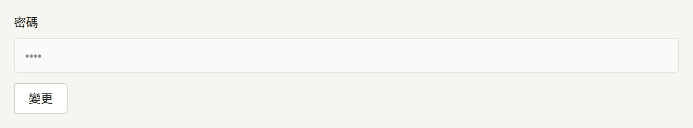
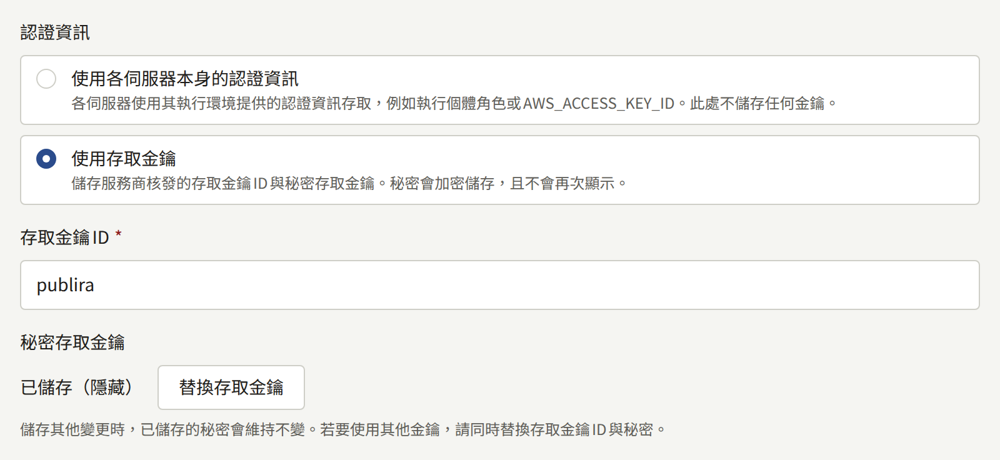

這些程序用來替換[每個密鑰可以放在哪裡](./index.md#每個密鑰可以放在哪裡)所列的每個密鑰。請在需要之前先閱讀——每項程序在平靜的日子執行，都比在事故當下執行容易。

第一次產生密鑰是[安裝](../../2-deployments/2-installing.md#產生密鑰)的一部分，而保管密鑰則是[備份與還原](../../2-deployments/9-backup-and-restore.md#密鑰加密金鑰)的一部分。

## 輪替密鑰加密金鑰

安裝實例保存的每份認證資訊都以加密金鑰密封，每個密封的值都會指出密封它的金鑰。`PUBLIRA_SECRET_ENCRYPTION_KEYS`列出處理程序可用來開啟值的所有金鑰，`PUBLIRA_SECRET_ENCRYPTION_PRIMARY_KEY_ID`則指出它用來密封新值的那一把。輪替就是新增一把金鑰、以它密封，並將已保存的值移到它上面；金鑰已不在清單中的值完全無法開啟。

### 1. 新增新金鑰

產生一把金鑰，並給它一個清單中尚未使用的ID，例如`k2`。將它加在舊金鑰旁邊，主要金鑰則維持原樣：

```text
PUBLIRA_SECRET_ENCRYPTION_KEYS=k1:<old key>,k2:<new key>
PUBLIRA_SECRET_ENCRYPTION_PRIMARY_KEY_ID=k1
```

以此設定重新啟動`publira server`和`publira worker`，並在之後的每個`publiractl`指令中使用它。請立即將新金鑰保存在您的密鑰儲存庫中，並與備份放在一起：從下一個步驟起，值就會以它密封。

### 2. 將它設為主要金鑰

當每個處理程序都以兩把金鑰執行後，將主要金鑰改為`k2`，然後再次重新啟動它們。從此以後儲存的每個值都會以`k2`密封，而以`k1`密封的每個值仍能開啟。

兩次重新啟動是刻意分開的。尚未取得`k2`的處理程序，無法開啟其他處理程序已經以它密封的值，因此當`publira server`或`publira worker`執行多個執行個體，或依序逐一重新啟動時，若在同一個步驟中切換主要金鑰，就會出現郵件失敗或登入被拒的空窗期。

在[Docker Compose](../../2-deployments/3-docker-compose.md)安裝實例上，每個步驟都是編輯`.env`中的這兩個變數，然後執行`docker compose up -d`，它會重新啟動`server`及一同執行的worker，其餘則繼續執行。

### 3. 重新密封已保存的值

以管理用登入身分的連線，並使用處理程序目前所持有的相同兩個變數，執行`publiractl db reseal`：

```bash
publiractl db reseal
```

它會以清單中的金鑰開啟資料庫中每個密封的值，並將每個指向主要金鑰以外金鑰的值以主要金鑰重新密封：包括平台和每個租戶的認證資訊、每位工作人員和營運人員的兩步驟驗證密鑰、每個「使用Apple登入」連結所持有的權杖、Web Push私密金鑰，以及outbox項目帶給worker的值。值本身維持不變，因此沒有人會被登出，也沒有人需要重新輸入任何東西，而且安裝實例在它執行期間仍持續提供服務：期間到來的儲存會等待它，或由它等待儲存，兩者都不會遺失。

它會為已保存的值所指向的每個金鑰ID輸出一行：

```text
KEY ID        RESEALED  ON PRIMARY  UNREADABLE
k1            42        0           0
k2 (primary)  0         3           0
```

`RESEALED`計算該金鑰原本密封、現在由主要金鑰密封的值，`ON PRIMARY`計算原本就由主要金鑰密封的值，`UNREADABLE`則計算清單中沒有任何金鑰能開啟的值。若要在不寫入任何東西的情況下查看相同的表格，請執行`publiractl db reseal --dry-run`。

在[Docker Compose](../../2-deployments/3-docker-compose.md)安裝實例上，`publiractl`服務已經具備管理用連線和`.env`中的金鑰：

```bash
docker compose run --rm publiractl db reseal
```

### 4. 只在沒有任何東西使用舊金鑰時才移除它

只有在`db reseal`以`0`結束、且`UNREADABLE`欄中沒有剩下任何值時，才從清單中移除`k1`。此時再執行一次，就只會為主要金鑰輸出一行，而它計算的每個值都不需要`k1`就能開啟。

當有清單中沒有任何金鑰能開啟的值時，`db reseal`會保留該值不動，密封其他所有值，並以`1`結束。它的日誌會列出每個這樣的值，包括其欄、其列，以及它所指向的金鑰ID，而表格會將它計入該金鑰ID之下。該值是以已不在清單中的金鑰，或以同一ID下的其他金鑰資料密封的：請將那把金鑰放回清單中，然後再次執行指令。若已經沒有人持有某個值的金鑰，就必須如遺失金鑰時所要求的，在原本儲存它的地方重新輸入。

金鑰已不存在的值無法開啟：若在租戶管理員的驗證器密鑰仍以`k1`密封時移除了`k1`，該管理員的登入會在兩步驟驗證步驟失敗並顯示錯誤頁面，伺服器會記錄`secretcrypto: unknown key id: k1`，而租戶的稽核記錄會以原因`secret_undecryptable`記錄一次失敗的**登入時的兩步驟驗證**。需要以遺失的金鑰密封之密碼的郵件也不會寄出。將金鑰放回清單並重新啟動，就能復原這一切。

當金鑰外洩時，只重新密封是不夠的。持有舊金鑰和輪替前任何資料庫備份的人，可以開啟該備份中的每個值，因此請在核發認證資訊的地方替換認證資訊本身——新的SMTP密碼、新的儲存貯體存取金鑰、新的付款服務商金鑰——並儲存新的認證資訊。在平台主控台中，新的SMTP密碼是透過**郵件**下**密碼**旁的**變更**輸入，新的存取金鑰則是透過**儲存**下的**替換存取金鑰**輸入，如[電子郵件](../6-email.md#變更帳戶)和[物件儲存](../5-object-storage.md#輪替存取金鑰)所述。





## 輪替資料庫角色的密碼

一個角色同一時間只有一個密碼，因此輪替就是在PostgreSQL中變更密碼，然後立即重新啟動以該角色連線的每個處理程序：

| 角色 | 連線者 |
| --- | --- |
| `publira_public`、`publira_admin` | `publira server` |
| `publira_platform` | `publira server`，以及變更平台設定的`publiractl`指令 |
| `publira_outbox`、`publira_ticker` | `publira worker` |
| `publira_content_stats` | `publira worker`，以及`publiractl job` |

1. 以`openssl rand -hex 32`產生新密碼。連線URL會以未跳脫的形式帶著它，這就是它採用十六進位的原因。
2. 以管理用登入身分的連線，只帶該角色的旗標執行`publiractl db roles`。其他每個角色都會保留其密碼：

   ```bash
   publiractl db roles --admin-password-file /run/secrets/publira-admin-db-password
   ```

   它會為每個角色輸出一行，您指定的角色為`set its password`，其他角色為`kept its password`。

3. 將上表中每個處理程序的連線URL改為新密碼，然後重新啟動它們。

處理程序已經開啟的連線會保持登入狀態，因此密碼變更的那一刻不會有任何東西失敗。但之後開啟的任何連線都會被拒絕，所以請不要在兩個步驟之間留下空檔。以舊密碼重新啟動的處理程序根本無法啟動：它的日誌會重複出現`password authentication failed for user "publira_admin"`，而它再次執行後，其`GET /readyz`會為每個角色列出一項檢查，因此不一致之處會在那裡被指出。以處理程序持有的密碼再次執行`db roles`即可修正。

若要一次輪替所有角色，請為`db roles`提供全部六個旗標，並重新啟動`publira server`和`publira worker`。

在Docker Compose安裝實例上，密碼是`.env`中的`PUBLIRA_*_DB_PASSWORD`變數，Compose檔案會以它們組成每個連線URL。變更變數後執行：

```bash
docker compose run --rm publiractl db roles --admin-password-file /run/secrets/admin-db-password
docker compose up -d
```

`docker compose up -d`只會重新啟動連線URL有變更的處理程序。

### 管理用登入身分的密碼

`publiractl`不管理管理用登入身分。請在PostgreSQL中變更其密碼，方法是在`psql`中執行`ALTER ROLE postgres PASSWORD '<new password>'`，或透過您的資料庫服務商變更，然後再變更您執行`db`指令時所用的`PUBLIRA_DB_URL`。沒有長期執行的處理程序使用它，因此不需要重新啟動任何東西。

在Docker Compose安裝實例上，PostgreSQL只會在建立其磁碟區時讀取`PUBLIRA_POSTGRES_PASSWORD`，因此只變更`.env`不會改變任何東西。請以`docker compose exec postgres psql -U postgres -d publira`執行`ALTER ROLE`，然後在`.env`中設定相同的值。下一次`docker compose up -d`會因為`postgres`容器的變數有所變更而重新啟動它，這會讓每個處理程序中斷幾秒鐘。

## 輪替簽署金鑰和權杖

這些值會在處理程序啟動時讀取。輪替其中一個，就是將新值交給持有它的每個處理程序，並一起重新啟動它們；它們都不會保存在資料庫中，替換後也都不需要保留。

| 值 | 變更位置 | 變更的影響 |
| --- | --- | --- |
| `PUBLIRA_AUTH_JWT_SECRET` | `publira server` | 登出所有人：每個租戶網站和其行動應用程式中的讀者、每個租戶主控台中的工作人員，以及平台主控台中的營運人員 |
| 單一Web應用程式的`PUBLIRA_AUTH_SECRET` | 該Web應用程式 | 只登出該應用程式的使用者 |
| 快取重新驗證權杖 | `publira server`、`publira worker`和每個Web應用程式 | 不會登出任何人 |
| Web服務權杖 | `publira server`、`web-admin`和`web-platform` | 不會登出任何人 |

在Docker Compose安裝實例上，這些變數是`.env`中的`PUBLIRA_AUTH_JWT_SECRET`、`PUBLIRA_WEB_STOREFRONT_AUTH_SECRET`、`PUBLIRA_WEB_ADMIN_AUTH_SECRET`、`PUBLIRA_WEB_PLATFORM_AUTH_SECRET`、`PUBLIRA_REVALIDATE_TOKEN`和`PUBLIRA_WEB_SERVICE_TOKEN`。變更其中一個後，`docker compose up -d`會正好重新啟動讀取它的處理程序。

### 存取權杖簽署金鑰

每個工作階段都是以這把金鑰簽署的存取權杖，因此新的金鑰會一次結束所有工作階段。開啟頁面的讀者或工作人員會被帶到登入畫面，並看到「您的登入狀態已過期。請重新登入。」租戶行動應用程式的工作階段也是同一種權杖，因此也會結束。正在進行兩步驟驗證登入的工作人員，必須從密碼重新開始。

章節圖片的連結帶有以同一把金鑰簽署的短期權杖。租戶的網站會將免費章節的頁面連同連結快取最多一小時，因此在該頁面重新建立之前，免費章節的圖片可能無法載入。

只要它可能已外洩，以及只要工作階段金鑰可能已外洩，就請輪替它：工作階段Cookie帶有有效期為一天的存取權杖，而只有新的簽署金鑰能讓它提前失效。

### Web應用程式的工作階段金鑰

每個Web應用程式都以自己的`PUBLIRA_AUTH_SECRET`密封其工作階段Cookie。新的金鑰會讓它密封的每個Cookie都無法讀取，因此其使用者會在沒有任何訊息的情況下回到登入畫面，而其他應用程式則保有各自的工作階段。輪替`web-storefront`的金鑰會將讀者從網站登出，但不會從行動應用程式登出，並會取消正在進行的「使用Apple或Google登入」；輪替`web-admin`的金鑰還會取消正在進行的兩步驟驗證登入。

該值至少必須為32位元組，且只使用其前32位元組，因此請以`openssl rand -base64 32`產生一個全新的值，而不是編輯舊值的結尾。

### 快取重新驗證權杖

`publira server`和`publira worker`會在每個捨棄Web應用程式快取頁面的請求中傳送它，而每個Web應用程式都會拒絕權杖與自己不符的請求。在兩邊不一致期間，每次捨棄都會以`401`被拒絕，worker會以`outbox event retry scheduled`搭配`revalidate endpoint returned status=401`記錄每次嘗試。worker會持續嘗試每次捨棄約九分鐘，因此只要在這段時間內以新權杖重新啟動所有處理程序，就不會遺失任何東西；用完嘗試次數的捨棄會讓它所指定的頁面維持原狀，如[排程工作與維護工作](../10-scheduled-jobs.md#查看被放棄的項目)所述。

### Web服務權杖

`web-admin`和`web-platform`會傳送它，以讀取其所有工作人員都看到的相同內容。當`publira server`持有不同的權杖時，這些讀取會被拒絕，兩個主控台都會在其儀表板上顯示「登入狀態已失效。請重新登入。」重新登入並沒有幫助：請以相同的權杖重新啟動這三者。
