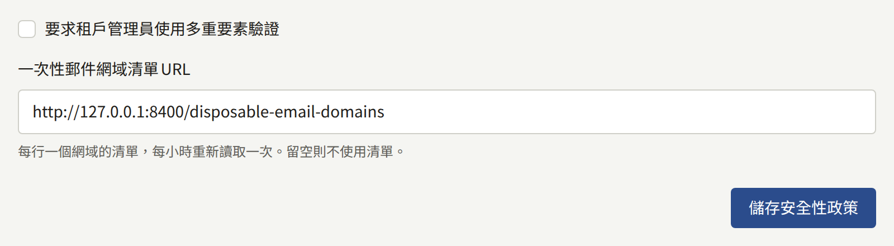
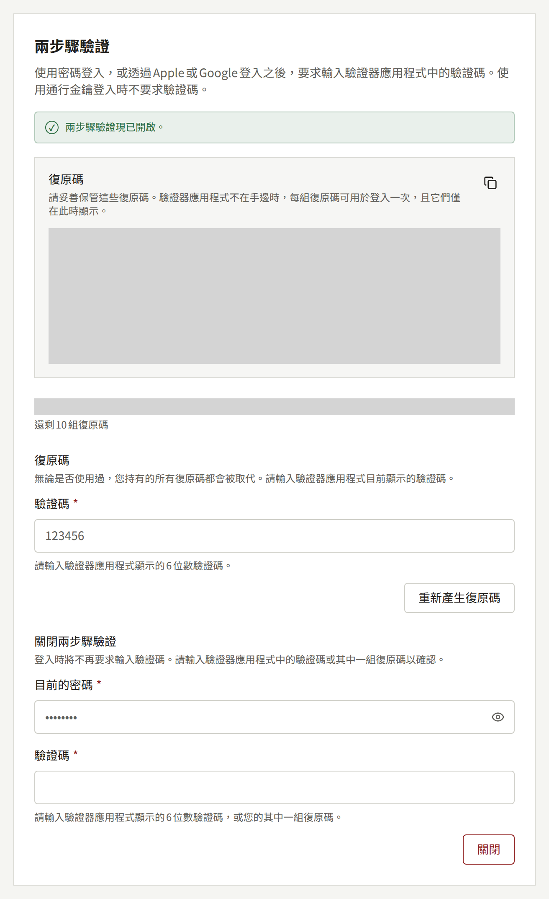

本頁寫給營運人員：租戶工作人員、讀者和平台主控台營運人員如何以第二驗證要素保護自己的帳戶、如何要求工作人員和營運人員使用，以及遺失時該怎麼做。

## 租戶工作人員

租戶的每位工作人員都可以從主控台的**帳戶設定**，以驗證器應用程式和十組復原碼保護自己的主控台帳戶，如為他們撰寫的[您的帳戶](../../4-console/3-setup/9-your-account.md)所述。

工作人員也可以用通行金鑰或安全金鑰回應兩步驟驗證，如[使用通行金鑰登入](../../4-console/3-setup/9-your-account.md#使用通行金鑰登入)所述。通行金鑰與驗證器應用程式一樣能滿足下述要求：在登入時被要求設定兩步驟驗證的租戶管理員，可以改為註冊通行金鑰。帳戶的通行金鑰與其驗證器共用同樣的十組復原碼，被拒絕的通行金鑰也與錯誤的驗證碼一樣，計入同一個鎖定次數。

通行金鑰綁定在主控台的主機上，無論該主機在哪裡提供服務，都絕不會綁定在租戶的網域上，即使主控台像`admin.<domain>`那樣位於該網域之下也是如此。因此，[將主控台遷移到其他主機](../2-tenants.md#把租戶移到其他主機名稱)——為它指定新的管理網域，或變更主控台位於`admin.<domain>`的租戶的網域——會讓其工作人員註冊的所有通行金鑰都無法使用。擁有驗證器應用程式或復原碼的工作人員可以用它們登入。唯一的第二驗證要素是通行金鑰的人，若要求涵蓋其角色，會被要求重新設定兩步驟驗證；若不涵蓋，則只憑密碼登入。將主控台遷移回原處，舊的通行金鑰就能再次使用。

您可以要求安裝實例上的每位租戶管理員使用它：在平台主控台**政策**下的**安全性**上勾選**要求租戶管理員使用多重要素驗證**，然後選擇**儲存安全性政策**，或執行：

```bash
publiractl policy set --mfa-required-for-tenant-admin
```



`--mfa-required-for-tenant-admin=false`會停止要求。這項要求會在租戶管理員登入時檢查，因此從每個人的下次登入起適用，而不影響已開啟的工作階段；它的作用和涵蓋的對象，請參閱[平台預設值與政策](../9-platform-policies.md#租戶管理員的兩步驟驗證)。

遺失了所有第二驗證要素——驗證器和通行金鑰——以及所有復原碼的工作人員，無法再次登入，租戶的其他管理員也無法從其帳戶移除兩步驟驗證。您可以使用`publiractl tenant member reset-mfa`來移除，如[租戶的工作人員](../3-tenant-staff.md#遺失兩步驟驗證)所述。

每個驗證器的密鑰都以加密金鑰密封，這就是[移除舊金鑰](./1-rotating-secrets.md#4-只在沒有任何東西使用舊金鑰時才移除它)可能讓工作人員無法登入的原因。通行金鑰則不然：安裝實例只保存每個通行金鑰的公開金鑰，任何人讀到它都無法證明任何事，因此輪替或移除金鑰不會影響通行金鑰的運作。

## 讀者

讀者也可以用同樣的方式，從網站**帳戶設定**的**安全性**中的**兩步驟驗證**，以驗證器應用程式和十組復原碼保護自己的網站帳戶，詳見[讀者的兩步驟驗證](../../4-console/2-readers/1-accounts.md#讀者的兩步驟驗證)。開啟後，在網站上使用密碼或透過Apple或Google登入時也會要求輸入驗證碼。通行金鑰本身就是第二驗證要素，因此使用通行金鑰登入時不要求。



租戶的應用程式也可以從**帳戶**畫面的**兩步驟驗證**同樣設定，在應用程式中登入時也會同樣要求輸入驗證碼。

不會要求讀者使用兩步驟驗證，本頁上的任何設定都不會改變這一點：本頁說明的要求只針對租戶管理員與營運人員。無論在哪裡登入，一個帳戶只有一個第二驗證要素，因此在主控台設定的工作人員在網站上也會被要求，成為工作人員的讀者在主控台上也會被要求輸入在網站上設定的那一個。

與工作人員的一樣，讀者的驗證器密鑰也以加密金鑰加密，因此[移除舊金鑰](./1-rotating-secrets.md#4-只在沒有任何東西使用舊金鑰時才移除它)同樣可能讓讀者無法登入。

## 平台營運人員

每位營運人員都可以用相同的方式，從**帳戶設定**上的**兩步驟驗證**，以驗證器應用程式和十組復原碼保護自己的平台主控台帳戶，如[營運人員自己的帳戶](../1-platform-console.md#營運人員自己的帳戶)所述。

無論角色為何，您都可以要求每位營運人員使用它：在**政策**下的**安全性**上勾選**要求平台主控台的所有營運人員使用兩步驟驗證**，然後選擇**儲存安全性政策**，或執行：

```bash
publiractl policy set --mfa-required-for-platform-operator
```

`--mfa-required-for-platform-operator=false`會停止要求。它會在營運人員登入時檢查，因此從每個人的下次登入起適用，而不影響已開啟的工作階段，包括您自己的；尚未設定的營運人員會看到什麼，請參閱[平台預設值與政策](../9-platform-policies.md#平台營運人員的兩步驟驗證)。請在要求之前先設定好自己的驗證器，免得您成為第一個發現登入會要求什麼的人。

同時遺失了驗證器和所有復原碼的營運人員，無法再次登入，其他營運人員也無法在平台主控台中從其帳戶移除它。您可以使用`publiractl operator reset-mfa`來移除，如[遺失兩步驟驗證](../1-platform-console.md#遺失兩步驟驗證)所述。它不需要任何帳戶，因此即使遺失的營運人員是安裝實例唯一的**超級管理員**也能使用。

每個驗證器的密鑰都與租戶工作人員的一樣以加密金鑰密封，因此[移除舊金鑰](./1-rotating-secrets.md#4-只在沒有任何東西使用舊金鑰時才移除它)也可能讓營運人員無法登入。

無論是否要求兩步驟驗證：

- 讓每位營運人員使用自己專屬的長密碼，並保存在密碼管理工具中。
- 盡可能只將**超級管理員**角色指定給少數營運人員，只需要檢視的人則指定為**稽核員**。
- 將不再需要帳戶的營運人員暫停或永久停用，如[暫停與永久停用](../1-platform-console.md#暫停與永久停用)所述。
- 考慮只在營運人員能連線的網路上提供平台主控台的主機名稱，例如透過VPN或在TLS終止點設定位址允許清單。讀者和租戶工作人員從來不需要它。
