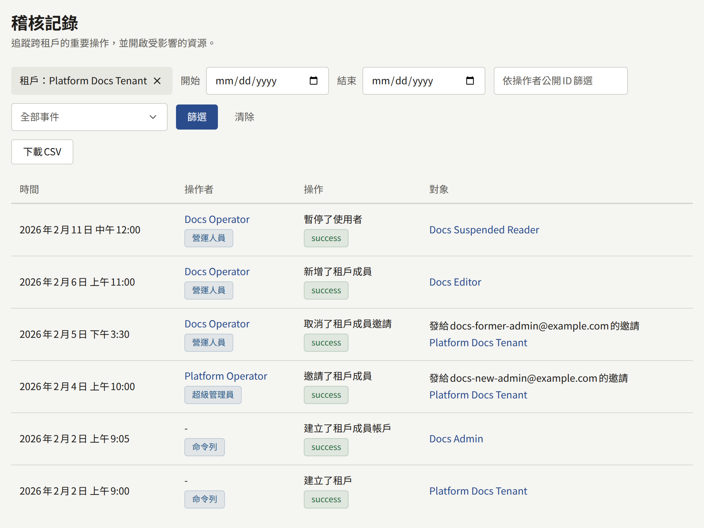

安裝實例保有兩種從不共用項目的稽核記錄：平台主控台的稽核記錄，記錄營運人員和`publiractl`所做的變更；以及每個租戶的稽核記錄，記錄其工作人員在租戶主控台中所做的變更。項目絕不會被刪除，資料庫也會拒絕Publira處理程序所連線的每個角色對項目做任何變更，唯一的例外是資料庫本身所做的變更：當執行操作的帳戶被刪除時，項目會改為保留該帳戶的名稱和公開ID。兩種記錄都可以按期間[匯出為CSV](#匯出記錄)。

## 平台主控台的記錄

平台主控台**治理**下的**稽核記錄**會以最新的項目優先列出，每頁20筆。每位營運人員都可以閱讀它，包括**稽核員**。每個項目會顯示**時間**、**操作者**及其角色、操作及其結果，以及**對象**。從`publiractl`所做的變更不會指出任何營運人員：其操作者為**命令列**。列表可以用**開始**和**結束**縮小到某個期間（以平台的**預設時區**計算的完整日期），也可以依公開ID縮小到單一操作者，或縮小到單一種類的操作。租戶頁面上的**查看稽核記錄**會開啟同時縮小到該租戶的列表：即變更了該租戶、其邀請，或其工作人員和讀者帳戶的項目。租戶名稱會顯示在列表上方，其關閉按鈕只會取消該篩選；**清除**則會取消所有篩選。

它會記錄：

- **營運人員**：新增、變更、暫停、重新啟用和永久停用；以及每位營運人員自己的兩步驟驗證：設定、登入時要求的驗證碼（無論正確與否）、以復原碼登入、新的復原碼，以及關閉兩步驟驗證。
- **平台設定與外部服務**：每次儲存一般設定、安全性與社群政策、保留期限預設值、郵件、儲存和搜尋設定，以及Web Push聯絡方式，還有每次測試郵件、儲存和搜尋連線及其結果。
- **租戶及其工作人員**：租戶的建立、變更、暫停和恢復；管理員的邀請，以及邀請的重新寄送和取消；成員的新增、以密碼建立、指定新角色和移除。
- **讀者**：營運人員對帳戶的暫停、恢復和刪除。
- **記錄本身**：每次匯出，以及其涵蓋的期間和所縮小到的租戶。

## 租戶的記錄

每個租戶主控台**管理**下的**稽核記錄**，會記錄其工作人員在那裡所做的事，包括兩步驟驗證，且只有其租戶管理員可以閱讀。它記錄的內容請參閱[稽核記錄](../../4-console/3-setup/8-audit-log.md)。無法從平台主控台閱讀它，而您從平台主控台或`publiractl`為租戶所做的變更，會記錄在平台主控台的記錄中，而不是租戶的記錄中。

## 匯出記錄

兩種記錄都可以由能閱讀它的人匯出為一個最多涵蓋366天的CSV檔案：租戶的記錄由其租戶管理員匯出，平台主控台的記錄則由每位營運人員匯出，包括**稽核員**。期間以完整日期計算，租戶的記錄以租戶的時區計算，平台主控台的記錄則以平台的**預設時區**計算，而操作者、操作，以及平台主控台記錄中的租戶，會像縮小列表那樣縮小檔案的範圍。

檔案包含該期間的每個項目，最舊的在前，每個項目一列：記錄的時間（附上期間所在時區的偏移）；操作者的公開ID、名稱和角色；操作、其結果和原因；所操作對象的種類和ID；以及用戶端位址。平台主控台記錄的檔案還會以公開ID和名稱列出每個項目的租戶，以及項目所操作對象的公開ID和名稱。檔案為帶有位元組順序標記的UTF-8，這能讓試算表將它讀取為UTF-8，而試算表會讀成公式的值會在開頭加上單引號寫入，使其保持為文字。

匯出本身也會成為它所讀取之記錄中的一個項目，因此記錄會顯示誰在何時取得了哪個期間的副本。

在平台主控台中，**稽核記錄**上篩選旁的**下載CSV**會將所顯示的期間、租戶、操作者和操作的項目儲存為以期間命名的檔案，例如`platform-audit-log-2026-04-01--2026-04-30.csv`。沒有**結束**時，期間結束於今天；沒有**開始**時，期間是結束於**結束**或今天的366天。比這更長的期間，或**開始**晚於**結束**的期間，在您縮小之前都無法下載。每次下載都會以**下載了稽核記錄CSV**出現在記錄中。

## 兩種記錄都不會記錄的內容

- **以密碼登入**。無論是成功的登入還是錯誤的密碼都不會留下項目；租戶的記錄只會記錄接在後面的兩步驟驗證步驟。`publira server`會將每次登入網站、租戶主控台或平台主控台的嘗試，記錄為以`audit auth`開頭的日誌行，其中包含操作、結果、原因和用戶端位址，例如`audit auth action=admin_login outcome=failure ... reason=invalid_credentials`。若您需要這項記錄，請保留伺服器的日誌。
- **安裝實例的密鑰和變數**。輪替金鑰、密碼或權杖是在Publira之外進行的，不會在任何地方留下項目。請自行記錄您在何時輪替了什麼。

每個項目在儲存之前，也會以帶有`msg=audit`的行寫入`publira server`的日誌。大多數項目會在變更後片刻，從伺服器記憶體中的佇列儲存，而經過幾次嘗試仍無法儲存的項目，或在伺服器停止時仍在佇列中的項目，會從主控台的列表中遺失，但仍保留在那一行日誌中。[監控](../11-monitoring.md#稽核記錄)列出了針對這些遺失應設定警示的日誌行和指標。
