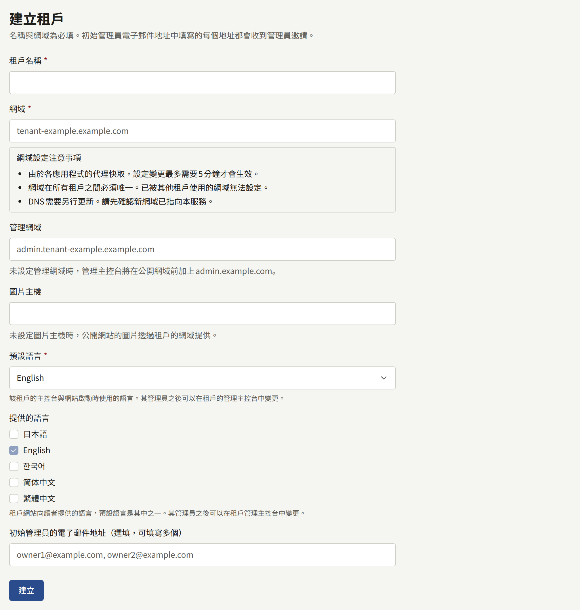
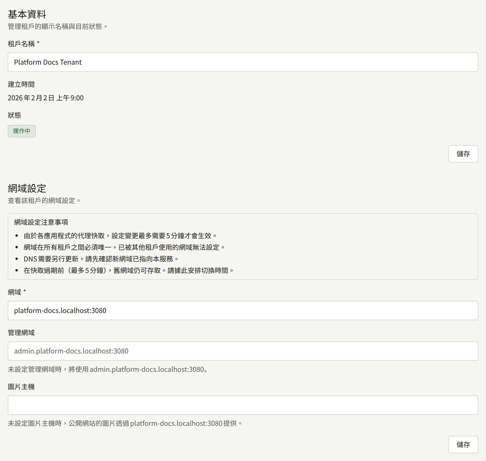
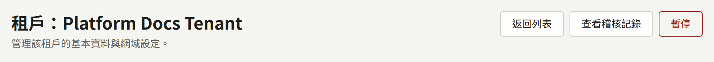
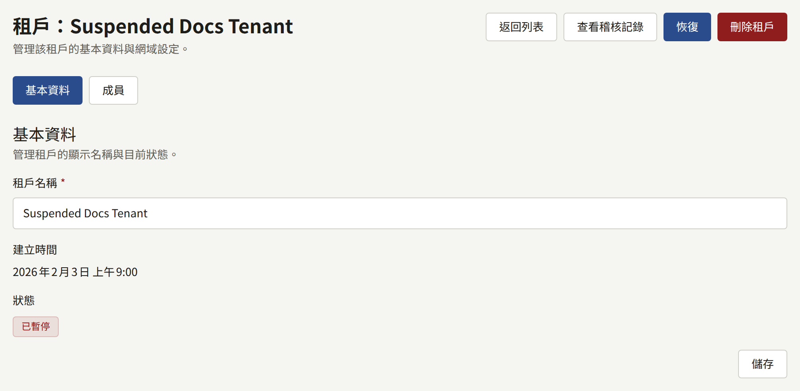
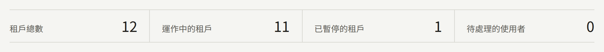
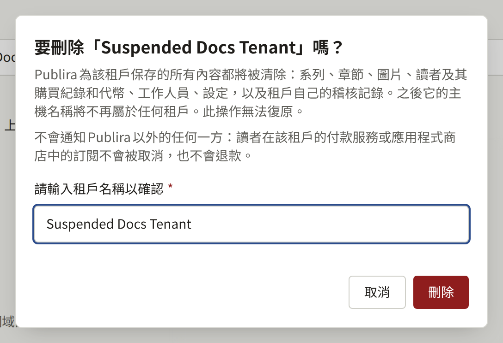

安裝實例服務的每個出版社都是一個租戶，在自己的網域上有一個公開網站，並在第二個主機名稱上有一個主控台。第一個租戶是由`publiractl setup`建立的。本頁說明如何新增下一個租戶，以及之後可以變更租戶的哪些內容。

本頁的每個`publiractl`指令都只寫出指令本身；請依[平台主控台與publiractl](./1-platform-console.md#在兩者之間選擇)所述的方式執行，並把`PUBLIRA_PLATFORM_DB_URL`設為`publira_platform`的連線。完整的旗標清單見[`publiractl`參考文件](https://github.com/publira/publira/blob/main/server/cmd/publiractl/README.md#tenant)。

## 建立租戶之前

由於租戶從建立的那一刻起就會在其主機名稱上提供服務，請先決定以下事項：

- **它的網域**，也就是提供其公開網站的主機，例如`comics.example.com`。
- **它的主控台主機**，也就是其工作人員登入的主機。除非您為它指定專屬的主機，否則就是`admin.`加上網域，例如`admin.comics.example.com`。
- **它的圖片主機**，只有在其網站的圖片要以專屬的主機名稱提供時才需要，例如`images.comics.example.com`，詳見[圖片主機](#圖片主機)。沒有圖片主機時，圖片會在其網域上提供。
- **它的預設語言**，也就是其網站與主控台一開始使用的語言。沒有任何東西會替它選擇。其管理員之後可以從租戶主控台變更。
- **它的網站向讀者提供的語言**，其中包含預設語言。維持不變時，網站只提供預設語言。其管理員之後也可以變更這些語言。
- **它的第一位管理員**，以及他們取得存取權的方式：寄送給他們的邀請，或是您以密碼建立的帳戶。兩者的比較見[租戶的工作人員](./3-tenant-staff.md)。

每個主機名稱都請單獨以小寫書寫：不加`https://`、不加路徑，也不加結尾的`/`。每個主機名稱只屬於一個租戶，作為其網域、主控台主機或圖片主機，絕不會同時作為其中兩者：代理會把一個主機名稱送到一個地方，因此重複使用的名稱會讓其中一方無法連線。Publira會拒絕其他租戶已用作這三者之一的網域、主控台主機或圖片主機（包括主控台預設取得的`admin.<domain>`）、與租戶本身網域相同的主控台主機，以及與租戶本身網域或主控台主機相同的圖片主機。當租戶將取得的`admin.<domain>`已被使用時，請為它指定專屬的管理網域。

接著依[新增租戶](../2-deployments/4-edge/index.md#新增租戶)所列的順序，讓它的主機名稱連到安裝實例：DNS、憑證，以及邊緣的路由。您可以在建立租戶之前或之後進行，但在完成之前，它的工作人員無法開啟主控台。

### 使用專屬網域的主控台主機

主控台主機不一定要在租戶的網域底下：位於`example.com`的網站，可以把主控台放在`admin.example.net`，以下方的**管理網域**或`--admin-domain`指定。若您能為它另外註冊一個網域，這是較安全的選擇。公開憑證授權單位簽發的每張憑證都會公開在Certificate Transparency日誌中，而crt.sh等服務可以讓任何人依網域搜尋，因此無論主控台主機叫什麼名稱，只要位於網站的網域底下，從它的憑證簽發的那一刻起就會與網站並列。萬用字元憑證可以讓名稱不出現在日誌中，但`admin.<domain>`是任何人都會最先嘗試的名稱。位於另一個可註冊網域、且憑證不包含網站任何主機的主控台主機，就不會以這種方式與網站產生關聯。主控台仍然會要求工作人員登入，因此這種做法隱藏的是它的登入頁面。`admin.<domain>`仍是預設值，維持原樣也能運作。

請在工作人員註冊通行金鑰之前決定：通行金鑰會綁定主控台的主機，因此之後把主控台移到其他主機時，已註冊的通行金鑰就無法使用，詳見[兩步驟驗證](./12-security/2-two-step-verification.md#租戶工作人員)。

邊緣還可以更進一步，只接受來自工作人員IP位址的主控台主機請求；[設定範例](../2-deployments/4-edge/1-sample-configurations.md)不會替您這樣做。這涵蓋的是主控台的頁面。它的API不需要這樣的規則：主控台透過私人網路呼叫它們，而依[只有公開API經過邊緣](../2-deployments/4-edge/index.md#只有公開api經過邊緣)設定的邊緣，在任何主機上都不會轉送它們。

### 圖片主機

租戶網站的圖片會在其網域上、透過與其頁面相同的邊緣提供。圖片主機則改以專屬的主機名稱提供它們，例如`images.comics.example.com`，讓它們可以透過專屬的負載平衡器或CDN連到Publira，與頁面和公開API分開，詳見[分開提供圖片與公開API](../2-deployments/7-scaling-out.md#分開提供圖片與公開api)。不需要這麼做的租戶，就不需要圖片主機。

租戶設定圖片主機之後，公開API會提供該主機上的網站圖片位址，而Publira在該主機上只會回應租戶網站的圖片，不提供其他任何內容：頁面、API與主控台都不在那裡提供。租戶的網站與行動應用程式會從那裡載入圖片；租戶主控台則繼續在主控台主機上載入它的圖片。

圖片主機必須像租戶的其他主機名稱一樣連到安裝實例：在DNS中設定、具備憑證，並把其上的`/images`路由到`publira server`，詳見[租戶的圖片主機](../2-deployments/4-edge/index.md#租戶的圖片主機)。範例設定會在它加入`PUBLIRA_EDGE_IMAGE_HOSTS`之後為它設定路由。請在設定之前準備好它，因為從那時起網站就會從它載入圖片。

之後設定、變更或清除圖片主機，與其他主機名稱的移動一樣，詳見[把租戶移到其他主機名稱](#把租戶移到其他主機名稱)：在`publira worker`把變更告知Web應用程式之前，網站在變更前準備好的頁面仍會連結到先前主機上的圖片，因此在那之前請讓先前的主機繼續提供服務。

## 建立租戶

### 從平台主控台

在側邊欄的**租戶**底下選擇**建立租戶**，並填寫：

- **租戶名稱**：出版社的名稱，邀請與租戶的其他郵件都以這個名稱稱呼它。
- **網域**：您選擇的網域。
- **管理網域**：主控台主機，只有在它不是`admin.<domain>`時才需要。留空時，主控台會在`admin.<domain>`上提供，如欄位下方的說明所示。
- **圖片主機**：提供租戶網站圖片的主機，只有在圖片不在其網域上提供時才需要。留空時，圖片會在網域上提供，如欄位下方的說明所示。
- **預設語言**。
- **提供的語言**：每種語言各有一個核取方塊，勾選租戶網站提供的每種語言。預設語言的核取方塊一定會勾選且無法取消，其餘的一開始都未勾選。
- **初始管理員的電子郵件地址（選填，可填寫多個）**：要邀請為租戶管理員的地址，以逗號或換行分隔。租戶建立後，每個地址都會立即收到邀請。



**建立**會建立租戶並開啟它的頁面。它的時區是平台的預設時區，其管理員可以從租戶主控台變更。

### 從publiractl

```bash
publiractl tenant create \
  --name "Example Comics" \
  --domain comics.example.com \
  --default-locale en \
  --supported-locale en \
  --supported-locale ja \
  --initial-admin-email owner@comics.example.com
```

`--supported-locale`指定租戶網站提供的一種語言，可以重複指定；預設語言必須是其中之一。省略時，網站只提供預設語言。`--admin-domain`為主控台指定專屬的主機，`--image-domain`為網站的圖片指定專屬的主機，`--timezone`則指定平台預設時區以外的IANA時區。`--initial-admin-email`可以重複指定，每個地址都會像從平台主控台那樣收到邀請。

### 建立之後

邀請由`publira worker`寄送，它必須在執行中，而且平台的SMTP設定必須已儲存。不寄送郵件的安裝實例，則改以`publiractl tenant admin create`為租戶建立第一位管理員，詳見[租戶的工作人員](./3-tenant-staff.md#不使用郵件建立帳戶)。

管理員登入之後，租戶其餘的設定（網站、品牌形象、付款，以及其他工作人員）都從它的主控台進行。

## 變更租戶

租戶的名稱、網域、主控台主機與圖片主機，都可以在建立後變更。它的語言與時區屬於其管理員，由他們從租戶主控台變更。

### 從平台主控台

從**租戶列表**開啟租戶。**基本資料**可以變更它的**租戶名稱**，**網域設定**則可以變更它的**網域**、**管理網域**與**圖片主機**。清空**管理網域**會把主控台移回`admin.<domain>`，清空**圖片主機**則會讓網站的圖片再次在網域上提供。



### 從publiractl

```bash
publiractl tenant update --tenant comics.example.com --name "Example Comics Ltd."
```

`--tenant`以網域或公開ID指定租戶。`--name`、`--domain`、`--admin-domain`與`--image-domain`各自只會取代對應的值，其餘保持不變；`--admin-domain ""`會把主控台移回`admin.<domain>`，`--image-domain ""`則會讓網站的圖片再次在其網域上提供。`publiractl tenant show --tenant comics.example.com`會印出租戶目前的狀態。

### 把租戶移到其他主機名稱

只要`publira worker`把變更告知Web應用程式，網站就會停止在舊網域上回應，其頁面也會連結到新網域；沒有`PUBLIRA_REVALIDATE_TOKEN`的worker處理程序無法告知，詳見[outbox](./10-scheduled-jobs.md#outbox郵件推播與快取重新驗證)，這時舊網域會繼續回應最多五分鐘。新網域會立即回應，除非有人在變更前開啟過它：網站會把不屬於任何租戶的主機名稱記住最多五分鐘。主控台會把它查詢過的每個主機名稱保留最多五分鐘，因此新的主控台主機要經過這麼久才會回應，舊的主機在那之前也會繼續回應。

請依[新增租戶](../2-deployments/4-edge/index.md#新增租戶)的順序進行：在變更之前，把新名稱加入DNS、憑證與路由，並在變更生效後移除舊名稱。沒有專屬管理網域的租戶，其主控台位於`admin.<domain>`，因此移動它的網域也會移動它的主控台，兩個新名稱都必須準備好。

移動網域也會移動建立在它之上的所有東西：

- 讀者與工作人員是在單一主機名稱上登入的，因此他們要在新的主機名稱上重新登入。
- 工作人員的通行金鑰屬於主控台的主機，因此會變更它的移動（新的管理網域，或主控台位於`admin.<domain>`的租戶換了新網域）會讓這些通行金鑰無法使用，詳見[兩步驟驗證](./12-security/2-two-step-verification.md#租戶工作人員)。
- 租戶的行動應用程式是為單一主機建置的，而且只會開啟該主機上的連結。請在它的[應用程式資訊清單](../5-mobile-app/1-app-manifest.md)中指定新的主機，重新建置並提交。
- 租戶主控台為付款顯示的**Webhook URL**，以及它為Apple與Google登入顯示的返回URL，都位於網域上。請向各服務商註冊新的URL。
- 變更前寄出的郵件會連結到舊的主機。

## 暫停租戶

平台主控台租戶頁面上的**暫停**，或`publiractl tenant suspend --tenant comics.example.com`，會把租戶標示為**已暫停**。**恢復**或`publiractl tenant resume`會把它重新標示為運作中。平台主控台的按鈕一按下就會生效，不會要求確認。無論以哪種方式，變更都會記錄在**稽核記錄**中，儀表板也會把該租戶計入**已暫停的租戶**。







暫停會停止為該租戶提供服務，除此之外不會變更它的任何東西：

- 它的網站、應用程式與主控台都會停止運作。API會拒絕該租戶的每個請求（包括登入），它的圖片也不再提供。讀者的瀏覽器或Publira前方的快取已經保存的圖片，最多仍會顯示一小時，這是Publira允許保存它們的時間。
- 讀者只會看到網站無法使用，不會看到其他資訊。網站的每個頁面都會以一個說明此事的頁面回應，狀態碼為`503`，這會告訴搜尋引擎網站只是暫時離開，而不是已經消失。應用程式會在每個畫面的位置顯示相同的內容並附上**重試**，在租戶恢復後，讀者點按它或回到應用程式時就會再次開啟。
- 工作人員會在主控台的每個頁面（包括登入頁面）看到主控台因網站已暫停而無法使用。其中不會提到任何內部細節。
- Web應用程式會把它們查詢過的主機名稱保留最多五分鐘。暫停後的這段期間內，它們已經準備好的頁面仍可能顯示，其他頁面則會顯示應用程式的錯誤頁面，而不是上述頁面。
- 其付款服務商與收件服務商傳送的通知也會被拒絕。每個服務商都會依自己的排程重試被拒絕的通知，因此租戶恢復時仍在重試的通知會在那時處理，已經放棄的通知則不會。
- 讀者與工作人員會保持登入。租戶暫停期間不會接受他們的工作階段，恢復後就會再次生效。
- 寄給其讀者與工作人員的郵件與推播通知不會寄送，也不會保留到之後再寄：它們連結的內容無法使用，而且等到租戶恢復時也已經過時了。例外是您從平台主控台或`publiractl`寄送的租戶管理邀請，它會寄出；其連結在租戶恢復後即可使用，若屆時已過期，**重新寄送**會簽發新的連結。
- 它的排定發布、免費閱讀期間、版稅結算，以及其他排程工作都會繼續進行，因此恢復後的租戶會處於它自己的排程原本應有的狀態。
- 它的詳細資料、成員與邀請，仍然可以從平台主控台與`publiractl`變更，詳見[租戶的工作人員](./3-tenant-staff.md)。

暫停或恢復租戶都不會刪除或變更它的任何東西，而恢復後會立即再次提供服務，不需要做其他任何事。

## 刪除租戶

已暫停的租戶可以刪除，刪除會清除安裝為它保存的所有內容：系列、章節、圖片、讀者及其購買紀錄和代幣、工作人員、設定，以及租戶自己的稽核記錄。刪除無法復原，而且只有**超級管理員**可以執行。

運作中的租戶無法刪除，因此請先暫停它，並在任何內容被清除之前，讓它保持暫停，時間長短由您決定讀者與工作人員需要被拒絕多久。租戶刪除後就無法再恢復。

不會通知安裝以外的任何一方。讀者在該租戶的付款服務或應用程式商店中的訂閱會在那裡繼續續訂，也不會退款：出版商應退的款項，需要由出版商在刪除租戶之前透過該服務自行退還。

### 從平台主控台

從**租戶**開啟已暫停的租戶。**恢復**旁邊的**刪除租戶**會開啟一個對話方塊，說明將清除哪些內容，並要求輸入租戶名稱。請依保存的名稱準確輸入；在兩者一致之前，對話方塊中的**刪除**無法使用。營運人員與稽核員看不到這個按鈕。



此後，租戶在列表與它的頁面上顯示為**正在刪除**。頁面會說明它正在刪除，而且其中的任何內容都無法變更：**恢復**與**儲存**按鈕都無法使用。

### 從publiractl

```bash
publiractl tenant delete --tenant comics.example.com --name "Example Comics"
```

`--name`必須與租戶名稱完全一致，指令以此確認要刪除的是哪個租戶。在清除完成之前，`publiractl tenant show`會把租戶顯示為`deleting`。

### 之後會發生什麼

`publira worker`會在一分鐘內清除該租戶：其在每張資料表中的列、儲存貯體中的物件、搜尋引擎索引中的文件，以及留在Valkey中的轉換後圖片與速率限制計數器，最後刪除租戶本身。在此之前，它會像已暫停的租戶一樣被拒絕。清除完成後，它的主機名稱不再屬於任何租戶，可以從DNS、憑證與邊緣的路由中移除，也可以分配給其他租戶。

隨後，租戶會從列表中消失。平台主控台會把讀取過的列表保留最多一分鐘，因此在這段時間內重新載入，仍可能看到租戶顯示為**正在刪除**。每位營運人員都會在**通知**中收到標題為「租戶已刪除」的通知，**稽核記錄**會保留請求與刪除各一筆紀錄，並附上租戶的名稱、網域與主控台主機。

一直顯示為**正在刪除**的租戶，是worker未能完成清除的租戶；這時會發生什麼，請參閱[其他排程工作](./10-scheduled-jobs.md#其他排程工作)。
