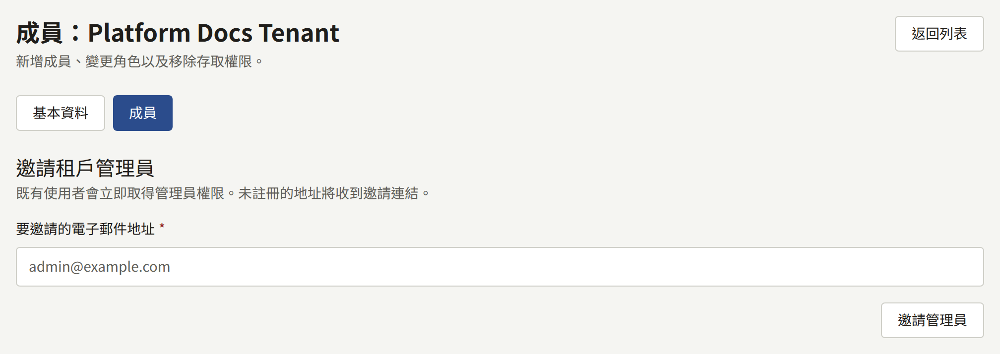
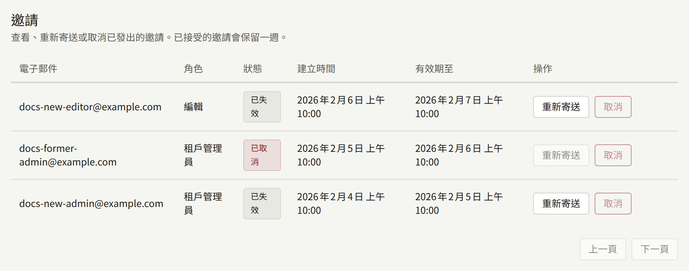
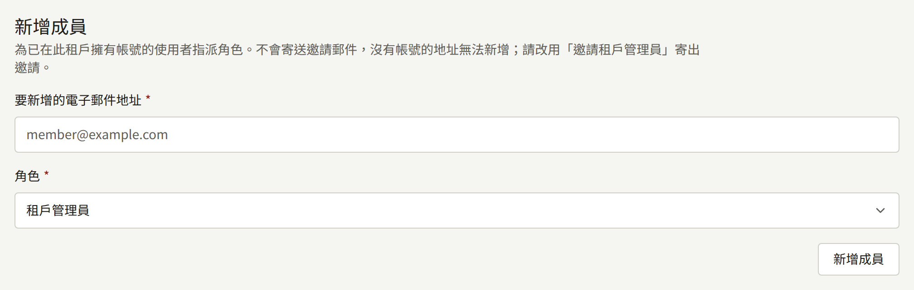
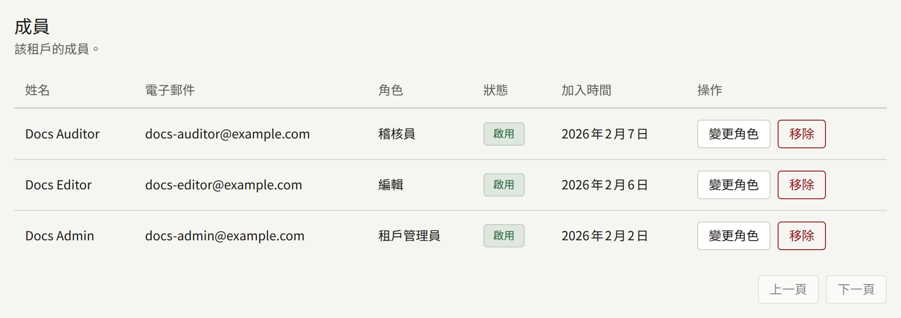

租戶的工作人員是登入其主控台的人員。本頁從營運人員的角度說明他們如何取得存取權：邀請第一位管理員、工作人員擁有的角色，以及租戶沒有任何管理員時該怎麼做。租戶有了管理員之後，就由該管理員從租戶主控台的**成員**管理其餘的工作人員，詳見[成員](../4-console/3-setup/6-members.md)，營運人員只有在出問題時才需要再次介入。

本頁的`publiractl`指令依[平台主控台與publiractl](./1-platform-console.md#在兩者之間選擇)所述的方式執行，而且每個指令都以`--tenant`透過網域或公開ID指定租戶。完整的旗標清單見[`publiractl`參考文件](https://github.com/publira/publira/blob/main/server/cmd/publiractl/README.md#tenant)。

## 成員與使用者

每個帳戶都屬於一個租戶：在兩個租戶的網站上註冊的讀者會有兩個帳戶，每個租戶各一個。帳戶是其租戶的**使用者**。同時擁有主控台角色的使用者，則是租戶工作人員中的**成員**，可以登入其主控台。

由此可以得出以下幾點：

- 讓某人成為工作人員，絕不會移動他們的帳戶。獲得角色的租戶讀者，會以他們閱讀時使用的地址與密碼登入主控台。
- 移除某人的角色會保留他們的帳戶。他們仍然是租戶的讀者，之後也可以再次獲得角色。
- 帳戶擁有角色期間，可以在網站與應用程式上閱讀租戶已發布的每個章節而無需購買，讓工作人員能以讀者看到的樣子檢查自己的目錄。在網站上，以這種方式開啟的付費章節會在價格旁註明它是透過角色開啟的，而尚未購買的讀者看到的會是購買提示，而不是章節的頁面。租戶的年齡確認仍然適用，而且它無法為章節評分，因此工作人員自己的閱讀不會計入網站顯示的評分。移除角色時，這項權限也會一併移除。

## 三種角色

| 角色 | 可以做的事 |
| --- | --- |
| **租戶管理員** | 主控台中的所有事：工作人員及其邀請、租戶的每項設定、其網站與品牌形象、郵件、付款、推播通知、登入與Google代碼的整合、讀者的帳戶與諮詢、閱讀券、購買及其退款、版稅，以及稽核記錄。若租戶要求章節在發布前必須經過審核，核准或退回章節只能由租戶管理員進行 |
| **編輯** | 撰寫目錄（系列、章節、作者、書系、類型），以及租戶的頁面、公告與活動橫幅，並管理留言。若租戶要求審核，則提交章節以供審核，詳見[發布前審核](../4-console/1-catalog/2-episodes.md#發布前審核) |
| **稽核員** | 查看編輯所處理的內容以及租戶的設定，但不能變更任何內容 |

每個角色都包含其下方角色可以做的所有事。主控台會隱藏角色不能使用的功能：編輯的側邊欄中看不到**成員**、**讀者**、**版稅**或**購買記錄**，而稽核員看不到任何會變更內容的按鈕。

由於只有租戶管理員能為其他人指派角色，租戶至少需要一位租戶管理員。

## 讓工作人員取得存取權

有三種方式，適合哪一種，取決於該人員在租戶中是否已有帳戶，以及安裝實例是否會寄送郵件。

### 邀請租戶管理員

邀請會寄送到一個地址，接受後該地址就會成為租戶管理員。新租戶通常就是這樣透過建立時提供的地址取得第一位管理員，之後也是這樣新增更多管理員。

- **平台主控台**：從**租戶列表**開啟租戶，選擇**成員**，在**邀請租戶管理員**底下輸入地址，再選擇**邀請管理員**。
- **publiractl**：`publiractl tenant invite create --tenant comics.example.com --email editor-in-chief@comics.example.com`



受邀者會收到一封以租戶預設語言撰寫、內含租戶主控台連結的郵件。他們在該頁輸入**姓名**與**密碼**，選擇**接受邀請**，然後登入。連結的有效期限為24小時。

已經屬於租戶使用者的地址不會收到邀請：它會立即成為租戶管理員，而且不會寄送郵件。這會取代它先前擁有的任何角色，因此以這種方式受邀的編輯會成為租戶管理員。

邀請郵件由`publira worker`寄送；若租戶已儲存自己的SMTP設定就使用它，否則使用平台的設定。沒有執行worker處理程序的安裝實例會建立邀請，但不會寄送任何東西。

從平台主控台或`publiractl`寄送的邀請只能產生租戶管理員。編輯與稽核員的角色依[新增現有使用者](#新增現有使用者)所述的方式指派，或由租戶自己的管理員邀請，他們的主控台可以讓邀請授予三種角色中的任何一種。

### 追蹤邀請

同一個**成員**畫面上的**邀請**，會列出租戶的每個邀請（包括租戶自己的管理員從租戶主控台寄出的邀請），以及接受後授予的**角色**與其狀態：**待處理**、**已接受**、**已取消**或**已失效**。

- 對待處理或已失效的邀請選擇**重新寄送**，會以新的連結再次寄送，有效期限再延長24小時。先前的連結會失效。
- 對待處理的邀請選擇**取消**，會撤回該邀請，其連結也會失效。



從命令列，`publiractl tenant invite list --tenant comics.example.com`會印出每個邀請及其ID，而`tenant invite resend --id <ID>`與`tenant invite cancel --id <ID>`則會對其中一個邀請（包括已失效的）執行動作。

租戶自己的管理員會在租戶主控台中看到相同的邀請，並可以在那裡寄送、重新寄送與取消邀請。

### 新增現有使用者

租戶的讀者可以直接獲得三種角色中的任何一種，不需要郵件：

- **平台主控台**：在租戶的**成員**畫面上，於**新增成員**底下輸入地址，選擇**角色**，再選擇**新增成員**。
- **publiractl**：`publiractl tenant member add --tenant comics.example.com --email reader@example.com --role tenant_editor`。`--role`是`tenant_admin`、`tenant_editor`與`tenant_auditor`其中之一。



這只適用於在租戶中已有帳戶的地址；其他地址都會被拒絕。沒有帳戶的人要先在租戶的網站上註冊，或以租戶管理員的身分受邀。已經擁有角色的帳戶，則改用**變更角色**變更。

### 不使用郵件建立帳戶

`publiractl tenant admin create`會直接建立主控台帳戶：帳戶會被設定密碼，其地址視為已驗證，並且可以立即登入。它不會寄送郵件，因此不寄送郵件的安裝實例就是以這種方式取得第一位管理員，以及之後的任何工作人員。

```bash
publiractl tenant admin create \
  --tenant comics.example.com \
  --email owner@comics.example.com \
  --name Owner \
  --generate-password
```

`--generate-password`只會把密碼印出一次，而且只印在終端機上，因此請在關閉終端機之前把它交給帳戶的擁有者。設定密碼的其他方式見[參考文件](https://github.com/publira/publira/blob/main/server/cmd/publiractl/README.md#tenant)，而`--role`可以改為建立編輯或稽核員，而不是租戶管理員。平台主控台沒有對應的功能。

該地址在租戶中必須還沒有帳戶。已有帳戶的地址，請改用`tenant member add`。

## 變更角色與移除人員

在平台主控台租戶的**成員**畫面上，**變更角色**會為成員指派另一個角色，**移除**則會移除他們的所有角色。



從命令列：

```bash
publiractl tenant member list --tenant comics.example.com
publiractl tenant member update-role --tenant comics.example.com --user <public ID> --role tenant_auditor
publiractl tenant member remove --tenant comics.example.com --user <public ID>
```

`tenant member list`會印出每位成員的公開ID，也就是`--user`接受的值。

主控台在每個請求時都會讀取成員的角色，因此變更會立即生效，對他們已經開啟的主控台也是如此。被移除的成員會保留帳戶，成為租戶的讀者，因此他們的購買與紀錄仍然屬於他們。

## 遺失兩步驟驗證

開啟了兩步驟驗證、之後又遺失所有第二要素（驗證器與通行金鑰）以及所有復原碼的工作人員，無法登入主控台，租戶的工作人員中也沒有任何人能從他們的帳戶移除兩步驟驗證。您可以：

```bash
publiractl tenant member reset-mfa --tenant comics.example.com --email editor@comics.example.com
```

也可以用`--user <public ID>`取代`--email`來指定帳戶。這個指令會移除帳戶的驗證器、它註冊的每個通行金鑰（無論是在哪個主控台位址上註冊的），以及所有復原碼，除此之外什麼都不動：它的密碼與角色都維持原樣。之後，該成員只以密碼登入，再從**帳戶設定**重新設定兩步驟驗證，詳見[您的帳戶](../4-console/3-setup/9-your-account.md)。若平台要求他們的角色使用兩步驟驗證，主控台會在他們登入時要求設定。

移除之後，帳戶就只受密碼保護，而這正是持有遭竊密碼的人會提出的要求。執行指令之前，請透過您已經確知屬於該成員的管道（而不是請求送達的那個管道），確認請求確實來自該成員。

這次移除會記錄在平台主控台的**稽核記錄**中，執行者為**命令列**。平台主控台本身沒有對應的功能。

## 讓沒有管理員的租戶恢復運作

租戶主控台會拒絕降級或移除最後一位租戶管理員，因此租戶通常一定會有一位。但實際上它仍可能失去最後一位：管理員離開了出版社、無法再存取自己的信箱，或帳戶遭到盜用。

平台主控台與`publiractl`不會保護最後一位租戶管理員，正是為了讓營運人員能夠介入：

- **應由工作人員中的某人接手**。以**變更角色**或`tenant member update-role --role tenant_admin`為他們的帳戶指派租戶管理員角色。
- **新的管理員在租戶中沒有帳戶**。邀請他們；若他們無法收信，則以`publiractl tenant admin create`建立帳戶。
- **最後一位管理員遺失了兩步驟驗證**。依[遺失兩步驟驗證](#遺失兩步驟驗證)所述，以`tenant member reset-mfa`移除它，他們就能再次以密碼登入。
- **最後一位管理員的帳戶遭到盜用**。先把角色指派給其他人，再以**移除**從遭盜用的帳戶取消角色，這會立即把它擋在主控台之外。該帳戶仍然可以讀者身分登入租戶的網站；新的管理員可以從租戶主控台的**讀者**暫停它。

上述每項變更都會記錄在平台主控台的**稽核記錄**中，並註明做出變更的營運人員，從`publiractl`所做的變更則註明**命令列**。租戶自己的工作人員從租戶主控台所做的變更，則改為記錄在租戶的稽核記錄中。
