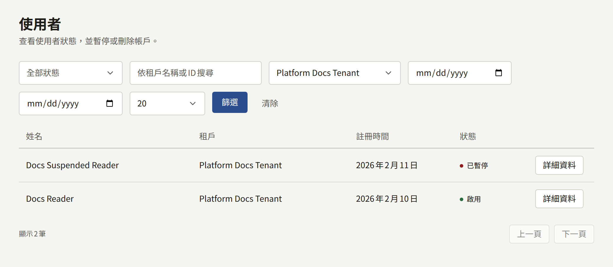
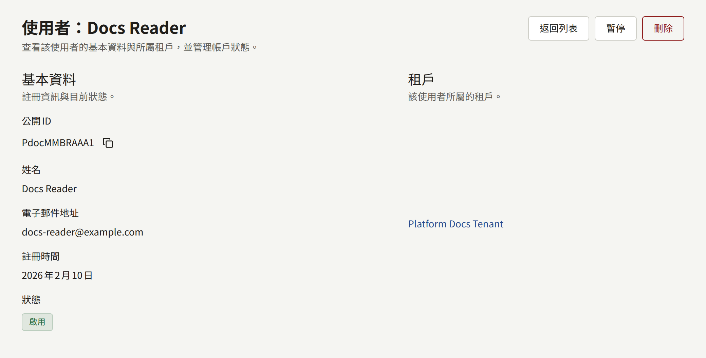
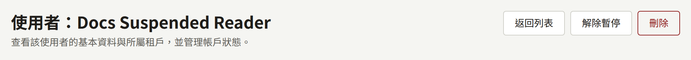

平台主控台側邊欄**治理**底下的**使用者**，會在同一處列出每個租戶的讀者。它是為了處理單一租戶無法獨自處理的事：送到營運人員而非出版社手上的投訴或法律要求，或是租戶管理員無法處理的帳戶。日常情況下，每個租戶的管理員會在租戶主控台的**讀者**中照顧自己的讀者。沒有對應的`publiractl`指令。

## 列表顯示的內容

每個帳戶都屬於一個租戶，因此在兩個租戶的網站上閱讀的人會出現兩次，每個租戶各一次。列表會顯示每個帳戶的**姓名**、**租戶**、**註冊時間**與**狀態**，並可依狀態、租戶與註冊日期篩選。它無法依姓名或電子郵件地址搜尋：請篩選到帳戶所屬的租戶及其註冊日期來找到帳戶。

列表只包含讀者。在租戶主控台中擁有角色的帳戶屬於工作人員，要從該租戶的**成員**管理，詳見[租戶的工作人員](./3-tenant-staff.md)。

**詳細資料**會開啟帳戶：它的**公開ID**、姓名、**電子郵件地址**、註冊日期、狀態，以及它所屬的租戶。

## 暫停與刪除帳戶

營運人員或超級管理員可以在帳戶的頁面上對它採取動作。稽核員看到的頁面沒有這些按鈕。

- **暫停**會讓讀者無法在網站與應用程式上登入，並結束他們現有的工作階段。帳戶中的任何內容都不會被移除。**解除暫停**會讓他們可以再次登入。
- **刪除**會永久移除帳戶，而且無法復原。想要刪除自己帳戶的讀者，可以自行從租戶的網站刪除，這通常是較好的做法。

擁有主控台角色的帳戶，這兩種動作都無法執行：請先從租戶的**成員**移除該角色。

每項動作都會連同執行它的營運人員記錄在**稽核記錄**中。
