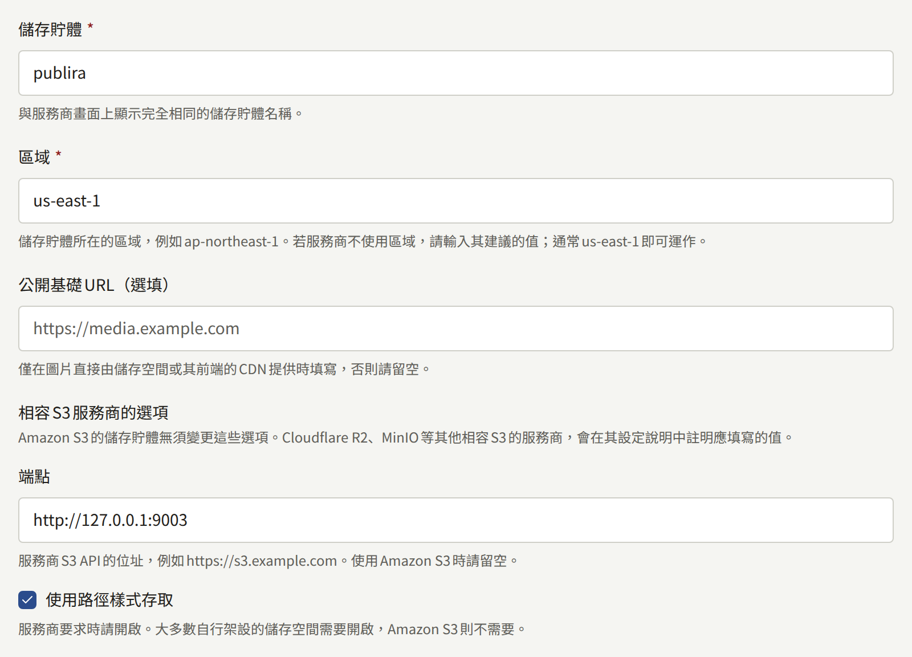
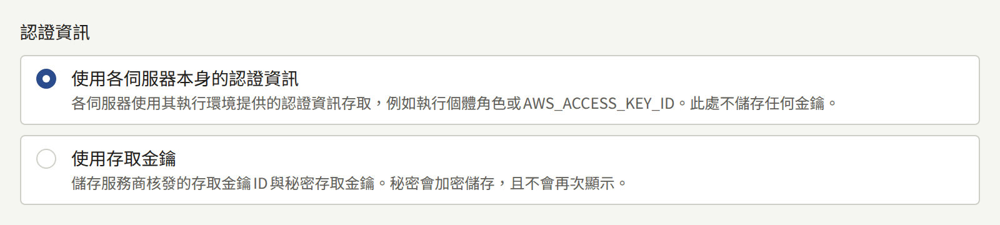
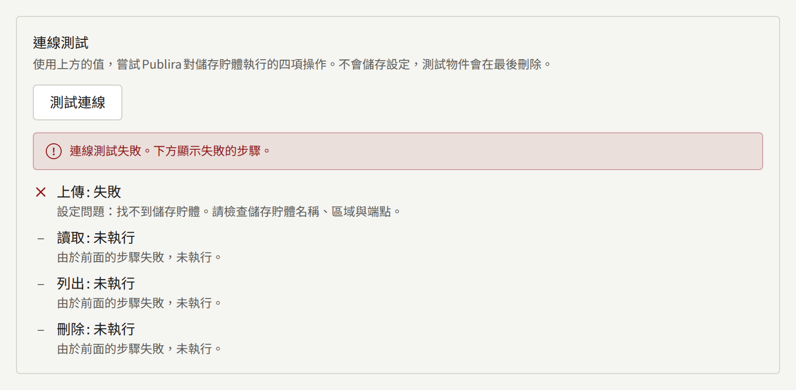
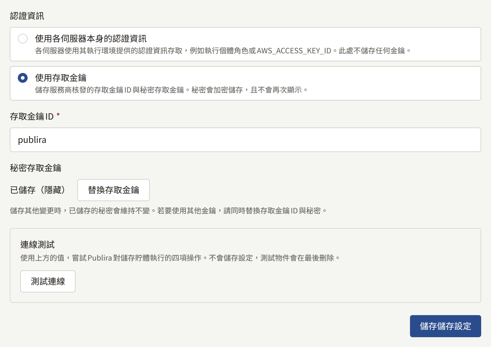

安裝實例保存的每一張圖片——封面、章節頁面、作者照片、各租戶的標誌——都存放在所有租戶共用的同一個相容S3的儲存貯體中。這個儲存貯體是由`publiractl setup`儲存的。本頁說明它的每一項設定、如何測試、日後如何變更，以及儲存的圖片如何送達讀者。

本頁的`publiractl`指令都只寫出指令本身；請依照[平台主控台與publiractl](./1-platform-console.md#在兩者之間選擇)所述的方式執行，將`PUBLIRA_PLATFORM_DB_URL`設為`publira_platform`的連線，並使用與各處理程序相同的`PUBLIRA_SECRET_ENCRYPTION_KEYS`和`PUBLIRA_SECRET_ENCRYPTION_PRIMARY_KEY_ID`。所有旗標都列在[`publiractl`參考文件](https://github.com/publira/publira/blob/main/server/cmd/publiractl/README.md#storage)中。

## 儲存貯體

Publira不會建立儲存貯體。請先在服務商那裡建立一個空的儲存貯體，並授予Publira所用的認證資訊在其中上傳、讀取、列出和刪除物件的權限。不需要將儲存貯體設為公開：讀者從不直接從它取得檔案。

這些設定指定儲存貯體及其連線方式：

| 設定 | `publiractl storage set` | 平台主控台 |
| --- | --- | --- |
| 儲存貯體的名稱 | `--bucket` | **儲存貯體** |
| 它的區域 | `--region` | **區域** |
| Amazon S3以外的儲存服務的位址 | `--endpoint` | **端點** |
| 在URL路徑而非主機名稱中指定儲存貯體 | `--force-path-style` | **使用路徑樣式存取** |
| 可讀取已儲存物件的URL | `--public-base-url` | **公開基礎URL（選填）** |



若儲存貯體位於Amazon S3，只需填寫儲存貯體及其區域，其餘留空。

若是其他相容S3的儲存服務——Cloudflare R2、MinIO、RustFS或服務商提供的物件儲存——請將其S3 API位址填為端點，並在服務商要求時開啟路徑樣式存取，大多數自架的儲存服務都有此要求。沒有區域概念的儲存服務仍需填入區域值；請填入其文件建議的值，若沒有建議則填`us-east-1`。

公開基礎URL請留空。無論它填了什麼，圖片一律經由`publira server`傳送，如[圖片如何送達讀者](#圖片如何送達讀者)所述。

## 認證資訊

Publira對儲存貯體的每個請求都會以下列兩種方式之一簽署。

**與設定一併儲存的存取金鑰**：由服務商核發的存取金鑰ID及其私密存取金鑰。私密金鑰以安裝實例的加密金鑰加密保存，因此每個存取儲存貯體的處理程序都必須以這些金鑰執行，且一旦儲存便不會再顯示。這是Amazon S3以外的儲存服務的一般選擇，也是處理程序沒有自身認證資訊的安裝實例唯一的選擇。

**各處理程序自行取得的認證資訊**，不儲存任何金鑰。各處理程序以AWS SDK本身的方式簽署：環境中的`AWS_ACCESS_KEY_ID`和`AWS_SECRET_ACCESS_KEY`、Web身分權杖，或其所在機器的執行個體角色。在AWS上，這能讓所有長期有效的密鑰都不進入資料庫，但`publira server`、`publira worker`以及您執行的`publiractl`都需要這份認證資訊：伺服器會上傳和讀取圖片，worker會刪除不再使用的圖片，而`publiractl storage test`也會進行簽署。

在平台主控台中，**認證資訊**以**使用存取金鑰**和**使用各伺服器本身的認證資訊**提供這兩種方式。使用`publiractl storage set`時，指定`--access-key-id`即會儲存金鑰，私密金鑰可以用`--secret-access-key-file`從檔案讀取、用`--secret-access-key-stdin`從標準輸入讀取、從遮蔽輸入的提示讀取，或在平台只能以環境變數設定密鑰時，用`--secret-access-key-env`從環境變數讀取；省略`--access-key-id`則會以各處理程序本身的認證資訊簽署，並移除已儲存的金鑰。



## 測試連線

測試會上傳一個小物件、讀回、列出，然後刪除它，這涵蓋了Publira對儲存貯體所做的一切操作，並回報這四個步驟各自的結果。

- 在平台主控台中，**儲存**下的**測試連線**會在儲存前測試表單中的值。測試從`publira server`執行。
- `publiractl storage test`會從`publiractl`執行的位置測試已儲存的設定，並在某個步驟失敗時以`1`結束。

失敗時會指出是哪個步驟以及原因：儲存服務拒絕了認證資訊、金鑰缺少某項操作的權限、在該名稱、區域和端點下找不到儲存貯體，或無法連線到端點。由於主控台的測試和指令在不同的機器上執行，若防火牆只允許其中一方連線到儲存服務，就會出現一方測試通過、另一方失敗的情況；必須能連線到儲存服務的是`publira server`和`publira worker`。



## 變更設定

### 從平台主控台

在側邊欄的**外部服務**下選擇**儲存**。畫面會顯示已儲存的設定，已儲存的私密金鑰顯示為**已儲存（隱藏）**。變更值後，選擇**測試連線**，再以**儲存儲存設定**儲存。若要使用另一組存取金鑰，請選擇**替換存取金鑰**，並同時輸入存取金鑰ID和私密金鑰；已儲存的私密金鑰只與儲存時的ID搭配使用。



營運人員或超級管理員可以儲存。稽核員可以檢視畫面，但無法儲存。

### 從publiractl

```bash
publiractl storage set \
  --bucket publira-images \
  --region ap-northeast-1 \
  --access-key-id AKIA... \
  --secret-access-key-file /run/secrets/aws-secret-access-key
publiractl storage test
publiractl storage show
```

`storage set`會以所給的旗標取代所有已儲存的設定，因此每次都要指定全部旗標：省略的旗標會清除其設定。以相同的`--access-key-id`且不提供私密金鑰執行時，會保留已儲存的私密金鑰。

### 變更何時生效

每個處理程序每30秒重新讀取一次設定，因此儲存後一分鐘內即會套用到所有處理程序，無須重新啟動。每次儲存和每次測試都會記錄在**稽核記錄**中。

### 遷移到另一個儲存貯體

儲存新的儲存貯體並不會複製任何內容到其中。目前已上傳的圖片會留在舊的儲存貯體，而安裝實例會到新的儲存貯體中尋找，但它們並不在那裡。請在儲存前先保持鍵值不變地複製物件，然後儲存，再複製一次，以補上第一次複製期間上傳的內容。使用AWS CLI或服務商的同等工具：

```bash
aws s3 sync s3://publira-images s3://publira-images-new
publiractl storage set --bucket publira-images-new --region ap-northeast-1 ...
aws s3 sync s3://publira-images s3://publira-images-new
```

儲存之後，安裝實例不會再碰觸舊的儲存貯體。請保留它，直到安裝實例已從新的儲存貯體提供服務一段時間，再自行刪除。

### 輪替存取金鑰

請向服務商核發新的金鑰，以`storage set`或**替換存取金鑰**儲存並測試，然後才撤銷舊金鑰。處理程序會在一分鐘內改用新金鑰，因此太早撤銷舊金鑰，會留下一段上傳和讀取圖片失敗的空窗期。

## 圖片如何送達讀者

讀者的瀏覽器和應用程式會從租戶本身主機名稱下的`/images`取得圖片，邊緣會將這些請求送往`publira server`，如[路由](../2-deployments/4-edge/index.md#路由)所要求。伺服器對每個請求會：

1. 確認讀者可以檢視該圖片。章節頁面只會顯示給該章節對其免費、或已解鎖該章節的讀者，未發布章節的頁面則只會在主控台中顯示給租戶的工作人員。
2. 從儲存貯體讀取原圖，轉換為瀏覽器接受的WebP或AVIF，並縮放成頁面要求的尺寸。
3. 將轉換結果保存在轉換快取中，使下一次以相同尺寸請求相同圖片時，不必再讀取儲存貯體或重新轉換。
4. 在將章節頁面傳送給讀者前加以加密，讓瀏覽器收到的不是可以儲存並在別處開啟的圖片檔案。封面、標誌和其他圖片則按原樣傳送。

因此，儲存貯體不需要公開存取、前面不需要CDN，也不需要預先製作縮放後的副本：每張圖片只需保存一份原圖。

### 轉換快取

轉換快取保存在以`PUBLIRA_REDIS_URL`提供給`publira server`的Valkey或Redis伺服器中，由伺服器的所有執行個體共用。若未提供，則保存在各執行個體的記憶體中，這在單一執行個體下可行，但每增加一個執行個體，就會讓每張圖片再被轉換一次。

轉換後的圖片會保存一小時，除非`publira server`上的`PUBLIRA_IMAGE_CACHE_TTL`另有指定，其值為`6h`這樣的時間長度或秒數。時間較長會減少讀取儲存貯體和轉換的次數，代價是Valkey的記憶體；較短則相反。每個圖片回應都帶有`X-Publira-Image-Cache: hit`或`miss`，可看出快取是否發揮作用。

其他圖片相關變數，以及如何建置包含轉換所需libvips程式庫的伺服器，請參閱[`publira server`參考文件](https://github.com/publira/publira/blob/main/server/cmd/publira/README.md#image-delivery)。
