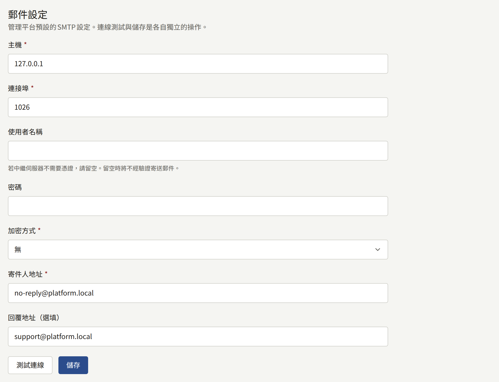
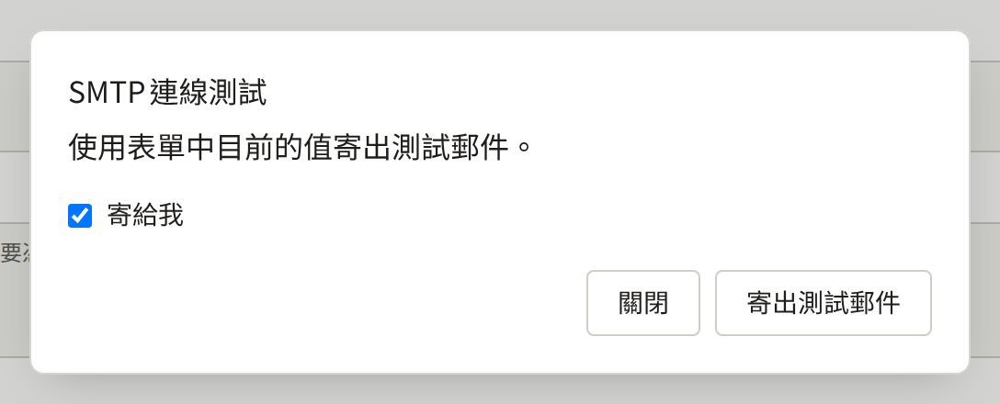
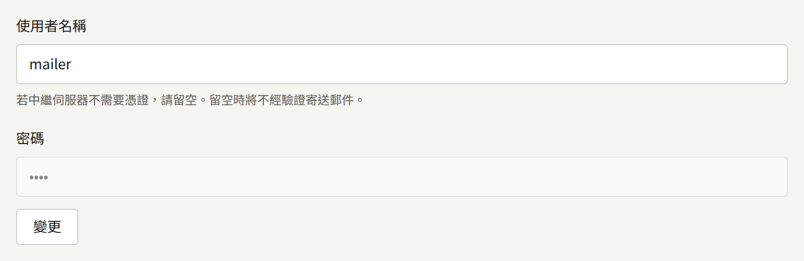

安裝實例會寄送郵件給讀者、各租戶的工作人員，以及平台主控台的營運人員。這些郵件全部由`publira worker`透過您提供的SMTP伺服器寄出：`publiractl setup`已儲存平台的SMTP帳戶，租戶也可以儲存自己的帳戶。本頁說明這兩者、如何測試，以及決定郵件外觀與連結目的地的設定。

本頁的`publiractl`指令都只寫出指令本身；請依照[平台主控台與publiractl](./1-platform-console.md#在兩者之間選擇)所述的方式執行，將`PUBLIRA_PLATFORM_DB_URL`設為`publira_platform`的連線，並使用與各處理程序相同的`PUBLIRA_SECRET_ENCRYPTION_KEYS`和`PUBLIRA_SECRET_ENCRYPTION_PRIMARY_KEY_ID`。所有旗標都列在[`publiractl`參考文件](https://github.com/publira/publira/blob/main/server/cmd/publiractl/README.md#smtp)中。

## 安裝實例寄送的郵件

| 收件人 | 郵件 |
| --- | --- |
| 租戶的讀者 | 確認新帳戶地址的連結；密碼重設，以及密碼已變更的通知；確認新的電子郵件地址，以及寄給舊地址的變更通知；有人以已有帳戶的地址嘗試註冊的通知；工作人員對聯絡訊息的回覆；所追蹤作品或作者的新章節、租戶發布的公告，以及其留言獲得核准的通知 |
| 租戶的工作人員 | 管理該租戶的邀請；密碼重設；確認新的電子郵件地址，以及寄給舊地址的通知；讀者送來的新聯絡訊息 |
| 平台營運人員 | 密碼重設；確認新的電子郵件地址，以及寄給舊地址的通知 |

每封郵件都以租戶的預設語言撰寫，寄給營運人員的則以平台的預設語言撰寫。

最後三種郵件會依讀者的通知偏好送達：每種通知都有各自的電子郵件設定，除非讀者關閉否則為開啟，且只有已確認的地址才會收到。租戶寄給所有人的公告，無論讀者的設定為何，都會寄給每一位地址已確認的讀者，因此讀者眾多的租戶會透過其SMTP帳戶一次寄出同樣多的郵件。

worker會將每封郵件放入佇列，並重試無法寄出的郵件，每次失敗後等待的時間加倍：一秒，接著兩秒，再來四秒。第十次嘗試失敗後，也就是第一次嘗試約九分鐘後，它便會永久放棄這封郵件，之後不會再有任何東西寄出它。因此，SMTP伺服器（或啟用後的`email-renderer`）若停擺超過這段時間，期間排入佇列的郵件會遺失，而不只是延遲。`publira worker`上的`PUBLIRA_OUTBOX_MAX_ATTEMPTS`可設定嘗試次數；由於等待時間持續加倍，最長可達每次嘗試間隔一小時，多加幾次嘗試就能涵蓋長得多的停擺。

每封被放棄的郵件都會由worker以`outbox event dead`記錄在日誌中，並在worker匯出OpenTelemetry指標時計入`publira.outbox.events.dead`指標，因此請對其中任一項設定警示。安裝實例無法再次寄送這樣的郵件：讀者需要重新申請密碼重設或確認郵件，管理員邀請則需要重新寄送，如[租戶的工作人員](./3-tenant-staff.md)所述。

沒有執行worker的安裝實例完全不會寄送郵件。

## 由哪個SMTP帳戶寄送

| 郵件 | 寄送途徑 |
| --- | --- |
| 租戶寄給讀者與工作人員的郵件 | 若租戶已儲存並開啟自己的SMTP帳戶則使用該帳戶，否則使用平台的帳戶 |
| 平台主控台的郵件 | 一律使用平台的SMTP帳戶 |

平台的帳戶是必要的：沒有它，營運人員無法重設密碼，所有沒有自己帳戶的租戶也什麼都寄不出去。租戶自己的帳戶則是選用的，供希望郵件從自家網域、透過自家服務商寄出的出版社使用。

## 平台的SMTP帳戶

| 設定 | `publiractl smtp set` | 平台主控台 |
| --- | --- | --- |
| SMTP伺服器 | `--host`、`--port` | **主機**、**連接埠** |
| 連線的加密方式 | `--encryption`：`tls`、`starttls`或`none` | **加密方式**：**TLS**、**STARTTLS**或**無** |
| 登入所用的使用者 | `--username` | **使用者名稱** |
| 其密碼 | `--password-file`、`--password-stdin`、遮蔽輸入的提示，或在平台只能以環境變數設定密鑰時使用`--password-env` | **密碼** |
| 寄出郵件的地址 | `--from-address` | **寄件人地址** |
| 回覆的收件地址（與寄件人不同時） | `--reply-to` | **回覆地址（選填）** |



請使用郵件服務商提供的SMTP提交（submission）設定值。連接埠587幾乎都是STARTTLS，連接埠465則從一開始就是TLS。只有在自己私有網路上的中繼伺服器才選擇**無**。

若中繼伺服器不需登入即可收信，請將使用者名稱留空；此時worker會不經驗證寄送，也不會保存密碼。密碼以安裝實例的加密金鑰加密保存，因此`publira worker`必須以儲存它時相同的金鑰執行。

寄件人地址必須是服務商允許該帳戶用來寄送的地址，而您的網域應發布服務商要求的SPF和DKIM記錄。否則大量郵件會被歸入垃圾郵件，或遭讀者的郵件伺服器拒收。

### 測試帳戶

測試會透過該帳戶寄出一封簡短的郵件，並回報伺服器是否接受。

- 在平台主控台中，**郵件**下的**測試連線**會開啟**SMTP連線測試**，以表單中尚未儲存的值，透過**寄給我**寄給您自己，或寄到另一個**收件人電子郵件地址**。郵件從`publira server`寄出。
- `publiractl smtp test --to operator@example.com`會從`publiractl`執行的位置以已儲存的設定寄送，並在伺服器拒絕時以`1`結束。



伺服器接受了測試郵件，仍可能將其投遞到垃圾郵件；請檢查收到它的收件匣。此外，測試是由`publira server`或`publiractl`寄出，實際的郵件則由`publira worker`寄出，因此請確認worker也能連線到SMTP伺服器。

### 變更帳戶

在平台主控台中，於側邊欄的**外部服務**下選擇**郵件**，變更值後選擇**儲存**。已儲存的密碼會被保留，除非您選擇其旁邊的**變更**；之後若將該欄位留空並儲存，則會刪除密碼。營運人員或超級管理員可以儲存，稽核員只能檢視畫面。



使用`publiractl`：

```bash
publiractl smtp set \
  --host smtp.example.com --port 587 --encryption starttls \
  --username mailer --password-file /run/secrets/smtp-password \
  --from-address no-reply@example.com
publiractl smtp test --to operator@example.com
publiractl smtp show
```

`smtp set`會以所給的旗標取代所有已儲存的設定，因此每次都要指定全部旗標；省略`--reply-to`會清除已儲存的值。以相同的`--username`且不提供密碼執行時，會保留已儲存的密碼。

worker每寄送一封郵件都會讀取設定，因此儲存後會套用到下一封郵件，無須重新啟動。每次儲存和每次測試都會記錄在**稽核記錄**中。

## 租戶自己的SMTP帳戶

租戶的管理員可在租戶的主控台中，從**整合** › **郵件**設定自己的帳戶。他們以**啟用覆寫設定**開啟**使用該租戶自己的SMTP伺服器**，並輸入與平台相同的值，另外還有**寄件人名稱（選填）**。**測試連線**會以表單中的值寄出測試郵件，**儲存**則會儲存。只有租戶管理員能變更它，[電子郵件](../4-console/3-setup/7-email.md)會引導他們完成設定。

從下一封郵件開始，該租戶的所有郵件都會透過它的帳戶寄出，包括寄給新管理員的邀請。關閉覆寫後，郵件會再次透過平台的帳戶寄出。

營運人員無須為此做任何設定，平台主控台和`publiractl`也都不會變更租戶的帳戶。若某個租戶的郵件不再送達，而平台的測試卻通過，首先要檢查的就是該租戶自己的帳戶。

## 純文字與HTML

沒有`email-renderer`時，所有郵件都是純文字。有了它，每封郵件會在相同的文字旁附帶HTML版本，由讀者的郵件應用程式顯示它偏好的版本。要啟用它，只需執行它，並以`PUBLIRA_EMAIL_RENDERER_URL`讓`publira worker`指向它，如[使用email-renderer寄送HTML郵件](../2-deployments/2-installing.md#使用email-renderer寄送html郵件)所述。

啟用後，renderer就成為寄送郵件的一環：它停擺期間，worker會重試每封郵件，而不是只以純文字寄出，重試次數與SMTP停擺時相同，因此renderer停擺超過這段時間同樣會遺失郵件。若要改回純文字，請移除該變數並重新啟動worker。

## 郵件中的連結導向何處

大多數郵件都帶有連結——用於確認地址、重設密碼或接受邀請。worker建立連結時並不知道請求來自哪個主機，因此主機與協定取自安裝實例的設定，由`publira worker`讀取：

| 郵件 | 連結導向 |
| --- | --- |
| 寄給讀者 | 租戶的網域，例如`https://comics.example.com` |
| 寄給租戶的工作人員 | 租戶的主控台主機，除非租戶另有指定，否則為`admin.<domain>` |
| 寄給平台營運人員 | `PUBLIRA_PLATFORM_APP_URL`中的位址，例如`https://platform.example.com` |

租戶連結的協定為`PUBLIRA_TENANT_URL_SCHEME`，未設定時為`https`；只有在瀏覽器確實以HTTP開啟租戶時才設為`http`。執行平台主控台的安裝實例，都必須在`publira worker`上設定`PUBLIRA_PLATFORM_APP_URL`：若未設定，營運人員收到的連結會導向本機開發機器的位址。

租戶的連結會跟隨其網域，因此租戶遷移到其他主機名稱後，此後寄出的郵件會導向新的主機名稱，而先前寄出的郵件仍導向舊的主機名稱，如[把租戶移到其他主機名稱](./2-tenants.md#把租戶移到其他主機名稱)所述。
