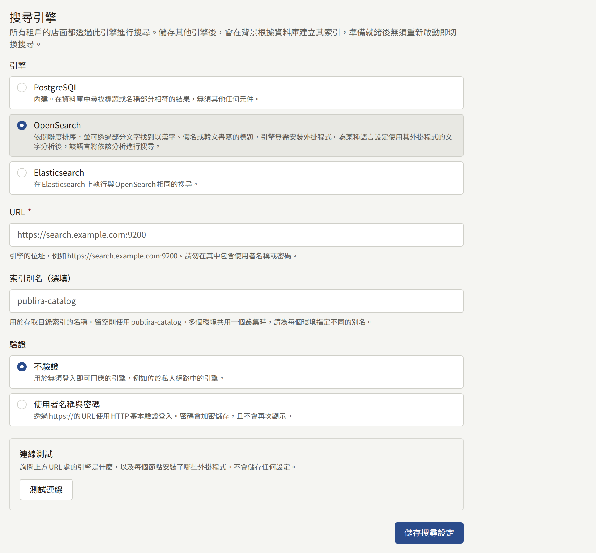
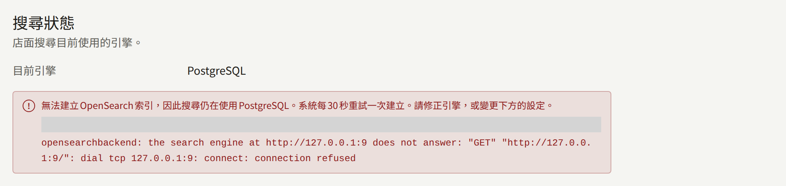
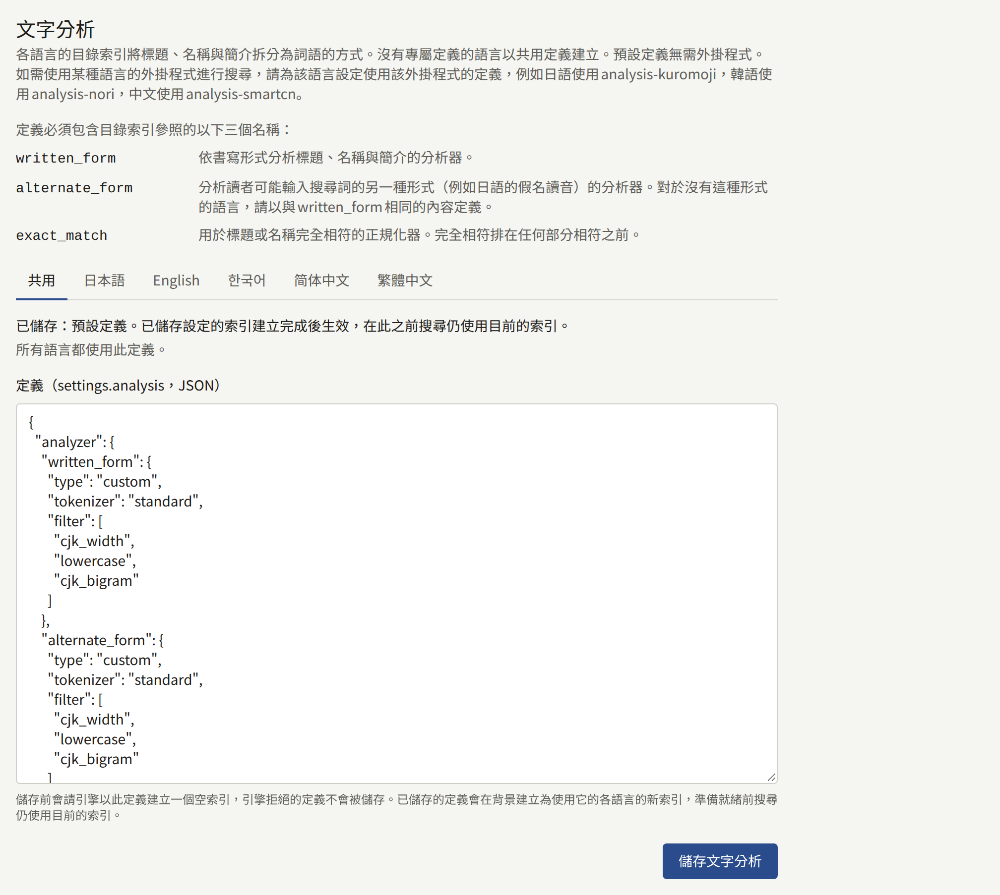

每個租戶網站上的搜尋，都透過所有租戶共用的同一個引擎尋找系列、作者和書系。安裝實例一開始使用資料庫本身，不需要其他任何東西；想要依關聯度排序結果的安裝實例，可以選用OpenSearch或Elasticsearch。本頁比較這些引擎、說明如何將搜尋從一個引擎遷移到另一個，並介紹引擎所保存的索引。

本頁的`publiractl`指令都只寫出指令本身；請依照[平台主控台與publiractl](./1-platform-console.md#在兩者之間選擇)所述的方式執行，將`PUBLIRA_PLATFORM_DB_URL`設為`publira_platform`的連線，並使用與各處理程序相同的`PUBLIRA_SECRET_ENCRYPTION_KEYS`和`PUBLIRA_SECRET_ENCRYPTION_PRIMARY_KEY_ID`。所有旗標都列在[`publiractl`參考文件](https://github.com/publira/publira/blob/main/server/cmd/publiractl/README.md#search)中。

## 選擇引擎

| 引擎 | `--engine` | 搜尋方式 | 需要的東西 |
| --- | --- | --- | --- |
| **PostgreSQL** | `sql` | 尋找包含輸入文字的標題和名稱，依標題或名稱排序 | 不需要任何東西：就是安裝實例已有的資料庫 |
| **OpenSearch** | `opensearch` | 依關聯度排序結果，容許以拉丁字母書寫的詞中打錯一個字母，並可透過部分文字找到以漢字、假名或韓文書寫的標題。設有[專屬文字分析](#為語言設定專屬外掛程式)的語言，會依該分析的方式搜尋，例如以假名輸入讀音來找到以漢字書寫的日文標題 | 一個OpenSearch叢集 |
| **Elasticsearch** | `elasticsearch` | 與OpenSearch相同的搜尋 | 一個Elasticsearch叢集 |

無論由哪個引擎找出結果，網站為每筆結果顯示的內容都是從資料庫讀取，因此系列絕不會因為引擎尚未跟上而顯示過時的標題、價格或封面。在任何引擎上，搜尋都能以相同的方式篩選和排序。

每個引擎都會依讀者語言中顯示的標題和簡介尋找系列：以英文瀏覽的讀者會透過英文標題找到系列，而不會透過只有日文標題才有的詞找到它。沒有英文標題的系列，則透過顯示在其位置的標題，也就是網站預設語言的標題來找到。作者和書系在所有語言中都只有一個名稱，無論讀者使用哪種語言，都透過該名稱找到。

若讀者瀏覽目錄多於搜尋，或會準確輸入標題，PostgreSQL就已足夠。當讀者以讀音尋找標題或拼錯字而一無所獲時，就該換成其他引擎。

## 準備OpenSearch或Elasticsearch

Publira不會替您執行引擎。請使用您自行營運的叢集或代管叢集，並準備以下各項：

- **外掛程式（如果需要）**。預設的文字分析只使用OpenSearch和Elasticsearch內建的功能，因此官方映像檔的引擎直接就能使用。只有在您為某種語言[設定基於外掛程式的專屬文字分析](#為語言設定專屬外掛程式)時，才需要外掛程式。
- **引擎回應的URL**，`http://`或`https://`，`publira server`、`publira worker`和`publiractl`都必須能連線到它。
- **使用者**（引擎需要時）。Publira以HTTP基本驗證登入，且只會將其傳送到`https://`的URL；它不支援API金鑰，也不支援您自己的憑證授權單位，因此啟用安全功能的引擎需要使用伺服器已信任的憑證。該使用者需要能建立、寫入和刪除索引，以及移動別名，這些名稱都以下方的索引別名開頭。
- **索引別名**，即Publira索引所依據的名稱：除非您另行指定，否則為`publira-catalog`。Publira會為讀者可選擇的每種語言各保存一個索引，每個索引都位於在別名後附加語言的名稱之下——`publira-catalog-en`、`publira-catalog-ja`、`publira-catalog-zh-hans`等——並自行建立這些索引及其別名。共用叢集的每個安裝實例都要指定各自的別名，因為兩個安裝實例使用同一個別名會互相覆寫對方的目錄。

## 測試引擎

測試會詢問引擎是什麼，以及每個節點安裝了哪些外掛程式，並回報產品、版本和外掛程式。當引擎沒有回應、拒絕認證資訊，或結果是與所選產品不同的另一個產品時，測試會失敗。外掛程式不影響結果：預設的文字分析不需要任何外掛程式，而您自己的定義會在儲存時與引擎進行核對。列出外掛程式需要一項叢集權限，而使用者除此之外並不需要它，因此沒有該權限的使用者會通過測試，只是不會列出外掛程式。

- 在平台主控台中，**搜尋**下的**測試連線**會在儲存前測試表單中的值。測試從`publira server`執行。
- `publiractl search test`會從`publiractl`執行的位置測試已儲存的引擎，並在測試失敗時以`1`結束。使用PostgreSQL時沒有可測試的東西，它會以`1`結束。

## 遷移到其他引擎

儲存引擎並不會立即將搜尋移到該引擎上。新引擎上的索引是空的，因此`publira worker`會先從資料庫建立索引，等索引包含所有租戶的目錄後，搜尋才會切換過去。在此之前，網站會繼續從原來的地方回應，因此讀者絕不會搜尋到空的索引。

### 從平台主控台

1. 在側邊欄的**外部服務**下選擇**搜尋**。
2. 在**引擎**下選擇**OpenSearch**或**Elasticsearch**，輸入其**URL**，以及（若有指定）其**索引別名（選填）**。
3. 在**驗證**下選擇**不驗證**，或選擇**使用者名稱與密碼**並輸入兩者。
4. 選擇**測試連線**，通過後以**儲存搜尋設定**儲存。



畫面頂端的**搜尋狀態**會顯示網站目前回應所用的引擎，在建立索引期間，也會顯示即將切換到的引擎。畫面每隔幾秒會重新檢查，因此切換發生時就會顯示出來。營運人員或超級管理員可以儲存；稽核員只能檢視畫面。

### 從publiractl

```bash
publiractl search set \
  --engine opensearch \
  --url https://search.example.com:9200 \
  --username publira --password-file /run/secrets/search-password
publiractl search test
publiractl search show
```

`search set`會以所給的旗標取代所有已儲存的設定，因此每次都要指定全部旗標；省略`--username`會刪除已儲存的密碼。以相同的`--username`且不提供密碼執行時，會保留已儲存的密碼。`search show`會輸出搜尋目前回應所用的引擎，以及進行中或已失敗的建立作業。

### 需要多久

worker每30秒尋找一次需要建立的索引，而填入索引所需的時間，取決於引擎接收所有租戶的每個已發布系列、作者和書系所需的時間。在此期間所做的變更也會寫入新索引，因此等待不會造成任何遺失。

### 建立失敗時

建立失敗——引擎消失了、已儲存的定義所需的外掛程式從某個節點上消失了、使用者無權建立索引——時，搜尋會維持原狀，錯誤會顯示在**搜尋狀態**和`publiractl search show`中。worker每30秒會重試一次，因此只要修正引擎，建立就會完成，無須再次儲存設定。若要改為放棄遷移，請儲存搜尋目前仍在使用的引擎。



### 改回PostgreSQL

儲存**PostgreSQL**，或執行`publiractl search set --engine sql`，會立即將搜尋移回：資料庫不需要索引。引擎上的索引會保持原樣；若不再使用，請自行刪除。

### 變更何時套用到所有處理程序

`publira server`和`publira worker`每30秒重新讀取一次設定，因此切換會在一分鐘內套用到所有執行個體，無須重新啟動。每次儲存和每次測試都會記錄在**稽核記錄**中。

## 文字分析

引擎如何將標題、名稱和簡介拆分為詞語，就是文字分析。由於所有租戶共用索引，所有租戶只有一個定義，而且除非某種語言有專屬定義，否則每種語言的索引都以它建立。預設定義不需要外掛程式，並在一定程度上適用於所有語言：它會透過詞語找到以拉丁字母書寫的標題，並容許打錯一個字母；對於以漢字、假名或韓文書寫的標題，則可透過其中任意連續兩個以上的字元找到，且忽略大小寫以及字母和假名的全形半形。除此之外，它對語言一無所知，因此舉例來說，它無法透過讀音找到以漢字書寫的標題。需要更多功能的語言，可以[設定基於其外掛程式的專屬定義](#為語言設定專屬外掛程式)。

定義是索引的`settings.analysis`物件，為最多64 KiB的JSON，且必須定義索引所參照的三個名稱：分析器`written_form`和`alternate_form`，以及正規化器`exact_match`。各自的用途請參閱[文字分析參考文件](https://github.com/publira/publira/blob/main/server/README.md#text-analysis)。

- 在平台主控台中，**搜尋**下**文字分析**的**共用**分頁會在**定義（settings.analysis，JSON）**中接收定義，並以**儲存文字分析**儲存。**恢復預設**會改回預設定義。使用PostgreSQL時沒有索引，因此也沒有可儲存的文字分析。
- 使用`publiractl`時，`search set --analysis-file korean-analysis.json`會與引擎一併儲存定義，`--default-analysis`則會改回預設定義。兩者都未指定時，`search set`會保留已儲存的定義。

為某種語言設定專屬定義，即可使用該語言的外掛程式進行搜尋：其索引會以該定義建立，其他所有語言的索引則以共用定義建立。

- 在平台主控台中，**文字分析**有一個共用定義的分頁**共用**，其中會說明哪些語言使用它，另外每種語言也各有一個分頁。沒有專屬定義的語言，會在其分頁中顯示共用定義作為起點。在該分頁中選擇**儲存文字分析**，會將編輯器的內容儲存為該語言的專屬定義，**使用共用定義**則會捨棄它，讓該語言再次以共用定義建立。
- 使用`publiractl`時，`search set`接受語言的專屬定義：

```bash
publiractl search set --engine opensearch --url https://search.example.com --locale-analysis-file ja=japanese-analysis.json
```

`--locale-analysis-file`以`LOCALE=FILE`的形式接收語言和檔案，`--shared-analysis-for ja`則讓該語言再次以共用定義建立。每種語言都可以重複指定其中之一；兩者都沒有指定的語言會保留現狀，在不帶這些旗標執行`search set`時，所有語言也都會保留現狀。語言有`ja`、`en`、`ko`、`zh-Hans`和`zh-Hant`。`publiractl search show`會在**Own analysis**下列出擁有專屬定義的語言。



在儲存定義之前，會請引擎以該定義建立一個空索引，被引擎拒絕的定義不會儲存，並會顯示引擎的理由，若是語言的專屬定義，還會顯示它所屬的語言。已儲存的定義會為其所變更的語言建立新索引，方式與新引擎相同，建立完成後搜尋便會切換過去；其他語言的索引則保持原樣。

### 為語言設定專屬外掛程式

在您為某種語言設定專屬定義之前，每種語言都以共用定義搜尋，而設定與否是選用的。OpenSearch和Elasticsearch都為許多語言發布了分析外掛程式——日語有`analysis-kuromoji`和`analysis-icu`，可將以漢字書寫的標題與以假名輸入的讀音配對；韓語有`analysis-nori`；中文有`analysis-smartcn`等——基於這些外掛程式的定義，會以該外掛程式的分析方式搜尋該語言：

1. 在每個節點停止時，以`bin/opensearch-plugin install`或`bin/elasticsearch-plugin install`加上外掛程式名稱來安裝外掛程式。儲存庫中的[開發用OpenSearch映像檔](https://github.com/publira/publira/blob/main/infra/docker/opensearch/Dockerfile)以Dockerfile的形式展示了這個步驟。之後**測試連線**就會將它列在每個節點都有的外掛程式中。
2. 依照引擎針對該外掛程式的文件，撰寫一個使用該外掛程式的分詞器和過濾器、並定義上述三個名稱的定義。
3. 在**文字分析**中該語言的分頁儲存它，或使用`publiractl search set --locale-analysis-file`。

該語言的索引會以它重新建立，準備就緒後，該語言的搜尋便會切換到新索引。沒有該語言標題的系列，會以顯示在其位置的標題收錄在該語言的索引中，因此該語言的分析也會套用到那個標題。

## 重新建立索引

worker會隨著租戶發布、編輯以及變更預設語言而持續更新索引，並在引擎或文字分析變更時，或版本變更了讀者可選擇的語言或預設文字分析時建立新索引，因此很少需要手動重新建立索引。在建立期間，**搜尋狀態**和`publiractl search show`會顯示建立進行中，網站則繼續從現有的索引回應。`publiractl search reindex`適用於剩下的兩種情況：

- **版本變更了索引**。當[版本說明](../2-deployments/8-upgrading.md#閱讀版本說明)指出目錄索引已變更時，請在升級完成後執行一次。
- **索引遺失**，原因是叢集被替換或索引被刪除。

```bash
publiractl search reindex
```

它會在目前的索引旁為每種語言建立新索引，填入所有租戶的目錄，一次將所有別名移到各自的新索引上，然後刪除舊索引，因此執行期間網站仍能繼續搜尋。它以`publira_content_stats`角色讀取目錄，因此請為它提供該角色的`PUBLIRA_CONTENT_STATS_DB_URL`，若引擎有已儲存的密碼，還要提供加密金鑰。worker正在建立索引時無法執行它，若有建立作業進行中，它會以`1`結束；請在建立完成後再執行一次。使用PostgreSQL時沒有需要重新建立的索引，它會以`1`結束。

`publiractl search reindex --tenant comics.example.com`會將單一租戶的目錄重新寫入搜尋目前使用的索引，而不建立新索引。它適用於某個租戶的結果看起來有誤的情況，無法將變更套用到索引本身。
