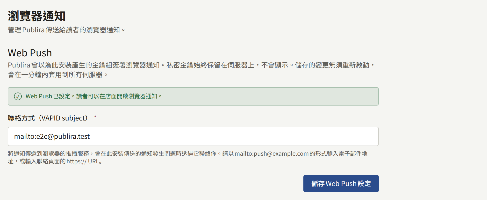

讀者可以允許租戶的網站傳送通知到自己的瀏覽器，這樣不必開啟網站，也能得知新章節或租戶發布的公告。安裝實例會透過每位讀者瀏覽器的推播服務傳送通知，並以屬於安裝實例的VAPID金鑰組簽署每則通知。Web Push是選用功能，在您開啟之前都是關閉的；從未開啟它的安裝實例不會傳送瀏覽器通知，也不會因此發生任何失敗。

本頁的`publiractl`指令都只寫出指令本身；請依照[平台主控台與publiractl](./1-platform-console.md#在兩者之間選擇)所述的方式執行，將`PUBLIRA_PLATFORM_DB_URL`設為`publira_platform`的連線，並使用與各處理程序相同的`PUBLIRA_SECRET_ENCRYPTION_KEYS`和`PUBLIRA_SECRET_ENCRYPTION_PRIMARY_KEY_ID`。所有旗標都列在[`publiractl`參考文件](https://github.com/publira/publira/blob/main/server/cmd/publiractl/README.md#webpush)中。

## 開啟需要什麼

需要兩樣東西，兩者都保存在安裝實例的設定中，而不是任何處理程序的環境中：

- **VAPID金鑰組**，瀏覽器的推播服務會以它核對每則通知。金鑰組由Publira產生；您不需要經手任何一把金鑰。私密金鑰以安裝實例的加密金鑰加密保存，絕不會顯示，公開金鑰則會在讀者的瀏覽器訂閱時交給該瀏覽器。
- **subject**，是推播服務在安裝實例傳送的內容出問題時可以聯絡您的聯絡方式：以`mailto:push@example.com`形式表示的電子郵件地址，或聯絡頁面的`https://` URL。

在儲存subject之前，Web Push都維持關閉。在此之前，網站不會提供瀏覽器通知，worker也不會傳送任何通知。

## 開啟Web Push

### 從publiractl

```bash
publiractl webpush init --subject mailto:push@example.com
publiractl webpush show
```

`webpush init`會在尚未保存金鑰組時產生金鑰組，並儲存subject。`webpush show`會輸出subject和公開金鑰。

`publiractl setup`也提供了這個步驟，因此在其中回答過的安裝實例已經開啟了Web Push。

### 從平台主控台

在側邊欄的**外部服務**下選擇**Web Push**。開啟畫面時，若尚未保存金鑰組，便會產生金鑰組。輸入**聯絡方式（VAPID subject）**並選擇**儲存Web Push設定**；畫面接著會顯示Web Push已設定。營運人員或超級管理員可以儲存；稽核員只能檢視畫面。



若畫面顯示因API伺服器沒有加密金鑰而無法設定Web Push，表示`publira server`啟動時沒有設定`PUBLIRA_SECRET_ENCRYPTION_KEYS`。請設定與其他處理程序相同的金鑰，重新啟動它，然後再次開啟畫面。

### 確認運作

API和worker每十秒重新讀取一次設定，因此儲存的subject無須重新啟動就會套用到它們。第一次儲存時，worker還會在大約二十秒後，也就是API開始以該subject回應之後，捨棄每個租戶網站資訊的快取副本，讓每個網站從下一個請求起提供瀏覽器通知。這次捨棄是outbox中的一次快取重新驗證，與其他重新驗證一樣傳送：沒有`PUBLIRA_REVALIDATE_TOKEN`的worker無法傳送它，如[outbox](./10-scheduled-jobs.md#outbox郵件推播與快取重新驗證)所述。

若要確認運作，請以讀者身分登入租戶的網站，在讀者通知設定的**瀏覽器通知**下開啟**在此瀏覽器中接收推播通知**，讓通知偏好中**追蹤的系列與單話的新話**這一列的**瀏覽器**保持開啟，然後追蹤一個系列：該系列下一個發布並在網站上顯示的章節，就會以瀏覽器通知送達。公告則要等讀者也開啟**公告**這一列的**瀏覽器**後才會送達，這一項一開始是關閉的。

每次儲存都會記錄在**稽核記錄**中。

## 日後變更

subject隨時都可以變更，方法是以新的`--subject`執行`webpush init`，或在同一個畫面中變更。它無法刪除：一旦儲存了subject，Web Push就會維持開啟。

金鑰組絕不會被替換。每個瀏覽器訂閱都是以其公開金鑰建立的，因此新的金鑰組會在不知不覺中讓所有開啟通知的讀者再也收不到通知；`publiractl`和平台主控台都不會產生第二組金鑰組。因此，金鑰組是安裝實例的備份必須保留的內容之一：它存在資料庫中，以加密金鑰加密，只要兩者之一遺失，它就會遺失。輪替加密金鑰時會保留金鑰組：`publiractl db reseal`會與其他所有內容一起，以新的金鑰重新密封私密金鑰，如[輪替密鑰加密金鑰](./12-security/1-rotating-secrets.md#輪替密鑰加密金鑰)所述。

瀏覽器已放棄的訂閱——因為讀者撤銷了權限或清除了網站資料——會在下一次對它傳送的通知遭拒時被移除。

## 行動應用程式上的通知

Web Push只涵蓋瀏覽器。租戶的行動應用程式收到的通知，是透過租戶自己的Firebase專案傳送，由其管理員從租戶的主控台設定；這些都不是安裝實例的設定。[推播通知](../5-mobile-app/3-push-notifications.md)說明了這項設定。
