安裝實例依靠少數幾項不屬於任何租戶的設定運作：新租戶起始時的語言、時區和貨幣，防止單一讀者或單一地址壓垮平台的限制，以及會過期的記錄要保留多久。本頁說明每一組設定防範什麼、如何變更，以及租戶的管理員可以為自己的租戶變更哪些部分。

每一項政策和保留期限的值都有內建預設值，沒有儲存任何值的安裝實例就依這些值運作。預設時區和預設貨幣也一樣：預設時區在儲存之前為`UTC`；預設貨幣是`publiractl setup`所指定的貨幣，未指定時為`USD`，而在此版本之前就已運作的安裝實例則為`JPY`。預設語言沒有內建預設值：`publiractl setup`已儲存一個，而平台主控台的設定畫面又以第一位營運人員選擇的語言取代了它。每個值的範圍和內建預設值，請參閱`publiractl`參考文件中的[`policy`](https://github.com/publira/publira/blob/main/server/cmd/publiractl/README.md#policy)和[保留期限](https://github.com/publira/publira/blob/main/server/cmd/publiractl/README.md#retention-periods)；本頁不再重複。

## 設定的位置

每一組設定都可以從平台主控台設定，或從依照[平台主控台與publiractl](./1-platform-console.md#在兩者之間選擇)所述方式執行的`publiractl`設定：

| 設定組 | 平台主控台 | `publiractl` |
| --- | --- | --- |
| 預設語言、時區和貨幣 | **平台**下的**一般** | `platform set`、`platform show` |
| 兩步驟驗證、是否允許租戶發行代幣、登入、密碼、購買、閱讀券、郵件和匿名瀏覽的限制，以及一次性郵件網域清單 | **政策**下的**安全性** | `policy set`、`policy show` |
| 留言、檢舉、評分、聯絡、閱讀器和通知設定的限制 | **政策**下的**社群** | `policy set`、`policy show` |
| 會過期的記錄保留多久 | **政策**下的**保留期限** | `retention set`、`retention show` |

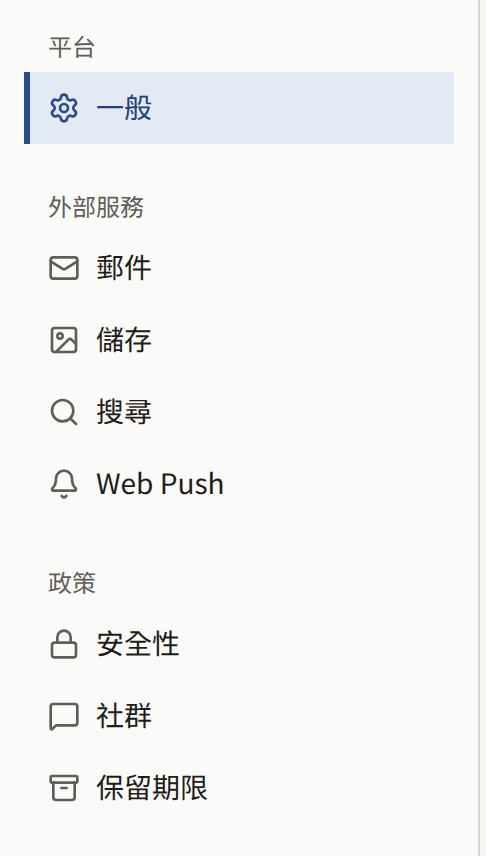

兩者都透過相同的程式碼寫入。`set`指令只會變更其旗標指定的值，其餘保持不變，而平台主控台的頁面則會一次儲存頁面上的所有值。沒有改變任何內容的儲存不會被記錄；其他儲存則會以**更新了平台設定**、**更新了平台政策**或**更新了保留期限預設值**記錄在**稽核記錄**中。**安全性**、**社群**和**保留期限**頁面不會覆寫它們沒看過的儲存：若有人在您開啟頁面後儲存了該頁面，平台主控台會以「其他營運人員已變更這些設定，因此未儲存。請重新載入頁面後再試一次。」拒絕。**安全性**和**社群**是以同一個政策儲存的，因此儲存其中任一個時，也會拒絕另一個的過時副本。**一般設定**上的三個表單不做這項檢查：每個表單都會以自己的值覆寫已保存的值，其他值則維持已保存的狀態。`publiractl`會在寫入前一刻讀取已保存的值，若在兩者之間有其他儲存發生，它會以`1`結束，之後再次執行相同的指令，就會將其旗標套用到那次儲存之上。

營運人員或超級管理員可以儲存這些頁面。稽核員會看到相同的表單，但儲存會被拒絕。

在儲存政策之前，平台主控台儀表板上的**設定狀態**卡片會顯示「登入、防濫用與資料保留限制採用內建預設值。」這是一個正常運作的安裝實例，而不是尚未完成的安裝實例：只有在內建值不適合平台時才變更。

## 平台預設值

**一般設定**有三個值，每個值都有自己的儲存按鈕。

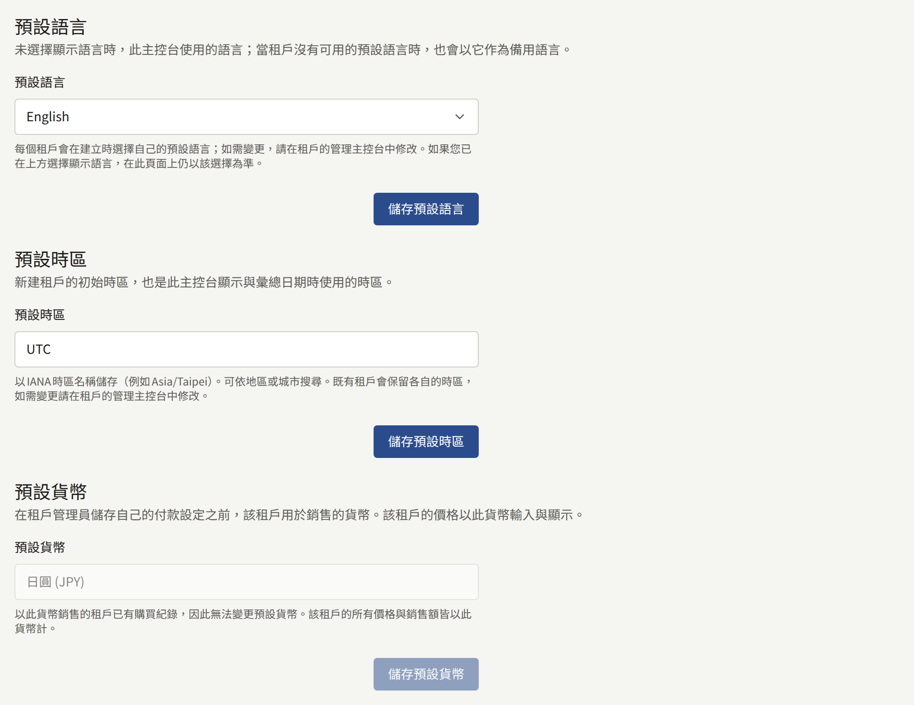

**預設語言**是為尚未選擇語言的營運人員顯示平台主控台（包括其登入畫面）時所用的語言，也是平台主控台寄給營運人員的郵件（例如密碼重設）所用的語言。它不會決定任何租戶的語言：每個租戶在建立時都會被指定自己的預設語言，如[租戶](./2-tenants.md#建立租戶之前)所述。第一位營運人員在設定畫面上選擇了這個值。

**預設時區**是建立時未指定時區的新租戶起始的時區，也是平台主控台顯示和計算日期所用的時區。租戶會保留建立時的時區，因此變更預設值只會影響之後建立的租戶。租戶的管理員可從租戶的主控台變更其時區。第一位營運人員在設定畫面上選擇了這個值，該畫面當時提供的是其瀏覽器的時區。

**預設貨幣**是管理員尚未儲存**付款設定**的所有租戶用於銷售的貨幣，因此也是這些租戶輸入與顯示價格所用的貨幣。儲存了付款設定的租戶會保留在那裡儲存的貨幣，預設值便不再影響它。可以在清單中依名稱或ISO 4217代碼（例如`EUR`）找到貨幣。一旦以該貨幣銷售的租戶賣出任何東西，就無法再變更它：此時欄位會變成唯讀並說明原因，`publiractl`也會拒絕變更，直到每個這樣的租戶都以自己的貨幣儲存了付款設定。`publiractl setup`和平台主控台的設定畫面會在設定安裝實例時詢問它，那正是選擇它的時機。

從指令列：

```bash
publiractl platform set --default-locale en --default-timezone America/New_York --default-currency USD
```

## 安全性

**安全性政策**包含對所有租戶一律適用、且任何租戶都無法變更的值。每一個值都在保護帳戶、會寄送郵件的操作，或涉及金錢的操作。

### 租戶管理員的兩步驟驗證

**要求租戶管理員使用多重要素驗證**（`--mfa-required-for-tenant-admin`）會讓租戶管理員無法只憑密碼登入租戶的主控台。尚未設定驗證器應用程式的管理員不會被拒於門外：輸入密碼後，主控台會顯示**設定兩步驟驗證**，等他們註冊了驗證器後才會完成登入。畫面會告訴他們這是租戶的要求，但實際上這是平台的要求，租戶無法關閉。

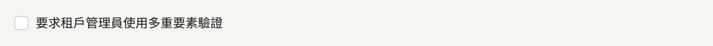

它一次適用於所有租戶，且只適用於**租戶管理員**角色；編輯和稽核員絕不會被要求。它會在每位管理員下次登入時生效，而不影響已開啟的工作階段。管理員仍可從帳戶設定關閉自己的驗證器，並會在下次登入時再次被要求設定。

平台主控台本身的營運人員不在這項設定的涵蓋範圍內；下一項才是他們的設定。

### 平台營運人員的兩步驟驗證

**要求平台主控台的所有營運人員使用兩步驟驗證**（`--mfa-required-for-platform-operator`）會讓營運人員無法只憑密碼登入平台主控台。尚未設定驗證器應用程式的營運人員不會被拒於門外：輸入密碼後，主控台會顯示**設定兩步驟驗證**，等他們註冊了驗證器並看過自己的復原碼後才會完成登入。

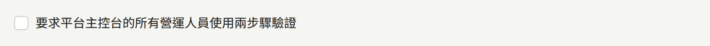

由於每位營運人員都能讀取所有租戶的資料，它涵蓋所有角色，包括**稽核員**。它會在每位營運人員下次登入時生效，而不影響已開啟的工作階段。營運人員仍可從**帳戶設定**關閉自己的驗證器，並會在下次登入時再次被要求設定。在有人開啟之前，它都是關閉的。`publira server`沒有`PUBLIRA_SECRET_ENCRYPTION_KEYS`的安裝實例會拒絕開啟它，因為在那裡沒有營運人員能設定驗證器，也沒有人能登入將它再次關閉。

### 租戶發行的代幣

**允許租戶發行代幣**（`--tenant-coins-allowed`）讓租戶可以發行代幣：一種由租戶的讀者預先購買、用於該租戶章節的餘額。在有人開啟之前，它都是關閉的，無論是新的安裝實例，還是從沒有這項功能的版本升級而來的安裝實例。

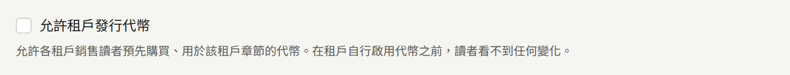

代幣是一種儲值工具，因此視您和各租戶所在的地點，可能受到預付支付工具、電子貨幣、匯款或禮品卡相關法律的規範。在某些司法管轄區，這些法律關注的對象是營運安裝實例的平台，而不是販售代幣的租戶。除非您已確認讓租戶發行代幣不會使您成為發行者，或已完成身為發行者所需的事項，否則請保持關閉。

開啟它並不會改變讀者看到的任何東西：租戶仍需在其主控台的**付款** › **代幣**下自行開啟代幣，如[代幣](../4-console/9-coins.md)所述。關閉它（取消勾選核取方塊，或使用`--tenant-coins-allowed=false`）會一次停止所有租戶，無論其自身設定為何：沒有租戶能販售代幣，也沒有讀者能使用代幣，而每位讀者都會保留自己的餘額。再次開啟時，每個租戶都會恢復原本儲存的設定。

### 速率限制

每一項限制都是每分鐘或每小時的次數，再加上第二個每天的次數，而每天的次數絕不會低於較短期間的次數。超過限制的請求會被拒絕，直到其時間窗口過去為止。時間窗口固定在時鐘上，而不是從讀者的第一個請求開始計算，因此次數會在每分鐘或每小時的整點重新計算，每天的次數則在UTC午夜重新計算。

| 在「安全性」頁面上 | 保護的對象 |
| --- | --- |
| **每分鐘密碼驗證數**和**每天密碼驗證數** | 讀者為了變更密碼、變更電子郵件地址或刪除帳戶而輸入目前的密碼。每一項都以帳戶計算，輸入正確密碼會清除次數，因此它會拖慢企圖猜出所持工作階段密碼的人，而不會影響只是打錯一次的讀者 |
| **每個地址每小時郵件請求數**和**每個地址每天郵件請求數** | 由會寄送郵件的表單寄往單一地址的郵件：讀者註冊和電子郵件驗證、三個應用程式中的密碼重設和電子郵件變更、工作人員邀請、來自平台主控台的管理員邀請和新增的營運人員，以及對聯絡訊息的回覆。地址在其所屬租戶內或平台主控台內計算，帶有`+tag`的地址會與不帶它的地址合併計算 |
| **每個來源每小時郵件請求數**和**每個來源每天郵件請求數** | 同樣的郵件，依提出請求的用戶端位址跨所有地址、所有租戶計算，讓單一用戶端無法寄信給一長串陌生人 |
| **每位讀者每分鐘應用程式內購買確認數**和**每位讀者每天應用程式內購買確認數** | 單一讀者交給伺服器向Apple或Google驗證的商店交易 |
| **每位讀者每分鐘等免費券使用數**和**每位讀者每天等免費券使用數** | 單一讀者使用等免費券的請求。已使用的閱讀券本身已受其系列的恢復時間限制；這項限制約束的是被拒絕的嘗試 |

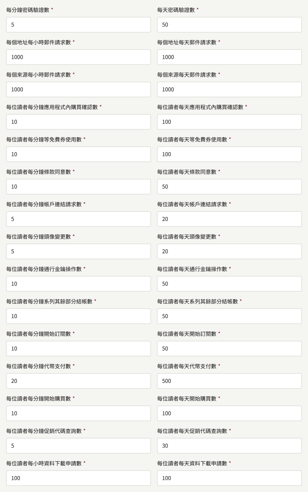

另外還有九項同類的限制，在「安全性」頁面上尚無欄位：單一讀者在被要求同意修訂版本時，對其租戶的服務條款和隱私權政策送出的同意，除非以`publiractl policy set --legal-page-agreement-per-minute`和`--legal-page-agreement-per-day`設定，否則為每分鐘10次、每天50次；單一讀者將Apple或Google帳戶連結到自己帳戶的請求，除非以`--identity-link-per-minute`和`--identity-link-per-day`設定，否則為每分鐘5次、每天20次；單一讀者上傳、選擇或移除圖示的次數，除非以`--icon-change-per-minute`和`--icon-change-per-day`設定，否則為每分鐘5次、每天20次；單一讀者開始註冊通行金鑰或以通行金鑰確認請求，或重新命名或移除通行金鑰的次數，除非以`--passkey-per-minute`和`--passkey-per-day`設定，否則為每分鐘10次、每天50次；單一讀者開始購買系列其餘部分的結帳，除非以`--series-remainder-checkout-per-minute`和`--series-remainder-checkout-per-day`設定，否則為每分鐘10次、每天50次；單一讀者開始的訂閱，無論是透過網站上的結帳還是租戶應用程式中的商店，都合併計算，除非以`--subscription-checkout-per-minute`和`--subscription-checkout-per-day`設定，否則為每分鐘10次、每天50次；單一讀者以代幣購買的章節，除非以`--coin-payment-per-minute`和`--coin-payment-per-day`設定，否則為每分鐘20次、每天500次；單一讀者開始購買章節、卷或代幣包的次數，無論是在網頁上還是透過應用程式的商店，都合併計算，除非以`--purchase-checkout-per-minute`和`--purchase-checkout-per-day`設定，否則為每分鐘10次、每天100次；以及單一讀者索取自己資料副本的次數（如[讀者帳戶](../4-console/2-readers/1-accounts.md#讀者下載的個人資料)所述），除非以`--data-export-per-hour`和`--data-export-per-day`設定，否則為每小時1次、每天1次，因為每次都會讀取安裝實例保存的該讀者的所有記錄。儲存「安全性」頁面時，這些限制會保留其目前的設定值。

每一份邀請都算作一次請求，包括**建立租戶**上的每一個**初始管理員的電子郵件地址**，這些地址會在建立租戶之前全部計算：只要有一個超過限制，就不會建立租戶，也不會寄出任何郵件。`publiractl`不經由任何表單寄送，不計入這些限制中的任何一項。

用戶端位址是`publira server`跳過它所信任的代理伺服器後，在`Forwarded`或`X-Forwarded-For`中找到的位址，如[Publira信任的代理伺服器](../2-deployments/4-edge/index.md#publira信任的代理伺服器)所述。位於同一個共用位址後方的讀者，例如辦公室或行動電信業者的閘道，會共用該位址的每個來源和每個用戶端次數。

### 登入嘗試

另有兩項限制保護以密碼登入租戶的網站、租戶的主控台或平台主控台本身。它們位於**安全性**頁面的速率限制之後，計算方式相同：

| 在「安全性」頁面上 | 旗標 | 保護的對象 |
| --- | --- | --- |
| **每個地址每分鐘登入嘗試數**和**每個地址每天登入嘗試數** | `--login-attempts-per-account-per-minute`和`--login-attempts-per-account-per-day` | 對單一地址嘗試的密碼。地址在其所屬租戶內計算（租戶的網站與其主控台共用同一個次數），或在平台主控台內計算。以正確密碼登入會清除次數，因此它會拖慢企圖猜出某個帳戶密碼的人，而不會影響打錯的人 |
| **每個來源每小時登入失敗數**和**每個來源每天登入失敗數** | `--login-attempts-per-source-per-hour`和`--login-attempts-per-source-per-day` | 來自單一用戶端位址、跨所有地址、所有租戶和平台主控台的登入失敗，讓單一用戶端無法對一長串地址嘗試同一個密碼。以正確密碼登入不計入 |

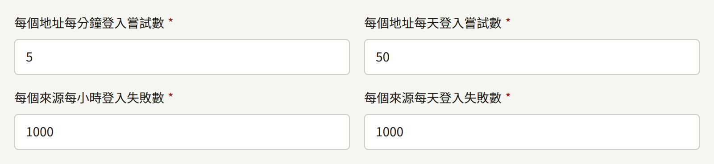

超過任一限制的嘗試會在檢查密碼之前被拒絕，且無論該地址是否有帳戶，拒絕的方式都相同，因此拒絕本身不會向猜測者透露哪些地址已註冊。此時登入畫面會顯示「短時間內的請求過多。請稍後再試。」，而不是電子郵件地址或密碼不正確，因為密碼很可能是正確的。兩步驟驗證是密碼之後的另一項檢查，這些限制不計算其驗證碼。

每個帳戶的限制也讓任何知道某個地址的人，可以透過以錯誤密碼耗盡其次數，使地址的擁有者在時間窗口過去前無法以密碼登入。使用Apple或Google登入以及密碼重設不受其影響。請將每天的值設得夠高，讓別人的腳本不至於害得某人一整天都無法以密碼登入。

### 匿名瀏覽

另有三項限制約束單一用戶端位址在未登入的情況下瀏覽租戶網站的速度：行動應用程式呼叫的公開API、其作品搜尋的呼叫，以及租戶網域和圖片主機的圖片。每一項都是10秒時間窗口內的次數，沒有每天的次數，且是在安裝實例前方的邊緣對相同請求所設的限制之後作為後盾，以防邊緣沒有設定任何限制。Web應用程式以自身名義、同時代表其所有讀者發出的呼叫不計入。

它們位於**安全性**頁面上登入嘗試限制之後的**匿名瀏覽**下：

| 在「安全性」頁面上 | 旗標 |
| --- | --- |
| **每個用戶端每10秒公開API呼叫數** | `--anonymous-read-public-api-per-10-seconds` |
| **每個用戶端每10秒作品搜尋數** | `--anonymous-read-search-per-10-seconds` |
| **每個用戶端每10秒圖片請求數** | `--anonymous-read-images-per-10-seconds` |

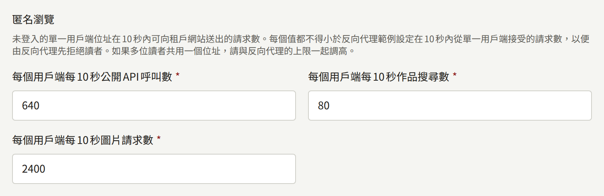

每一項若低於範例邊緣設定在10秒內從單一用戶端接受的次數，就會被拒絕，好讓邊緣始終是第一個拒絕讀者的一方：頁面會在訊息中指出最小值，且不會儲存任何內容。當讀者共用一個位址時，例如行動電信業者的閘道，請將它們與邊緣的允許量一起調高，因為邊緣的允許量若調高到超過伺服器的值，邊緣放行的請求就會被伺服器拒絕。[publira server自身的限制](./12-security/5-rate-limits.md#publira-server自身的限制)列出了內建值、各自的最小值，以及邊緣所接受的量。

### 次數保存的位置

這些限制由`publira server`在其`PUBLIRA_REDIS_URL`指定的Valkey或Redis伺服器中計算，[安裝](../2-deployments/2-installing.md#佈建服務)會請您準備這台伺服器。`publira server`的所有執行個體共用這些次數，因此無論您執行多少個執行個體，限制都會在整個安裝實例中生效。

若未設定該變數，每個執行個體都會在自己的記憶體中計算，日誌中也不會有任何說明。這樣一來，請求分散到三個執行個體的讀者會得到三倍的限制，而重新啟動會讓所有次數歸零。執行個體無法連線到Redis時也會發生同樣的情況：啟動時無法連線的伺服器會記錄錯誤並自行計算，之後才斷線的伺服器則會記錄警告，在連線恢復前自行計算，並在恢復時再次記錄。若您執行多個`publira server`執行個體，請在每一個上都設定`PUBLIRA_REDIS_URL`。

儲存的變更會在十秒內套用到所有執行中的執行個體，無須重新啟動。

### 一次性郵件網域清單

**一次性郵件網域清單URL**（`--disposable-email-domains-url`）是`publira server`讀取專供拋棄式郵件使用之網域清單的位置。Publira並未隨附任何清單，因此在您提供URL之前不會有清單。

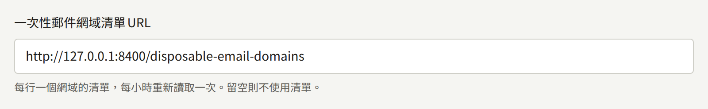

清單是每行一個網域的純文字檔案；空白行和以`#`開頭的行會被忽略，這正是[disposable-email-domains](https://github.com/disposable-email-domains/disposable-email-domains)專案封鎖清單的格式。列出的網域也涵蓋其子網域。每個執行個體會在第一次需要時讀取清單，並在一小時後再次讀取。若讀取失敗，或檔案中有不是網域的行，執行個體會繼續使用上次讀取的清單並記錄警告；若之前沒有清單，則不拒絕任何地址，並在一小時後重試。新的URL會在儲存後的下一次查詢時讀取。

儲存清單本身不會拒絕任何地址。想要拒絕拋棄式地址的租戶，需在其主控台**設定**的**不接受的電子郵件地址**下開啟**不接受拋棄式信箱網域**，從那時起，讀者就無法以列出網域的地址註冊，或將地址變更為這樣的地址。使用Apple或Google登入不受影響。當平台沒有清單時，該開關會說明它不起作用。

## 社群

**社群限制**是對讀者在租戶社群中行為的限制。這裡的每個值都是所有租戶的起點，也是租戶可選擇的最寬鬆值：租戶可以為自己將限制設得更嚴格，但絕不能更寬鬆。

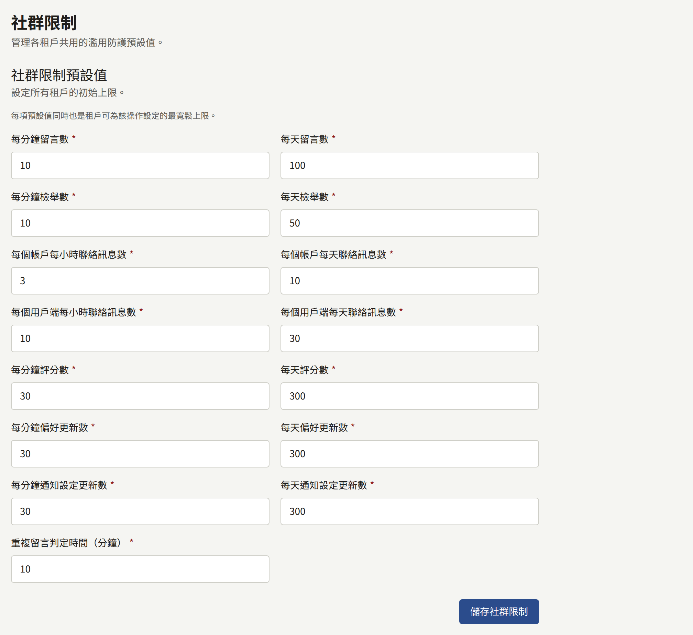

| 在「社群」頁面上 | 限制的對象 |
| --- | --- |
| **每分鐘留言數**和**每天留言數** | 單一讀者發表的留言 |
| **每分鐘檢舉數**和**每天檢舉數** | 單一讀者檢舉的留言 |
| **每個帳戶每小時聯絡訊息數**和**每個帳戶每天聯絡訊息數** | 單一已登入讀者透過租戶的聯絡表單送出的訊息 |
| **每個用戶端每小時聯絡訊息數**和**每個用戶端每天聯絡訊息數** | 無論是否登入，從單一用戶端位址透過聯絡表單送出、跨所有租戶計算的訊息 |
| **每分鐘評分數**和**每天評分數** | 單一讀者按下章節評分的次數 |
| **每分鐘偏好更新數**和**每天偏好更新數** | 單一讀者儲存閱讀器版面配置的次數 |
| **每分鐘通知設定更新數**和**每天通知設定更新數** | 單一讀者儲存其通知設定的次數 |
| **重複留言判定時間（分鐘）** | 讀者在同一章節再次發表相同留言時被拒絕的時間長度，從1分鐘到一週。比對會在去除前後空白後以完全相符進行 |

這些次數與安全性限制保存在相同的位置，因此[次數保存的位置](#次數保存的位置)同樣適用於它們。

## 保留期限

**保留期限預設值**設定四種記錄在所有未自行設定期限的租戶中保留多久。每個期限都是整數天數。`publira worker`會依自己的排程刪除超過期限的內容；不需要做任何設定來執行它，而`publiractl job`可以手動執行相同的清除。

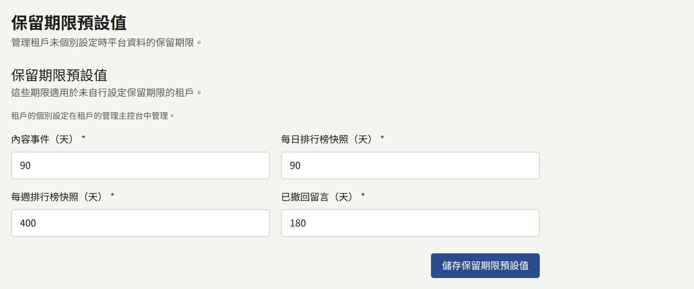

| 記錄 | 內容 | 刪除者 | 頻率 |
| --- | --- | --- | --- |
| **已撤回留言** | 留言者已刪除的留言，保留下來讓工作人員在相關的檢舉或爭議尚未解決時仍能閱讀。對該留言提出的檢舉會隨之刪除 | `purge-withdrawn-comments` | 每小時 |
| **內容事件** | 每一次的瀏覽、讀完、購買、收藏、評分和留言，依發生時的狀態記錄 | `purge-content-events` | 每24小時 |
| **每日排行榜快照** | 每天的排行榜 | `purge-ranking-snapshots` | 每24小時 |
| **每週排行榜快照** | 每週的排行榜 | `purge-ranking-snapshots` | 每24小時 |

每次清除都會在開始時讀取期限，因此儲存的變更會從下一次執行起套用。若在目前的間隔內尚未執行過，每次清除也會在`publira worker`啟動時執行，而停機後的第一次執行會刪除期間已過期的所有內容。

有些記錄刻意會比其期限保存得更久：

- 被工作人員或檢舉門檻隱藏的留言，無論多久都絕不會刪除：它是審核決定的記錄。只有留言者自行撤回的留言才會被清除。
- 租戶每種排行榜中最新的一份一定會保留，因此排行榜絕不會變成空白。

選擇期限：

- **內容事件**在被記錄後會用於兩件事：每天結束後建立的當日統計，以及根據租戶在其自身時區中最近完整的28天所建立的推薦。統計會比事件保存得更久，因此較短的期限不會縮減租戶的報表。記錄每位已登入讀者在哪些天活躍的資料也是如此，主控台會依據它追蹤某一週註冊的讀者在之後十二週的情況，因此即使期限比這更短，這些週仍能計算。低於30天的期限——也就是28天，加上建立推薦的那一天，以及因時鐘調整而變長的一天——會使推薦只能依據較少的天數，並可能在某一天的統計建立之前就刪除其事件，因此無論是平台的預設值還是租戶自己的期限，都會被拒絕。在Publira開始拒絕之前已儲存的較短期限，會以30天保留。
- **排行榜快照**是為了隨時間比較而保留的；向讀者顯示的永遠只有最新的一份。較短的期限只會縮短可比較的時間範圍。
- **已撤回留言**的期限應涵蓋您的租戶處理留言相關檢舉或爭議所需的時間。租戶的主控台會向工作人員顯示每則已撤回留言預定被刪除的時間。

從指令列：

```bash
publiractl retention set --content-event-days 120
```

## 租戶可以變更的部分

租戶的管理員可以從租戶主控台的**設定** → **限制與保留**為自己的租戶變更其中部分設定，如為他們撰寫的[設定](../4-console/3-setup/1-settings.md#限制與保留)所述。編輯和稽核員可以看到該頁面，但無法儲存。

| 設定組 | 租戶可以做的事 |
| --- | --- |
| **一般**：預設語言和時區 | 這裡無法變更；每個租戶從建立的那一刻起就有自己的語言和時區，並從其主控台的**設定**變更 |
| **一般**：預設貨幣 | 在**付款設定**中選擇自己的貨幣，之後預設值便不再影響它 |
| **安全性**：所有值 | 無法變更。租戶唯一相關的選擇是是否拒絕一次性郵件網域，而用來拒絕的清單是平台的清單 |
| **社群**：所有值 | 將任一項設得更嚴格：更低的上限，或更長的重複留言判定時間。比平台的值更寬鬆的值會被拒絕 |
| **保留期限**：所有期限 | 將任一項設得比平台的預設值更長或更短，範圍為1到36500天，**內容事件**則從30天起 |

在該頁面上，每一組設定一開始都勾選了**使用平台預設值**，並在旁邊顯示平台的值。取消勾選後，管理員可以輸入租戶自己的值，並以**儲存社群限制**或**儲存保留期限**保存；再次勾選並儲存，則會讓該組設定回到平台的值。使用平台預設值的租戶，會跟隨您之後對它所做的每一次變更。

平台的值變更時，租戶自己的值會保留，只有一個例外。租戶的社群限制在每次請求時都會與平台的限制比較，並套用兩者中較嚴格的一方，因此將平台的限制調低到租戶自己的值以下，也會讓該租戶變得更嚴格。再次調高並不會放寬選擇了更嚴格值的租戶。保留期限沒有這樣的比較：租戶自己的期限會原樣使用。

租戶的變更會以**更新了社群限制**和**更新了保留期限**記錄在其主控台的稽核記錄中。
