系列是讀者追蹤的作品：它有標題、簡介、封面、書系與作者，並包含讀者所開啟的章節。側邊欄**作品**群組中的**系列**會列出租戶的系列，最新的在前，每頁二十筆。清單上方的**連載狀態**與**年齡分級**可以篩選清單。

每一列可以用**編輯**（稽核員則是**檢視**）開啟系列，並以**章節**開啟它的章節。一列的**狀態**在系列的**發布日期與時間**已過時為**已發布**，在該時間尚未到來時為**已預約**，沒有設定時間時則為**草稿**。沒有同時在網站與應用程式上顯示的系列，標題旁會標示**僅網頁**或**僅應用程式**。

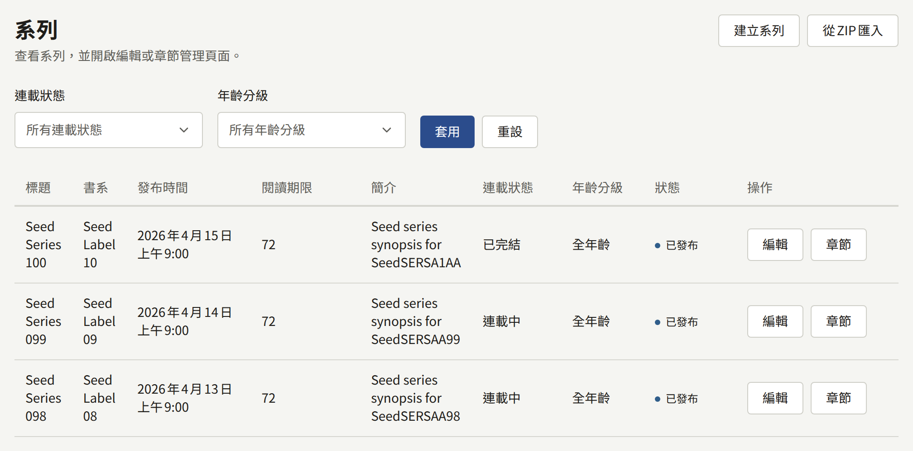

## 建立系列

選擇**建立系列**。這個表單與之後編輯系列時使用的是同一個，表單上的每個欄位之後都可以變更。選擇底部的**建立系列**即可儲存，並開啟系列的編輯頁面。

標題與簡介是以網站的預設語言撰寫。網站其他語言的標題與簡介，要等系列建立後再新增，如[其他語言的標題](#其他語言的標題)所述。

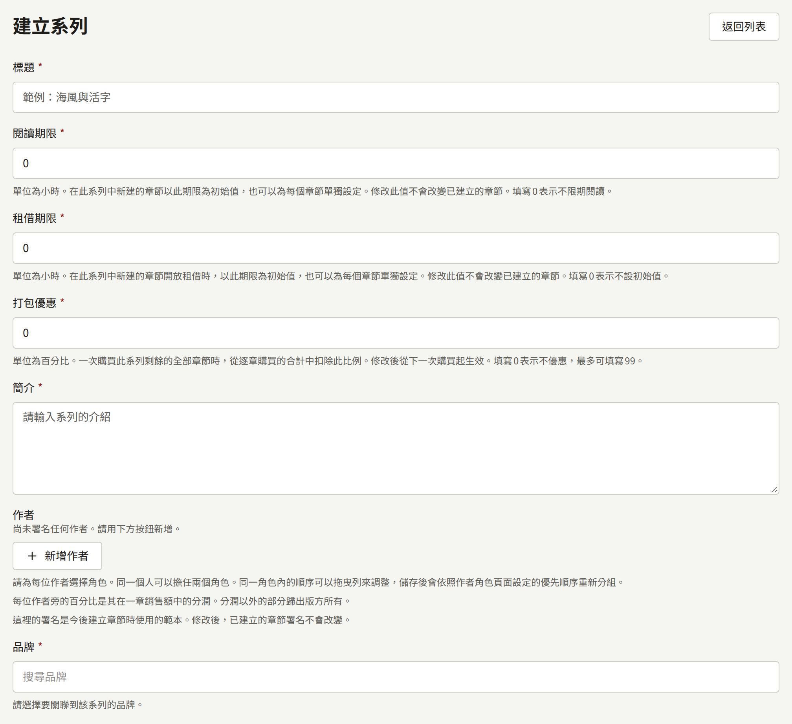

### 讀者最先看到的內容

- **標題**：最多255個字元。
- **簡介**：系列頁面上的說明，最多10,000個字元。
- **作者**：列名於系列的人，各自擔任某個角色，如[作者與作者角色](./4-authors.md#為作者署名)所述。每位作者旁的百分比是他們在系列章節銷售額中所占的分潤，[報表與版稅](../6-reports-and-royalties.md#作者應得的金額)有說明。這些署名會在每個章節建立時複製到章節上：之後變更它們，不會影響已存在的章節。
- **書系**：系列所屬的出版品牌。系列必須有一個書系，因此請先建立書系，如[書系](./3-labels.md)所述。
- **類型**：租戶的任意數量的類型，依**類型**中設定的順序顯示。
- **標籤**：最多20個自由填寫的詞，每個最多50個字元，讀者可以依標籤瀏覽。與已在使用中的標籤相符（不分大小寫）的標籤，會歸入該標籤。
- **封面圖**：最大10 MB、至少2400 × 3200像素的JPEG、PNG或WebP圖片。這個表單只在建立系列時提供此欄位；之後要在**封面圖**分頁中變更，如[封面圖](#封面圖)所述。

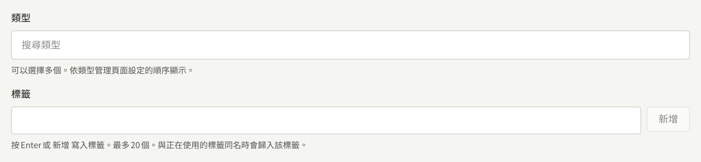

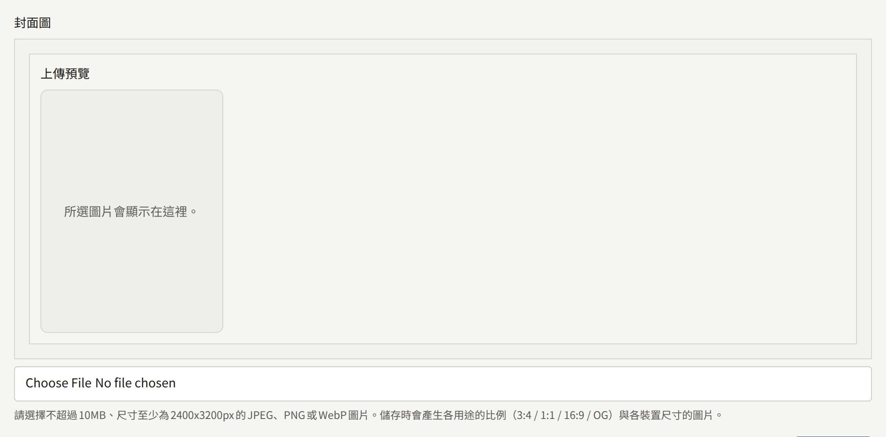

### 發布日期與時間

**發布日期與時間**決定系列是否公開。它以租戶的時區解讀，欄位上會標示該時區。

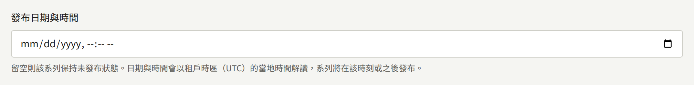

- **空白**：系列為隱藏。它的頁面會如同不存在一般回應，其中的章節也都無法閱讀，不論章節本身的狀態為何。
- **已過去的時間**或目前時間：系列儲存後立即公開。
- **未來的時間**：系列在該時間之前保持隱藏。`publira worker`每分鐘會尋找時間已過的系列一次，並重新整理網站的快取頁面，因此在該時間之後約一分鐘內，網站的清單與首頁就會包含它。

之後清空這個欄位，會將已公開的系列連同其章節再次從網站上撤下。由於系列無法刪除，這是撤下系列的唯一方法。

當隱藏的系列變為公開時（無論是第一次或再次公開），在它隱藏期間發布的章節會通知追蹤這些章節、該系列或其列名作者的讀者，且這些章節的日期會從系列公開的那一刻算起。系列先前公開期間已通知過的章節，會保留原本的日期，也不會再次通知。[章節](./2-episodes.md#已預約的章節何時出現)說明了誰會收到通知。

### 顯示位置與販售位置

**顯示位置**決定讀者可以在哪裡找到這個系列：**網頁與應用程式**、**僅網頁**或**僅應用程式**。新系列一開始為**網頁與應用程式**。在系列不顯示的平台上，對讀者而言系列及其章節都不存在；章節可以縮小這個設定的範圍，但永遠不能擴大。

**販售位置**決定它的付費章節可以在哪裡購買。一開始為**沿用租戶設定**，也就是沿用**付款** › **付款方式**中的**販售位置**，該設定變更後也會繼續沿用。[販售章節](../4-selling-episodes.md#章節的販售位置)涵蓋了這兩項設定，以及擁有應用程式的租戶為何可能只在網站上提供某個系列。

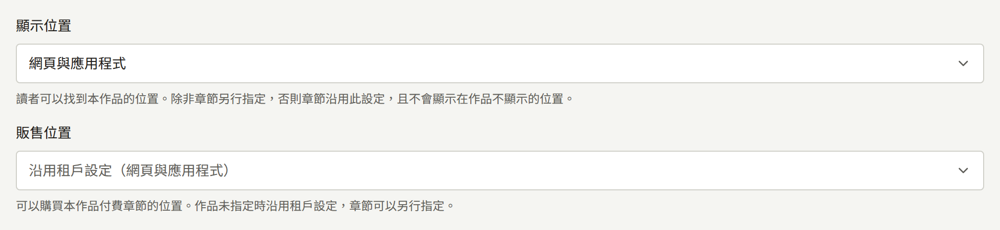

### 連載狀態與更新週期

**連載狀態**為**連載中**、**已完結**或**休刊中**。讀者會在系列頁面上看到它，也可以依它篩選系列清單。它不會改變其他任何事：**已完結**的系列仍然可以新增章節。

**更新週期**標示預期推出新章節的星期。系列頁面接著會顯示這些星期，後面加上「更新」，系列也會列在網站首頁**依更新日瀏覽**中的每一個對應星期下。沒有勾選任何一天時，系列頁面不會提及更新週期，系列也不會列在任何一天下。在這些日子並不會有任何機制發布章節：發布時間仍由每個章節自己的**發布日期與時間**決定。

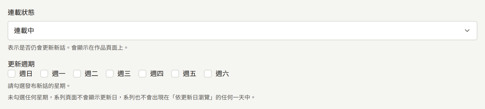

### 年齡分級

**年齡分級**為**全年齡**、**R15**或**R18**。分級為**R15**或**R18**的系列會在網站上標示分級，其頁面在開啟前會要求讀者確認年齡。在讀者確認之前，有分級的系列也不會出現在首頁與搜尋結果中。

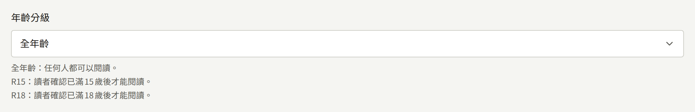

只要確認即可，還是讀者也必須以能證明年齡的出生日期登入，是由整個租戶的**需要證明年齡的分級**決定，如[設定](../3-setup/1-settings.md#年齡驗證)所述。系列無法自行設定這一點。

### 留言

**留言**決定讀者對系列章節的留言如何公開：**不接受留言**、**立即公開**或**審核後公開**。一開始為**沿用租戶設定**，也就是沿用**設定**中的**留言的公開方式**，該設定變更後也會繼續沿用，如[設定](../3-setup/1-settings.md#讀者留言)所述。審核與管理留言的方式請參閱[留言](../2-readers/2-comments.md)。

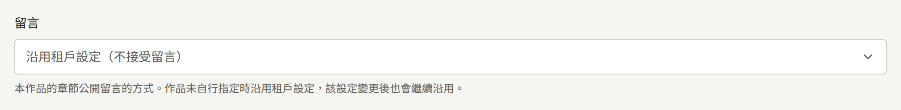

在這裡所做的選擇不論租戶設定為何都會套用到該系列，因此設為**立即公開**的系列，即使租戶不接受留言，也會接受留言。

### 閱讀方向與跨頁

**閱讀方向**是系列頁面的翻頁方向：**從右到左**（日本漫畫的閱讀方式，也是預設值）或**從左到右**。它決定翻頁的方向、跨頁中兩頁的順序、進度列，以及上一章與下一章位於哪一側。

**跨頁起始頁**決定在寬度足以並排兩頁的畫面上，從哪一頁開始兩頁一組顯示。在此之前的頁面會單獨顯示。預設值`2`會讓第一頁（通常是封面）單獨顯示；`1`則從第一頁開始配對。頁數少於這個值的章節會一次顯示一頁。

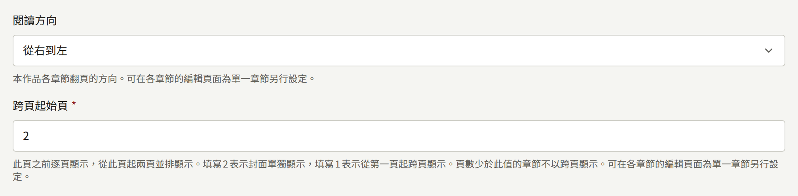

章節可以自行設定其中任一項，如[頁面版面](./2-episodes.md#頁面版面)所述。沒有自行設定的章節會沿用系列的設定，系列變更後也會繼續沿用。

### 閱讀期限

**閱讀期限**（以小時為單位）是系列中每個新章節的**閱讀期限**的初始值。購買會讓章節在章節自己的期限內保持可閱讀，而不是系列的期限：章節可以在建立時或[之後變更](./2-episodes.md#變更價格與閱讀期限)為不同的期限，之後變更系列的期限也不會影響已建立的章節。新系列一開始為`0`，代表購買後永久可閱讀。[販售章節](../4-selling-episodes.md#價格與閱讀期限)說明了這個期限如何使用。

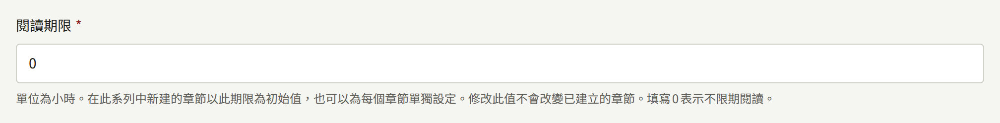

### 租借期限

**租借期限**（以小時為單位）是系列中每個新章節的**租借期限**的初始值。它本身不會讓任何章節可以租借：章節只有在設定了**租借價格**之後才能租借，而這個期限就是租借後可閱讀的時間長度。與**閱讀期限**一樣，系列的值變更時，章節會保留建立時的值。新系列一開始為`0`，代表不設定，此時新章節的**租借期限**一開始為空白。[販售章節](../4-selling-episodes.md#價格與閱讀期限)說明了租借。

### 打包優惠

**打包優惠**（以整數百分比表示）是讀者在一次結帳中購買系列其餘部分時所省下的金額：該系列中讀者尚未擁有的每個付費章節，以它們的價格總和減去這個百分比計價。新系列一開始為`0`，不打任何折扣，最大為`99`。變更從下一次結帳起套用，不影響讀者已購買的任何內容。[販售章節](../4-selling-episodes.md#系列的剩餘章節)說明了這種販售方式。

## 其他語言的標題

系列在網站提供的每種語言中都有標題與簡介，網站提供哪些語言由租戶管理員在[**設定**](../3-setup/1-settings.md#語言)中選擇。在**基本資料**分頁的表單上方，**語言**為每種語言各提供一個分頁，下方的表單則編輯所選語言的標題與簡介。**標題**下方的說明會標示該語言。系列尚未有標題的語言會標示為「**（未新增）**」：它的分頁會開啟**標題**與**簡介**都空白的表單，在該處選擇**更新系列**就會新增它們。在新增之前，網站與應用程式上使用該語言的讀者會以其他語言看到這個系列，並附有說明此情況的提示，搜尋引擎也不會被告知該系列有該語言的頁面。

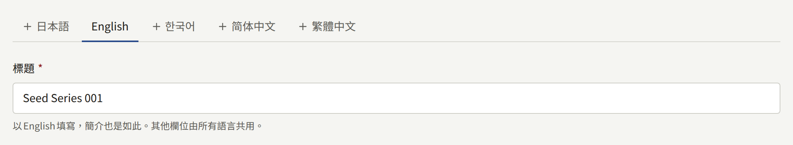

表單上的其他所有欄位都屬於系列本身，而不屬於某一種語言，因此在任何語言的分頁上變更它們，都會變更所有語言。分頁旁的**刪除此翻譯**會刪除所選語言的標題與簡介，但不能刪除系列的最後一組。

**系列**清單以及主控台中其他會提及系列的畫面，會以網站的預設語言顯示系列的標題。沒有預設語言標題的系列，會以最初撰寫時的語言命名。

## 封面圖

系列的**封面圖**分頁可以替換或刪除建立系列時所選的圖片。在**封面圖**下選擇新圖片並選擇**更新封面圖**，或選擇**刪除目前的封面圖**讓系列不使用封面圖。新圖片必須是最大10 MB、至少2400 × 3200像素的JPEG、PNG或WebP圖片。

網站不會直接顯示上傳的圖片。儲存時會從中裁切出四張固定形狀的圖片，顯示在下方的**各比例圖片**中。每個欄位的標題是形狀的名稱，下方有一行說明該形狀用在哪裡：

| 欄位 | 最小尺寸 | 使用位置 |
| --- | --- | --- |
| **直式 (3:4)** | 1200 × 1600 | 網站與應用程式書架上的封面，以及網站上的系列頁面 |
| **方形 (1:1)** | 1200 × 1200 | 網站清單中系列及其章節旁的小圖片，也是網站提供給搜尋引擎的圖片之一 |
| **橫式 (16:9)** | 1600 × 900 | 網站與應用程式中的寬幅橫幅，以及網站上系列頁面中每個章節旁與章節結尾處的小圖片 |
| **連結預覽 (1200:630)** | 1200 × 630 | 分享系列或其章節的連結時所顯示的預覽。沒有這張圖片的系列，分享時會使用網站以其標題、標誌與主題色彩繪製的卡片，如[連結預覽](../3-setup/2-branding.md#連結預覽)所述 |

每種形狀都從圖片的中央裁切。若要讓某種形狀使用不同的裁切範圍或專屬的圖片，請點選**各比例圖片**下該形狀的圖片，並選擇一張至少與該欄位要求一樣大的JPEG、PNG或WebP圖片，也可以是與之前相同的圖片。接著以**調整取景框**設定該形狀要顯示圖片的哪個部分，再以**取代**儲存，其他三種形狀維持不變。只有在系列已有封面圖時才能取代某種形狀，因此請先在**封面圖**下上傳一張。在該處上傳新的封面圖，會取代全部四種形狀。

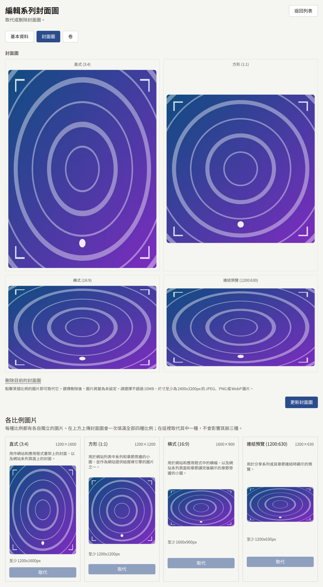

書系與類型也有相同的分頁，尺寸也相同。各形狀在它們上的使用位置不同，每個欄位下方的說明會標示所編輯項目的使用位置：例如，書系的方形圖片是它在應用程式中的圖塊，以及網站清單中它旁邊的小圖片，而它的直式圖片目前尚未在任何地方顯示。

## 等待即可免費

**等待即可免費**位於**基本資料**分頁的系列表單下方，讓已登入的讀者可以用一張等待一段時間後會再次取得的免費券，一次一個地免費開啟系列的付費章節：

- **為本系列提供免費券**用於開啟此功能。關閉時，下方的數值會保留到下次使用，讀者已用免費券開啟的章節在時間到之前仍保持可閱讀。
- **獲得下一張免費券的時間**：讀者使用免費券後多久可取得下一張，範圍為1到8760。一開始為`23`。變更從每位讀者下一次使用時起套用。
- **章節可閱讀的時間**：用免費券開啟的章節可閱讀多久，範圍為1到8760。一開始為`72`。
- **免費券不可閱讀的最新章節數**：從系列順序中最後一個章節往回數，最新發布的章節中有幾個保留給購買者。`0`表示免費券可以開啟任何付費章節。

選擇**儲存等待即可免費設定**即可儲存。讀者在每個系列持有一張免費券，未使用的免費券不會累積。免費券無法開啟已對所有人免費的章節、讀者已可開啟的章節，或讀者的年齡不允許的章節。系列頁面會告訴讀者免費券的運作方式，並以**不可用免費券**標示免費券無法開啟的章節。

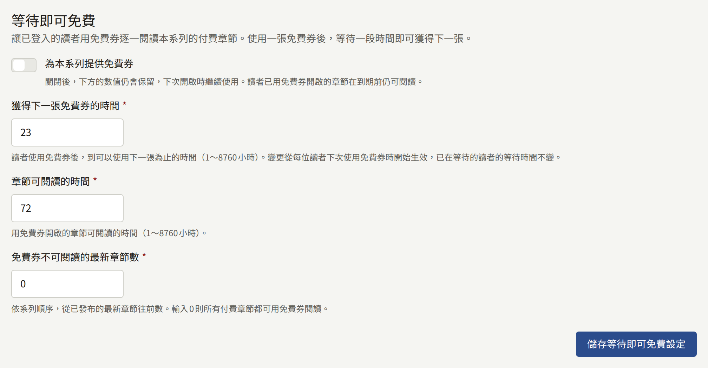

[販售章節](../4-selling-episodes.md#免費閱讀期間與等待即可免費)說明了免費券與價格及免費閱讀期間如何並存。

## 發布後免費

**發布後免費**位於**基本資料**分頁的**等待即可免費**下方，會讓系列的每個付費章節在發布後經過設定的天數時，對所有人免費：

- **章節發布後轉為免費**用於開啟此功能。關閉時，下方的數值會保留到下次使用。
- **發布後天數**：章節發布後幾天變為免費，範圍為1到3650。一開始為`30`。
- **保持付費的最新章節數**：從系列順序中最後一個章節往回數，最新發布的章節中有幾個不論發布多久都保持原價。`0`表示每個付費章節到期後都會變為免費。

選擇**儲存發布後免費設定**即可儲存。worker處理程序會在每個章節到期當天為它新增一段免費閱讀期間來開放它，這段期間在章節的[免費閱讀期間](./2-episodes.md#免費閱讀期間)中會列為**依系列規則**，且無法在該處刪除。這段期間會在規則涵蓋該章節的期間持續：在關閉規則的狀態下儲存，或以會排除某些章節的數值儲存，這些章節會立即恢復收費；之後才變成最新章節之一的章節，會在worker處理程序下一次執行時恢復收費。手動排定的免費閱讀期間會維持原樣，規則的期間則從它結束時開始。

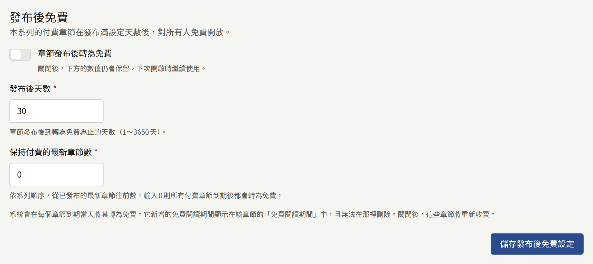

## 卷

卷是系列中一連串的章節，以專屬的價格在一次結帳中一起販售。購買卷會永久開放其中的每個章節：卷不能租借，也沒有閱讀期限。一個章節最多屬於一卷，且在卷之外仍會單獨販售。

系列的**卷**分頁會依順序列出它的卷，每一卷都附有封面、價格、包含的章節數、書店連結的數量，以及是否**銷售中**。拖曳卷的控制點可以變更順序，放下後就會立即儲存。稽核員看到的清單沒有控制點，並以**檢視**開啟每一卷。

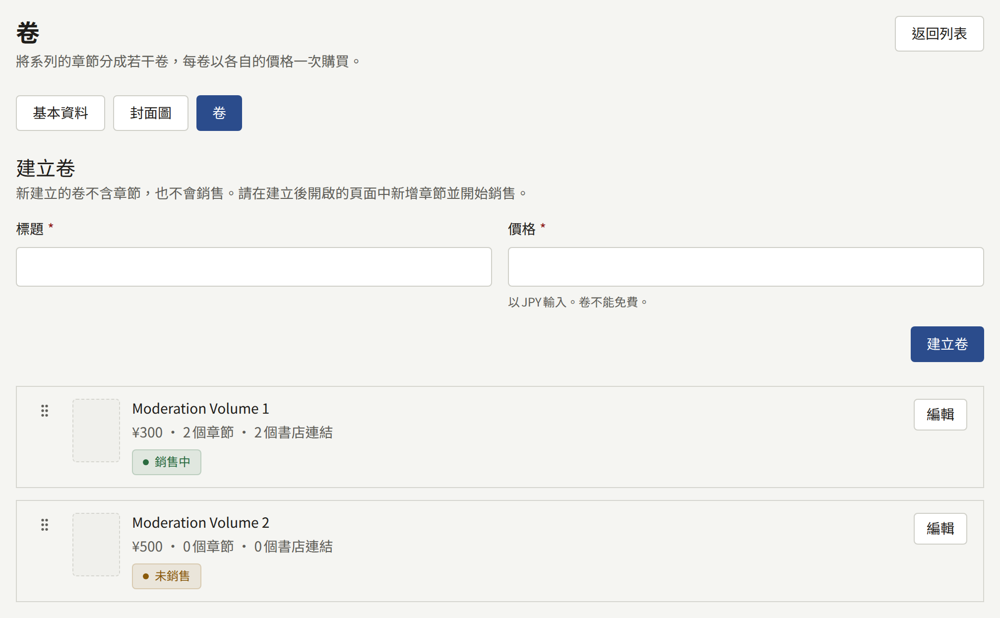

### 建立卷

在**建立卷**下，輸入最多255個字元的**標題**，以及以租戶貨幣計價、必須大於`0`的**價格**。選擇**建立卷**會開啟新卷。新卷不包含任何章節，也尚未銷售。一個系列最多可有100卷。

卷的畫面有五個部分：

- **基本資訊**以**更新卷**一併變更標題與價格。新價格會套用到儲存後的購買。
- **章節**是卷所包含內容的清單，如下所述。
- **封面圖**接受最大10 MB、至少2400 × 3200像素的JPEG、PNG或WebP圖片，並裁切成與[系列封面圖](#封面圖)相同的四種形狀。沒有封面圖的卷會以系列的封面圖顯示。
- **書店連結**列出卷的紙本書在哪裡販售，如下所述。
- **銷售**讓卷開始販售或停止銷售。

### 選擇章節

在**章節**下，於**新增章節**中搜尋系列的章節，並選擇**新增**將它加到清單末尾。拖曳章節的控制點可以變更它在卷中的位置，以該列末端的按鈕可以將它移出。在選擇**儲存章節**之前不會儲存任何變更。除了已發布的章節，草稿與已預約的章節也可以加入。

其他卷已包含的章節不會出現在選項中：請先將它從那一卷移出。

卷一旦銷售過，它所包含的章節就再也無法從中移出，即使停止銷售後也一樣。在銷售期間開始結帳的讀者仍然可以完成結帳，購買會開放卷所包含的內容。章節仍然可以新增與重新排序。

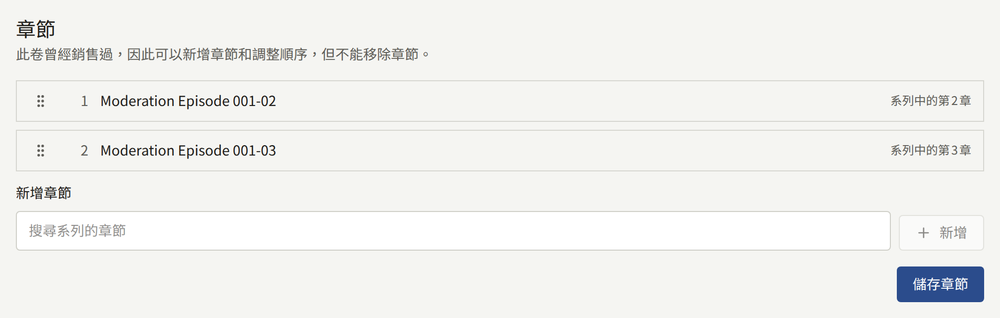

### 書店連結

在**書店連結**下，**新增連結**會在清單末尾新增一列。為每一列填入**標籤**，也就是按鈕上顯示的文字，例如書店名稱，長度為1到50個字元，以及以`https://`開頭、最多2,048個字元的**URL**。一卷最多可有10個連結。拖曳連結的控制點可以變更它在清單中的位置，以該列末端的按鈕可以將它移出。

在選擇**儲存書店連結**之前不會儲存任何變更，儲存時會依清單當下的內容與順序儲存：移出所有列後儲存，卷就不會有任何連結。某一列無法儲存時，該欄位下方的訊息會指出是哪一列，且清單中的任何內容都不會儲存。系統不會檢查URL是否能回應。

卷在銷售期間，系列頁面會在網站與應用程式上，於該卷下方的**購買紙本書**底下，依清單順序列出它的連結。每個連結都是帶有其標籤的按鈕，在網站上會於新分頁開啟書店，在應用程式中則以裝置的瀏覽器開啟，絕不會在應用程式內開啟。

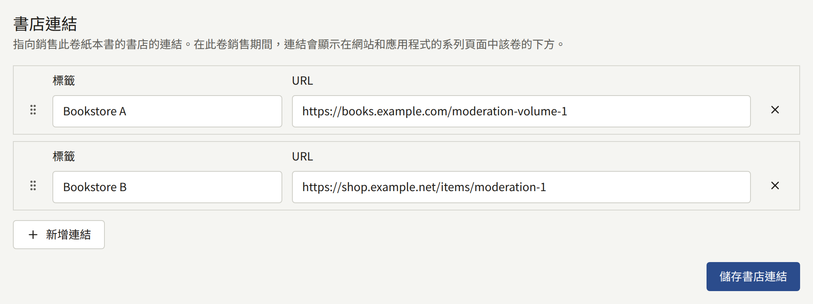

### 讓卷開始販售

在**銷售**下，**開始銷售**會向讀者提供這一卷，**停止銷售**則停止提供。不包含任何章節的卷無法開始銷售。停止銷售卷不會收回讀者已購買的任何內容。

由於購買卷就是購買其中的每個章節，卷只會在它的每個章節都能購買的地方販售：如果其中某個章節在**販售位置**中設為只在網站上販售，這一卷也是如此。[販售章節](../4-selling-episodes.md#章節的販售位置)說明了章節在哪裡販售。

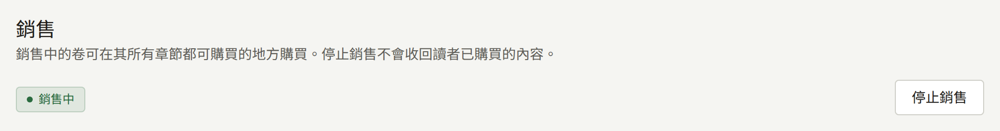
