章節是讀者開啟並付費的內容：一連串的頁面圖片，附有標題、價格與發布時間。章節位於所屬的系列之中。在**系列**清單中，選擇該系列那一列的**章節**即可開啟。

清單會以位置與標題顯示每個章節，並附上狀態（**草稿**、**已預約**或**已發布**）、價格，已預約的章節還會顯示預定時間。租戶[要求審核](#發布前審核)期間，等待租戶管理員決定的已預約章節會標示為**審核中**，被退回的則標示為**已退回**。沒有同時在網站與應用程式上顯示的章節，會標示為**僅網頁**、**僅應用程式**或**不在任何位置顯示**；設有[試讀頁數](#試讀頁數)的付費章節會標示其頁數，例如**試讀：3頁**，因此整個系列的試讀設定一眼就能確認。**編輯**會開啟章節，稽核員則是**檢視**。章節的編輯畫面有兩個分頁：**封面圖**（說明見[封面圖](#封面圖)），以及包含畫面上其他所有區塊的**基本資料**。

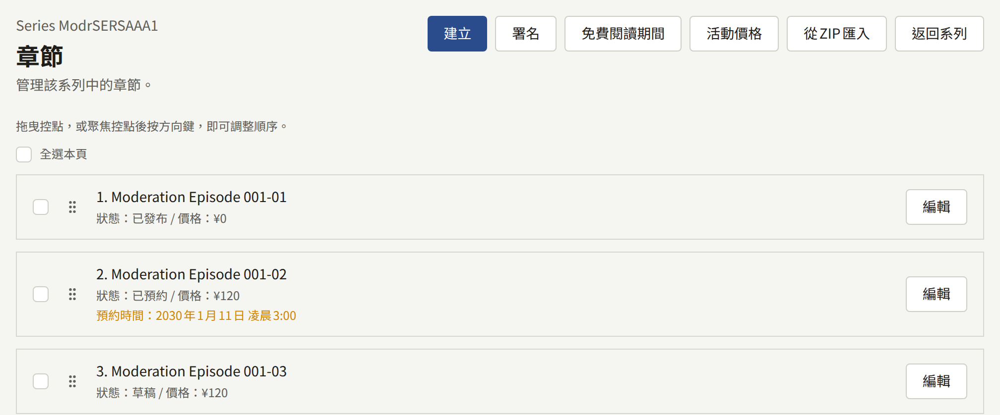

不論作品是否為漫畫，章節都是由頁面圖片構成。目前尚不支援以文字撰寫的小說（[#505](https://github.com/publira/publira/issues/505)）。

## 章節的順序

章節依系列的順序列出，並在網站上依此編號。新章節會排在最後。要移動章節，請拖曳它的控制點，或將焦點移到控制點上再使用方向鍵。清單每頁顯示二十個章節，章節只能在所在的頁面內移動。

網站依位置為每個章節編號，顯示為「第N章」，讀者還看不到的章節也會計入。請將草稿與已預約的章節放在順序的最後，讓已發布的章節編號不會跳號。

新的順序一經儲存就會反映到網站上。

## 建立章節

在章節清單中選擇**建立**，並填寫：

- **標題**：章節在網站預設語言中的標題，例如`Episode 1 — A beginning morning`。之後可以[變更](#變更標題)，並在該處以網站的其他語言填寫。
- **價格**：以租戶貨幣計價的價格（欄位會標示貨幣），小數位數不可超過該貨幣的位數：500日圓為`500`，4.99美元為`4.99`。`0`會讓章節免費。
- **閱讀期限**：購買後章節可閱讀多少小時。`0`代表永久可閱讀。初始值為系列的[閱讀期限](./1-series.md#閱讀期限)。
- **租借價格**與**租借期限**：租借章節的費用（低於**價格**），以及租借後可閱讀多少小時。**租借價格**留空表示不提供租借。**租借期限**的初始值為系列的[租借期限](./1-series.md#租借期限)。
- **試讀頁數**：付費章節中，任何人在購買前可以閱讀開頭的幾頁，如[試讀頁數](#試讀頁數)所述。初始值為`0`，代表不開放任何頁面。**價格**為`0`時不會提供此欄位，因為免費章節會開放所有頁面。
- **發布日期與時間**：章節發布的時間，以租戶的時區解讀。留空即建立草稿。已過去的時間會讓章節在建立後立即發布。
- **顯示位置**與**販售位置**：章節可以在哪裡被找到與購買，如[顯示位置與販售位置](#顯示位置與販售位置)所述。兩者一開始都沿用系列的設定。

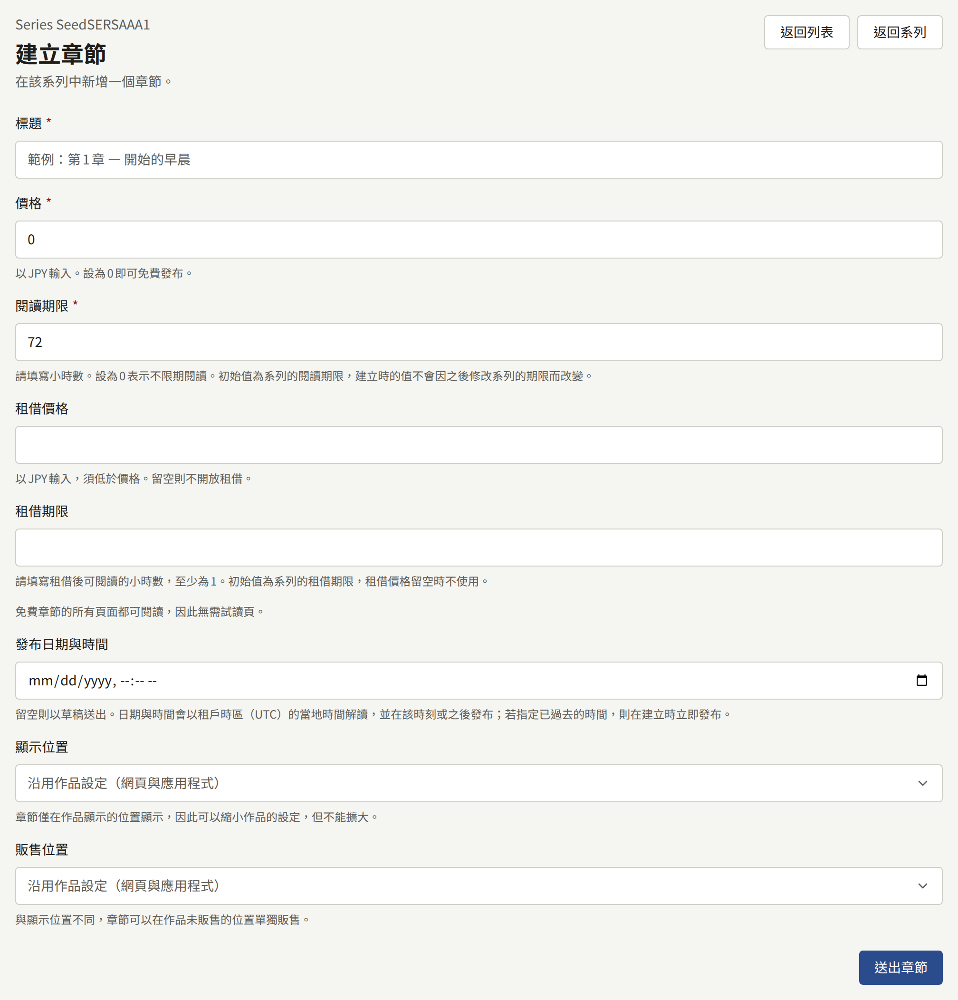

**價格**、**閱讀期限**、租借與**試讀頁數**都可以[之後變更](#變更價格與閱讀期限)。[販售章節](../4-selling-episodes.md#價格與閱讀期限)有說明這些項目。

選擇**送出章節**。章節會以系列上列名的作者建立，並開啟它的編輯畫面以新增頁面。

## 變更標題

章節編輯畫面頂端的**標題**保存章節在網站提供的每種語言中的標題。**語言**為每種語言各提供一個分頁，下方的欄位保存所選語言的標題。變更後選擇**更新標題**。新標題一經儲存，網站與應用程式就會顯示。標題不能留空。

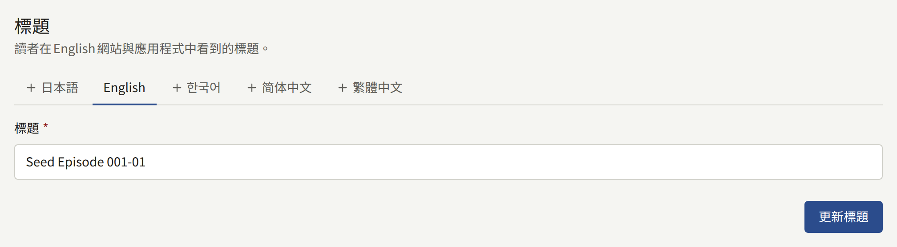

章節尚未有標題的語言會標示為「**（未新增）**」。它的分頁會開啟空白的欄位：輸入標題並選擇**新增翻譯**。在新增之前，網站與應用程式上使用該語言的讀者會看到其他語言的章節標題。分頁旁的**刪除此翻譯**會刪除所選語言的標題，但不能刪除章節的最後一個標題。

章節清單以及主控台中其他會提及章節的畫面，會以網站的預設語言顯示章節的標題。

## 變更價格與閱讀期限

章節編輯畫面上的**價格與閱讀期限**保存章節販售所依據的數值，規則與建立時相同：**價格**以租戶貨幣計價，`0`會讓章節免費；**閱讀期限**是小時數，`0`代表購買後永久可閱讀。**租借價格**與**租借期限**保存租借設定：清空**租借價格**會停止提供租借；對尚未提供租借的章節，**租借期限**會帶入系列的[租借期限](./1-series.md#租借期限)，因此只要設定價格即可提供租借。**試讀頁數**保存章節的[試讀頁數](#試讀頁數)。變更其中任何一項後，選擇**更新價格與閱讀期限**。這些數值一經儲存，網站與應用程式就會以新數值販售章節。

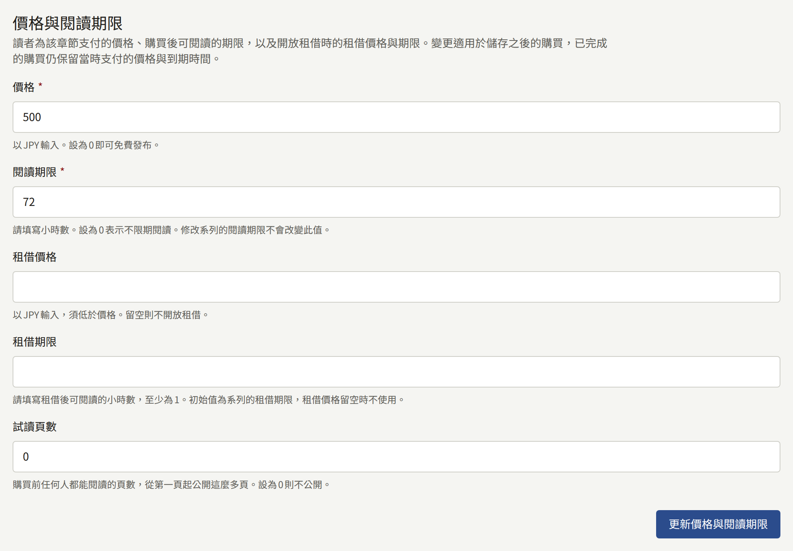

### 試讀頁數

**試讀頁數**是付費章節中，從閱讀順序的第一頁算起，任何人（不論是否登入）在購買前可以閱讀的頁數。`0`代表不開放任何頁面，欄位不接受負數。由於頁面經常在設定價格之後才新增，因此可以設定大於章節現有頁數的數值：欄位會註明章節目前有幾頁，只會開放現有的那些頁面，之後新增的每一頁也會在不超過該數值的範圍內開放。

只有在**價格**大於`0`時才會提供此欄位。免費章節本來就會開放所有頁面，因此欄位會改為顯示不需要試讀的說明；將**價格**降為`0`並儲存，會清除這個數值。再次為章節定價時，欄位會以`0`提供。

變更會套用到儲存後的購買。已完成的購買會保留當時支付的價格與到期時間，而在變更前已開啟金流服務商結帳頁面的讀者，會支付該頁面顯示的金額。變更系列的**閱讀期限**或**租借期限**不會改變這些數值。

透過商店販售的應用程式，會以對應其價格的商店商品購買章節，因此新價格或新的[活動價格](#活動價格)可能需要新的商品：請參閱[商店商品](../4-selling-episodes.md#在應用程式中販售)。

## 新增頁面

章節編輯畫面上的**新增漫畫頁面**，可以在**上傳方式**下以三種方式之一新增頁面：

- **選擇多張頁面圖片**一次接受多個JPEG、PNG、GIF或WebP檔案，可以選擇檔案或拖放到**頁面圖片**上。它們會依瀏覽器提供的順序新增，通常是依檔名排序，因此新增後請確認順序。
- **送出ZIP**接受一個ZIP檔案，並依路徑順序新增其中的`.png`、`.jpg`、`.jpeg`與`.gif`圖片，因此`page2.png`會排在`page10.png`之前。其中的其他檔案（包括WebP圖片）會被忽略，且最多可包含1000張圖片。
- **送出ePub**接受一個ePub檔案，並依閱讀順序新增其頁面所顯示的JPEG、PNG、GIF或WebP圖片，最多1000張。

選擇**新增頁面圖片**、**送出ZIP**或**送出ePub**即可上傳。不論使用三種方式中的哪一種，每張圖片最大20 MB，每次上傳最大128 MB，因此整個章節可以用一個ZIP或ePub新增。ZIP或ePub解壓縮後的圖片合計最大256 MB。超過這個大小時，請分成多次上傳；每次上傳的頁面都會接在上一次的最後一頁之後。卡片會在檔案選擇器下方註明這些格式與限制。

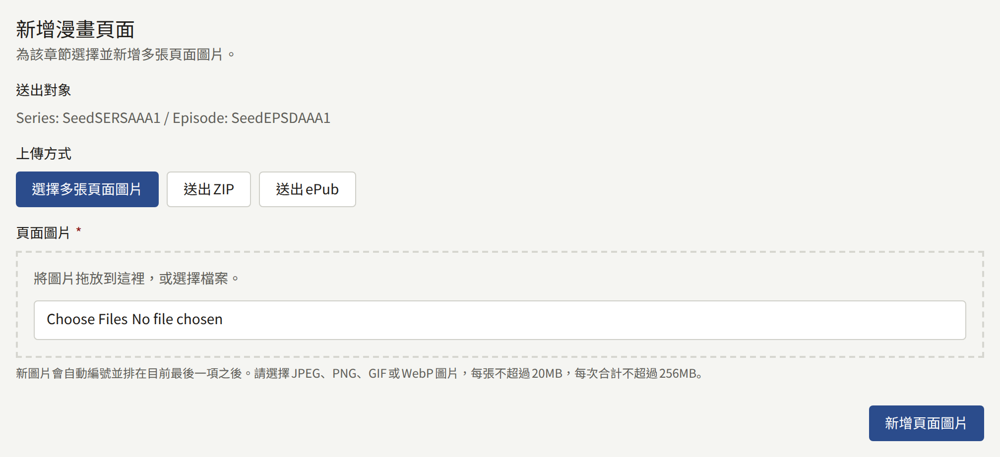

**已新增的頁面圖片**會依順序顯示頁面。拖曳頁面的控制點，或將焦點移到控制點上再使用方向鍵，即可移動頁面。每一頁下方有：

- **替換**會以新圖片取代該頁。在**新的頁面圖片**下選擇一張最大20 MB的JPEG、PNG、GIF或WebP圖片，然後選擇**替換頁面**。其他頁面都維持原位。
- **刪除**會在以**刪除頁面**確認後，將該頁從章節中移除。其後的頁面會往前移一位。已刪除的頁面無法復原；若要還原，請重新新增它的圖片。

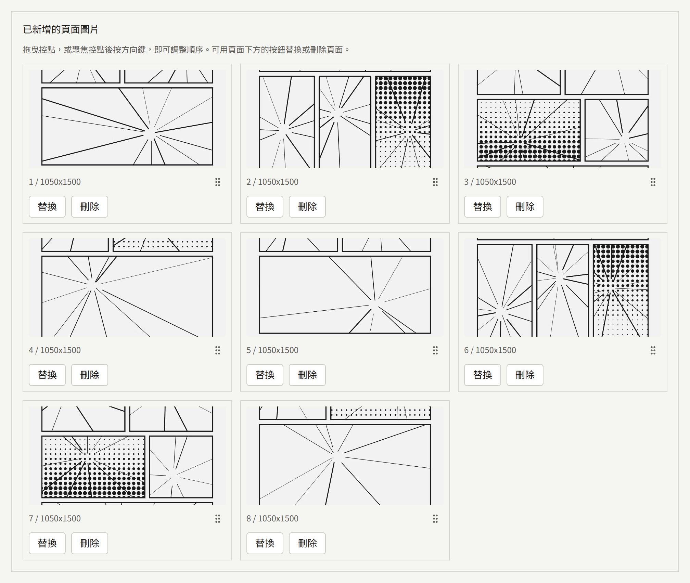

新增到已發布章節的頁面、替換或刪除的頁面，以及頁面的新順序，一經儲存就會呈現給讀者。沒有任何頁面的已發布章節，會向讀者顯示其頁面尚未發布。

刪除頁面不會改變章節在[頁面版面](#頁面版面)中自行設定的**跨頁起始**。如果該頁現在已超過最後一頁，章節會以不使用跨頁的方式顯示，直到它再次有那麼多頁為止。

## 從ZIP匯入

**系列**列表和系列的章節列表上的**從ZIP匯入**可以用一個包含頁面圖片的ZIP建立系列及其章節，而不必逐一建立章節並手動加入頁面。它適用於從其他服務遷移作品目錄，或一次交付多個章節。

ZIP中包含放在任意資料夾裡的頁面圖片，以及位於根目錄、名為`publira-import.json`的清單：

```json
{
  "version": 1,
  "series": {
    "title": "系列標題",
    "synopsis": "系列簡介",
    "locale": "zh-Hant",
    "reading_direction": "rtl"
  },
  "episodes": [
    {
      "title": "第1話",
      "price": 0,
      "scheduled_at": "2030-01-01T00:00:00+09:00",
      "pages": ["ep01/001.png", "ep01/002.png"]
    }
  ]
}
```

- `version`為`1`。
- `series`指定章節的去向。若要建立系列，請填寫`title`，並可選填`synopsis`、`reading_direction`（`rtl`或`ltr`，未填寫時為由右至左），以及系列文字和章節標題所用語言`locale`（未填寫時為租戶的預設語言）。系列會以草稿建立。若要加入現有系列，只填寫`{ "id": "<ID>" }`，ID可在系列位址`/series/<ID>`和章節列表頂端查看。從系列的章節列表匯入時，清單必須指定該系列。
- `episodes`依建立順序列出章節，它們排在系列已有章節之後。每個章節都需要`title`和`pages`：`pages`是ZIP內的路徑，須與儲存的完全一致，並依閱讀順序排列。`price`的寫法與**價格**相同，使用租戶的貨幣，未填寫時為`0`。`scheduled_at`是帶時區偏移的未來時間，在所有頁面就緒後預約章節；未填寫時章節維持為草稿。

清單不接受其他鍵。署名、封面、翻譯、類型、標籤和租借在匯入後到主控台中設定。

在**ZIP檔案**中選擇ZIP。主控台會在傳送任何內容之前檢查它，並依章節和路徑列出發現的所有問題：清單不接受的鍵、ZIP中缺少的頁面、重複的路徑、不是JPEG、PNG、GIF或WebP圖片的檔案，以及超出限制的內容。ZIP通過檢查之前不會建立任何內容。如果ZIP中可見的路徑被回報為缺失，請將資料夾和檔案名稱改為ASCII字元：某些工具會以清單無法比對的形式儲存其他字元。

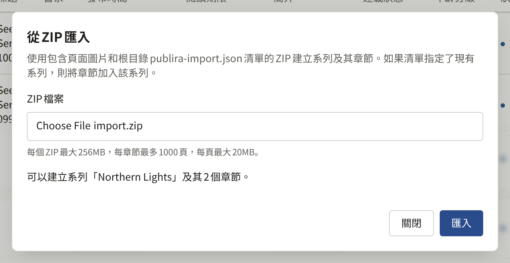

每個ZIP最大256 MB，每個章節最多1000頁，每頁最大20 MB。更大的目錄可分成多個指定同一系列ID的ZIP匯入。在[#4239](https://github.com/publira/publira/issues/4239)解決之前，Cloud Run上的安裝每個ZIP最大32 MiB。

選擇**匯入**，並在結果出現之前保持視窗開啟。ZIP會整體傳送，主控台在最後一個章節完成後才會回應，因此可能需要幾分鐘。結果中每個章節一列，顯示**已匯入**、**失敗**或**未開始**。

匯入不是全部成功或全部復原的操作。章節依序建立，第一次失敗會讓之後的章節停止，已建立的內容會保留。若要繼續，請從清單中移除已匯入的章節，然後再次匯入ZIP。失敗的章節如果帶有指向編輯畫面的連結，表示它已作為草稿建立，頁面可能不完整：請在那裡加入其餘頁面並設定發布時間，然後將它也從清單中移除，或者刪除該章節並將它保留在清單中。如果在結果出現之前連線中斷，匯入可能仍已完成，因此再次匯入前請檢查系列的章節。

匯入的章節與手動建立的章節相同：[稽核記錄](../../3-operations/12-security/3-audit-logs.md)顯示相同的操作，如果租戶要求審核，預約的章節會經過[審核](#發布前審核)。

## 頁面版面

**頁面版面**僅針對此章節，設定系列為其章節決定的兩件事：

- **閱讀方向**：**沿用作品設定**、**從右到左**或**從左到右**。
- **跨頁起始**：**沿用作品設定**，或**為該章節指定**，後者會要求輸入跨頁開始的頁碼，範圍從1到章節的最後一頁。請先新增頁面：沒有任何頁面的章節只能沿用系列的設定。

選擇**更新頁面版面**即可儲存。沿用系列的數值會隨系列變更。[閱讀方向與跨頁](./1-series.md#閱讀方向與跨頁)說明了各項設定在閱讀器中的作用。

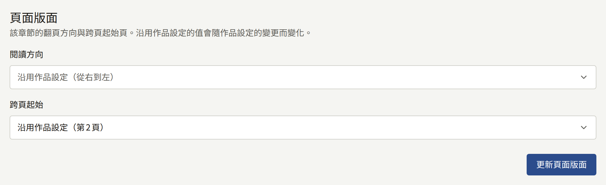

網站只會在寬度至少768像素且高度不超過寬度的閱讀器中並排顯示兩頁，應用程式則只會在平板電腦或橫向持握的手機上這樣顯示。其他情況下頁面會一次顯示一頁。

## 預覽頁面

章節編輯畫面底部的**預覽**會以網站使用的閱讀器顯示章節的頁面：依儲存的順序、以章節的閱讀方向翻頁，並從版面設定的起始頁開始組成跨頁。草稿或已預約的章節與已發布的章節預覽方式相同，因此可以在讀者看到之前確認頁面。

翻頁方式與讀者在網站上相同：使用方向鍵、點選閱讀器的左右邊緣附近，或點選閱讀器中央以顯示頁面下方的**上一頁**、**下一頁**與閱讀進度滑桿。預覽遵循與網站相同的跨頁規則，因此視窗夠寬時會並排顯示兩頁。

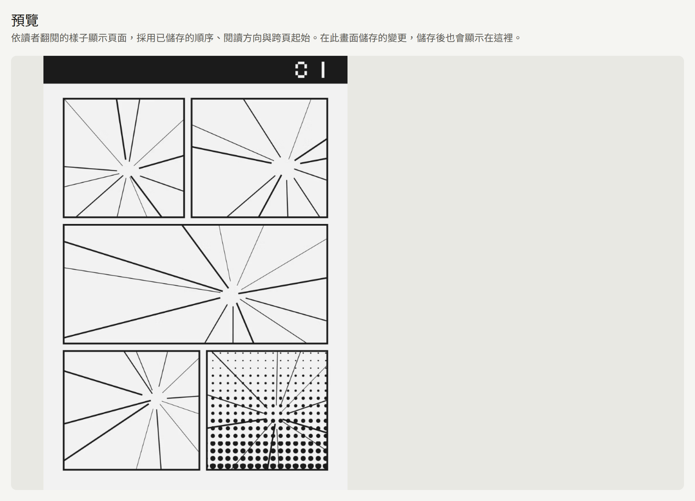

在編輯畫面上儲存的變更（新增、替換、刪除或移動頁面，或更新**頁面版面**），一經儲存就會反映在預覽中，且預覽會從第一頁重新開始。在**頁面版面**中選擇但尚未儲存的數值不會顯示。沒有任何頁面的章節，會在預覽中說明這一點。

所有能開啟章節的人都可以在預覽中翻頁，包括無法變更章節的人。

## 封面圖

沒有專屬封面圖的章節，在網站與應用程式顯示其圖片的任何地方，都會顯示所屬系列的[封面圖](./1-series.md#封面圖)，因此新章節不需要在這裡做任何設定。只有在章節的外觀應與系列不同時，才為它設定專屬的封面圖。如果章節與系列都沒有圖片可用於**連結預覽 (1200:630)**，分享章節連結時會使用網站以章節標題繪製的卡片，如[連結預覽](../3-setup/2-branding.md#連結預覽)所述。

在章節編輯畫面的**封面圖**分頁中設定。在**封面圖**下，選擇一張最大10 MB、至少2400 × 3200像素的JPEG、PNG或WebP圖片，然後選擇**更新封面圖**。儲存時會將它裁切成與系列封面相同的四種形狀與尺寸，顯示在**各比例圖片**中：**直式 (3:4)**、**方形 (1:1)**、**橫式 (16:9)**、**連結預覽 (1200:630)**。每個欄位下方的說明會標示章節封面的該形狀用在哪裡。

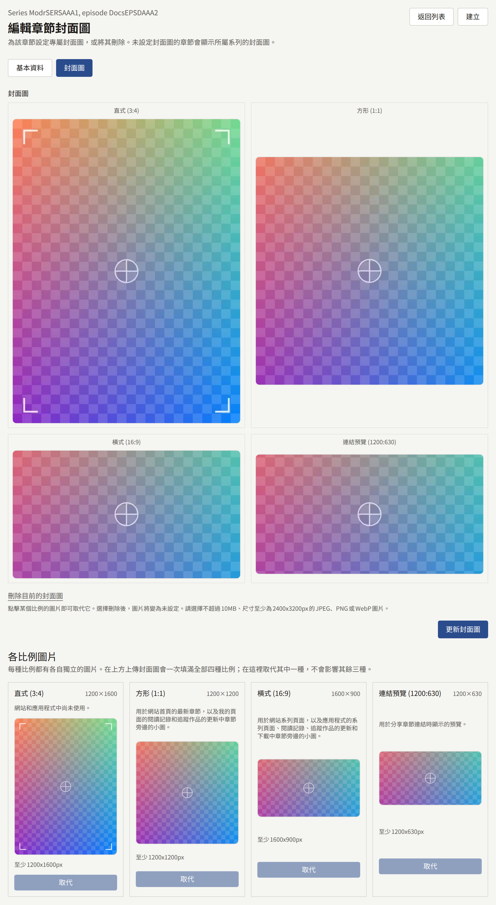

每種形狀都從圖片的中央裁切。若要讓某種形狀使用不同的裁切範圍或專屬的圖片，請點選**各比例圖片**下該形狀的圖片，並選擇一張至少與該欄位要求一樣大的JPEG、PNG或WebP圖片，也可以是與之前相同的圖片。接著以**調整取景框**設定該形狀要顯示圖片的哪個部分，再以**取代**儲存，其他三種形狀維持不變。只有在章節已有封面圖時才能取代某種形狀，因此請先在**封面圖**下上傳一張。在該處上傳新的封面圖，會取代全部四種形狀。

若要改回使用系列的封面，請選擇**刪除目前的封面圖**，然後選擇**更新封面圖**。

## 署名

章節編輯畫面上的**作者**列出此章節列名的作者，每位作者各自擔任某個角色，並附有其在銷售額中的分潤。新章節一開始使用系列的署名，之後在這裡單獨變更：之後對系列署名的變更不會影響它。在這裡新增的署名會標示為**僅本集**，用於只參與這個章節的客座作者。選擇**儲存作者**即可儲存。

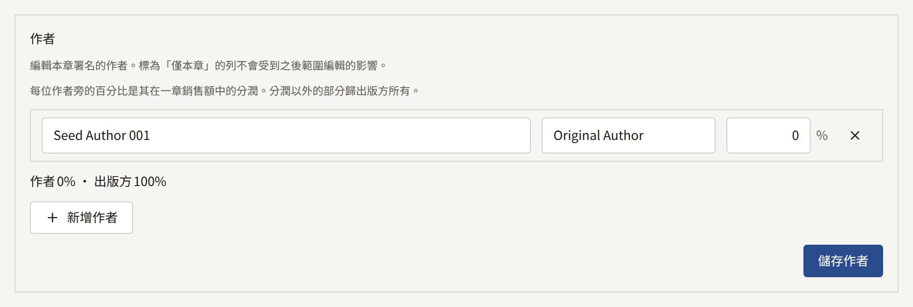

網站上的章節頁面會顯示這些署名，系列頁面則顯示系列本身的署名。章節的署名也是支付版稅的依據，如[報表與版稅](../6-reports-and-royalties.md#作者應得的金額)所述；與讀者帳戶連結的作者可以閱讀署名為自己的章節，如[作者與作者角色](./4-authors.md#將作者連結到讀者帳戶)所述。

若要一次變更多個章節的署名，例如某位作畫者從第12章開始加入時，請在清單中選取章節，然後選擇**署名**。在**操作**下：

- **新增**會在每個尚未以該角色列名該作者的所選章節上，以該角色列名該作者，不設分潤。
- **取代**會將一條署名改為另一條。
- **移除**會刪除一條署名。
- **設定分潤**會變更一條署名的分潤。

選擇操作要套用的**作者**與**角色**，在列出系列所有章節的**章節**下勾選章節（一次最多1000個），然後選擇**套用**。**取代**、**移除**與**設定分潤**不會變更**僅本集**的署名。結果會顯示有多少章節被變更，以及其他章節各自未變更的原因。

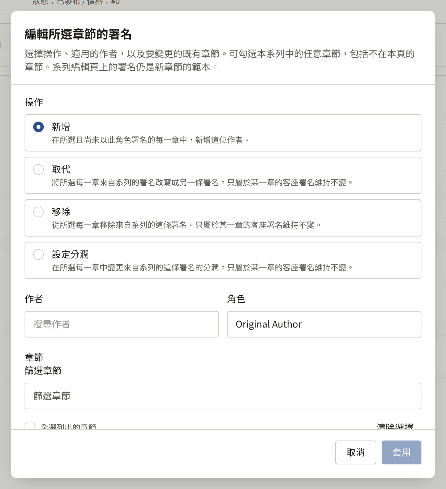

## 顯示位置與販售位置

每個章節都有自己的**顯示位置**與**販售位置**，一開始都沿用系列的設定：

- **顯示位置**可以縮小系列的顯示範圍，但不能擴大。在顯示位置為**僅應用程式**的系列中設為**僅網頁**的章節，不會在任何地方顯示，畫面會對此發出警告。選擇**更新顯示位置**即可儲存。
- **販售位置**可以指定系列本身的**販售位置**未包含的平台，但章節只會在它同時顯示的地方販售。選擇**更新販售位置**即可儲存。

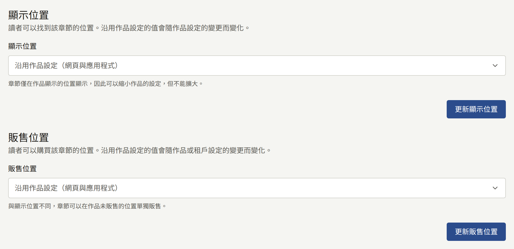

將**顯示位置**設為不在任何地方顯示，可以在不取消發布的情況下將已發布的章節從網站上撤下。[販售章節](../4-selling-episodes.md#章節的販售位置)涵蓋了在章節不販售的地方讀者會看到什麼。

## 免費閱讀期間

免費閱讀期間會在兩個時間點之間，向所有人（不論是否登入）開放付費章節。章節會保留它的價格，並在期間結束時再次適用。在免費章節上設定的期間沒有任何作用。

章節編輯畫面上的**免費閱讀期間**會列出它的期間，標示為**免費中**、**已排定**或**已結束**。若要新增，請輸入**開始時間**與**結束時間**（兩者都以租戶的時區解讀），然後選擇**新增免費閱讀期間**。**結束時間**必須晚於**開始時間**且仍在未來；**開始時間**可以是過去的時間，此時章節會從現在起免費。同一章節的兩個期間不能重疊，但一個期間可以正好在另一個結束時開始。

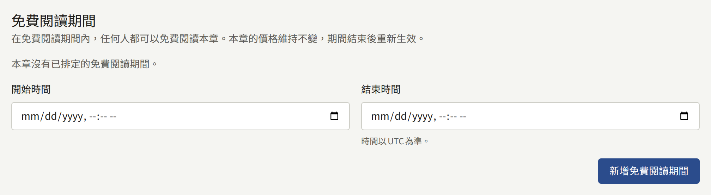

期間無法編輯。請**刪除**它再新增另一個；刪除已開始的期間會立即讓章節恢復收費。

標示為**依系列規則**且沒有結束時間的期間，是由系列的[發布後免費](./1-series.md#發布後免費)規則新增的，該規則會在每個付費章節發布後經過設定的天數時開放它。這種期間沒有**刪除**：當規則被關閉或不再涵蓋該章節時，它就會消失，如[排程工作與維護工作](../../3-operations/10-scheduled-jobs.md#其他排程工作)所述。

若要為多個章節設定相同的期間，請在章節清單中選擇**免費閱讀期間**。在**對象章節**下，選擇**所選的章節**（清單中勾選的章節）、**開頭的章節**（依系列順序的前若干個章節）或**所有章節**。接著輸入**開始時間**與**結束時間**，然後選擇**新增**。如果期間與任何一個章節上已有的期間重疊，就不會新增任何期間。

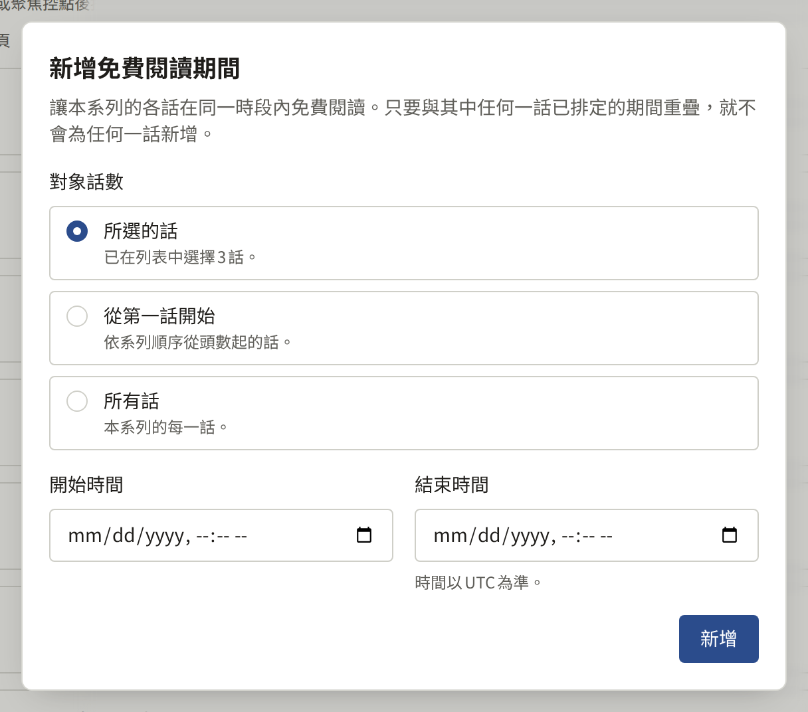

網站會從期間開始的那一刻起顯示它，並在結束的那一刻撤下：`publira worker`會在開始與結束時重新整理快取頁面，如[排程工作與維護工作](../../3-operations/10-scheduled-jobs.md#免費閱讀期間與其他快取頁面)所述。

## 活動價格

活動價格會在兩個時間點之間以較低的價格販售付費章節。在活動期間購買章節，不論是在網站上，還是在透過**應用程式內購買**販售的應用程式中，都會以活動價格收費；與[系列的其餘部分](../4-selling-episodes.md#系列的剩餘章節)一起購買時也一樣，且是在扣除系列的**打包優惠**之前套用。章節會保留自己的**價格**，並在活動結束時再次適用。租借會維持其**租借價格**，以活動價格完成的購買則會保留當時支付的價格。

章節編輯畫面上的**活動價格**會列出它的活動及其價格，標示為**活動中**、**已排定**或**已結束**。若要新增，請以租戶貨幣輸入低於章節**價格**的**活動價格**，接著輸入**開始時間**與**結束時間**（兩者都以租戶的時區解讀），然後選擇**新增活動價格**。**結束時間**必須晚於**開始時間**且仍在未來；**開始時間**可以是過去的時間，此時章節會從現在起以活動價格販售。同一章節的兩個活動不能重疊，但一個活動可以正好在另一個結束時開始。免費章節沒有可以降低的價格，因此該區塊在免費章節上不提供表單。

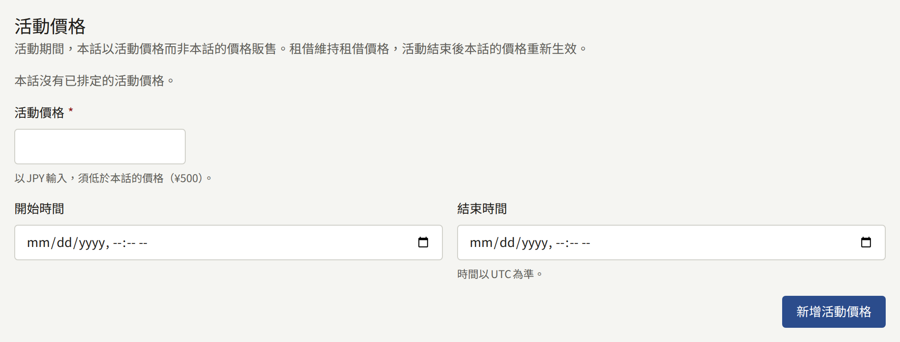

活動無法編輯。請**刪除**它再新增另一個；刪除已開始的活動會立即讓章節恢復以自己的價格販售。將章節的**價格**降到等於或低於某個活動的價格，會使該活動失去作用，因為此時章節會以自己的價格販售。

若要讓多個章節以相同的價格與期間參加活動，請在章節清單中勾選它們，然後選擇**活動價格**。輸入**活動價格**、**開始時間**與**結束時間**，然後選擇**新增**。如果價格沒有低於每個勾選章節的**價格**，或期間與其中任何一個章節上已有的活動重疊，就不會新增任何活動。

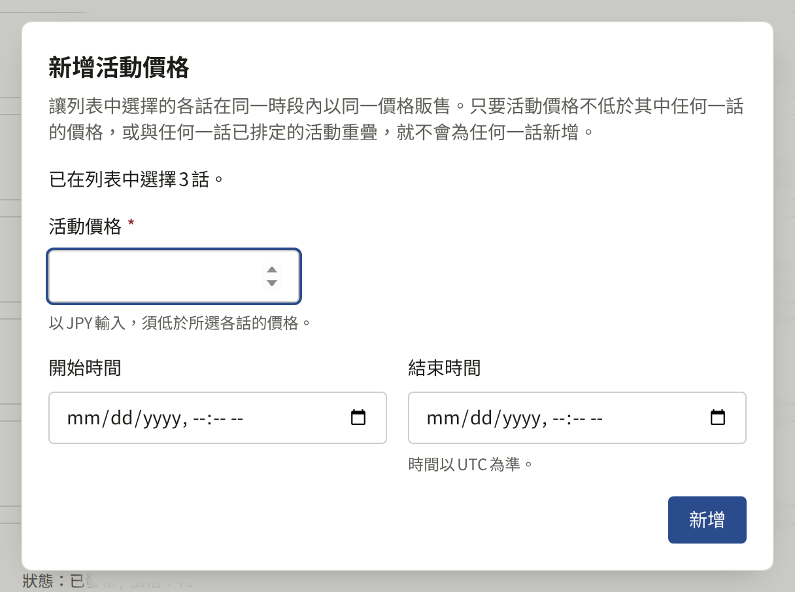

網站在任何標示章節價格的地方，對活動中的章節都會顯示活動價格、旁邊加上刪除線的原本**價格**，以及以租戶時區表示的活動結束時間。價格在讀者開始購買時就已確定，因此在活動結束後才開始購買的讀者，即使開始購買的頁面仍標示活動價格，也會支付章節原本的**價格**，付款頁面會顯示這個價格。

網站會從活動開始的那一刻起標示它，並在結束的那一刻撤下：`publira worker`會在開始與結束時重新整理快取頁面，如[排程工作與維護工作](../../3-operations/10-scheduled-jobs.md#免費閱讀期間與其他快取頁面)所述。

應用程式會在系列的章節清單、鎖定的章節，以及上一個章節結尾處對下一個章節的推薦中標示活動：顯示活動價格、旁邊加上刪除線的章節原本**價格**，以及活動結束時間；與應用程式中的所有時間一樣，結束時間以讀者裝置的時區表示。不論應用程式是透過網頁結帳販售，還是透過[**應用程式內購買**](../4-selling-episodes.md#在應用程式中販售)販售都是如此；後者會以對應活動價格的商店商品購買章節，因此商店的付款畫面會收取應用程式所標示的價格。

## 發布章節

章節處於以下三種狀態之一：

| 狀態 | 意義 |
| --- | --- |
| **草稿** | 沒有發布時間。讀者看不到它 |
| **已預約** | 發布時間尚未到來。在那之前讀者看不到它 |
| **已發布** | 發布時間已過。只要系列為公開，且章節在讀者所用的平台上顯示，讀者就可以開啟它 |

在章節發布之前，它的頁面會如同不存在一般回應，它不會出現在任何清單中，前後章節的上一章與下一章連結也會跳過它。

### 設定時間

章節編輯畫面上的**發布設定**用於設定或變更已存在章節的時間。以租戶的時區輸入時間，或清空欄位，然後選擇**更新發布日期與時間**：

- **已過去的時間**（例如目前時間）會立即發布草稿或已預約的章節，除非租戶[要求審核](#發布前審核)。它會通知追蹤者並送往搜尋索引，與已預約的章節到達時間時一樣。已發布的章節維持原狀，因此以它已顯示的時間儲存這個區塊不會改變任何事。
- **未來的時間**會將章節預約在該時間發布。
- **空白的欄位**會讓章節成為草稿。

後兩者會將已發布的章節從網站上撤下，如[將章節從網站上撤下](#將章節從網站上撤下)所述。

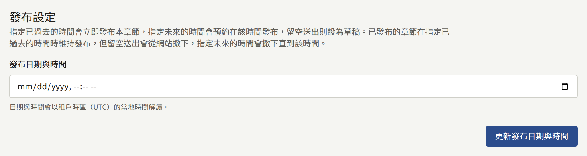

因此，為已公開的系列發布新章節的一般做法是：

1. 讓**發布日期與時間**保持空白，以草稿建立章節。
2. 新增頁面、設定版面，並在[預覽](#預覽頁面)中確認兩者。
3. 在**發布設定**下，輸入目前時間以立即發布，或輸入應發布的時間，然後儲存。

### 已預約的章節何時出現

章節由`publira worker`發布，它每分鐘會尋找時間已過的章節一次。在那一次執行時，章節會：

- 在網站上自己的頁面與所屬系列的章節清單中開放，應用程式中也是。
- 通知追蹤該章節、其系列或其列名作者的每位讀者：在它所顯示的網站與應用程式上各發送一則通知與推播通知，在網站上顯示時還會寄送電子郵件。每位讀者的通知設定決定其中哪些會送達。
- 送往搜尋索引。

因此，預約在12:00的章節大約在12:01就可以閱讀，網站的清單（例如依**最近更新**排序的系列清單）也會從同一時刻起顯示它。

到了時間很久之後仍為**已預約**的章節，代表worker處理程序沒有在執行，或無法發布它。此時租戶管理員會收到標題為「有章節發布失敗」的通知。這需要由營運人員修復，如[排程工作與維護工作](../../3-operations/10-scheduled-jobs.md#預約發布)所述，修復後章節會自行發布。若不想等待而要直接發布，請在**發布設定**下輸入目前時間並儲存。

在系列尚未公開時發布的章節，會等待系列公開，以免任何通知導向找不到的頁面。它會在系列發布時通知讀者，不論是透過**更新系列**，還是系列自己的**發布日期與時間**到來；從那時起，由於在那之前沒有讀者能開啟它，它會以系列公開的時刻作為發布日期。系列先前公開期間已通知過追蹤者的章節，會保留原本的日期，也不會再次通知。

在**不在任何位置顯示**的狀態下發布的章節不會通知任何人，之後開始顯示時也不會通知。只在網站與應用程式其中之一顯示的章節，只會在該處通知：讀者只會在那一邊的通知中看到它的通知，推播通知也只會送到他們的瀏覽器或只會送到他們的手機。章節在哪裡通知，是在`publira worker`發送通知時決定的，在那之後變更它的**顯示位置**，並不會改變已發送的通知。請在發布時間之前設定好章節的顯示位置。

### 發布前審核

租戶可以要求每個章節在發布前都由租戶管理員核准，讓編輯所預約的內容先經過第二個人閱讀。在租戶管理員於[**設定**](../3-setup/1-settings.md#發布前審核)中開啟**發布前必須審核**之前，審核功能是關閉的；關閉期間，章節只依它的時間發布，如上所述。

要求審核期間：

- **儲存時間即會提交章節審核**。建立章節時或在**發布設定**下儲存的發布時間，會讓章節成為**已預約**並進入審核，而不是自行預約發布。已過去的時間也不會立即發布它：它與其他章節一樣等待決定。要求審核期間，**發布設定**會在欄位上方說明這一點。
- **租戶管理員核准或退回章節**。章節編輯畫面的**發布設定**下方有一個**審核**區塊。章節在審核中時，租戶管理員會在該處看到**評語**欄位以及**核准**與**退回**。已核准的章節會與其他已預約的章節一樣，由`publira worker`在其時間發布；時間已過的章節則在核准的那一刻發布。核准時評語是選填的，退回時則必須寫明需要修改的地方。
- **被退回的章節會保留它的時間，並保持未發布**。提交它的工作人員會在主控台收到標題為「有章節被退回」的通知，以及一封引用評語的電子郵件。修改完成後，他們在**發布設定**下選擇**提交審核**，就會再次提交而不變更它的時間。儲存另一個時間也會提交它。
- **每一輪審核都會保留**。**審核**區塊會列出章節審核的每一輪，最舊的在前：誰在何時提交、誰在何時核准或退回，以及評語。章節目前的狀態會標示在區塊標題旁：**審核中**、**已退回**或**已核准**。每位工作人員都可以閱讀這個區塊；稽核員在其中看不到任何控制項，編輯則看不到**核准**或**退回**。
- **核准後的變更會讓章節重新進入審核**。已核准的章節，若其頁面、標題、價格、版面、封面圖、署名，或**顯示位置**與**販售位置**有所變更，或被設定了另一個時間，就需要再次核准，因為已核准的內容已不再是將要發布的內容。已發布的章節不會再次審核。
- **等待審核的章節並不是發布失敗**。它在時間過後仍維持**已預約**，也不會有人收到它無法發布的通知。
- **草稿永遠不會處於審核中**。在**發布設定**下清空時間，會將章節連同其預約一起撤出審核。

開啟審核會將每個已預約的章節提交審核，包括先前開啟審核期間已核准的章節，因此在租戶管理員核准之前，它們都不會發布。關閉審核會讓每個已預約的章節依其時間發布，不論它是在審核中、已退回還是已核准。審核關閉期間，編輯畫面不會顯示**審核**區塊與**提交審核**，章節清單也不會將任何章節標示為**審核中**或**已退回**。

每次提交、核准與退回都會記錄在**稽核記錄**中。

### 何時發布什麼

側邊欄**作品**群組中的**行事曆**會顯示租戶所有系列在一個月內的發布。每一天會列出在當天發布或已在當天發布的章節，附有系列標題、章節標題與狀態（**已預約**或**已發布**），選擇其中一個會開啟它的編輯畫面。一天是以租戶時區計算的一天（畫面上會標示時區），因此在該時區預約於23:30的章節，不論查看者身在何處，都會顯示在那一天。草稿沒有時間，不會顯示在行事曆上。

行事曆會開啟在當月，並標示今天。**上個月**與**下個月**一次移動一個月，**本月**則回到當月。儀表板**發布佇列**旁的**開啟行事曆**也會開啟它。每位工作人員都可以開啟它，但無法從它變更任何內容：章節要在它自己的**發布設定**下重新預約。

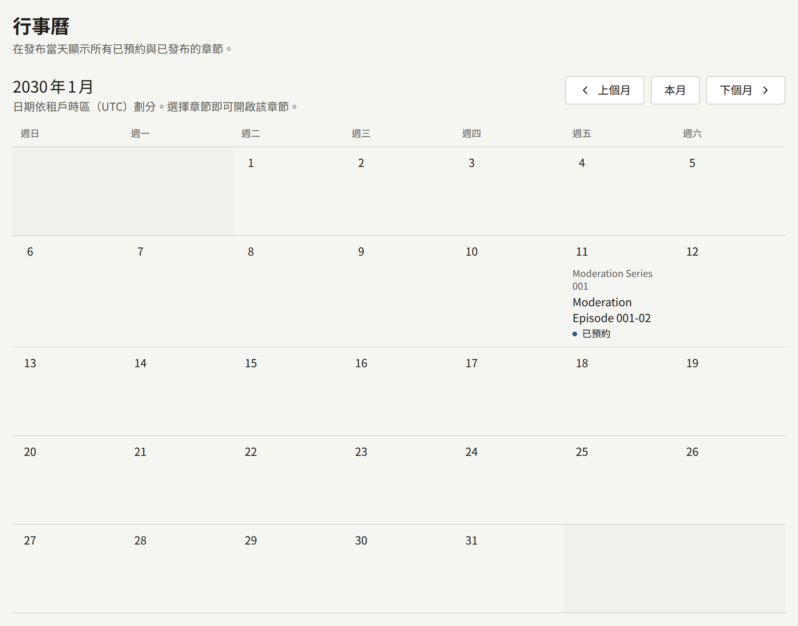

### 將章節從網站上撤下

已售出的章節，或有需要保留的記錄引用的章節，無法刪除，詳見[刪除章節](#刪除章節)。若要將已發布的章節從網站上撤下，請改為：

- 在**發布設定**下**清空欄位**並儲存。章節會回到**草稿**。
- **輸入未來的時間**並儲存。章節在該時間之前不會出現在網站上，並在該時間再次發布，且不會再次通知追蹤者。
- **設定顯示位置**，讓它不在任何地方顯示。章節維持已發布，並在設定變更後立即恢復。

已購買該章節的讀者，在上述任何一種情況下都會失去存取權，直到章節恢復為止。

### 刪除章節

租戶管理員可以透過章節編輯畫面**基本資料**分頁最後的**刪除本章**來刪除章節；編輯與稽核員看不到它。對話框會要求輸入章節標題，在準確輸入標題之前，**刪除章節**無法按下。按下後，章節會連同其頁面、封面圖、翻譯、署名、免費閱讀期間、活動價格與審核記錄一起刪除，讀者留下的留言及其檢舉、追蹤、反應與閱讀記錄也會一併刪除。稍後，關於該章節及其留言與審核的通知也會從讀者與工作人員的通知中刪除。章節會立即從網站、應用程式與搜尋索引中消失，主控台會回到該系列的章節列表。刪除無法復原，**稽核記錄**會記錄這項操作與章節標題。

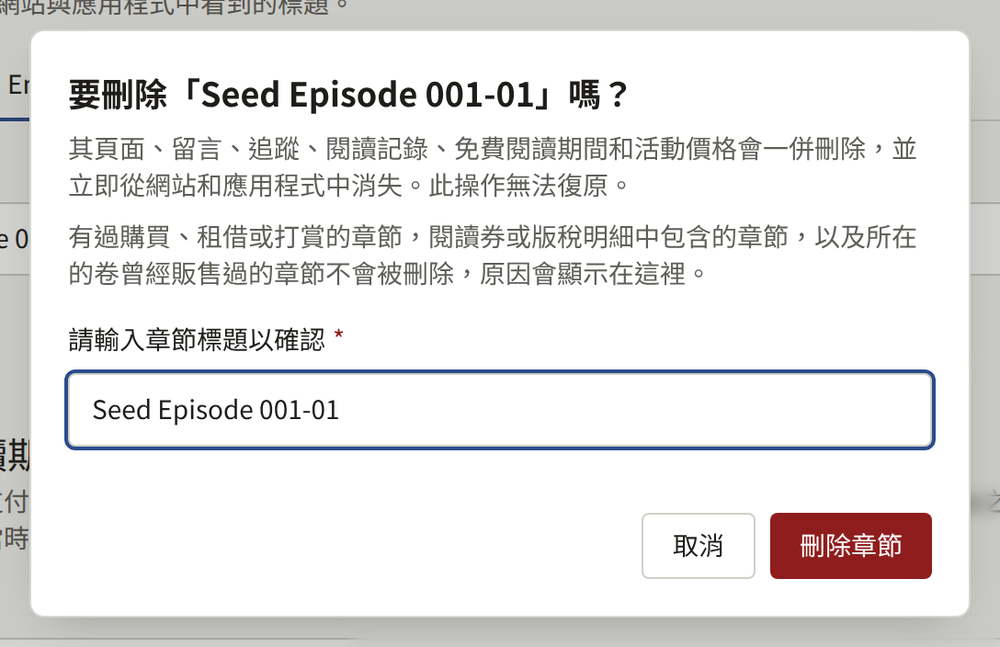

只要以下任一項引用了該章節，章節就不會被刪除，對話框會顯示原因：

- 購買、租借或打賞，無論是讀者付費或工作人員授予，包括在App Store或Google Play中的購買、以代幣付款的購買，以及隨包含該章節的卷或打包優惠一起的購買。**查看本章的購買記錄**會開啟篩選為本章的**購買記錄**。
- 本章仍可能完成的付款。
- 閱讀券，包括已撤銷與已過期的。**查看本章的閱讀券**會開啟篩選為本章的**閱讀券**。
- 包含本章的版稅明細。
- 讀者已使用的本章促銷代碼。
- 包含本章且曾經販售過的卷，無論現在是否仍在販售。

這些都是金錢或授予讀者權利的記錄，因此記錄與章節都不會被刪除：請改為將章節從網站上撤下。從未販售過的卷，以及無人使用過的本章促銷代碼，只會在章節刪除時失去該章節。
