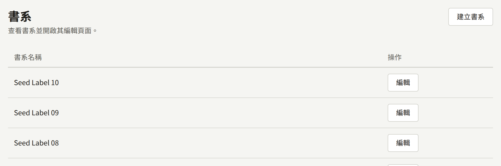
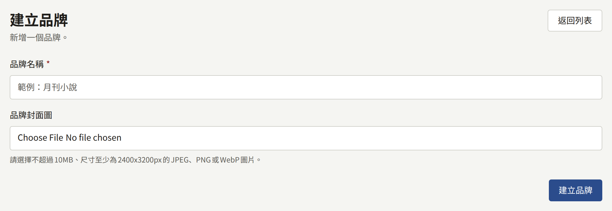
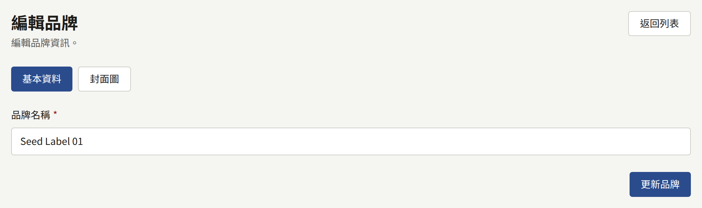
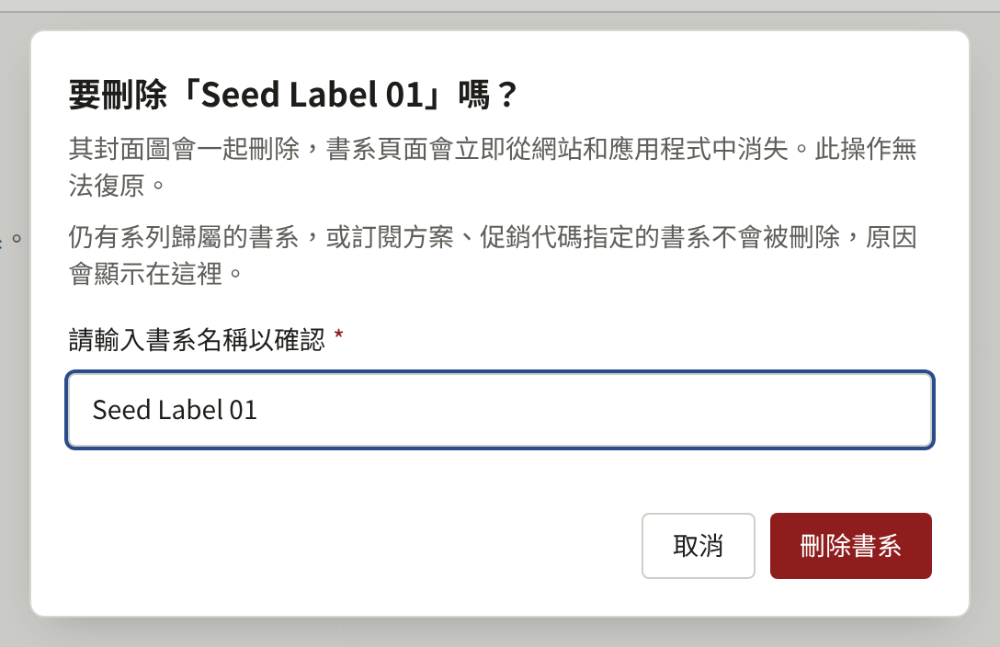

書系是出版品牌：出版社為旗下一系列作品取的名稱，例如一本雜誌或一套叢書。每個系列都只屬於一個書系，因此在書系存在之前，系列無法儲存。只有單一出版品牌的出版社，只需建立一個書系，並將每個系列都歸在它底下。

側邊欄**作品**群組中的**書系**會列出書系，最新的在前，每頁二十筆。

## 建立書系

選擇**建立書系**，輸入**書系名稱**，然後選擇**建立書系**。**書系封面圖**是最大10 MB、至少2400 × 3200像素的JPEG、PNG或WebP圖片，為選填，之後也可以再新增。

書系的頁面有兩個分頁。**基本資料**以**更新書系**變更它的名稱。**封面圖**可以替換或刪除它的圖片，並調整從中裁切出的四種形狀，如[封面圖](./1-series.md#封面圖)對系列的說明。

兩個書系可以同名，因此建立前請先確認清單。誤建的書系在沒有任何內容引用它之後，可以依[刪除書系](#刪除書系)所述刪除。

## 在網站上

- 網站頁首的**書系**會列出每個書系，以及其已發布系列的數量。
- 每個書系都有一個頁面，顯示它的名稱、作為寬幅橫幅的封面圖，以及依標題排序的已發布系列。
- 系列頁面會顯示它的書系，並連結到該書系。
- 首頁的**推薦書系**會顯示最近建立且有已發布系列的六個書系，並附有前往所有書系的連結。

書系從建立的那一刻起，即使其中還沒有任何公開的系列，也會列在**書系**中，它的頁面也會回應，並顯示「已發布0部系列」。只有在它的某個系列發布後，它才會出現在**推薦書系**中，因此請在那之前設定好它的名稱與封面圖。

已發布系列全都因**顯示位置**而不在某個平台上顯示的書系，不會列在該平台上。

## 刪除書系

租戶管理員可以透過書系頁面**基本資料**分頁最後的**刪除本書系**來刪除書系；編輯與稽核員看不到它。對話框會要求輸入書系名稱；在準確輸入名稱之前，**刪除書系**無法按下。按下後，書系會連同其封面圖一起刪除。書系頁面會立即從網站、應用程式與搜尋索引中消失，主控台會回到**書系**列表。刪除無法復原，**稽核記錄**會記錄這項操作與書系名稱。

只有在沒有任何內容引用書系時，才能刪除書系。只要存在以下任一項，書系就不會被刪除，對話框會顯示原因，並附上前往其所在畫面的連結：

- 歸屬本書系的系列，不論其狀態為何。請在系列**基本資料**分頁的**書系**中將其逐一移到其他書系，或依[刪除系列](./1-series.md#刪除系列)所述刪除系列。**查看本書系的系列**會開啟依本書系篩選的**系列**列表。
- **可閱讀範圍**包含本書系的訂閱方案。請依[變更、取消發布與刪除方案](../5-subscription-plans.md#變更取消發布與刪除方案)所述，將本書系從方案的可閱讀範圍中移除。**查看訂閱方案**會開啟**訂閱方案**。
- 本書系未刪除或已被讀者使用的促銷代碼。請依[查看、暫停與刪除代碼](../4-selling-episodes.md#查看暫停與刪除代碼)所述刪除無人使用的促銷代碼；有讀者使用過的代碼時，書系無法刪除。**查看促銷代碼**會開啟**促銷代碼**。

對話框會依此順序顯示第一個符合的項目，因此同時符合多項的書系，在解決一項之後會因下一項再次被拒絕刪除。
