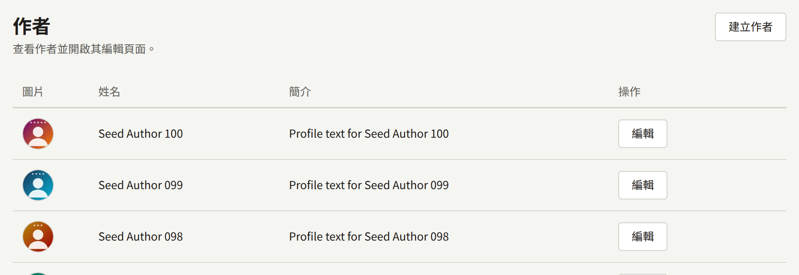
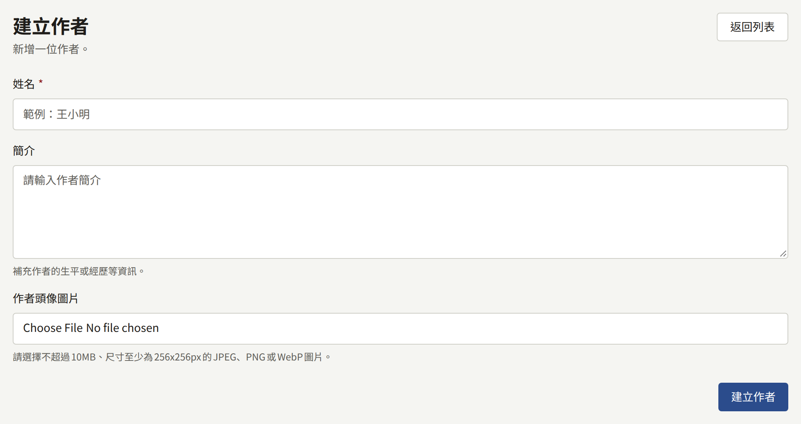
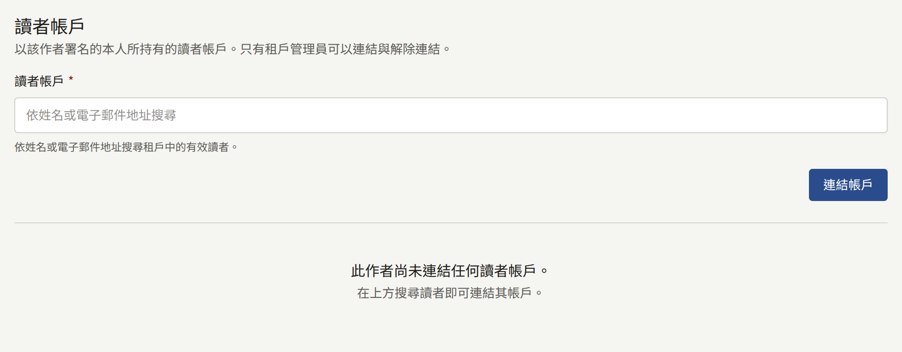
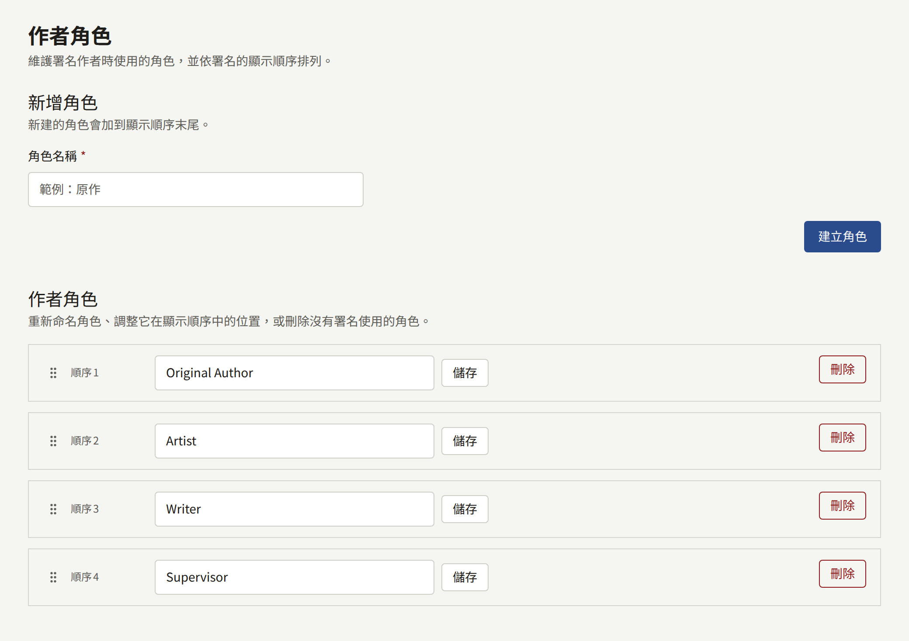
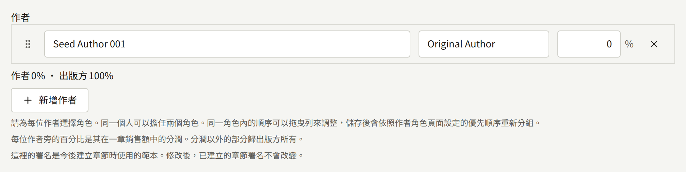

作者是列名於作品的人：撰稿者、作畫者、改編作品的原作者。系列及其每個章節都會列出作者，每位作者各以某個作者角色列名；這些署名就是讀者在標題旁看到的內容，也是支付版稅的依據。

## 作者

側邊欄**作品**群組中的**作者**會列出租戶的作者，最新的在前，每頁二十筆。選擇**建立作者**並填寫：

- **姓名**：讀者看到的名稱；如果此人以筆名發表作品，就填筆名。
- **簡介**：選填的個人介紹，會依原樣（包括換行）顯示在作者的頁面上。
- **作者頭像圖片**：選填，最大10 MB、至少256 × 256像素的JPEG、PNG或WebP圖片。**調整取景框**用於選擇從中裁切出的正方形。

選擇**建立作者**即可儲存。之後以同一個表單搭配**更新作者**變更作者。作者無法刪除，且兩位作者可以同名，因此請先確認清單。

以兩個筆名發表作品的人，就是兩位作者。

### 在網站上

- 至少有一部已發布系列的每位作者，都有一個頁面，顯示其頭像、姓名、簡介，以及依標題排序的署名系列。讀者可以在該處追蹤作者，並會收到每個署名該作者的新章節的通知。
- 網站的作者清單，以及首頁的**推薦作者**，會依姓名順序顯示這些作者。
- 沒有已發布系列的作者沒有頁面。

系列或章節頁面上的署名是純文字，不會連結到作者的頁面。

### 將作者連結到讀者帳戶

租戶管理員可以在作者頁面的**讀者帳戶**下，記錄某位作者就是網站上的某位讀者。編輯與稽核員看不到這個區塊。

在**讀者帳戶**中以姓名或電子郵件地址搜尋該讀者，然後選擇**連結帳戶**。該讀者必須已在網站上擁有帳戶，且電子郵件地址已確認；工作人員的帳戶無法連結。一個帳戶可以連結到多位作者，一位作者也可以連結到多個帳戶。

連結後，該讀者：

- 可以閱讀以章節本身的署名列出該作者的每個章節，不需購買。章節會告知讀者，因為他們是作者，所以可以閱讀。只在系列上列名並不會開放其章節，系列的年齡分級也仍然適用。
- 不會被提供購買這些章節的選項，也無法為它們評分。
- 在這些章節上的留言會帶有**作者**徽章，他們的名稱也會連結到作者的頁面。

在租戶管理員於[設定](../3-setup/1-settings.md#作者頁面)的**作者頁面**下開啟**向作者顯示其自己的頁面**之前，已連結的讀者看不到作者的任何其他資訊。開啟後，讀者可以針對其所連結的每位作者閱讀：

- 目前有多少讀者追蹤這位作者。
- 在網站上發布且署名該作者的每個章節，以及其過去28天的會員瀏覽數與讀完數，計算方式與**分析**下的**章節**相同。比率也與該處一樣，由這兩個數值計算而得。
- 如果同時開啟了**顯示明細和銷售額**，還有這些章節在同樣28天內的銷售額、扣除退款後的收入，以及每份已結算版稅明細中屬於該作者的部分，如[報表與版稅](../6-reports-and-royalties.md#連結的作者能看到明細的哪些內容)所述。
- 在網站上發布且署名該作者的每個章節上已公開的留言，最新的在前，每則都附有其章節，與每位讀者在章節下看到的內容完全相同。等待審核、已移除或已被留言者刪除的留言不在其中，只透過系列署名該作者的章節上的留言也不在其中。這份清單僅供閱讀：若要回應，讀者要在該章節上留言，他們的留言會帶有**作者**徽章。

讀者在網站上以**我的頁面**中的**開啟作者頁面**開啟這些頁面，在應用程式中則以**帳戶**分頁中**已購買**下的**作者頁面**開啟。兩者都只有在有可開啟的作者時才會顯示。每位作者都有自己的頁面，連結到多位作者的讀者可以用頂端的分頁切換。作者頁面上的**留言**會開啟該作者章節上的留言。

讀者只能看到自己所連結的作者，絕對看不到其他作者的數據或明細行，即使是與自己並列署名的作者也一樣。工作人員的帳戶什麼都看不到，即使是在成為工作人員之前就已連結的帳戶也一樣。

**解除連結**會移除連結，讀者的帳戶則維持原樣。兩者都會記錄在稽核記錄中。

## 作者角色

作者角色是作者以什麼身分列名。每條署名都會指定一個角色，同一位作者也可以在同一個系列中以兩個角色列名兩次。

新租戶有四個角色：**Original Author**、**Artist**、**Writer**與**Supervisor**。它們的名稱以英文原樣儲存，讀者看到的也是原本的寫法，因此使用其他語言的網站要為它們重新命名。

**作者角色**會依優先順序列出它們。在這個畫面上：

- **新增角色**以**角色名稱**與**建立角色**新增角色。名稱最多50個字元，且不分大小寫必須是唯一的。新角色會排在順序的最後。
- 每個角色的名稱都可以直接在原處變更，並以**儲存**儲存。該角色的每條署名都會顯示新名稱。
- 拖曳角色的控制點可以變更順序。
- **刪除**會刪除沒有任何署名使用的角色。仍在使用中的角色無法刪除：主控台會顯示有多少署名使用它，必須先將這些署名改為其他角色。

沒有任何角色時，無法為任何人署名。

## 為作者署名

署名在系列表單與每個章節編輯畫面的**作者**下輸入。每一列都指定一位**作者**、一個**角色**與一個分潤，也就是作者據以獲得版稅的銷售額百分比。分潤分配後剩下的部分屬於出版社。分潤合計不能超過100%。

儲存時，各列會依角色分組，並依角色的優先順序排列；在同一個角色內，拖曳列可以排列作者的順序。

網站以相同的方式顯示署名：每個角色後面接著其作者，例如「Original Author Name1, Name2 / Artist Name3」。系列頁面顯示系列的署名，章節頁面則顯示章節本身的署名。

系列的署名是其新章節的範本：章節建立時會複製一份，系列的署名變更時，章節仍保留那份複本。[署名](./2-episodes.md#署名)說明了如何在一個章節或一次在多個章節上變更署名，[報表與版稅](../6-reports-and-royalties.md#作者應得的金額)則說明了分潤如何成為版稅。
