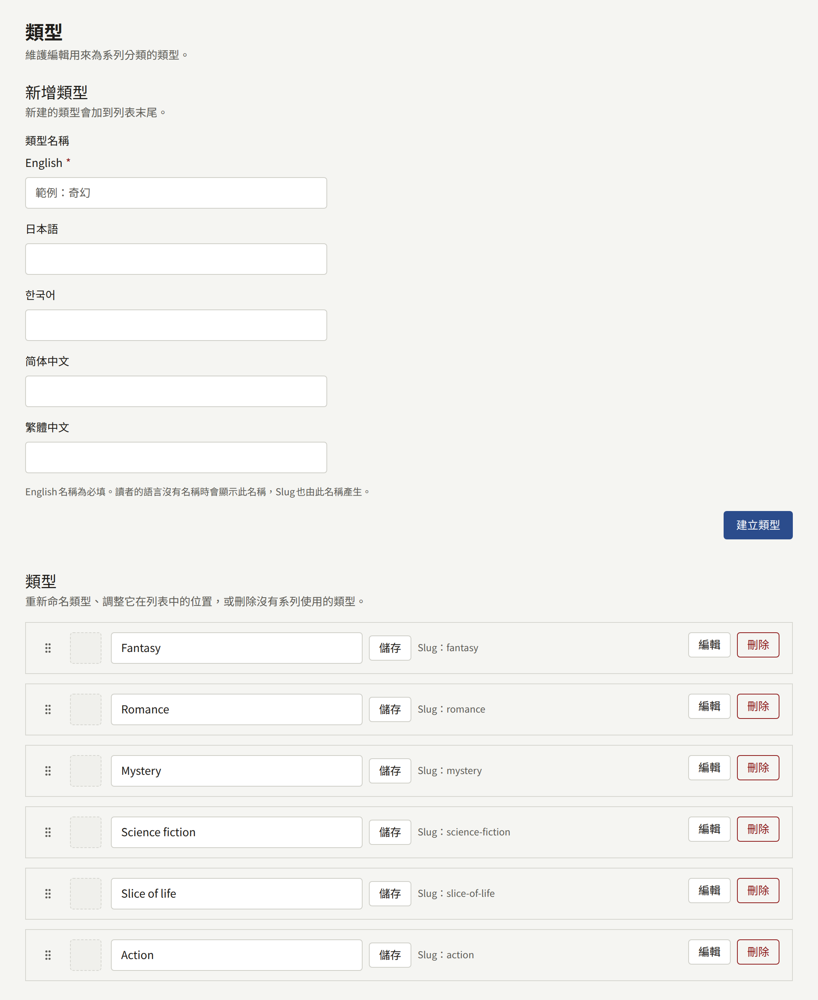
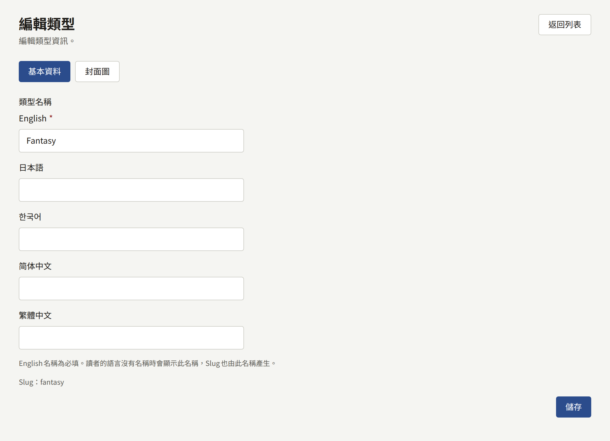

類型是租戶為系列歸類的分類，例如奇幻或愛情。系列可以屬於任意數量的類型（在系列的表單上選擇），讀者則依類型瀏覽作品目錄。類型由租戶自行決定：沒有任何預先定義的類型，且所有類型都在同一層的清單中。

側邊欄**作品**群組中的**類型**會在一個頁面上顯示整份清單。

## 管理類型

- **新增類型**以**類型名稱**與**建立類型**新增類型。**類型名稱**為網站提供的每種語言各有一個欄位，如[以各語言為類型命名](#以各語言為類型命名)所述。名稱最多50個字元，且預設語言的名稱必須是唯一的。新類型會排在清單的最後。
- 每個類型在預設語言中的名稱都可以直接在原處變更，並以**儲存**儲存。
- 拖曳類型的控制點可以變更它的位置。這個順序就是網站列出類型的順序，也是系列的類型顯示的順序。
- **編輯**會開啟類型的頁面。它的**基本資料**分頁保存類型在網站提供的每種語言中的名稱，**封面圖**分頁則為它設定圖片，如[封面圖](./1-series.md#封面圖)對系列的說明。
- **刪除**會刪除沒有任何系列使用的類型。仍在使用中的類型無法刪除：請先將它從每個系列中移除。

## 以各語言為類型命名

類型可以在網站提供的每種語言中各有一個名稱，網站提供哪些語言由租戶管理員在[**設定**](../3-setup/1-settings.md#語言)中選擇。**新增類型**與類型的**基本資料**分頁上的**類型名稱**，為這些語言各提供一個欄位，以該語言本身的語言名稱標示，網站的預設語言排在最前面。

- 預設語言的名稱為必填。使用類型沒有名稱的語言的讀者，會看到預設語言的名稱。
- 與名稱一起顯示的類型slug，是由預設語言的名稱產生的。它可以防止兩個類型取相似的名稱：只有大小寫或空格不同的名稱會產生相同的slug，因此其中第二個會被拒絕。
- 類型在網站上的位址是它的公開ID，而不是slug，因此重新命名類型不會改變位址，且位址在每種語言中都相同。
- 其他名稱為選填。填入欄位就會新增該語言的名稱。在類型的**基本資料**分頁上，清空欄位並選擇**儲存**會刪除該名稱。
- 網站未提供的語言沒有欄位。已以該語言儲存的名稱會保留，再次提供該語言時，它的欄位就會回來。

## 在網站上

- 首頁的**依類型瀏覽**會依清單的順序顯示每個類型，以及其已發布系列的數量。租戶沒有任何類型時，這個區塊會隱藏。
- 網站頁首的**類型**會以圖塊顯示每個類型，附有它的封面圖；沒有封面圖時，則顯示其中幾個系列的封面。
- 每個類型都有一個頁面，顯示本週在其中受歡迎的作品，以及它的系列，讀者可以依狀態與其他篩選條件縮小範圍。
- 系列頁面會連結到它的每個類型。
