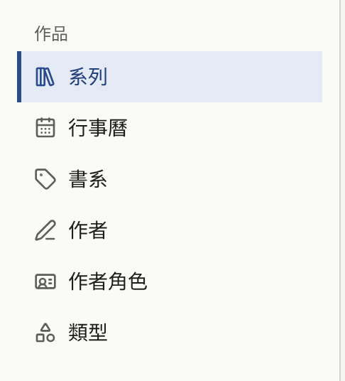

讀者在網站上可以開啟的一切，都是某個系列的章節；系列歸屬於某個書系，並列出它的作者。建立這些內容的畫面，以及顯示何時發布的行事曆，都位於側邊欄的**作品**群組：

| 畫面         | 內容                                                    |
| ------------ | ------------------------------------------------------- |
| **系列**     | 作品及其章節                                            |
| **行事曆**   | 每個已預約與已發布的章節，顯示在其發布當天              |
| **書系**     | 系列所屬的出版品牌                                      |
| **作者**     | 列名於系列與章節的人                                    |
| **作者角色** | 作者以什麼身分列名，例如**Original Author**或**Artist** |
| **類型**     | 讀者瀏覽作品目錄時所依據的分類                          |

租戶管理員與編輯可以在這些畫面上建立與變更所有內容，只有與作者連結的**讀者帳戶**例外，那只有租戶管理員能看到與變更。稽核員可以開啟其中每一個畫面，但表單為唯讀，也看不到建立任何項目的按鈕。作品目錄中除了章節的頁面，以及沒有被任何項目使用的作者角色與類型之外，什麼都無法刪除，因此不應再被閱讀的系列或章節，是從網站上撤下而不是刪除。

## 從空的作品目錄到第一個章節

以下順序是主控台所要求的：系列沒有書系就無法儲存，作者要從已存在的作者清單中選取列名，而章節屬於某個系列。準備第一個章節的期間，系列保持隱藏，到最後一步時兩者才一起呈現給讀者。

1. **建立書系**。在**書系**中選擇**建立書系**，輸入**書系名稱**，然後選擇**建立書系**。只有單一出版品牌的出版社只需建立這一個書系，之後的每個系列也都歸在它底下，而不是每個系列各建一個書系。請參閱[書系](./3-labels.md)。
2. **建立作者**。在**作者**中，為每位要列名的人選擇**建立作者**，填入**姓名**，若有的話也填入**簡介**並設定**作者頭像圖片**。請參閱[作者與作者角色](./4-authors.md)。
3. **檢查作者角色**。新租戶有四個以英文命名的作者角色：**Original Author**、**Artist**、**Writer**與**Supervisor**。由於讀者會在每個姓名旁看到它們，如果網站使用其他語言，請在**作者角色**中重新命名。
4. **建立類型**。如果網站要依類型瀏覽，請在**類型**中建立網站所用的類型。系列沒有類型也能儲存，之後再指定類型即可。請參閱[類型](./5-genres.md)。
5. **建立系列**。在**系列**中選擇**建立系列**。填入**標題**、**簡介**與**書系**，在**作者**中列出作者，選擇**封面圖**，並讓**發布日期與時間**保持空白，這樣系列在您作業期間會保持隱藏。選擇**建立系列**。請參閱[系列](./1-series.md)。
6. **建立第一個章節**。在**系列**清單中，選擇該系列那一列的**章節**，再選擇**建立**。輸入**標題**與**價格**，並將**發布日期與時間**設為目前時間，章節建立後就會立即發布。由於系列仍處於隱藏，章節此時還無法閱讀。選擇**送出章節**。請參閱[章節](./2-episodes.md)。
7. **新增頁面**。在章節的編輯畫面中，於**新增漫畫頁面**下新增頁面圖片，然後在**已新增的頁面圖片**下確認它們的順序。
8. **發布系列**。回到系列，將**發布日期與時間**設為目前時間，然後選擇**更新系列**。系列與它的第一個章節現在已出現在網站上。
9. **以讀者身分開啟**。登出或使用私密視窗，從網站首頁、**書系**，或搜尋標題找到該系列。開啟章節並翻閱頁面。付費章節會改為顯示價格，開啟方式請參閱[販售章節](../4-selling-episodes.md)。

之後的章節會新增到已公開的系列中，因此要先以草稿準備，等頁面就緒後再設定時間，如[發布章節](./2-episodes.md#發布章節)所述。

## 本節內容

- [系列](./1-series.md)：建立系列、它在哪裡與何時顯示、年齡分級、閱讀方向、留言、封面圖，以及**等待即可免費**。
- [章節](./2-episodes.md)：建立章節、新增頁面、價格與閱讀期限、頁面版面、署名、在哪裡顯示與販售、免費閱讀期間、預約發布，以及顯示何時發布什麼的行事曆。
- [書系](./3-labels.md)：系列所屬的出版品牌，以及讀者看到的書系頁面。
- [作者與作者角色](./4-authors.md)：列名於作品的人、他們以什麼身分列名、署名在網站上如何呈現，以及將作者連結到其讀者帳戶。
- [類型](./5-genres.md)：讀者瀏覽時所依據的分類，以及它們的順序。
