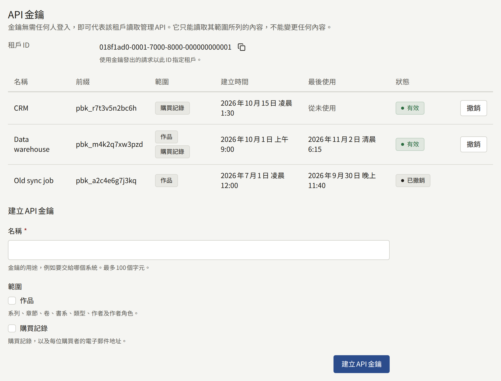
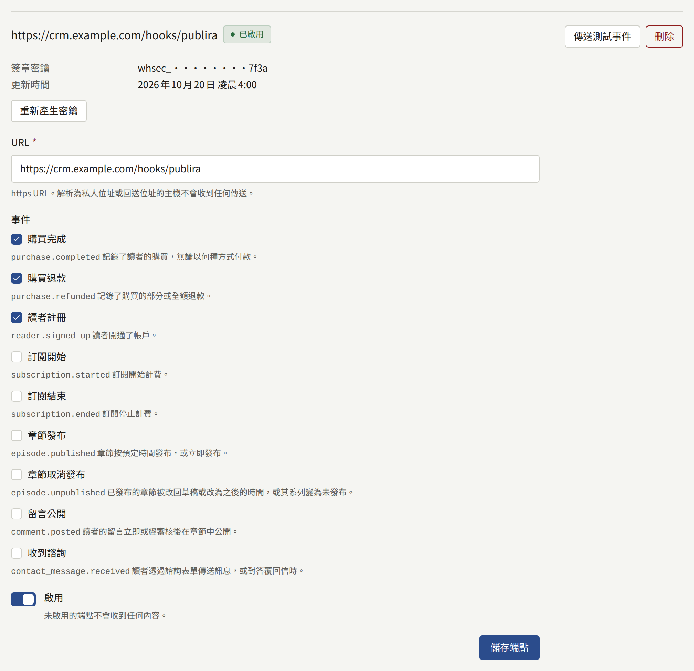
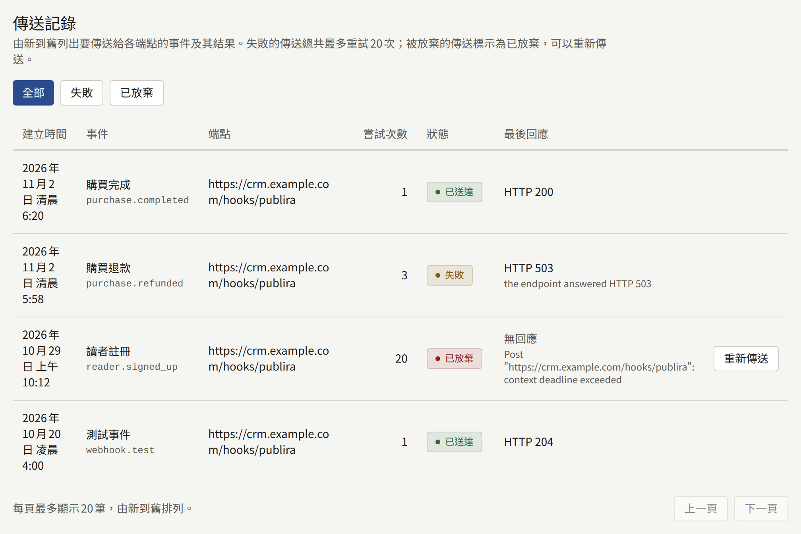

**整合** › **API金鑰與Webhook**會將租戶與出版社自己運作的系統連接起來，例如CRM、資料倉儲或會計系統。系統以**API金鑰**讀取租戶的作品目錄與購買記錄，或在作品目錄中新增系列與章節，並透過**Webhook端點**在銷售、退款、新讀者、訂閱、章節發布或取消發布、讀者留言、讀者諮詢發生的當下得知。Webhook端點是系統自己的一個URL，每個事件都會傳送到那裡。**傳送記錄**會列出傳送給每個端點的內容，以及被放棄的內容。

只有租戶管理員看得到**API金鑰與Webhook**，其中的每項變更都會記錄在**稽核記錄**中：**建立了API金鑰**、**撤銷了API金鑰**、**建立了Webhook端點**、**更新了Webhook端點**、**刪除了Webhook端點**、**重新產生了Webhook簽章密鑰**與**重新傳送了Webhook**。

## API金鑰



金鑰無需任何人登入，即可呼叫此租戶的管理API。它只能讀取和變更其範圍所列的內容，只有具備**編輯作品**的金鑰才能變更內容。

### 建立金鑰

1. 在**建立API金鑰**下，輸入說明金鑰用途的**名稱**，例如要交給哪個系統，最多100個字元。
2. 選擇它的**範圍**，至少選擇下列其中一項：

   | 範圍 | 金鑰可以做的事 |
   | --- | --- |
   | **作品** | 讀取系列、章節、卷、書系、類型、作者及作者角色 |
   | **購買記錄** | 讀取租戶的購買記錄或某位讀者的購買記錄，以及每位購買者的電子郵件地址 |
   | **編輯作品** | 建立與變更系列和章節，新增、替換、重新排序與刪除章節的頁面，上傳其封面圖，設定章節的作者，以及預約章節的發布，詳見[透過金鑰變更作品](#透過金鑰變更作品) |

   只選擇系統需要的範圍：**購買記錄**會將每位購買者的地址交給它，**編輯作品**則讓它能變更讀者看到的內容。範圍彼此不相包含，因此變更作品後還要讀回確認的系統也需要**作品**。

3. 選擇**建立API金鑰**。

金鑰只會在**新的API金鑰**下顯示一次，並附有複製它的控制項。請立即複製，並保存在使用它的系統可以讀取的位置：系統只保留它的雜湊值，因此無法再次顯示；離開或重新整理頁面後，它也會從畫面上消失。未複製的金鑰應撤銷，並以新的金鑰取代。

之後，列表會以**前綴**顯示該金鑰，也就是`pbk_`及其後的十二個字元，即系統所持有金鑰的開頭部分；**最後使用**會精確到分鐘。

### 發出請求

系統在管理API上以`Authorization: Bearer <key>`傳送金鑰，並以列表上方顯示的**租戶ID**指定租戶，如以下這個取得租戶系列的請求：

```bash
curl <server>/rpc/publira.admin.v1.AdminSeriesService/ListSeries \
  -H "Authorization: Bearer pbk_…" \
  -H "Content-Type: application/json" \
  -d '{"tenant": {"tenantId": "<Tenant ID>"}}'
```

安裝實例前方的邊緣不會轉送管理API，因此金鑰是由能直接連到`publira server`的系統使用，也就是透過Web應用程式呼叫它的那個網路。請向安裝實例的營運人員詢問該位址。

各個程序及其欄位請見[管理API的定義](https://github.com/publira/publira/tree/main/proto/publira/admin/v1)。使用金鑰的請求在下列情況會收到這些回應：

- **`unauthenticated`**：金鑰已撤銷或不明，或請求指定了其他租戶時。
- **`permission_denied`**：呼叫的程序不在其任何範圍允許之列時，例如以不具備**編輯作品**的金鑰進行寫入。
- **`resource_exhausted`**，附帶`Retry-After`：超過安裝實例對使用金鑰之請求的限制時，也就是每分鐘600次、每天100,000次，除非營運人員設定了其他值。

### 透過金鑰變更作品

具備**編輯作品**的金鑰與主控台一樣，逐一呼叫程序來新增章節：以`CreateSeries`與`UpdateSeries`新增系列，以`CreateEpisode`新增章節，以`UploadEpisodeImages`上傳頁面（也可以是打包好的ZIP或ePub），以`UpdateEpisodePublishSchedule`設定發布時間。其餘的變更使用`UpdateEpisodeTitle`、`UpdateEpisodePricing`、`UpdateEpisodeLayout`、`ReplaceEpisodeImage`、`ReorderEpisodeImages`、`DeleteEpisodeImage`、`ReplaceEpisodeCredits`、`UploadSeriesEyeCatchAspectImage`、`UploadEpisodeEyeCatchImage`與`UploadEpisodeEyeCatchAspectImage`。金鑰能變更的只有這些：租戶的設定、成員、付款、讀者，以及[發布前審核](./1-catalog/2-episodes.md#發布前審核)的決定，仍只能由已登入的成員變更。

每次變更都會與主控台中的變更一樣記錄在[稽核記錄](./3-setup/8-audit-log.md)中，其**操作者**會顯示金鑰的名稱與前綴，並以**API金鑰**取代角色。每次變更也與其他請求一樣計入金鑰的請求上限。

開啟**發布前必須審核**期間，以金鑰儲存發布時間會與編輯儲存時一樣將章節提交審核，只有在租戶管理員核准後章節才會發布。

### 撤銷金鑰

選擇金鑰旁的**撤銷**，然後選擇**撤銷金鑰**。從此之後，使用它發出的每個請求都會被拒絕，它會以**已撤銷**的狀態留在列表中。已撤銷的金鑰無法再次使用。

若要不中斷地替換金鑰，請先建立新金鑰，將系統切換到新金鑰，等**最後使用**顯示舊金鑰已停止使用後，再撤銷舊金鑰。

## Webhook端點



端點是出版社自己的https URL，每發生一個它訂閱的事件，都會收到一個附簽章的`POST`請求。一個租戶最多可保留五個端點，每個端點都有自己的表單。

### 新增端點

在**新增端點**下：

1. 輸入它的**URL**：使用`https`，含有主機名稱，不含使用者名稱、密碼或片段，最多2048個字元。`http` URL會被拒絕。
2. 選擇要傳送給它的**事件**，至少一個，如[事件](#事件)所述。
3. 保持**啟用**開啟，即可立即開始傳送。
4. 選擇**新增端點**。

端點的簽章密鑰只會在**端點的簽章密鑰**下顯示一次。請立即複製並交給接收方，接收方會用它驗證每次傳送的簽章，如[驗證傳送](#驗證傳送)所述。之後，端點只會在**簽章密鑰**下顯示它的提示：`whsec_`、一段遮罩，以及密鑰的最後四個字元。

除非安裝實例的營運人員已[允許該位址](../3-operations/12-security/index.md#送往自有網路的webhook)，否則傳送不會送往解析為私人位址、回送位址、鏈路本機位址或共用位址的主機，並且絕不會跟隨重新導向。每次傳送時都會檢查主機解析到哪裡，因此之後解析到其他地方的URL，會在那時被拒絕。

### 變更、測試與刪除端點

- **儲存端點**會儲存端點自己的表單：它的URL、事件與**啟用**。未啟用的端點不會收到任何內容：這段期間發生的事件不會補傳給它，而關閉時仍在等待的傳送會被放棄。
- **傳送測試事件**會向端點傳送一個`webhook.test`事件，無論端點是否啟用，也無論它訂閱了什麼。這次測試會和其他傳送一起列在**傳送記錄**中，可藉此在真正的事件送達之前檢查新的接收方。
- 選擇**重新產生密鑰**，再選擇**重新產生密鑰**，會替換簽章密鑰，並在**新的簽章密鑰**下顯示一次新密鑰。從此之後，每次傳送都會以新密鑰簽章，包括先前傳送的重試；仍以舊密鑰驗證的接收方會拒絕它們。請立即更新接收方，並重新傳送這段期間被放棄的傳送。
- 選擇**刪除**，然後選擇**刪除端點**，會刪除該端點，以及所有要傳送給它的傳送。

## 事件

| 事件 | 傳送時機 | `data` |
| --- | --- | --- |
| **購買完成**（`purchase.completed`） | 記錄了讀者的購買，無論以何種方式付款：金流服務商、應用程式商店、租戶的代幣，或折抵全額的促銷代碼 | 購買 |
| **購買退款**（`purchase.refunded`） | 記錄了購買的部分或全額退款。每次部分退款都是各自獨立的事件 | 退款後的購買 |
| **讀者註冊**（`reader.signed_up`） | 讀者開通了帳戶，使用地址與密碼，或以Apple或Google登入 | 讀者 |
| **訂閱開始**（`subscription.started`） | 訂閱開始計費 | 訂閱 |
| **訂閱結束**（`subscription.ended`） | 訂閱停止計費 | 訂閱 |
| **章節發布**（`episode.published`） | 章節發布時：預定時間到達時，或以已經過去的時間建立、預約或核准而立即發布時。即使系列尚未公開也會傳送。每次發布都是一個獨立的事件，因此退回草稿後再次發布的章節會再次傳送 | 章節 |
| **章節取消發布**（`episode.unpublished`） | 已發布的章節從網站下架時：清空**發布設定**中的時間或改為之後的時間時，無論系列是否公開都會傳送一個事件；清空系列的**發布日期與時間**或改為之後的時間時，會為該系列中每個已發布的章節各傳送一個事件。每次下架都是一個獨立的事件，因此再次發布後又下架的章節會再次傳送 | 下架的章節 |
| **留言公開**（`comment.posted`） | 讀者的留言在章節中顯示時：留言的公開方式為**立即公開**時於發表時傳送，為**審核後公開**時於審核人員在**留言**中通過時傳送。每則留言只在首次顯示時傳送一次，因此移除後又恢復的留言不會再次傳送，在通過之前被移除或被留言者刪除的留言也不會傳送 | 留言 |
| **收到諮詢**（`contact_message.received`） | 讀者聯絡租戶時：透過諮詢表單傳送訊息時，以及對答覆的回信記錄在**答覆與回信**下時傳送。只有在**收件**區塊變為**就緒**之後，回信才會被記錄（[讀者回信時](./2-readers/3-contact-messages.md#讀者回信時)）。每則訊息與每封回信各傳送一次 | 諮詢 |
| **代幣包購買**（`coin_pack.purchased`） | 記錄了讀者對代幣包的購買，透過金流服務商或應用程式商店付款。每次購買只傳送一次，與每次購買都會傳送的**購買完成**分開傳送 | 代幣包購買 |
| **收到打賞**（`tip.received`） | 記錄了讀者對章節作者的[打賞](./4-selling-episodes.md#打賞)，透過金流服務商或應用程式商店付款。每次打賞只傳送一次，與每次購買都會傳送的**購買完成**分開傳送 | 打賞 |
| **測試事件**（`webhook.test`） | 選擇了**傳送測試事件** | 空 |

### 請求本文

每次傳送都是一個JSON物件：

```json
{
  "id": "evt_…",
  "type": "purchase.completed",
  "created_at": "2026-11-02T06:20:00Z",
  "tenant_id": "<the tenant's public ID>",
  "data": {}
}
```

`id`是事件的ID。對於該事件送往的每個端點與每次嘗試，它都相同，因此接收方應保存它，並捨棄已經處理過的事件：當先前某次嘗試的回應遺失時，同一事件可能會送達不只一次。`type`是上表中的事件名稱，`created_at`是事件發生的時間。

`data`以管理API識別記錄時所用的ID指定記錄，絕不使用資料庫自身的ID：

| 物件 | 欄位 |
| --- | --- |
| 購買 | `purchase_id`，即`GetPurchase`所接受的ID；`kind`：`purchase`、`rental`或`tip`；`item`：`episode`、`volume`、`series_bundle`或`coin_pack`，並在適用時附帶`series_public_id`、`episode_public_id`與`volume_public_id`；`reader_public_id`與`reader_email`，讀者刪除帳戶後兩者皆為空；`price`為讀者支付的金額，`list_price`為扣除促銷代碼折扣前的價格，兩者皆以貨幣的最小單位表示，並附帶`currency`；`refunded_amount`；`purchased_at`、`expires_at`與`refunded_at`；`provider`為金流服務商或`coins`，`store`為`app_store`或`google_play`，對於促銷代碼贈與的購買，兩者皆為空；以及`test` |
| 代幣包購買 | `purchase_id`，與**購買完成**所指的是同一筆購買，即`GetPurchase`所接受的ID；`coin_pack_public_id`；`coins`與`bonus_coins`，即該購買發放的代幣與贈送代幣，為讀者開始付款時所顯示的數量，之後即使編輯了代幣包也不會改變；`price`為讀者支付的金額，以貨幣的最小單位表示，並附帶`currency`；`reader_public_id`，讀者刪除帳戶後為空；`purchased_at`；`provider`為金流服務商，或`store`為`app_store`或`google_play`；以及`test` |
| 打賞 | `purchase_id`，與**購買完成**所指的是同一筆購買，即`GetPurchase`所接受的ID；`episode_public_id`與`series_public_id`；`price`為讀者支付的金額，以貨幣的最小單位表示，並附帶`currency`；`creator_public_ids`，即記錄打賞時章節所署名的作者的公開ID，依署名順序每人各列一次，章節未署名任何人時為空列表；`reader_public_id`，讀者刪除帳戶後為空；`purchased_at`；`provider`為金流服務商，或`store`為`app_store`或`google_play`；以及`test` |
| 讀者 | `reader_public_id`、`email`、`name`、`email_verified`（讀者確認地址之前為false），以及`signed_up_at` |
| 章節 | `episode_public_id`與`series_public_id`；租戶預設語言的`title`；以及`published_at` |
| 下架的章節 | `episode_public_id`與`series_public_id`；以及`withdrawn`：章節本身被下架時為`episode`，其系列被下架時為`series` |
| 留言 | `comment_public_id`、`episode_public_id`與`series_public_id`；`body`；`author_public_id`與`author_name`，即留言者的公開ID與顯示名稱，不含其電子郵件地址；以及`published_at`，即顯示的時間 |
| 諮詢 | `message_public_id`；`subject`，讀者未填寫主旨時為空，回信時為其所回覆訊息的主旨；`body`，讀者所寫的內容；`reply`，透過表單傳送的訊息為false，回信為true；`reader_public_id`與`reader_name`，即傳送該訊息之帳戶的公開ID與顯示名稱，讀者未登入或之後刪除了帳戶時兩者皆為空；以及`received_at`。不含讀者希望接收答覆的地址 |
| 訂閱 | `plan_public_id`與`plan_name`；`reader_public_id`與`reader_email`，讀者刪除帳戶後兩者皆為空；`provider`：`stripe`、`app_store`或`google_play`；`status`；`current_period_end`與`cancel_at_period_end`；`started_at`；以及`test` |

每次傳送也都帶有以下標頭：

| 標頭                  | 值                                    |
| --------------------- | ------------------------------------- |
| `X-Publira-Event`     | 事件名稱                              |
| `X-Publira-Delivery`  | 這次傳送的ID，它的每次嘗試都相同      |
| `X-Publira-Signature` | 簽章，如下所述                        |
| `Content-Type`        | `application/json`                    |
| `User-Agent`          | `Publira-Webhooks/`加上安裝實例的版本 |

## 驗證傳送

`X-Publira-Signature`的格式為`t=<unix seconds>,v1=<hex>`，其中hex是以端點的簽章密鑰，對時間戳記、一個句點，以及與收到時完全相同的請求本文計算出的HMAC-SHA256。接收方會重新計算這個值，並拒絕簽章不同的傳送，以及時間戳記與自身時鐘相差超過幾分鐘的傳送，重送的傳送就屬於這種情況：

```js
import { createHmac, timingSafeEqual } from "node:crypto";

// body is the raw request body, before any JSON parsing.
const verify = (secret, header, body, toleranceSeconds = 300) => {
  const parts = new Map(header.split(",").map((part) => part.split("=")));
  const timestamp = Number(parts.get("t"));
  const signature = Buffer.from(parts.get("v1") ?? "", "hex");
  const expected = createHmac("sha256", secret)
    .update(`${timestamp}.${body}`)
    .digest();

  return (
    Math.abs(Date.now() / 1000 - timestamp) <= toleranceSeconds &&
    signature.length === expected.length &&
    timingSafeEqual(signature, expected)
  );
};
```

對於接收方已接受的傳送，請以`2xx`狀態回應，之後再進行它所要求的工作：超過十秒的回應會被視為沒有回應。

## 重試與重新傳送



傳送的結果取決於端點的回應：

- **`2xx`**：它會變成**已送達**。
- **`408`與`429`以外的其他任何`4xx`**：無論傳送多少次，接收方都不會接受，因此會立即被放棄。
- **其他任何情況**，包括`3xx`、`408`、`429`與`5xx`、逾時或沒有回應：它會變成**失敗**並重試，每次嘗試後等待的時間加倍，從一秒開始，最長一小時。總共嘗試20次後，也就是第一次嘗試約八小時後，它會被放棄。

被放棄的傳送為**已放棄**。**傳送記錄**由新到舊列出每次傳送，**失敗**與**已放棄**會將列表篩選為這些傳送：每筆都會顯示建立時間、事件、端點、已進行的嘗試次數、狀態，以及端點的最後回應或沒有回應的原因。

已放棄的傳送旁的**重新傳送**會再次傳送它，請求本文與事件ID都相同，並擁有自己的20次嘗試。它的**嘗試次數**會從原本的次數繼續累計。請先修正讓接收方拒絕它的問題，否則重新傳送也會以同樣的方式被放棄。
