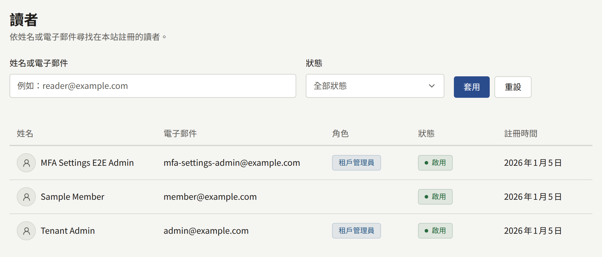
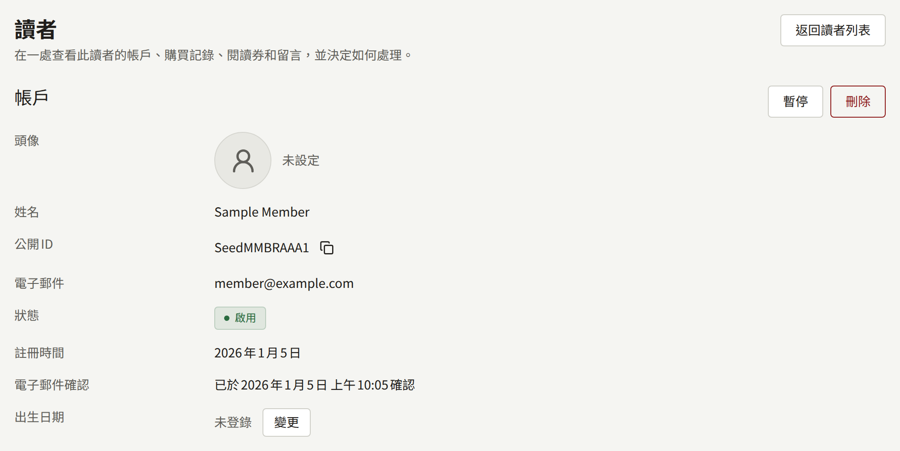
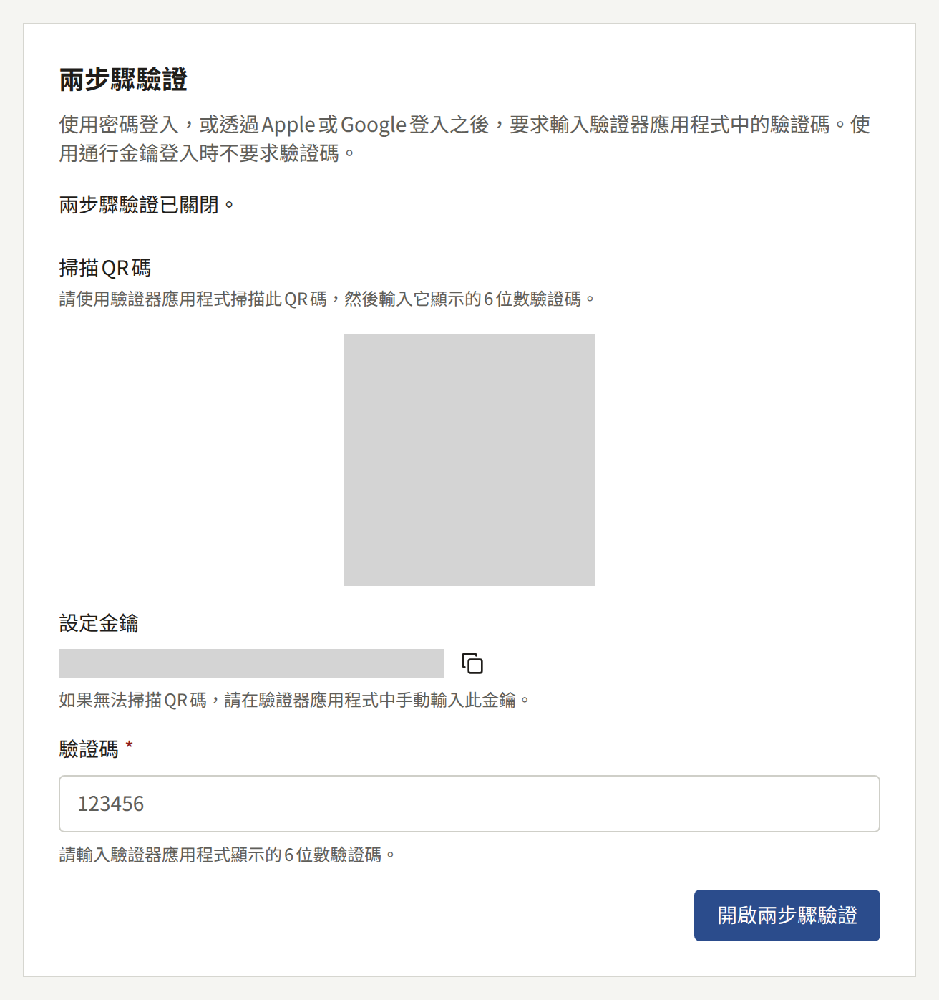
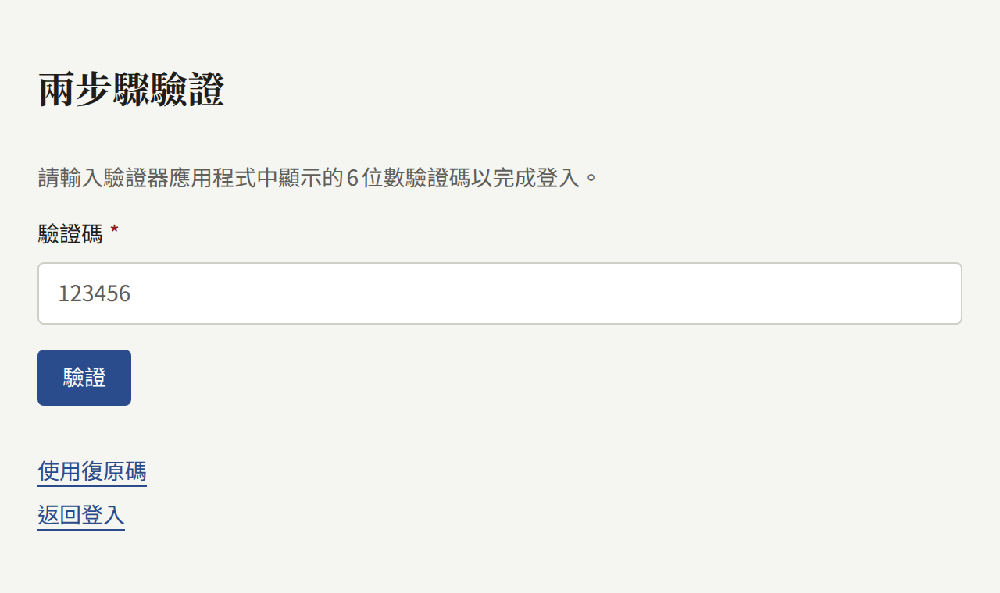

**讀者**會列出租戶網站上的每個帳戶，最新註冊的在前，每頁二十筆。由於主控台帳戶也是網站上的帳戶，因此工作人員也包括在內：**角色**會顯示工作人員所擔任的最高角色，讀者則為空白。只有租戶管理員能看到它。

若要尋找某人，請在**姓名或電子郵件**中輸入其姓名或電子郵件地址的一部分，然後選擇**套用**。搜尋會比對兩者中任何位置的內容，且不分大小寫，因此`tanaka`會找到`Tanaka Hanako`與`h.tanaka@example.com`。**狀態**可以將清單縮小到某一種狀態：

| 狀態       | 意義                                                 |
| ---------- | ---------------------------------------------------- |
| **啟用**   | 帳戶可以登入                                         |
| **未啟用** | 讀者已註冊，但尚未確認電子郵件地址。確認之前無法登入 |
| **已暫停** | 租戶管理員已暫停此帳戶。在解除暫停之前無法登入       |

每一列的開頭是讀者為帳戶選擇的頭像，尚未選擇頭像的讀者則顯示一個簡單的輪廓；**留言**也以相同方式顯示留言者的頭像。點選清單中讀者的姓名會開啟其頁面。對租戶管理員而言，**留言**中留言者的姓名，以及撰寫時已登入的諮詢寄件人，也都會開啟其頁面。

## 讀者頁面

**帳戶**會顯示讀者的**頭像**、姓名、附有複製按鈕的**公開ID**、電子郵件地址、狀態、註冊時間、是否已確認電子郵件地址及確認時間，以及**出生日期**。

下方有三個區塊，列出讀者擁有的內容，最新的在前，每頁二十筆：

| 區塊 | 列出的內容 |
| --- | --- |
| **購買記錄** | 讀者購買的所有內容，附有購買的章節、卷、系列其餘部分或代幣組合包、金額、付款方式，以及它是否仍開放所購買的內容。標題會開啟所購買的內容，**檢視**則會在**購買記錄**中開啟這筆購買，可以在該處退款 |
| **閱讀券** | 工作人員發放給讀者的閱讀券，附有章節與閱讀券的狀態。**撤銷**與**發放閱讀券**的運作方式與[閱讀券](./4-access-tickets.md)中相同，且不需離開這個頁面 |
| **留言** | 讀者寫過的所有內容，包括他們自己刪除、尚未被永久刪除的留言，可進行的操作與[留言](./2-comments.md)中相同 |

## 更正出生日期

出生日期一經儲存，讀者就無法自行變更，因此輸入錯誤的讀者必須向網站提出請求，而在[年齡驗證](../3-setup/1-settings.md#年齡驗證)中設定的年齡檢查，會依照已儲存的日期進行。若要更正，請選擇**出生日期**旁的**變更**，輸入日期，然後選擇**儲存**。將日期留空即可清除，之後讀者在有年齡限制的系列上會再次被要求輸入。新日期從讀者下一次閱讀時起適用。

## 刪除讀者的頭像

讀者的頭像會顯示在其留言旁，所有閱讀網站的人都看得到，因此違反網站規則的頭像要從這裡撤下。選擇**頭像**旁的**刪除頭像**，並以**刪除**確認。圖片會立即停止在網站與主控台上顯示，帳戶會改以簡單的輪廓代替。之後讀者可以選擇另一個頭像，就像他們自己刪除頭像後一樣。

只有在帳戶顯示頭像時，才會提供**刪除頭像**。

讀者可以上傳頭像、從租戶自己的頭像中挑選，還是完全不顯示頭像，是在**設定**中設定的，如[讀者頭像](../3-setup/1-settings.md#讀者頭像)所述。

## 暫停讀者

**暫停**會讓讀者在所有裝置上登出，並拒絕其以密碼或Apple、Google登入，直到解除暫停為止。帳戶的其他部分都不會改變：他們已公開的留言會留在網站上，他們的購買與閱讀券仍屬於他們，只是在無法登入期間無法使用。

同一頁面上的**解除暫停**會讓帳戶回到**啟用**；如果其電子郵件地址從未確認過，則回到**未啟用**。讀者需要重新登入；被暫停所終止的工作階段仍維持終止。若要尋找已暫停的讀者，請將**狀態**設為**已暫停**。

## 讀者的兩步驟驗證

讀者可以從網站**帳戶設定**的**安全性**中的**兩步驟驗證**，設定在密碼之外再要求輸入驗證器應用程式中的驗證碼。選擇**開啟**會顯示一個供掃描的QR碼，以及可手動輸入的同一組金鑰，讀者輸入應用程式隨後顯示的6位數驗證碼即可開啟。接著網站會顯示十組復原碼，僅顯示這一次，並附有複製按鈕：驗證器應用程式不在手邊時，每組復原碼可用於登入一次。**重新產生復原碼**會憑驗證器應用程式中的驗證碼，取代全部十組復原碼，無論是否使用過。**關閉**會要求輸入讀者的密碼，以及驗證器應用程式中的驗證碼或其中一組復原碼；沒有密碼的讀者改用自己的通行金鑰，或透過Apple或Google重新登入來確認。

開啟後，使用密碼或透過Apple或Google登入時，會在完成登入之前要求輸入驗證碼，之後讀者會前往原本要去的頁面。選擇**使用復原碼**即可改為輸入其中一組復原碼。通行金鑰本身就是第二驗證要素，因此使用通行金鑰登入時不要求驗證碼。連續輸錯五次驗證碼後，十五分鐘內任何驗證碼都會被拒絕。

無論在哪裡登入，一個帳戶只有一個第二驗證要素。在主控台設定了驗證器的工作人員在網站上也會被要求輸入其驗證碼，在網站上設定的驗證器在同一帳戶登入主控台時也會被要求。擁有主控台通行金鑰的工作人員要從主控台的**帳戶設定**而不是網站設定驗證器，網站也會如此提示。

租戶的應用程式也可以從**帳戶**畫面的**兩步驟驗證**進行同樣的設定。在應用程式中選擇**開啟**，會顯示設定金鑰及複製按鈕，供複製到同一支手機上的驗證器應用程式，同時顯示QR碼，供其他裝置上的應用程式掃描；隨後顯示的十組復原碼附有複製按鈕與分享按鈕。無論兩步驟驗證是在應用程式中還是在網站上開啟的，在應用程式中使用密碼或透過Apple或Google登入時，都會同樣要求輸入驗證碼。

不會要求讀者使用兩步驟驗證：營運人員可以設定的要求只針對租戶管理員，詳見[兩步驟驗證](../../3-operations/12-security/2-two-step-verification.md)。

## 讀者下載的個人資料

讀者可以從網站上的**帳戶設定**或應用程式中的帳戶畫面，下載網站所保存關於他們的所有資料的副本，因此依APPI或GDPR提出的查閱網站所保存個人資料的請求，不需要任何工作人員手動蒐集就能回應。工作人員無法代替讀者提出請求：請引導來信的讀者前往其帳戶設定。

讀者提出請求後，副本會在一分鐘左右內準備好。不論其通知設定為何，他們都會在網站上的通知中以及透過電子郵件收到已準備好的通知，並可以在七天內從同一個地方不限次數地下載。之後副本會被刪除，他們可以再次提出請求。除非營運人員允許更多次，否則讀者每天只能提出一次請求，如[平台預設值與政策](../../3-operations/9-platform-policies.md)所述，且在先前的請求仍在準備時無法再次提出。副本保存在安裝實例的物件儲存中，因此在營運人員尚未設定物件儲存時，讀者無法提出請求。

副本是一個ZIP檔案，每種記錄各有一個JSON檔案，旁邊還有讀者原本就可以下載的購買記錄CSV：

| 檔案 | 內容 |
| --- | --- |
| `account.json` | 他們的姓名、電子郵件地址、狀態、出生日期，以及註冊與確認地址的時間 |
| `sign_in_methods.json` | 帳戶是否有密碼與第二重驗證、與它連結的Apple與Google帳戶，以及它的通行金鑰 |
| `follows.json` | 他們追蹤的系列、章節與作者 |
| `reading_positions.json`、`reading_history.json` | 他們在每個章節中停在哪裡，以及他們讀過的每個章節 |
| `ratings.json` | 他們給章節的評分 |
| `comments.json`、`comment_reports.json` | 他們寫過的每則留言（不論現在處於什麼狀態），以及他們檢舉過的留言 |
| `purchases.json`、`purchases.csv` | 他們購買的所有內容 |
| `coin_transactions.json` | 他們獲得與使用的代幣 |
| `subscriptions.json` | 他們在網站與應用程式上的訂閱 |
| `preferences.json` | 他們的通知設定與閱讀器偏好（如果曾經儲存過） |
| `legal_page_consents.json` | 他們同意過的每個版本的服務條款與隱私權政策 |
| `access_tickets.json` | 工作人員發放給他們的閱讀券 |
| `contact_messages.json` | 他們在登入狀態下寄出的諮詢，以及每則諮詢上的回覆 |

副本不包含屬於工作人員而非讀者的內容：工作人員在閱讀券或諮詢上留下的備註、哪位工作人員核准、隱藏或處理了某項內容，以及金流服務商與商店用來保存租戶記錄的ID。副本也不包含任何密碼或第二重驗證的密鑰，網站本來就不會以任何人都能讀取的形式保存這些資訊。

## 刪除讀者

**刪除**會以與讀者自行註銷帳戶完全相同的方式刪除帳戶，且無法復原：

| 讀者擁有的內容 | 會發生什麼 |
| --- | --- |
| 留言，以及他們提出的檢舉 | 刪除 |
| 購買 | 保留但不再關聯購買者，因此銷售額與版稅不會改變 |
| 方案的訂閱 | 立即在租戶的Stripe帳戶上取消，因此讀者不會再被收費。已付款的期間不會退款。讀者在應用程式中購買的訂閱是由App Store或Google Play收費，只有讀者本人才能在該處取消：它會被保留但不再關聯訂閱者，由讀者在商店中取消 |
| 閱讀券、追蹤、閱讀紀錄、評分、通知，以及連結的Apple與Google登入 | 刪除 |
| 諮詢 | 保留，並顯示為來自**訪客** |
| 工作人員的角色 | 移除 |
| 他們所請求的資料副本 | 在一小時內刪除 |

若之後可能想要復原，請改為暫停而不是刪除。

您無法暫停或刪除自己目前登入的帳戶，也無法暫停或刪除租戶最後一位有效的租戶管理員：請先將其他人設為租戶管理員。暫停、解除暫停、刪除、變更或清除出生日期，以及刪除頭像，都會以**暫停了讀者**、**解除了讀者暫停**、**刪除了讀者**、**變更了讀者出生日期**、**清除了讀者出生日期**與**刪除了讀者頭像**記錄在[稽核記錄](../3-setup/8-audit-log.md)中。
