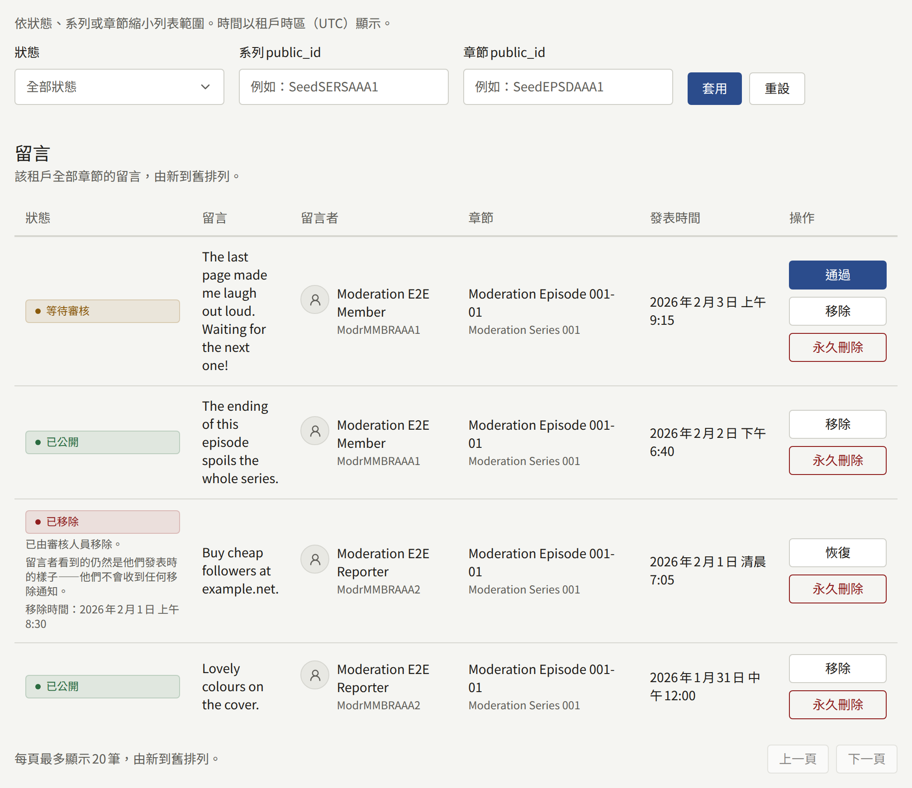
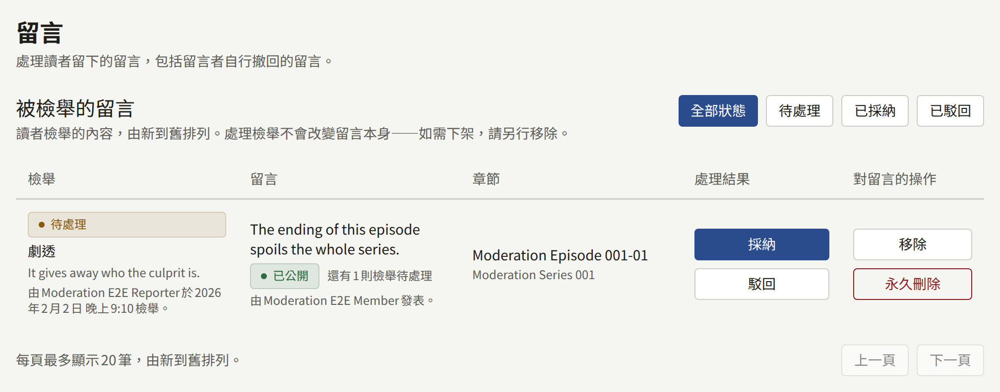

只有在留言功能開啟時，讀者才能在章節上留言：整個租戶的設定在**設定** › **讀者留言**下，個別系列的設定則在該系列的表單上。[讀者留言](../3-setup/1-settings.md#讀者留言)說明了三種選擇：**不接受留言**、**立即公開**與**審核後公開**，以及讓留言自動移除的檢舉次數。

只有已登入的讀者可以留言，每則最多1000個字元。留言屬於某個章節；沒有回覆或討論串，因此對一則留言的操作不會影響其他留言。

**留言**顯示兩份清單：先是**被檢舉的留言**，接著是租戶章節上的所有留言，最新的在前。稽核員可以看到這兩份清單，但沒有操作按鈕。

## 留言狀態的意義

| 狀態 | 誰看得到留言 |
| --- | --- |
| **等待審核** | 只有留言者本人，並標示為**等待審核** |
| **已公開** | 所有人 |
| **已移除** | 只有留言者本人，看到的是他們發表時的樣子 |
| **留言者已刪除** | 網站上沒有任何人看得到，包括留言者本人。工作人員在它被永久刪除之前可以在這裡看到 |

## 各項操作的作用

| 操作 | 可用於 | 作用 |
| --- | --- | --- |
| **通過** | **等待審核** | 公開留言，並通知留言者其留言現已公開 |
| **移除** | **等待審核**、**已公開** | 讓留言從網站上消失，只有留言者本人仍看得到。可填寫**理由（選填）**，它會記入稽核記錄 |
| **恢復** | **已移除** | 讓留言恢復原狀：如果原本已公開就再次公開，否則回到**等待審核**。針對它仍在等待處理的每則檢舉都會被駁回 |
| **永久刪除** | 任何狀態 | 永久刪除留言及其檢舉。必須填寫**理由**，因為稽核記錄的項目將是這則留言唯一留下的痕跡 |

不論是管理者還是讀者的檢舉移除了留言，被移除留言的留言者都不會收到通知。他們會繼續看到自己發表時的留言，因此為了擾亂留言區而發文的人，不會得到任何促使他們再次發文的訊號。

如果在您載入清單後，另一位管理者已對同一則留言進行操作，您的操作會被拒絕，並顯示「其他審核人員已處理這則留言。請重新載入列表查看目前狀態。」

## 處理審核佇列

只要有任何留言在等待審核，選單中的**留言**就會顯示其數量。每位工作人員也會在主控台收到「有留言等待審核」的通知，每個章節每小時最多一次；它會開啟篩選為該章節等待審核留言的清單。

1. 開啟**留言**，將**狀態**設為**等待審核**，然後選擇**套用**。
2. 閱讀每則留言，選擇**通過**將它公開，或選擇**移除**讓它不出現在網站上。
3. 逐頁處理，直到清單清空為止。

在留言通過之前，除了留言者本人之外沒有人看得到它，因此置之不理的佇列，就等於一個一直空白的留言區。從佇列中移除的留言，對留言者本人仍會顯示為**等待審核**。

## 被檢舉的留言

已登入的讀者可以檢舉不是自己所寫的已公開留言，選擇**垃圾訊息或廣告**、**辱罵或騷擾**、**劇透**或**其他原因**，並可附上選填的說明。每位讀者對一則留言只能檢舉一次；再次檢舉不會有任何改變。留言者不會收到通知。

當一則留言等待處理的檢舉達到**觸發移除的檢舉次數**時，它會自動移除，不需等待工作人員，留言者也不會收到通知。之後它會顯示「檢舉數達到門檻後已自動移除。」，稽核記錄則會以**自動**為執行者記錄**因檢舉自動移除了留言**。每位工作人員都會收到主控台通知「有留言被檢舉」，每個章節每小時最多一次。

**被檢舉的留言**為每則檢舉列出一列，最新的在前，附有理由、說明、檢舉者、留言及其留言者。檢舉在處理之前為**待處理**：

- **採納**記錄該檢舉是正確的。它不會變動留言：若要撤下已公開的留言，請同時選擇**移除**。
- **駁回**記錄該檢舉是錯誤的。它不會恢復已自動移除的留言：若要恢復，請選擇**恢復**。

處理佇列時，請將它設為**待處理**，然後針對每則留言決定是否保留。如果不保留，請**移除**它並**採納**它的檢舉。如果保留，若它已被移除就**恢復**它，這會一次駁回它所有等待處理的檢舉；若沒有被移除，就逐一**駁回**每則檢舉。處理檢舉會降低朝向自動移除的計數，因此已駁回的檢舉之後不會讓留言超過門檻。

## 已撤回的留言

讀者可以隨時刪除自己的留言。留言會立即從網站上消失，所有人（包括讀者本人）都看不到，工作人員也無法恢復。**留言**會繼續將它顯示為**留言者已刪除**，並附上刪除的時間與將被永久刪除的時間，讓工作人員在留言者撤下某則被檢舉或被投訴的留言後，仍然可以閱讀它。針對它的檢舉會留在佇列中，仍然可以處理。

已撤回的留言在撤回後經過**設定** › **限制與保留** › **保留期限** › **已撤回留言**中設定的期間後，會連同其檢舉一起被永久刪除。`publira worker`每小時永久刪除一次；該列會以目前設定的期間計算，顯示將於幾天後的哪一天被永久刪除。選擇**永久刪除**可以提早刪除。已移除的留言永遠不會自動被永久刪除：它會一直保留，直到管理者將它永久刪除。

## 尋找留言

留言清單可以依**狀態**、**系列public_id**與**章節public_id**縮小範圍。公開ID是主控台中該系列或章節位址的最後一部分，如`/series/<series public ID>/episodes/<episode public ID>`，每則留言的**章節**也會連結到該處。不符合任何項目的ID會顯示空白的清單。

與章節上列名作者連結的帳戶所發表的留言，在網站上與這裡都會帶有**作者**徽章。這不會改變留言的管理方式。

作者不需要使用主控台，就能閱讀讀者對其作品的看法。與作者連結的讀者，可以從自己的作者頁面閱讀署名該作者的每個章節上已公開的留言，如[作者](../1-catalog/4-authors.md#將作者連結到讀者帳號)所述。等待審核或已移除的留言永遠不會出現在那裡，因此移除對所有人都與對留言者本人一樣不會有任何通知。

通過、移除、恢復與永久刪除留言，以及採納與駁回檢舉，都會連同您填寫的理由記錄在稽核記錄中。
