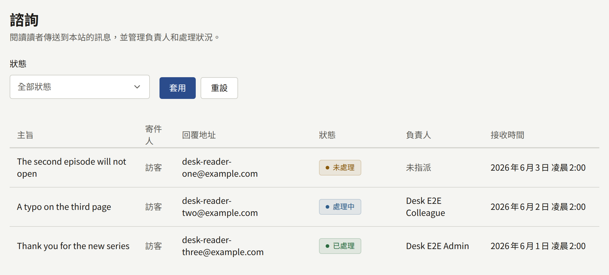
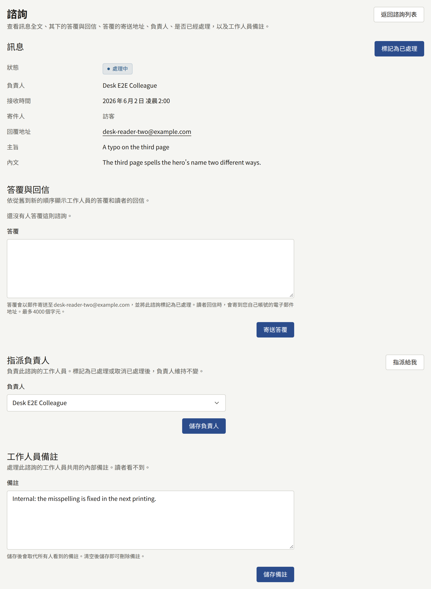

讀者不論是否登入，都可以從**聯絡我們**寫信給網站，網站每個頁面的頁尾與應用程式中都有它的連結。他們會填寫答覆要寄送到的電子郵件地址、最多200個字元的選填主旨，以及最多4000個字元的訊息。已登入讀者的地址會自動填入，也可以變更。

新訊息會寄送給每位有效的租戶管理員，寄到其帳戶的地址，內含讀者的地址、主旨與完整的訊息。由於編輯與稽核員無法開啟**諮詢**，因此不會寄送給他們，已暫停的帳戶也不會收到。沒有有效租戶管理員的租戶不會將郵件寄給任何人；訊息仍會在**諮詢**中等待。主控台本身不會為新訊息顯示數量或通知，因此請查看**諮詢**，或留意那些郵件。

**諮詢**會列出訊息，最新的在前，每頁二十筆，附有**主旨**、**寄件人**、**回覆地址**、**狀態**、**負責人**與**接收時間**。讀者在登入狀態下寄出時，**寄件人**會顯示讀者的帳戶，否則顯示**訪客**。**狀態**由訊息的情況決定，永遠不會手動設定：

| 狀態       | 時機                             |
| ---------- | -------------------------------- |
| **未處理** | 尚未處理，且沒有指派任何人       |
| **處理中** | 尚未處理，且已指派一位租戶管理員 |
| **已處理** | 已標記為已處理，或已答覆         |

## 答覆訊息

1. 從**諮詢**開啟訊息。
2. 在**指派負責人**下選擇**指派給我**，或挑選一位租戶管理員並選擇**儲存負責人**，讓其他人知道這則訊息正在處理中。只有租戶管理員可以被指派。
3. 在**答覆**下撰寫答覆，最多4000個字元，然後選擇**寄送答覆**。

答覆會儲存在**答覆與回信**下，訊息會變為**已處理**，`publira worker`會將答覆寄到訊息的**回覆地址**：

- 透過在[電子郵件](../3-setup/7-email.md)中設定的郵件伺服器，從其地址寄出；在租戶擁有自己的郵件伺服器之前，則透過平台的郵件伺服器寄出；
- 主旨為「Re:」加上讀者的主旨；讀者未填寫主旨時，則為「Re: 您向」加上網站名稱與「傳送的諮詢」；
- 讀者的訊息會引用在答覆下方；
- 不論讀者以什麼語言撰寫，都使用租戶的預設語言。

主控台不會顯示郵件是否已送達。如果郵件設定有誤，答覆仍會被儲存，訊息也會是**已處理**，但郵件永遠不會寄出；因此當租戶透過自己的伺服器寄送時，請在答覆讀者之前，以**寄件**下的**測試連線**檢查設定。與主控台寄送的所有郵件一樣，寄到同一個地址的答覆，每小時與每天的數量都有限制。

## 讀者回信時

讀者的回信會送到哪裡，取決於**整合** › **郵件**中的**收件**區塊是否為**就緒**；[讀者對諮詢訊息的回覆](../3-setup/7-email.md#讀者對諮詢訊息的回覆)逐步說明了如何設定：

- **在它就緒之前**，答覆的回覆地址是您自己帳戶的電子郵件地址。讀者的回信會送到您自己的信箱。它不會記錄在主控台中，訊息也會維持**已處理**：請從您的郵件回覆，或再次從主控台答覆。
- **一旦它就緒**，回覆地址就是網站自己的地址之一，專為該訊息建立。讀者的回信會以「來自」其地址「的回信」記錄在**答覆與回信**下，訊息會重新開啟，租戶管理員也會如同收到新訊息時一樣收到郵件。

**答覆**下方的提示會說明租戶適用哪一種情況。

## 追蹤

- **工作人員備註**是租戶管理員針對這則訊息共用的一則備註，最多4000個字元。讀者永遠看不到它。儲存會為所有人取代它，以空白儲存則會清除它。
- **標記為已處理**會在不答覆的情況下將訊息標記為已處理，例如垃圾訊息。**取消已處理**會讓它回到**處理中**或**未處理**。兩者都不會變更負責人。

訊息永遠不會被刪除：它們沒有保留期限。之後刪除帳戶的讀者所寄出的訊息會被保留，並顯示為來自**訪客**。標記為已處理、重新開啟、指派、編輯備註與答覆，都會記錄在稽核記錄中；答覆的內文則不會記錄。
