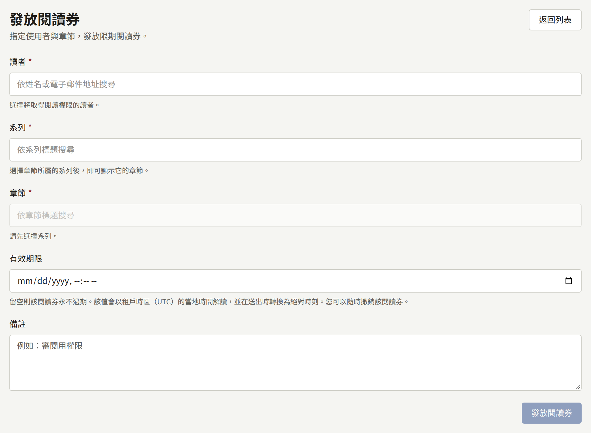
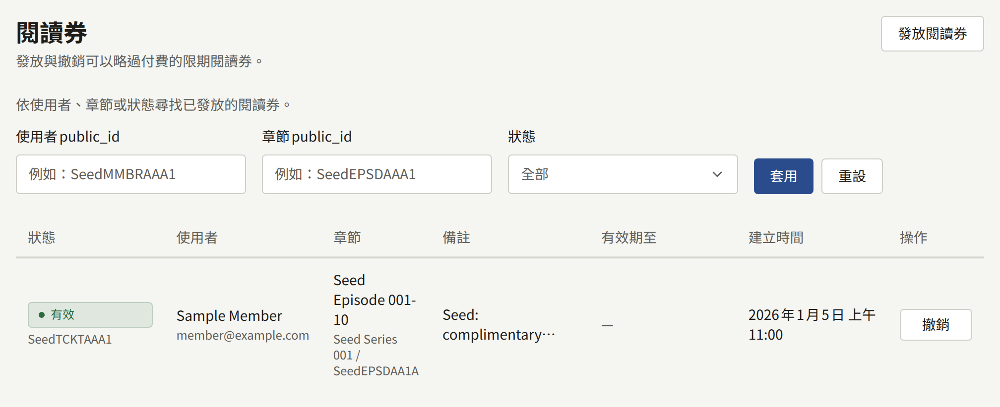

閱讀券會在網站與應用程式上，不需付款就向一位讀者開放一個章節，直到它到期或被撤銷為止。在讀者應該不需購買就能閱讀的情況下使用它：書評人或媒體人員、獎品，或是購買出了問題、不應讓其等待退款再重新購買的讀者。只有租戶管理員能看到**閱讀券**。

閱讀券不是銷售。它不會為任何作者帶來版稅，章節也不會出現在讀者的**已購買**中。它不會解除年齡檢查：年齡不足以閱讀該系列的讀者，即使有閱讀券也無法閱讀。它只會開放已發布的章節，對免費章節則沒有任何作用。讀者不會收到他們擁有閱讀券的通知，因此請您自行告知他們。

## 發放閱讀券

1. 開啟**閱讀券**，然後選擇**發放閱讀券**。
2. 在**讀者**下，輸入讀者姓名或電子郵件地址的一部分，然後選取該讀者。只會提供**啟用**的讀者。
3. 選擇**系列**，再選擇**章節**。
4. 可選擇以租戶的時區設定**有效期限**。留空時，閱讀券永遠不會到期。
5. 可選擇撰寫最多1000個字元的**備註**，例如發放閱讀券的原因。
6. 選擇**發放閱讀券**。

若要向您已開啟其頁面的讀者發放閱讀券，請在[其頁面](./1-accounts.md#讀者頁面)的**閱讀券**下選擇**發放閱讀券**。同一個表單會在頁面上開啟，但沒有**讀者**欄位，閱讀券發放後會出現在頁面的清單中。

一位讀者與一個章節，同一時間只會有一張來自工作人員的閱讀券：

- 如果他們已經有一張有效的閱讀券，就不會發放新的，現有的閱讀券會保留其有效期限與備註。主控台會說明這一點並指出那張閱讀券。若要變更閱讀券的有效期限或備註，請從清單中撤銷它，再發放一張新的。
- 如果他們有一張已過期的閱讀券，主控台會要求您先從清單中撤銷它。

## 撤銷閱讀券

在清單或讀者頁面中，有效閱讀券上的**撤銷**會立即讓讀者無法再閱讀該章節。這個操作無法復原：若要再次讓他們閱讀，請發放一張新的閱讀券。已撤銷的閱讀券會以**已撤銷**留在清單中，並附上撤銷的時間。

## 閱讀清單

清單只包含工作人員發放的閱讀券。讀者透過[**等待即可免費**](../4-selling-episodes.md#免費閱讀期間與等待即可免費)自行取得的免費券不在其中，也無法在這裡撤銷：那是讀者依系列規則有權獲得的免費閱讀，而不是工作人員發放的，對同一位讀者與章節發放的工作人員閱讀券，會與它並存，而不是取代它。

清單會顯示每張閱讀券的**狀態**、**使用者**、**章節**、**備註**、**有效期至**與**建立時間**，最新的在前，每頁二十筆。**狀態**為**有效**、**已過期**或**已撤銷**，篩選器的**僅有效**會同時排除已過期與已撤銷的閱讀券。**使用者public_id**與**章節public_id**需要完整的公開ID，可以從讀者的頁面或主控台中章節的位址複製；ID的一部分或姓名都找不到任何結果。

發放與撤銷會以**發放了閱讀券**與**撤銷了閱讀券**記錄在稽核記錄中。
