**設定**位於**管理**下，共有三個分頁。**一般**包含租戶對自己網站所做的決定。**限制與保留**包含營運人員為所有租戶設定的值，租戶可以在一定範圍內變更。**讀者頭像**包含讀者可以顯示為頭像的內容，以及租戶提供給讀者挑選的頭像。

這些分頁上的每張卡片都有自己的儲存按鈕，且只會儲存自己的欄位，因此請先儲存一張卡片，再前往下一張。每位工作人員都能開啟**設定**，但只有租戶管理員能儲存。編輯或稽核員會在每張卡片上看到「只有租戶管理員才能變更此設定。您只有唯讀權限。」

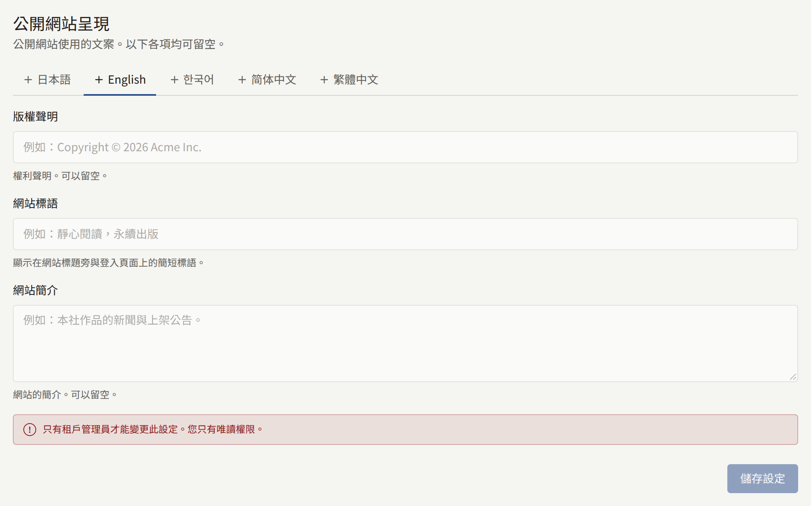

## 一般

### 公開網站呈現

三段文字，每一段都可以留空：

- **版權聲明**：顯示在網站每個頁面及其登入畫面的底部。
- **網站標語**：一行簡短的文字，顯示在登入、註冊與密碼畫面上，也會出現在分享網站首頁連結時所附的圖片上（請參閱[連結預覽](./2-branding.md#連結預覽)）。
- **網站簡介**：顯示在網站的頁尾，並作為網站的說明提供給搜尋引擎與連結預覽。

網站提供的每種語言（在[語言](#語言)中選擇）在**語言**下都有一個分頁，各自擁有這三段文字。卡片一開始會顯示預設語言的分頁，沒有自己文字的語言會標示為「**（未新增）**」。**儲存設定**會儲存目前開啟分頁的三個欄位，其他語言的文字則維持不變。請在切換分頁之前儲存：未儲存的編輯不會保留。清空三個欄位並儲存，就會移除該語言的文字。

網站會向讀者顯示其閱讀語言的文字；該語言沒有文字時，則顯示預設語言的文字。擁有自己文字的語言只會顯示這些文字：在其分頁上留空的欄位，在該語言中仍會是空的，而不會改為顯示預設語言的文字。

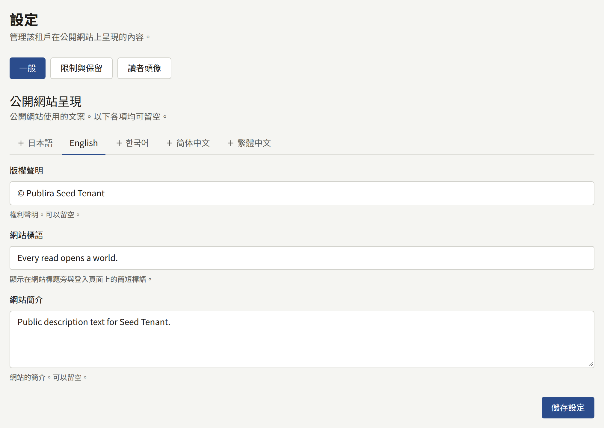

### 時區

**時區**是主控台與公開網站上所有日期與時間的顯示與輸入所採用的時區。在系列或章節上輸入的發布時間依此時區解讀，橫幅停止顯示的時間，以及報表與稽核記錄計算日期的方式也是如此。它也決定在計算版稅時，一個月的銷售在何處結束、下個月從何處開始，以及計算讀者年齡時所依據的日期。輸入城市或地區即可縮小清單範圍，然後選擇**儲存時區**。

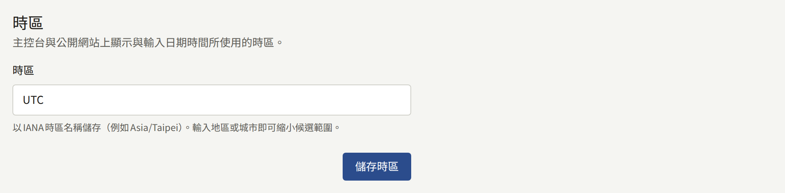

請在首次銷售之前設定：之後變更它會移動尚未結算月份的切分點，而已結算版稅的月份則會保留其結算時所用的時區。

新租戶一開始使用平台的預設時區，除非營運人員選擇了其他時區，否則就是`UTC`。

### 語言

**語言**決定網站向讀者提供哪些語言，以及一開始使用其中的哪一種。

**提供的語言**為Publira已翻譯的每種語言各提供一個方塊：日本語、English、한국어、简体中文與繁體中文。請勾選讀者可以用來瀏覽網站的語言。關閉某種語言會隱藏以該語言撰寫的頁面翻譯，但不會刪除它們；重新開啟該語言時，這些翻譯就會恢復，如[翻譯](./3-pages.md#翻譯)所述。

讀者只會看到已勾選的語言。網站的**顯示語言**選單會列出這些語言，網站地圖與搜尋引擎讀取的語言連結也是如此。透過書籤或搜尋結果開啟已關閉語言的網址時，會改以預設語言開啟同一個頁面。

租戶的應用程式也遵循相同的選擇。它沒有**顯示語言**選單，而是讀取讀者裝置上設定的語言：它會以其中第一個網站有提供的語言開啟；如果網站一個都沒有提供，則以預設語言開啟。

**預設語言**是網站與這個主控台對尚未選擇語言的人一開始使用的語言。已經選擇語言的讀者或工作人員會保留自己的選擇。預設語言也是：

- 租戶寄出的郵件所使用的語言，包括寄給新工作人員的邀請；
- 新頁面最初撰寫時所使用的語言。

預設語言一定會提供：它的方塊會保持勾選且無法取消，將未勾選的語言選為預設語言時，也會自動勾選它。營運人員在建立租戶時已選擇了預設語言，除非營運人員選擇了更多語言，否則新租戶只會提供該語言。**儲存語言**會同時儲存這兩項。

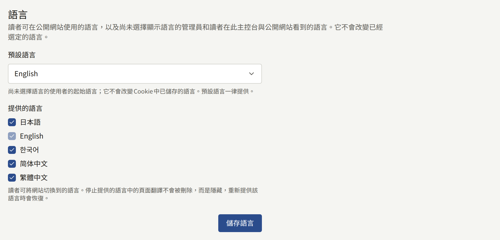

### 讀者留言

**留言的公開方式**決定讀者能否在章節上留言，以及其他人何時能看到留言：

| 選項 | 作用 |
| --- | --- |
| **不接受留言** | 章節頁面不顯示留言區，也無法發表任何留言。新租戶從這裡開始 |
| **立即公開** | 留言從發表的那一刻起，所有人都能閱讀 |
| **審核後公開** | 在審核人員於**留言**中通過之前，只有留言者看得到該留言，如[處理審核佇列](../2-readers/2-comments.md#處理審核佇列)所述 |

**觸發移除的檢舉次數**是指留言在不等待工作人員處理的情況下被隱藏之前，必須有多少位不同的讀者檢舉它。被隱藏的留言會在**留言**中的[檢舉佇列](../2-readers/2-comments.md#被檢舉的留言)等待處理，留言者仍然看得到它，工作人員也可以將它恢復。初始值為`3`；設為`0`則會把所有移除都交給您的審核人員。

系列可以在其表單上設定自己的**留言**選項，之後該系列會套用它，而不是這裡的設定。維持**沿用租戶設定**的系列，會遵循之後在這裡所做的任何變更。選擇**儲存留言設定**即可儲存。

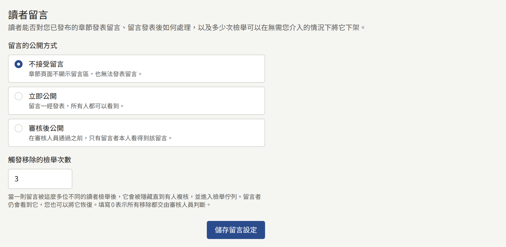

### 發布前審核

**發布前必須審核**在新租戶上是關閉的，開啟後，每個章節都必須等待租戶管理員核准才會發布。開啟時，儲存章節的發布時間就會將該章節提交審核，只有在租戶管理員核准後，章節才會在該時間發布；租戶管理員也可以附上說明需要修改之處的意見將其退回。[發布前審核](../1-catalog/2-episodes.md#發布前審核)說明了在章節編輯畫面上進行的審核流程。

開啟它會將每個已預約的章節提交審核，因此在核准之前，這些章節都不會發布。關閉它則會讓每個已預約的章節在其時間發布，無論它處於審核中、已退回或已核准。選擇**儲存審核設定**即可儲存。

### 作者頁面

兩個方塊，在新租戶上都是關閉的。**向作者顯示其自己的頁面**讓連結到某位作者的讀者可以開啟該作者的頁面，如[將作者連結到讀者帳號](../1-catalog/4-authors.md#將作者連結到讀者帳號)所述。關閉時，即使第二個方塊已開啟，這些頁面仍會保持隱藏。

**顯示明細和銷售額**會在這些頁面上加入每個章節的銷售額，以及每份已結算的版稅明細中屬於該作者的部分。頁面關閉時也可以儲存此方塊，它會在頁面開啟時生效。頁面開啟而此方塊關閉時，讀者仍會看到追蹤者人數，以及每個章節的瀏覽數與讀完數，但看不到銷售額或明細。

選擇**儲存作者頁面設定**即可儲存。

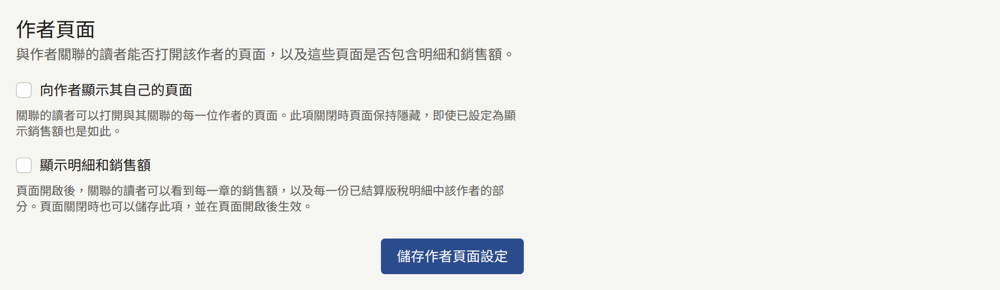

### 年齡驗證

每個系列都有**年齡分級**：**全年齡**、**R15**或**R18**。**需要證明年齡的分級**決定網站以多嚴格的方式讓讀者遵守分級：

| 選項 | R15系列 | R18系列 |
| --- | --- | --- |
| **不驗證年齡** | 讀者確認自己已滿15歲 | 讀者確認自己已滿18歲 |
| **僅驗證R18** | 讀者確認自己已滿15歲 | 只對出生日期顯示已滿18歲的讀者開放 |
| **驗證R15和R18** | 只對出生日期顯示已滿15歲的讀者開放 | 只對出生日期顯示已滿18歲的讀者開放 |

新租戶從**不驗證年齡**開始。分級為**全年齡**的系列永遠不受限制。

所謂「確認」，是讀者按下**我已滿15歲**或**我已滿18歲**，瀏覽器會為該網站記住這個選擇。所謂「證明」年齡，是讀者已登入，且帳戶上已儲存出生日期。讀者可以在註冊時或之後在設定中提供出生日期，一旦儲存就無法變更。沒有出生日期的讀者會看到**登錄出生日期**，年齡不足的讀者則會被告知該作品不適合其年齡閱讀。出生日期輸入錯誤的讀者需聯絡網站，由租戶管理員從**讀者**中該讀者的頁面更正。

選擇**儲存年齡驗證**即可儲存。

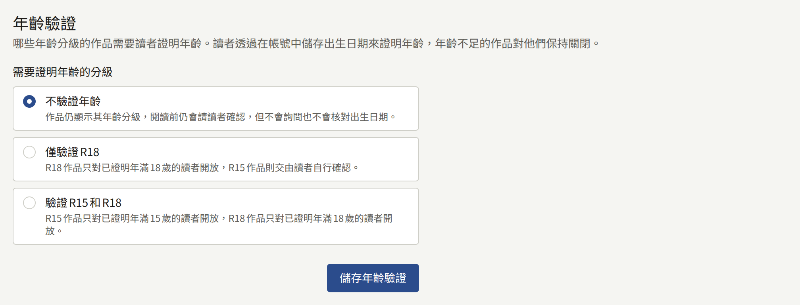

### 服務條款與隱私權政策

**服務條款**與**隱私權政策**各自指定租戶的一個已發布頁面。網站與應用程式會連結到這些頁面，讀者在建立帳戶時會同意它們；當其中任一頁面的新版本要求讀者同意時，讀者也會再次同意，如[發布新版本](./3-pages.md#發布新版本)所述。請先撰寫並發布這些頁面，如[頁面](./3-pages.md#服務條款與隱私權政策)所述，再於此處選擇它們，然後選擇**儲存服務條款與隱私權政策**。選擇**無**則不設定該項目。

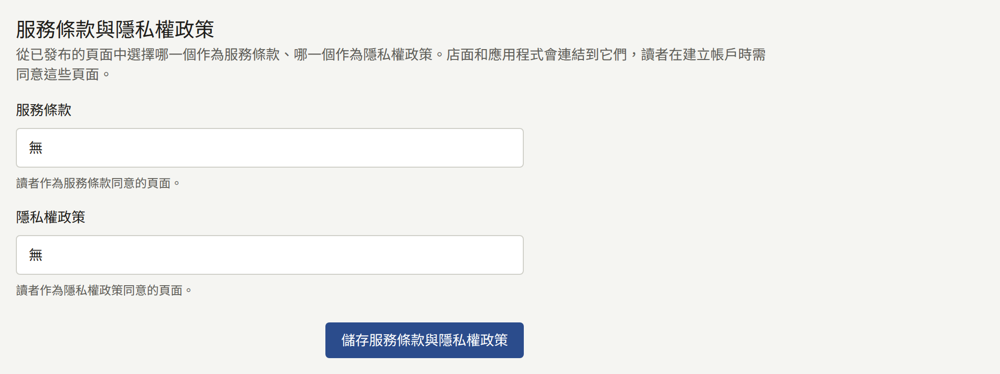

如果此處選擇的頁面之後從網站下架，卡片會顯示已沒有任何連結指向它，註冊時也不再要求讀者同意它。請重新發布該頁面，或選擇另一個頁面。

### 讀者註冊

訪客能否在網站上建立讀者帳戶。關閉註冊可以讓網站繼續為現有讀者提供服務，同時不接納任何新讀者，適用於在正式上線前只對受邀群組開放的網站，或是在處理一波不受歡迎的註冊期間。已經擁有帳戶的讀者仍可繼續登入、購買與閱讀。

- **接受新讀者**在您關閉之前都是開啟的。關閉期間，任何人都無法在網站上建立帳戶，無論是使用電子郵件地址，還是首次透過Apple或Google登入。網站的註冊頁面會顯示**暫停註冊**與您的訊息來取代表單，**登入**也會在原本提供**註冊**的位置顯示同樣的提示。
- **暫停註冊期間顯示的訊息**是訪客看到的文字，最多1000個字元，會依照輸入內容連同換行一起顯示。留空時，網站會顯示「本站目前不接受新帳號註冊。」註冊開放期間，訊息仍會保留，因此再次暫停註冊時會顯示相同的文字。

選擇**儲存註冊設定**即可儲存。註冊暫停期間，卡片會在開關上方說明：「註冊已暫停。在重新開放之前，任何人都無法透過電子郵件地址或Apple、Google在網站上建立新的讀者帳號。」重新開啟開關並儲存，就會立即開放註冊。

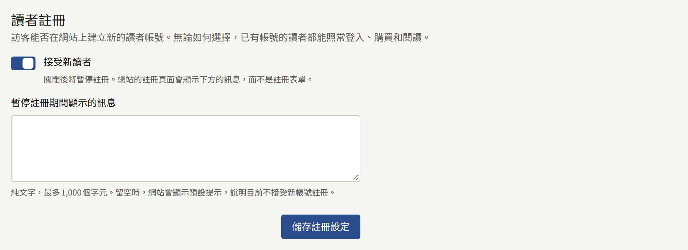

儲存會以**更新了讀者註冊設定**記錄在[稽核記錄](./8-audit-log.md)中。

### 不接受的電子郵件地址

讀者無法用來註冊，也無法將電子郵件地址變更為這些地址。嘗試使用的讀者會看到「本站不接受此電子郵件地址。請使用其他電子郵件地址。」

- **不接受拋棄式信箱網域**會依據平台維護的清單，拒絕一次性郵件服務的網域。如果營運人員沒有設定任何清單，該開關會說明它沒有作用。
- **不接受的地址和網域**每個欄位填寫一個項目，最多1000個。含有`@`的項目是一個地址，也會拒絕加上`+tag`的同一地址。其他項目則是網域，例如`example.net`，也會拒絕其子網域。在欄位中貼上多行時，每行會新增一個欄位。不支援萬用字元。

選擇**儲存不接受的電子郵件地址**即可儲存。清單會套用於下一次的註冊或地址變更。已經用被拒絕的地址註冊的讀者會保留其帳戶。

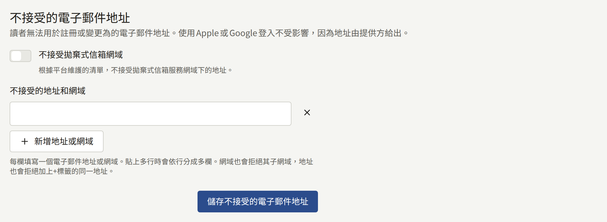

透過Apple或Google登入永遠不會在這裡被拒絕，因為地址是由服務商提供的。只有租戶管理員能看到這張卡片的內容。

### 爬蟲排除規則

網站的`robots.txt`要求爬蟲避開的內容。遵守`robots.txt`的爬蟲會停止擷取此處排除的內容。這不會對讀者隱藏任何內容，而忽略該檔案的爬蟲仍可擷取每個頁面，因此這並不是讓頁面保持私密的方法。

- **排除在整個網站之外的爬蟲**列出Publira所知道的爬蟲，並依其擷取頁面的用途分組：**AI訓練**、**AI助理**與**圖片搜尋**。每個爬蟲都以其營運者為`robots.txt`記載的名稱（token）表示，下方附有營運者。勾選的爬蟲會被要求不要擷取網站的任何頁面。清單由Publira固定；不在清單上的爬蟲無法新增。
- **對所有爬蟲排除的路徑**每個欄位填寫一個路徑，最多100個，例如`/drafts`。路徑以`/`開頭，也涵蓋其下的所有內容。在欄位中貼上多行時，每行會新增一個欄位。不支援萬用字元，路徑也不能包含空格、`*`、`$`、`?`或`#`。`/robots.txt`、`/sitemap.xml`與`/sitemap`無法排除，因為爬蟲需要它們來讀取網站。

選擇**儲存爬蟲排除規則**即可儲存。每個路徑儲存時都不含結尾的`/`，清單會依字母順序顯示。

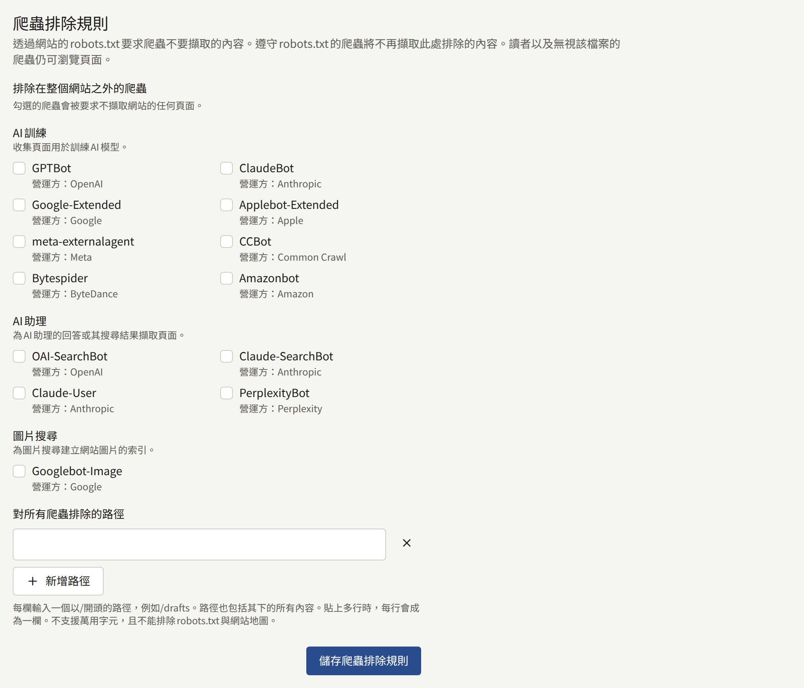

儲存會以**更新了爬蟲排除規則**記錄在[稽核記錄](./8-audit-log.md)中。

### 搜尋引擎擁有權驗證

Google Search Console與Bing Webmaster Tools為了證明網站屬於您而提供的代碼。每個已設定的代碼都會以`<meta>`標籤的形式加入網站的每個頁面，兩項服務將這種方法稱為**HTML tag**或**HTML Meta Tag**。

- **Google Search Console**接受將網站新增為網址前置字元資源時，Search Console所顯示的標籤，例如`<meta name="google-site-verification" content="…" />`。
- **Bing Webmaster Tools**接受Bing Webmaster Tools所顯示的標籤，例如`<meta name="msvalidate.01" content="…" />`。

請貼上整個標籤，或只貼上其`content`值。只有該值會被儲存，離開欄位後，欄位就會顯示該值。從另一項服務複製來的標籤會被拒絕。將欄位留空，即可從網站移除該標籤。

選擇**儲存驗證代碼**即可儲存，然後要求該服務驗證網站。

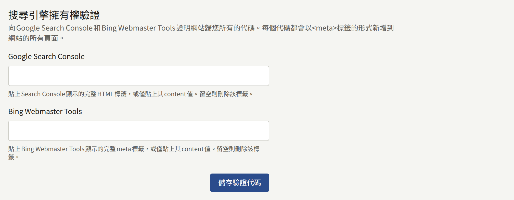

只有租戶管理員能看到這張卡片的內容。儲存會以**更新了搜尋引擎擁有權驗證**記錄在[稽核記錄](./8-audit-log.md)中。

## 限制與保留

**限制與保留**包含兩份表單：

- **社群限制**：一位讀者可以多頻繁地發表或檢舉留言、為章節評分、透過聯絡表單來信、儲存閱讀器的版面設定，以及儲存通知設定，還有讀者再次發表相同留言時會被拒絕多久。
- **保留期限**：已撤回的留言、內容事件，以及每日與每週的排行榜快照，在被刪除之前保留多久。

這些表單上的每個群組一開始都勾選了**使用平台預設值**，並在旁邊顯示營運人員設定的值。使用預設值的租戶會遵循營運人員之後的變更。若要設定租戶自己的值，請取消勾選該方塊、輸入值，然後以**儲存社群限制**或**儲存保留期限**儲存表單。若要恢復為平台的值，請再次勾選該方塊並儲存。

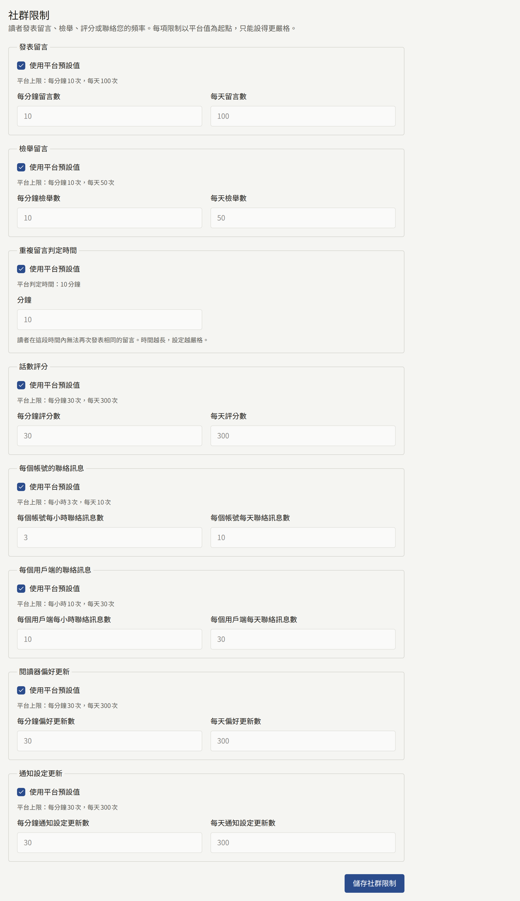

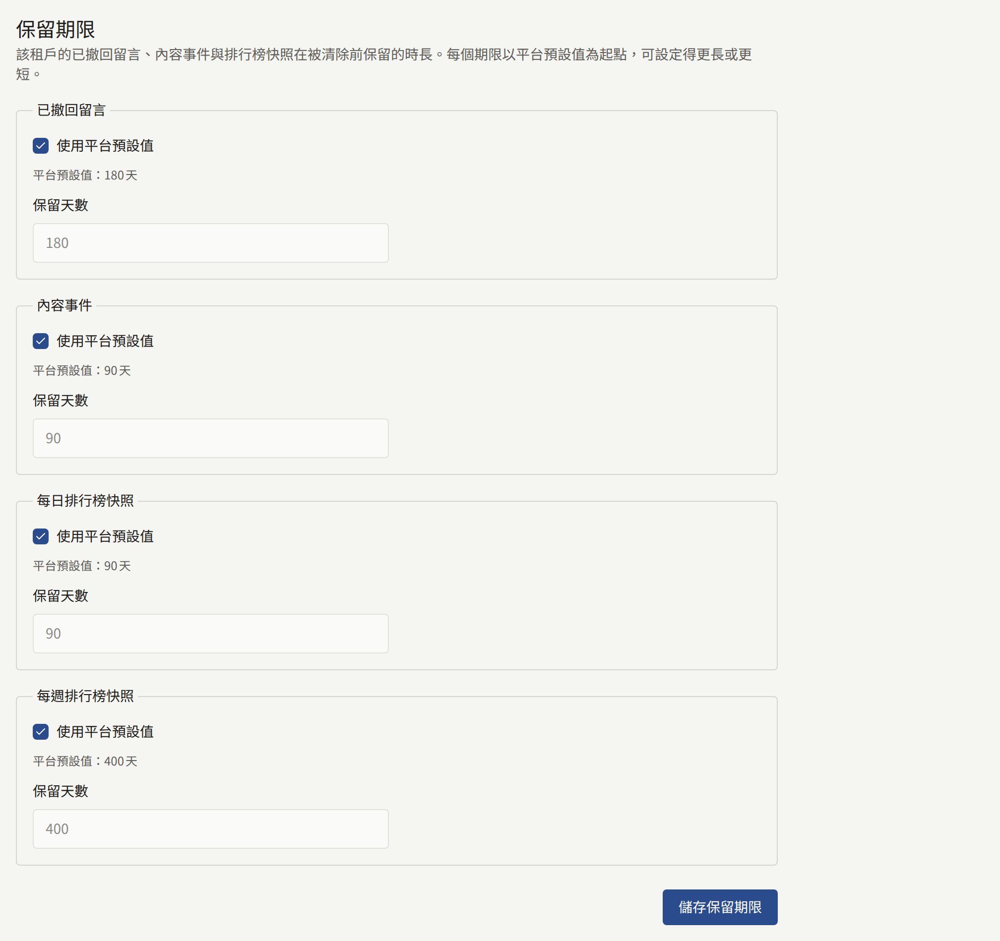

- 社群限制只能設得比平台的更嚴格：更少的次數，或更長的重複留言判定時間。較寬鬆的值會被拒絕，並顯示指出該設定的訊息。如果營運人員之後將平台的限制收緊到比租戶的值更嚴格，則會套用平台的限制。
- 保留期限可以比平台預設值更長或更短，範圍為1到36500天。**內容事件**則是從30天開始，更短的期限會被拒絕：網站的推薦是根據最近28個完整日的內容事件建立的。

如果在您開啟表單之後，有其他人儲存了同一份表單，您的儲存會被拒絕，並顯示「在此頁面開啟期間，該設定已在他處被變更。請重新載入頁面後再次輸入。」

每項限制與紀錄是什麼，以及每次清除後會保留哪些內容，在[平台預設值與政策](../../3-operations/9-platform-policies.md#社群)中從營運人員的角度說明。此分頁上的儲存會以**更新了社群限制**與**更新了保留期限**記錄在[稽核記錄](./8-audit-log.md)中。

## 讀者頭像

### 讀者頭像設定

**讀者可以顯示的內容**決定讀者在其留言與帳戶上，名字旁邊可以顯示什麼作為頭像：

| 選項               | 作用                                                  |
| ------------------ | ----------------------------------------------------- |
| **上傳自己的圖片** | 讀者上傳自己選擇的圖片。新租戶從這裡開始              |
| **從預設中選擇**   | 讀者從[預設頭像](#預設頭像)中挑選一個，且無法上傳圖片 |
| **不顯示頭像**     | 所有讀者都不顯示頭像，網站對所有人顯示簡單的輪廓      |

選擇**儲存讀者頭像設定**即可儲存。儲存**從預設中選擇**或**不顯示頭像**會撤下該選項不允許的頭像，因此主控台會先以「要刪除讀者的頭像嗎？」詢問：

- **從預設中選擇**會刪除讀者上傳的所有圖片。已選擇預設頭像的讀者會保留其頭像。
- **不顯示頭像**會刪除讀者顯示的所有頭像。

選擇**儲存並刪除**即可繼續。無論卡片顯示的已儲存設定為何，主控台都會詢問，因為在頁面開啟之後，其他租戶管理員可能已經變更了設定。被刪除的頭像無法還原，因此當設定再次允許頭像時，每位讀者都需要重新選擇。**上傳自己的圖片**不會刪除任何內容，儲存時也不會詢問。

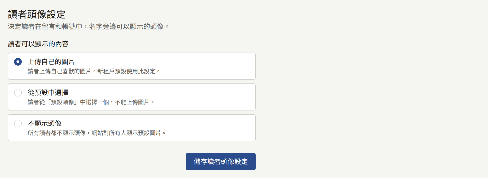

### 預設頭像

讀者在**從預設中選擇**下可以挑選的頭像，最多50個。在任何設定下都可以新增預設頭像，因此請在切換到該設定之前先準備好：清單為空時，讀者沒有任何頭像可以挑選。

若要新增，請在**頭像圖片**下選擇10MB以下的JPEG、PNG或WebP圖片，然後選擇**新增頭像**。系統會從圖片中心裁切出正方形，其尺寸必須至少為128 × 128 px。每個預設頭像都會以網站繪製頭像的方式顯示，並附上其儲存的尺寸。

若要刪除，請選擇其下方的**刪除**，再以**刪除**確認。已選擇該頭像的讀者將沒有頭像，在選擇其他頭像之前會顯示簡單的輪廓。

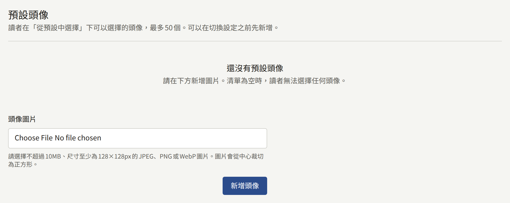

此分頁上的儲存會以**更新了讀者頭像設定**、**新增了讀者頭像預設**與**刪除了讀者頭像預設**記錄在[稽核記錄](./8-audit-log.md)中。
