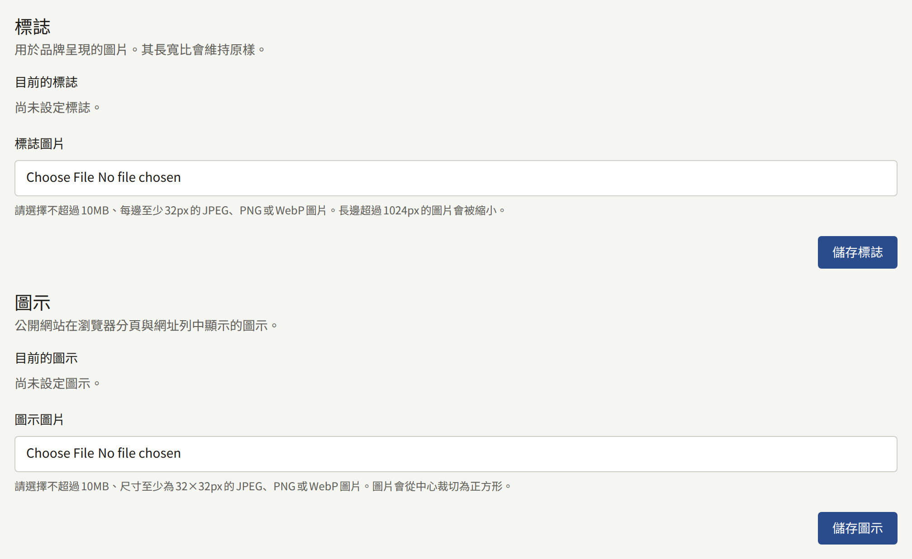
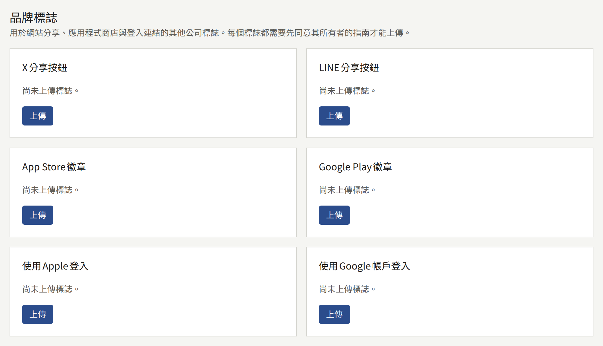
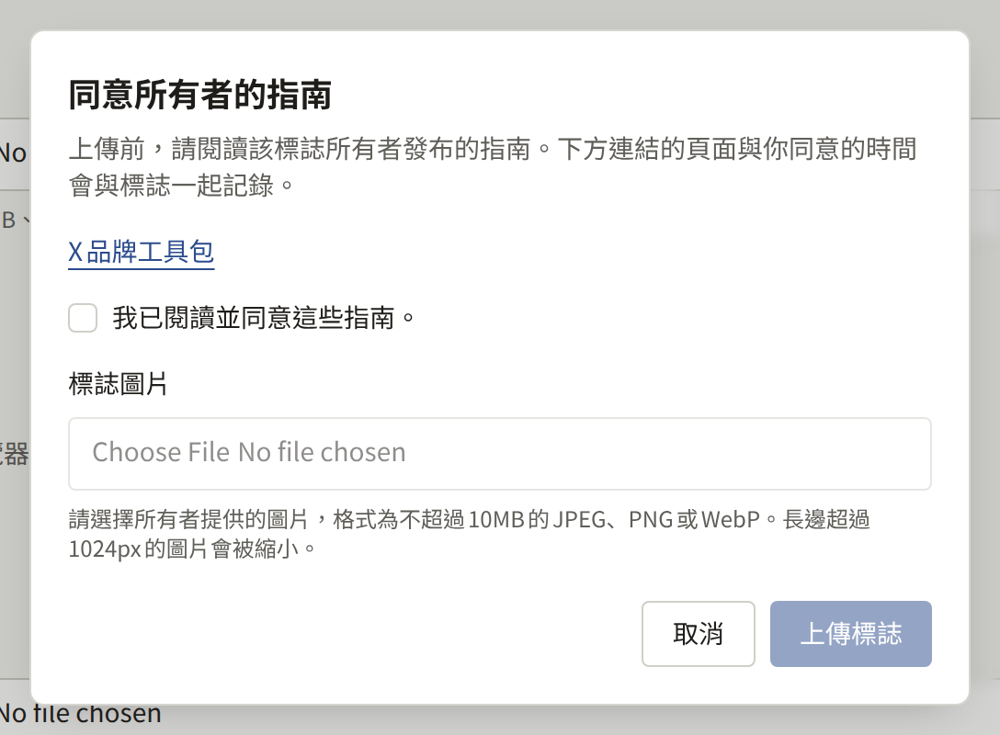
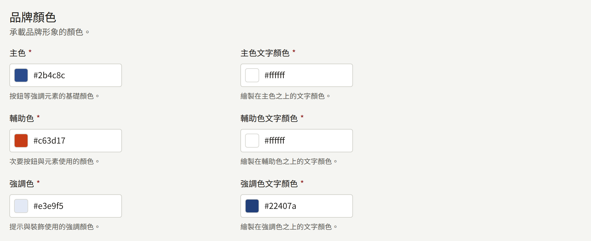
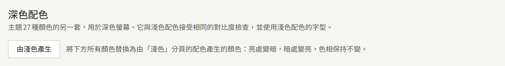
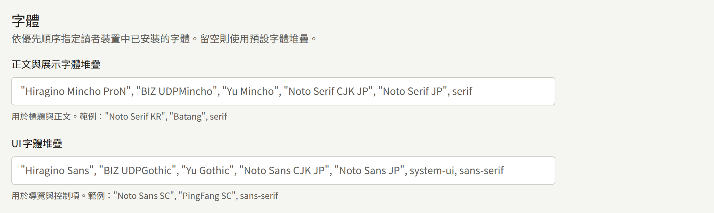
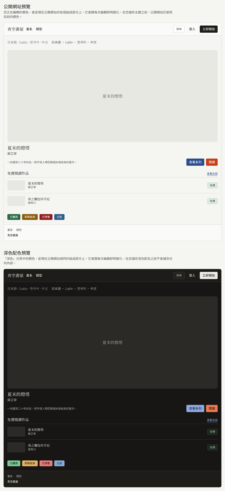

**品牌**位於**管理**下，決定網站的外觀：頁首的標誌、瀏覽器分頁中的圖示、登入表單旁的圖片、其他公司的標誌、網站的顏色，以及文字所使用的字體。這個畫面包含**標誌**、**圖示**、**登入頁面圖片**、**品牌標誌**，以及主題的顏色與字體，旁邊還有深色配色。每一項都會分別儲存，儲存其中一項時，其他項目會維持不變。

只有租戶管理員能變更品牌。編輯與稽核員看到的是同一個畫面，但其控制項都已停用。

## 標誌、圖示與登入頁面圖片

這三者都接受10MB以下的JPEG、PNG或WebP圖片。標誌與圖示會以PNG儲存，因此透明背景會保持透明。登入頁面圖片會將JPEG維持為JPEG，其他格式則以PNG儲存。

|  | **標誌** | **圖示** | **登入頁面圖片** |
| --- | --- | --- | --- |
| 顯示位置 | 取代網站名稱，顯示在網站與這個主控台每個頁面的頂端。租戶的應用程式會在其作品目錄畫面上用它取代名稱 | 顯示在瀏覽器的分頁與網址列中，也是讀者將網站加入主畫面時手機所使用的圖示 | 在寬度至少1024px的畫面上，顯示在網站登入與註冊畫面的表單旁。較窄的畫面只會顯示表單。租戶的應用程式會在其登入畫面上顯示它：在寬度至少840px的畫面上顯示在表單旁，在較窄的畫面上則顯示在表單上方 |
| 形狀 | 維持原樣 | 從中心裁切為正方形 | 維持原樣。網站與應用程式會裁切它，以填滿表單旁或上方的空間，而該空間的形狀會隨視窗改變 |
| 尺寸 | 寬或高超過1024px的圖片會被縮小，縮小後每邊仍必須至少為32px | 至少32×32px。大於512×512px的圖片會被縮小 | 寬或高超過2560px的圖片會被縮小，縮小後較短的一邊仍必須至少為512px |
| 未設定時 | 網站會顯示租戶的名稱 | 瀏覽器會顯示其預設圖示 | 在網站與應用程式中，該空間都會以主題的顏色填滿 |

在**標誌圖片**、**圖示圖片**或**登入頁面圖片檔案**下選擇檔案，然後選擇**儲存標誌**、**儲存圖示**或**儲存登入頁面圖片**。再次儲存會取代原本的圖片。**刪除**會在您確認後將其移除。

請為圖示提供一張標誌位於中央的正方形圖片，因為中央正方形以外的部分都會被裁掉。請為標誌提供一張標誌周圍空白較少的圖片。網站的頁首會以32px的高度、最多144px的寬度顯示它，因此寬度超過高度四倍半的標誌，顯示時會比32px更矮。

請為登入頁面圖片提供一張即使邊緣被裁掉也依然成立的圖片：將重要的部分放在靠近中央的位置，也不要放入讀者必須閱讀的文字。標誌和系列的圖片都不會代替它，因此如果您想在兩處使用同一幅美術作品，請在這裡也上傳一次。

當營運人員尚未為安裝實例設定物件儲存時，這三者的上傳都會被拒絕，並顯示「平台尚未設定圖片儲存空間，因此無法上傳圖片。請聯絡平台營運人員進行設定。」，如[物件儲存](../../3-operations/5-object-storage.md)所述。

這三者都不會用在租戶的郵件中，郵件會以Publira自己的顏色寄出。標誌會用在分享網站連結時所顯示的圖片中，如[連結預覽](#連結預覽)所述；圖示與登入頁面圖片則不會。

## 連結預覽

在聊天或貼文中分享網站任何頁面的連結時，連結會展開並附上一張圖片。設有圖片「**連結預覽 (1200:630)**」的系列或章節，會照上傳時的樣子顯示該圖片，如[系列](../1-catalog/1-series.md#封面圖)所述。其他所有頁面，以及沒有該圖片的系列或章節，則會顯示網站為其繪製的卡片：

- 以大字顯示頁面本身的名稱：系列或章節的標題，書系、類型、標籤或作者的名稱，或是**頁面**中某個頁面的標題。章節的卡片會在上方顯示其系列的標題，品牌、類型或作者的卡片則會顯示其所屬清單的名稱。首頁，以及排行榜等沒有自己名稱的頁面，會顯示[設定](./1-settings.md)中的**網站標語**；如果沒有設定，則顯示網站名稱。
- 底部顯示標誌；尚未上傳標誌時，則改為顯示網站名稱。
- 使用淺色配色的背景與文字顏色，頂端並有一條主色的色帶。

卡片使用所連結頁面的語言。網站無法繪製的文字（例如表情符號）會從圖片中省略，但與圖片一同分享的標題仍會保留它。新的標誌、顏色的變更或重新命名的系列，會像反映在頁面上一樣反映在卡片上，但已經顯示過某個連結的服務可能會暫時保留先前的圖片，因為每個服務都會保留自己的副本。

## 品牌標誌

**品牌標誌**存放其他公司的標誌，用於網站的分享、應用程式商店與登入連結：**X分享按鈕**、**LINE分享按鈕**、**App Store徽章**、**Google Play徽章**、**使用Apple登入**與**使用Google帳戶登入**。Publira並未隨附任何這類美術素材。每個標誌都屬於其擁有者，擁有者會公布可以使用該標誌的條件，因此由租戶在同意這些條件後，上傳擁有者所提供的美術素材。

每個標誌都有自己的卡片。尚未上傳任何內容的卡片會顯示「尚未上傳標誌。」並提供**上傳**。**上傳**會開啟一個對話框，其中有指向擁有者指南頁面的連結，例如**X品牌工具包**。在您勾選「我已閱讀並同意這些指南。」之前，**標誌圖片**欄位與**上傳標誌**都會保持停用。勾選只在對話框開啟期間有效，因此每次上傳（包括替換）都會再次要求勾選。

圖片除了最小尺寸以外，都適用與標誌相同的限制：10MB以下的JPEG、PNG或WebP，以PNG儲存，寬或高超過1024px時會被縮小。寬度遠大於高度的徽章也可以接受。與標誌一樣，在營運人員設定物件儲存之前，上傳會被拒絕。

上傳標誌後，其卡片會顯示該標誌、同意指南的人與時間，以及**已同意的指南**的連結，也就是對話框在當時所顯示的頁面。Publira會將該頁面與標誌一起記錄，因此當之後的Publira版本將對話框連結到不同的頁面時，已上傳的標誌仍會保留其同意時的頁面。如果同意的帳戶之後已被刪除，卡片會說明這一點，而不會顯示其名稱。**替換**會在重新同意後上傳另一張圖片，**刪除**則會在您確認後移除該標誌及其同意紀錄。

網站會將上傳的X或LINE標誌繪製在分享選單中該服務那一列的開頭，位於該列原有的文字旁。上傳的App Store或Google Play徽章，會以圖片本身的比例，取代在應用程式中販售的章節上該商店的按鈕。上傳的使用Apple登入或使用Google帳戶登入標誌，會以圖片本身的比例，放在登入與註冊畫面上該提供者按鈕的開頭，位於按鈕原有的文字旁。尚未上傳標誌的地方，網站只會顯示文字，與任何內容上傳之前相同。

Publira不會檢查上傳的圖片顯示的內容。它是否為擁有者目前的美術素材，以及是否依照指南允許的方式使用，由租戶負責。

## 主題顏色與字體

主題有三個分頁：包含顏色與字體的**淺色**、包含深色配色的**深色**，以及**預覽**。

### 顏色

主題在**淺色**分頁上有27種顏色，每種顏色都以`#RRGGBB`輸入，或透過旁邊的色票選擇。這些顏色分為四組：

- **品牌顏色**：**主色**、**輔助色**與**強調色**，每種都附有繪製在其上的文字顏色。主色用於按鈕與其他強調的部分。
- **背景與文字顏色**：頁面的背景與文字，以及繪製在其上的表面、卡片、彈出視窗與柔和區域，每一項都附有其文字顏色。
- **介面元素顏色**：邊框、輸入欄位，以及標示哪個控制項取得鍵盤焦點的外框。
- **狀態顏色**：成功、警告、錯誤與資訊通知的顏色，每一種都附有其文字顏色。

每種顏色與繪製在其上的文字顏色之間的對比度必須至少為4.5:1，也就是WCAG AA對一般文字的標準。低於該標準的組合會被拒絕，並在「請檢查這些顏色組合，以確保文字清晰可讀。」下顯示其實際達到的比值。邊框、輸入欄位與焦點外框的顏色不會檢查，因為它們上面不會繪製文字。

### 深色配色

**深色**分頁包含另一組同樣的27種顏色，分組也相同，用於深色畫面。它適用同樣的4.5:1對比度檢查，且沒有自己的字體：它使用**淺色**分頁上的字體。**儲存深色配色**會與淺色配色分開儲存，儲存其中一方時，另一方會維持不變。

租戶一開始沒有深色配色。在儲存深色配色之前，分頁會顯示「尚未儲存深色配色。」並在欄位中填入由已儲存的淺色配色產生的顏色，可以直接調整並儲存。

**由淺色產生**會將分頁上的每種顏色，替換為根據**淺色**分頁上的顏色（包括尚未儲存的顏色）所產生的顏色。每種顏色都會保留其色相，並採用相反的明度，因此背景會變暗，文字會變亮，品牌顏色的淡色調則會變成該顏色的深色調。產生後對比度低於4.5:1的組合會改用白色或黑色文字，因此結果可以直接儲存。再次選擇它即可從淺色配色重新開始。

儲存深色配色後，**儲存深色配色**旁的**刪除**會在您確認後將其移除，分頁會再次顯示產生的顏色。

在租戶擁有深色配色之前，網站只有一組顏色。擁有深色配色後，當讀者的裝置處於深色模式時，網站會以深色配色繪製，且頁首會新增**主題**，讀者可在其中選擇**淺色**、**深色**或**跟隨系統**。這個選擇會保存在讀者的瀏覽器中，如[網站在讀者瀏覽器中儲存的內容](./3-pages.md#網站在讀者瀏覽器中儲存的內容)所列，之後每個頁面都會以該選擇開啟。

當讀者的裝置設為深色時，租戶的應用程式會以深色配色顯示。沒有深色配色時，應用程式的深色模式會根據**主色**產生其顏色，與儲存深色配色之前相同。

### 字體

**字體**有兩個欄位：

- **正文與展示字體堆疊**：用於標題與閱讀文字的字體。
- **UI字體堆疊**：用於導覽與控制項的字體。

每個欄位都是以逗號分隔的字型家族名稱清單，寫法與CSS相同，例如`"Noto Serif KR", "Batang", serif`。讀者的裝置會使用清單中第一個已安裝的字體。字型不會被下載，因此請指定讀者裝置上有的字體，並以`serif`或`sans-serif`作為清單的結尾。欄位留空時，會使用Publira的預設清單（顯示為其預留位置文字），該清單以日文字體為優先。以其他文字系統的讀者為對象的網站，應將該文字系統的字體列在最前面。

租戶的應用程式會使用主題的顏色，但不使用其字體。

### 預覽與儲存

在您編輯**淺色**分頁時，主控台本身會套用新的顏色，讓您在儲存之前就能看到效果。深色配色只會在預覽中顯示，因為主控台是以淺色繪製的。**預覽**分頁會在構成網站的各個部分上顯示淺色配色：頁首、精選系列、章節清單、徽章與頁尾，並以兩種字體堆疊各顯示一行日文、拉丁文、韓文與中文文字。其下方的**深色配色預覽**會在相同的部分上顯示**深色**分頁上的顏色。預覽不會顯示標誌、圖示或登入頁面圖片。

在您選擇**儲存主題**之前，任何變更都不會反映到網站上。之後，隨著讀者的瀏覽器與網站的快取取得新主題，讀者會在大約一分半鐘內看到新的主題。

主控台沒有將主題恢復為Publira預設值的按鈕。每種顏色的預設值就是新租戶上欄位所顯示的值，因此請在變更之前記下這些值。
