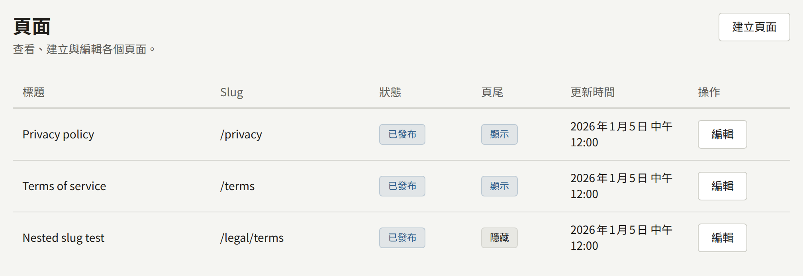
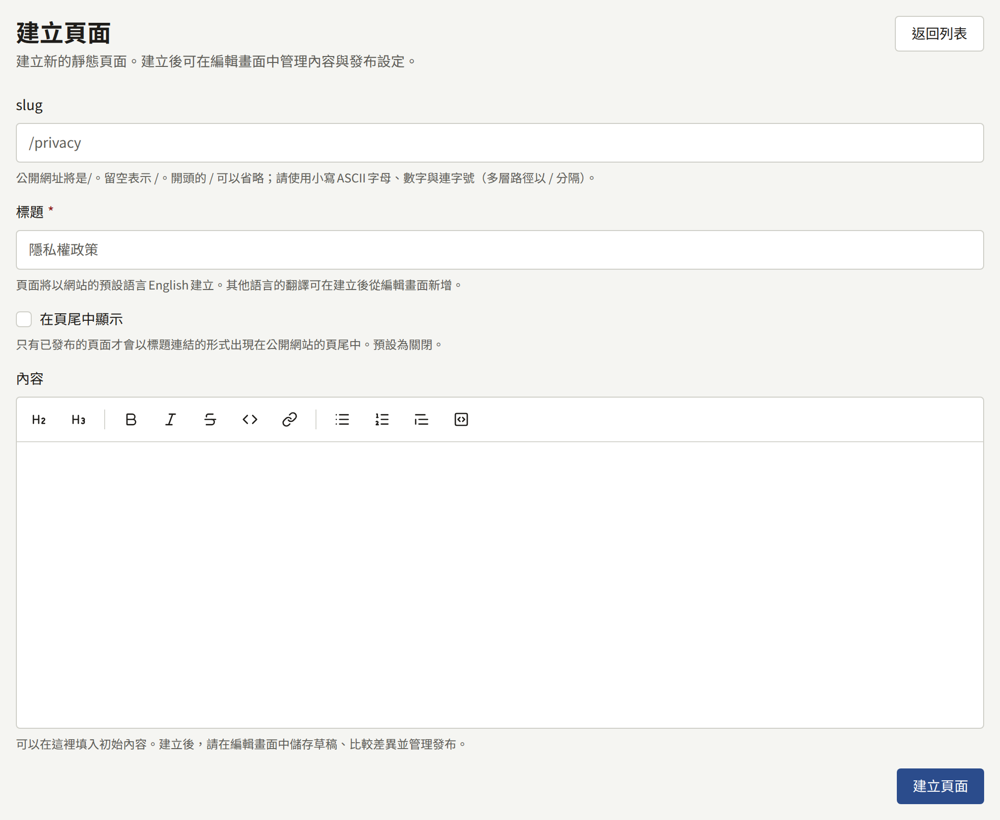
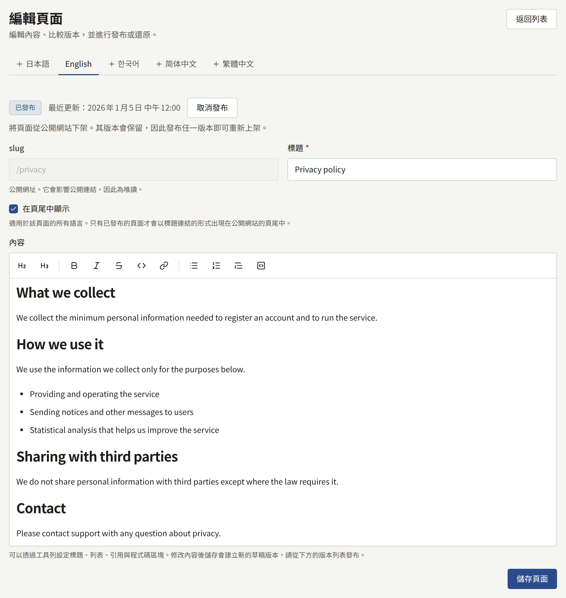
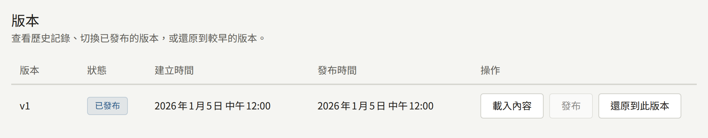
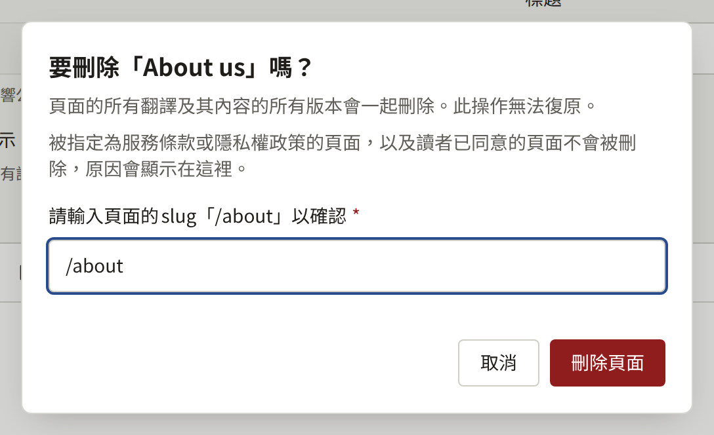

**頁面**位於**網站**下，存放出版社為網站撰寫的頁面：服務條款、隱私權政策、介紹出版社的頁面、投稿指南，以及其他任何不屬於系列的內容。頁面在富文字編輯器中撰寫，以版本保存，並可以翻譯成網站的每一種語言。

租戶管理員與編輯可以建立、編輯、發布及翻譯頁面，只有租戶管理員可以刪除頁面。稽核員可以開啟頁面，但無法變更任何內容。

## 建立頁面

選擇**建立頁面**，並填寫：

- **Slug**：頁面在網站上的位址。`privacy`會在`https://comics.example.com/privacy`提供該頁面，`legal/terms`則會在`https://comics.example.com/legal/terms`提供。請使用小寫字母、數字與連字號，巢狀路徑的各部分之間以`/`分隔。頁面建立後就無法變更Slug，因為指向該頁面的連結會失效。網站本身使用的路徑，例如登入與帳戶頁面，會被拒絕。
- **標題**：顯示在頁面頂端，以及所有連結到該頁面的地方。頁面會以網站的預設語言建立。
- **在頁尾中顯示**：頁面發布後，會以其標題列在網站每個頁面的頁尾中。之後可以在編輯畫面上變更。
- **內容**：頁面本文的第一個版本，在[撰寫與發布](#撰寫與發布)所說明的編輯器中撰寫。可以先留空，到下一個畫面再撰寫。

**建立頁面**會將頁面建立為草稿，並開啟其編輯畫面。在發布某個版本之前，網站上不會出現任何內容。

不應再被閱讀的頁面，請如下所述取消發布。誤建或不再需要的頁面，之後可以依[刪除頁面](#刪除頁面)的說明刪除。

## 撰寫與發布

編輯畫面會在一個編輯器中顯示頁面的本文，撰寫時即會顯示格式化後的樣子。編輯器上方的工具列會為選取的文字或游標所在的段落套用格式：**標題**、**小標題**、**粗體**、**斜體**、**刪除線**、**程式碼**、**連結**、**項目符號清單**、**編號清單**、**引用**與**程式碼區塊**。**連結**會要求輸入位址，如果沒有選取任何內容，則會直接將位址本身插入為連結。在編輯器中輸入的Markdown會在輸入時即套用格式，因此在行首輸入`## `會產生標題，輸入`- `則會產生項目符號清單。

本文會以Markdown儲存。在這個編輯器出現之前以Markdown撰寫的本文，在編輯器中開啟時會保留其表格、工作清單與圖片，編輯後也會保留。註腳與HTML在編輯後不會保留：它們會被儲存為純文字。

**儲存頁面**會一次儲存變更後的標題與**在頁尾中顯示**。變更後的本文會儲存為新的**草稿**版本，讀者看不到它。儲存永遠不會發布。

**在頁尾中顯示**屬於頁面本身，而不是其中某個翻譯，因此在任何語言的分頁上變更它，都會變更所有語言的設定。只要頁面處於發布狀態，頁尾會在儲存後片刻跟著更新。

**版本**列出頁面的每個版本，依序編號為`v1`、`v2`等，並顯示其狀態：讀者看到的版本為**已發布**，其他則為**曾經發布**或**草稿**。每個版本上都有：

- **發布**會讓該版本取代先前發布的版本，成為讀者看到的版本。
- **載入內容**會將該版本的本文放回編輯器，讓您從那裡繼續撰寫。
- **還原到此版本**會將該版本的本文複製到新的草稿中。發布該草稿，即可將舊的文字放回網站上。

頁面有兩個版本之後，**比較版本**會顯示任意兩個版本之間新增與刪除的Markdown行。

頁面狀態旁的**取消發布**會將頁面從網站上撤下。其版本都會保留，發布其中一個版本即可讓頁面重新上線。

變更發布後片刻，網站就會顯示該變更。

## 翻譯

編輯畫面在**語言**下為網站提供的每種語言各提供一個分頁，這些語言由租戶管理員在[**設定**](./1-settings.md#語言)中選擇。網站不再提供的語言的翻譯沒有分頁，但會被保留：當該語言再次提供時，其分頁會連同原本的翻譯一起恢復。讀者也看不到這類翻譯，因此只以網站不再提供的語言發布的頁面，會從網站上消失，也不會出現在網站地圖中，直到其中一種語言再次提供，或頁面以網站提供的語言發布為止。沒有自己翻譯的語言會標示為「**（未新增）**」，以該語言瀏覽網站的讀者會看到以其他語言顯示的頁面，並附有說明此情況的提示。若要新增翻譯，請開啟其分頁、輸入標題，然後選擇**新增翻譯**。接著依照上述方式撰寫並發布其本文。

每個翻譯都有自己的標題、版本與已發布版本，因此對其中一個翻譯所做的更正，在其他翻譯中也做同樣的更正之前，不會反映到那些翻譯上。**刪除此翻譯**會移除一個翻譯，但無法移除最後一個。

## 刪除頁面

租戶管理員可以透過頁面編輯畫面最後**刪除頁面**中的**刪除本頁面**刪除頁面；編輯與稽核員看不到此操作。只有在頁面的所有翻譯都未發布時才會顯示此操作，因此讀者可以開啟的頁面，必須先在每個已發布翻譯的分頁中以**取消發布**將其從網站下架。

對話框會要求輸入頁面的slug，在正確輸入之前無法選擇**刪除頁面**。開頭的`/`可加可不加。選擇後，頁面會連同其所有翻譯以及所有版本一起刪除，主控台會回到**頁面**清單。刪除無法復原，**稽核記錄**會連同頁面的slug與標題記錄此操作。

只要符合以下任何一項，對話框就會說明原因，而不會刪除頁面：

- 頁面的某個翻譯已發布。在開啟對話框後有人發布了翻譯時即屬於這種情況。**開啟已發布的翻譯**會開啟某個已發布翻譯的分頁，可在該處以**取消發布**將其從網站下架。
- 租戶將本頁面指定為服務條款或隱私權政策。已取消發布的頁面在選擇其他頁面或**無**之前仍會保持指定。**開啟服務條款與隱私權政策**會開啟該設定。
- 讀者已同意頁面的某個版本。讀者同意的內容會作為其同意的記錄保留，因此讀者以服務條款或隱私權政策身分同意過的頁面永遠無法刪除，只能保持取消發布的狀態。

對話框會依此順序顯示第一項，因此符合多項的頁面在第一項解決後，會因下一項再次被拒絕刪除。

## 服務條款與隱私權政策

Publira沒有用於法律文字的特殊頁面類型。服務條款與隱私權政策都是一般的頁面，再由租戶管理員在**設定** › **服務條款與隱私權政策**中指定：

1. 在這裡建立並發布每個頁面；如果希望讀者以自己的語言閱讀，請以網站提供的每種語言建立並發布。
2. 在**設定**中，將它們分別選為**服務條款**與**隱私權政策**，然後選擇**儲存服務條款與隱私權政策**。

從那時起：

- 無論這兩個頁面是否顯示在頁尾中，網站與應用程式都會連結到它們。
- 註冊表單會在兩個頁面的連結上方顯示「我已閱讀並同意以下內容。」，不勾選就無法建立帳戶。首次透過Apple或Google註冊的讀者，會在**完成註冊**上看到同樣的同意項目。
- 租戶會記錄每位讀者同意了每個頁面的哪個已發布版本，以及同意的時間。

已選擇但尚未發布的頁面，在註冊時不會要求同意。如果沒有選擇任何頁面，註冊時完全不會要求同意。

### 發布新版本

發布任一頁面的新版本，會變更新讀者從那時起所同意的內容。如果在您發布時有讀者正開著註冊表單，其註冊會被拒絕，並顯示「需要同意的頁面已更新。請閱讀後重新同意。」，因此不會有人同意自己沒有看過的文字。

已經擁有帳戶的讀者是否需要同意新版本，是在發布時決定的。在任一頁面上，租戶管理員按下**發布**時會先詢問，並提供兩種發布方式：

- **發布並要求讀者同意**會要求每位讀者同意這個版本。當變更改變了讀者所同意的內容時，請選擇此項。
- **不要求同意直接發布**會將該版本作為更正發布，例如修正錯字或失效的連結：已同意先前版本的讀者不會再次被要求同意。

編輯按下**發布**時，一律不要求同意直接發布。在**版本**中，發布時要求了讀者同意的版本，會在其狀態下方標示**已要求讀者同意**。

被要求同意的讀者，下次在登入狀態下開啟網站的頁面時，會被帶到一個畫面，上面寫著「以下頁面已更新。如需繼續使用您的帳戶，請閱讀並同意。」該畫面會連結有所變更的頁面，並要求讀者勾選「我已閱讀並同意以下內容。」**同意並繼續**會記錄讀者對其所看到版本的同意，並讓讀者回到原本所在的頁面；在另一個版本要求同意之前，讀者不會再次被詢問。在同意之前，讀者仍可閱讀網站以及自己擁有的章節，但帳戶的大多數功能，例如購買章節、留言或追蹤系列，都會被拒絕。不想同意的讀者可以登出，或在**設定**中刪除其帳戶。

每個翻譯都會分別詢問。已同意其他語言版本頁面、且該翻譯沒有變更的讀者不會被詢問，因此適用於所有語言的變更，需要在每個翻譯的分頁上以**發布並要求讀者同意**發布。

應用程式也會詢問。在應用程式中登入的讀者，在開啟應用程式時、回到應用程式時，或是應用程式因為讀者尚未同意而被拒絕某項操作時，會看到同樣的畫面，取代應用程式的其他部分。該畫面連結同樣的頁面，並提供**登出**與**刪除帳戶**作為同意以外的選擇；**同意並繼續**會讓讀者回到應用程式中原本所在的位置。在應用程式或網站上所做的同意對兩者都有效，因此讀者只會被詢問一次。

### 網站在讀者瀏覽器中儲存的內容

隱私權政策會說明網站在讀者的瀏覽器中保存了什麼。以下是網站設定的所有Cookie與瀏覽器儲存空間，因此政策可以不靠猜測就列出它們。Cookie的名稱在每個Publira網站上都相同。

| Cookie | 設定時機 | 內容 | 保留期間 |
| --- | --- | --- | --- |
| `publira_web_storefront_auth` | 讀者登入時 | 讀者的工作階段，以只有網站持有的金鑰加密 | 直到工作階段結束：登入後一天，或讀者登出時 |
| `publira_web_storefront_signup_pending_email`、`publira_web_storefront_reset_password_email`、`publira_web_storefront_resend_verification_email` | 讀者送出註冊表單、要求重設密碼，或再次要求確認連結時 | 郵件寄送的電子郵件地址，讓下一個頁面可以顯示該地址，而不必將它放進頁面的網址中 | 一分鐘 |
| `publira_web_storefront_sign_in` | 讀者選擇**透過Apple繼續**或**透過Google繼續**時 | 進行中的登入，經過加密，用來核對Apple或Google的回應 | 十分鐘，或直到收到回應為止 |
| `publira_web_storefront_sign_up` | 首次透過Apple或Google登入的讀者看到**完成註冊**時 | Apple或Google傳回的讀者相關資訊，經過加密，保留到讀者同意條款為止 | 四分鐘 |
| `publira_web_storefront_mfa` | 開啟了兩步驟驗證的讀者輸入密碼，或透過Apple或Google登入後，被要求輸入驗證碼時 | 等待驗證碼的登入，經過加密 | 五分鐘，或直到驗證碼被接受為止 |
| `publira_web_storefront_dismissed_announcement` | 讀者選擇**關閉該公告**時 | 讀者所關閉公告的識別碼 | 一年 |
| `publira_resolved_locale` | 造訪時，只要該Cookie尚未包含網站的預設語言 | 網站的預設語言代碼，例如`en`，不含任何讀者相關資訊 | 一年 |
| `publira_web_storefront_view_actor` | 未登入的讀者開啟系列或章節時；如果網站會先詢問，則在讀者於同意橫幅上同意之後 | 只用來計算瀏覽次數的隨機識別碼。它不與任何帳戶關聯，網站上的任何內容也不會依據它進行個人化 | 180天 |
| `publira_web_storefront_analytics_consent` | 讀者在同意橫幅上選擇**同意**或**不同意**時；只有當**整合** › **Google代碼**中的**讀者同意**設為**先徵求讀者同意**時，網站才會顯示該橫幅 | 回答，`granted`或`denied`，不含其他任何內容 | 六個月 |

| 瀏覽器儲存空間 | 設定時機 | 內容 | 保留期間 |
| --- | --- | --- | --- |
| `localStorage`中的`publira.age-rating.confirmation.<tenant ID>` | 讀者在開啟有年齡分級的系列或章節之前，以**我已滿15歲**或**我已滿18歲**確認年齡時 | 已確認的最高分級，`r15`或`r18` | 直到讀者清除網站的資料為止 |
| `localStorage`中的`publira.payment-provider.<tenant ID>` | 讀者在付款前於**付款方式**中選擇付款服務商時；只有當租戶透過多個付款服務商收款時，網站才會顯示該選單 | 所選的付款服務商，例如`stripe` | 直到讀者清除網站的資料為止 |
| `localStorage`中的`publira.theme` | 讀者在網站頁首的**主題**中選擇**淺色**、**深色**或**跟隨系統**時；只有當租戶擁有深色配色時，網站才會顯示該選單 | 所做的選擇，`light`、`dark`或`system` | 直到讀者清除網站的資料為止 |
| `sessionStorage`中的`publira.wide-viewer` | 讀者將章節閱讀器加寬到視窗大小，或再次縮窄時 | 閱讀器是否為加寬狀態 | 直到分頁關閉為止 |
| 推播訂閱 | 讀者在**設定**中開啟**瀏覽器通知**，並在瀏覽器本身的提示中允許通知時 | 瀏覽器的推播服務傳送網站通知的目的地位址 | 直到讀者關閉通知或登出為止 |
| 網站的Service Worker | 與推播訂閱同時 | 顯示網站通知的指令碼。它不保存任何頁面，也不保存任何讀者相關資訊 | 直到讀者清除網站的資料為止。關閉通知或登出會結束訂閱，Service Worker會留下，但沒有任何內容需要傳送 |

這些內容都只會傳送到網站本身。除非網站如下所述載入Google代碼，否則網站不會從其他公司載入任何可能設定自己的Cookie或得知讀者資訊的內容，您可以在政策中用類似以下的句子說明這一點：「本網站只儲存此處所列的Cookie與瀏覽器儲存空間，且不會將其中的任何內容傳送給其他公司。」

只有在讀者執行需要其他公司的操作時，讀者的瀏覽器才會連線到其他公司：選擇**透過Apple繼續**或**透過Google繼續**會將讀者帶到Apple或Google登入，**分享到X**與**分享到LINE**會開啟這些服務，而瀏覽器通知則會透過製作讀者瀏覽器的公司的推播服務傳送，並經過加密，使該服務無法讀取。

此清單涵蓋的是Publira本身儲存的內容。如[Google代碼](../8-google-tag.md)所述，在**整合** › **Google代碼**中輸入的Google Analytics或Google Tag Manager ID，會在讀者登入、註冊、重設密碼或變更帳戶設定的頁面以外的每個頁面載入Google的代碼。該代碼會帶來自己的Cookie，並將其收集的內容傳送給Google或您的伺服器端Tag Manager容器，您的容器所觸發的每個代碼也是如此。您的隱私權政策也必須涵蓋這些內容，請依據Google本身的文件，以及容器中每個代碼的文件撰寫。
