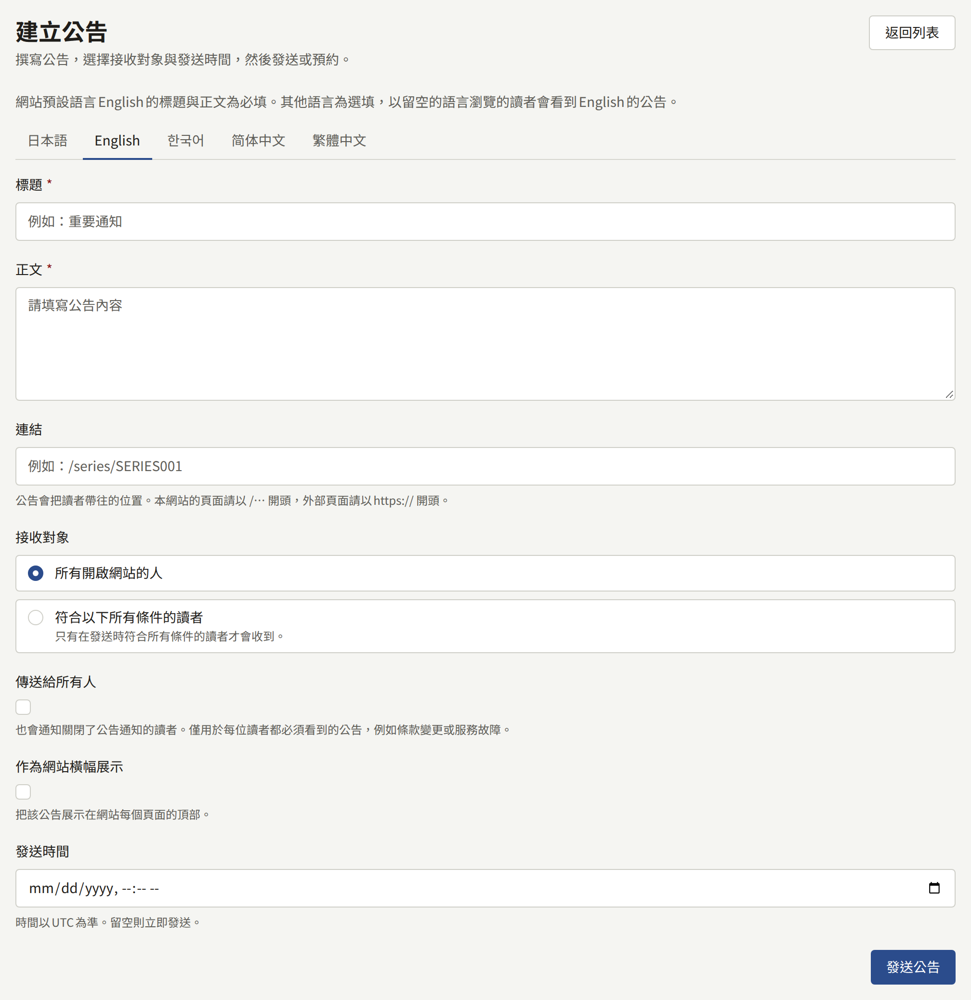
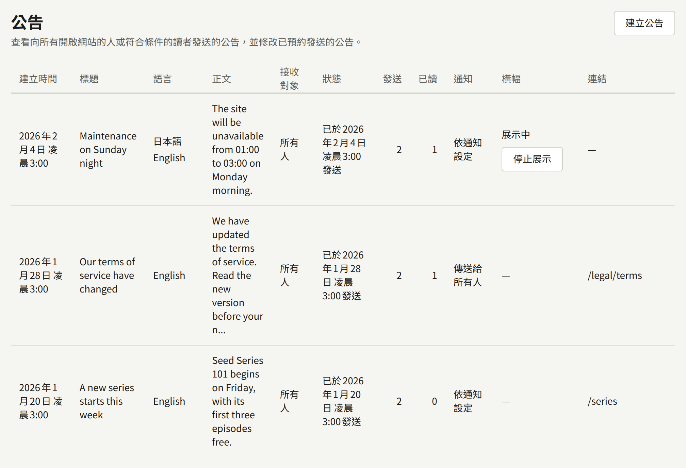

**公告**位於**網站**下，是出版社一次向所有讀者傳達訊息的方式：新的系列、條款的變更、維護時段等。每則公告都會列在網站的**公告**頁面上，並傳送到讀者的通知中。公告也可以只傳送給一組條件所選出的讀者，例如某個系列的追蹤者；請參閱[選擇接收對象](#選擇接收對象)。同一時間也可以有一則公告以橫幅顯示在網站與應用程式每個頁面的上方。

租戶管理員與編輯可以建立公告、變更或刪除已預約的公告，以及撤下橫幅。稽核員只能看到清單。

## 建立公告

選擇**建立公告**，並填寫：

- **標題**與**正文**，網站提供的每種語言各有一個分頁：標題最多120個字元，正文最多2000個字元的純文字。請參閱[以多種語言撰寫](#以多種語言撰寫)。
- **連結**（選填）：讀者開啟公告時被帶往的位置。若是本網站的頁面，請以`/`開頭，例如`/series/SERIES001`或`/legal/terms`；若是其他網站，請以`https://`或`http://`開頭。
- **接收對象**：**所有開啟網站的人**（預設），或**符合以下所有條件的讀者**。請參閱[選擇接收對象](#選擇接收對象)。
- **傳送給所有人**（預設關閉）：通知每位擁有帳戶的讀者，包括通知設定中關閉了公告的讀者。請參閱[傳送給所有人](#傳送給所有人)。
- **作為網站橫幅展示**：同時將公告顯示在每個頁面的上方。請參閱[網站橫幅](#網站橫幅)。
- **發送時間**（選填）：公告發送的時間。留空則會立即發送。請參閱[預約公告](#預約公告)。

**發送公告**會立即發送。設定了**發送時間**時，按鈕會改為**預約發送公告**，公告會在該時間發送。公告一旦發送就無法編輯或刪除，因此請在發送之前仔細檢查。

## 預約公告

公告可以指定一個發送時間，而不是立即發送：例如在星期五撰寫，於星期一早上九點發送。請在**發送時間**中輸入時間，然後選擇**預約發送公告**。該時間以租戶的時區為準，且必須是未來的時間。橫幅的**停止展示的時間**必須晚於該時間。

在該時間之前，公告處於預約狀態，讀者看不到它：它不會出現在網站的**公告**頁面或應用程式中，不會通知任何讀者，其橫幅也不會顯示。清單的**狀態**欄會顯示**預約於**該時間**發送**。租戶管理員或編輯仍可選擇該欄中的**編輯**，變更其中的任何內容（包括時間），然後選擇**儲存**；或選擇**刪除**並確認，將其刪除。在**發送時間**留空的狀態下儲存，就會立即發送。

在指定時間後約一分鐘內，公告會像在那時建立的公告一樣發送：讀者會收到通知，公告會出現在**公告**頁面與應用程式中，其橫幅也會顯示。讀者看到的公告會依發送時間（而不是撰寫時間）與其他公告排序。設有條件的公告也會在那一刻選出其讀者。從那時起，公告就無法再編輯或刪除。

## 以多種語言撰寫

表單為網站提供的每種語言各提供一個分頁，以該語言本身命名，並一開始顯示網站的預設語言。這些語言就是在**設定**的[語言](./1-settings.md#語言)中所選擇的語言：網站未提供的語言沒有分頁。

- 預設語言的**標題**與**正文**為必填。以您留空的語言瀏覽的讀者，會看到預設語言的公告。
- 其他所有分頁都是選填的。請同時填寫其**標題**與**正文**，或兩者都留空。

**發送公告**會將公告連同您撰寫的所有語言一次發送。公告發送後就無法再新增語言，因此請在發送之前寫好所有翻譯。

清單會以預設語言顯示每則公告的標題，**語言**欄則會列出其撰寫時使用的每種語言。

## 傳送給所有人

只有當讀者的通知設定允許時，公告才會送達讀者的通知與電子郵件，因此關閉了公告通知的讀者不會得知活動的消息。**傳送給所有人**會通知每位擁有帳戶的讀者，並寄送電子郵件給每位地址已確認的讀者，無論這些設定為何。推播仍然只會送達開啟了公告推播設定的讀者。請將它保留給每位讀者都必須看到的通知，例如條款的變更或服務中斷。

清單的**通知**欄會顯示每則公告的傳送方式：**傳送給所有人**，或是未使用此選項傳送的公告所顯示的**依通知設定**。

## 選擇接收對象

公告可以傳送給符合一組條件的讀者，而不是所有人。在**接收對象**下選擇**符合以下所有條件的讀者**，然後在**新增條件**中挑選一個條件。每個條件都會新增一列，包含其所需的輸入欄位，**移除**則可以將其移除。條件如下：

- **追蹤了系列**：讀者追蹤了您所選的**系列**。
- **購買過系列的章節**：讀者持有您所選**系列**中某個章節的購買紀錄，無論是單獨購買、隨卷購買，或打包購買。已退款或已撤銷的購買不計算在內。
- **訂閱**：讀者對您所選**方案**或**任何方案**的訂閱仍然有效（**訂閱中**：在試用期間、有效中，或續訂付款逾期），或讀者曾有已結束的訂閱且目前沒有任何有效的訂閱（**訂閱已結束**）。
- **從未購買過**：讀者從未在網站上購買過任何東西。在金流服務商的測試模式下進行的購買不計算在內。
- **未閱讀的天數**：讀者至少在您輸入的**天數**內沒有開啟任何章節，或從未開啟過任何章節。
- **註冊後的天數**：讀者註冊至今不超過您輸入的**天數**。
- **語言**：讀者以您所選的語言使用網站，可選的語言為網站提供的語言：讀者最後一次瀏覽網站或使用應用程式時所用的語言；對於從未選擇過語言的讀者，則為網站的預設語言。
- **登記了應用程式的推播通知**：讀者已登記一支執行網站應用程式的手機以接收推播通知。

天數的範圍為1到3650。每個條件只能使用一次，因此已新增的條件不會再次出現在選項中，且條件會組合在一起：讀者只有在符合公告所指定的每一個條件時，才會收到該公告。

每一列都填寫完畢後，表單會計算條件所選出的讀者人數並顯示，例如**將送達12位讀者**，並在條件變更時重新計算。這是當下的人數，僅供參考：公告發送時會重新選出讀者，且無論是否能計算出人數，公告都可以發送。

公告設有條件期間，**傳送給所有人**與**作為網站橫幅展示**都會關閉且無法開啟，如表單在其上方所說明。移除所有條件後，就可以再次使用。

清單的**接收對象**欄會顯示每則公告的對象：**所有人**，或其所指定的條件數，例如**2個條件**。

條件只會在公告發送的那一刻評估一次。之後才符合條件的讀者（例如在一天後才追蹤該系列）不會收到公告，而之後不再符合條件的讀者，仍會保有已收到的公告。

設有條件的公告會依照通知設定的允許範圍，送達其所選出的每位讀者，且永遠不會：

- 以網站橫幅顯示，因為每位訪客都會看到網站橫幅；
- 以**傳送給所有人**傳送，因為每位讀者都必須看到的通知，不應該因為條件而對部分讀者隱藏；
- 對未登入的訪客或未收到該公告的已登入讀者，列在**公告**頁面或應用程式中，且其專屬頁面會向他們顯示**找不到頁面**。

## 讀者看到的內容

- **在網站上**，頁首的**公告**頁面會由新到舊列出所有傳送給所有人的公告，任何人都可以閱讀。已登入的讀者也會在那裡看到傳送給自己的設有條件的公告，與其他公告列在一起，並可在登入狀態下像其他公告一樣開啟。每個標題都會在專屬的頁面中開啟公告。已登入的讀者可以看到哪些公告尚未閱讀。
- **在通知中**，每位擁有帳戶且通知設定允許公告的讀者，都會收到通往該公告的「新公告」；對於以**傳送給所有人**傳送的公告，每位擁有帳戶的讀者都會收到。設有條件的公告只會送達其所選出的讀者。
- **透過電子郵件**，每位地址已確認且通知設定允許以電子郵件接收公告的讀者，都會收到一封附有公告標題與**公告**頁面連結的郵件；對於以**傳送給所有人**傳送的公告，每位地址已確認的讀者都會收到。
- **以推播通知**，通知設定允許以瀏覽器通知接收公告的讀者，會在瀏覽器中收到通知；設定允許在手機上接收的讀者，則會從應用程式收到通知。通知的標題是以讀者語言顯示的公告標題，開啟通知即會顯示該公告。這兩項設定一開始都是關閉的，因此尚未儲存任何設定的讀者不會收到任何推播，且**傳送給所有人**也不會覆寫這些設定。
- **在應用程式中**，**公告**畫面會列出相同的公告，並顯示相同的已讀標記。

讀者會以自己的語言看到每則公告：在網站上是其瀏覽時使用的語言，在應用程式中則是應用程式顯示的語言。如果您沒有以該語言撰寫公告，讀者會看到預設語言的公告，並附有說明其顯示語言的提示。

公告發送後，清單會顯示其送達的範圍。**發送**欄計算公告送達的讀者人數：傳送給所有人的公告為每位擁有帳戶的讀者，設有條件的公告則為發送時條件所選出的讀者。通知設定讓公告不進入其通知的讀者也會被計算在內。**已讀**欄計算在網站或應用程式中開啟過該公告的讀者人數。公告處於預約狀態時，這兩欄都會顯示—，而在公告發送後、讀者收到通知之前的片刻，**發送**可能會顯示0。

## 網站橫幅

以**作為網站橫幅展示**建立的公告，會顯示在網站每個頁面的頁首上方，向每位訪客顯示，無論是否登入，也會顯示在應用程式作品目錄畫面的頂端。在網站上，橫幅的連結會通往公告的**連結**；如果沒有設定連結，則通往公告的專屬頁面。訪客可以關閉橫幅，之後它在該瀏覽器中會保持關閉。

同一時間只會顯示一個橫幅：橫幅仍在展示中的最新公告。因此，建立新的橫幅會隱藏先前的橫幅，直到新的橫幅撤下為止。

除非您為橫幅設定結束時間，否則它會一直展示，直到您將其撤下：

- 橫幅核取方塊下的**停止展示的時間**，會在該時間撤下橫幅，時間以租戶的時區為準。該時間必須是未來的時間。
- 清單**橫幅**欄中的**停止展示**，會立即撤下橫幅。

無論哪種方式，公告都會保留在**公告**頁面與讀者的通知中。只有橫幅會消失。
