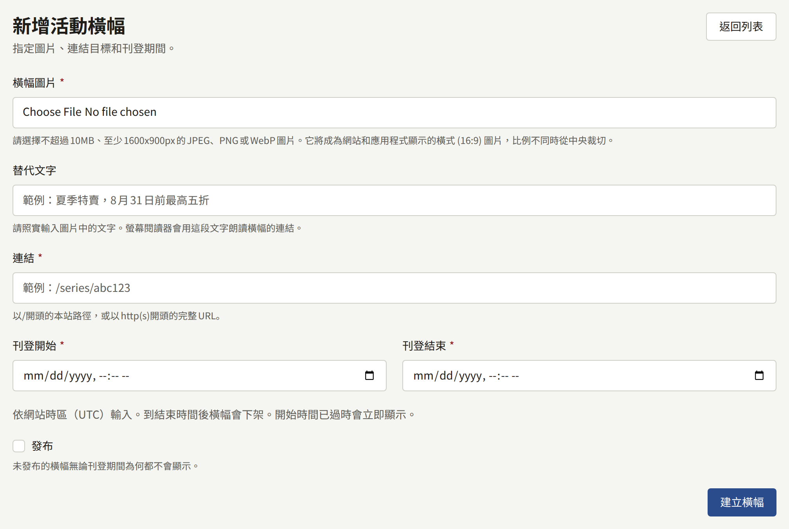
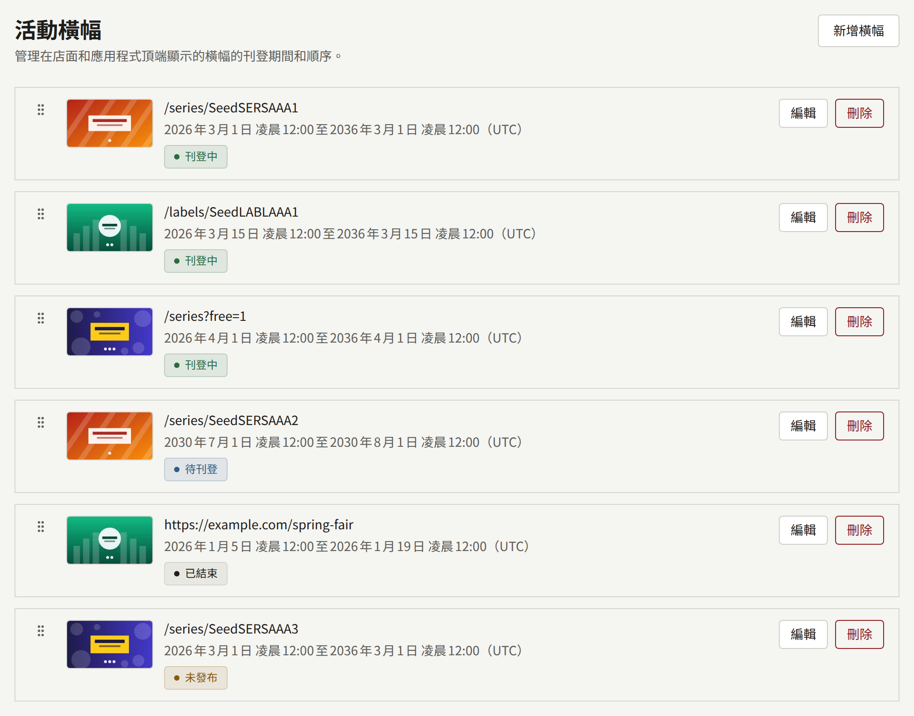

**活動橫幅**位於**網站**下，用來把活動推到沒有主動尋找它的讀者面前：某個系列的折扣、新的連載、在其他網站舉辦的書展等。橫幅是一張連結到某處的圖片，會在您設定的期間內顯示。網站會在首頁頂端顯示正在刊登的橫幅，應用程式則顯示在其作品目錄畫面的頂端。

橫幅不是公告。它不會進入任何人的通知，讀者無法關閉它，而且只會顯示在這兩個畫面上。若要向所有讀者傳達訊息，或在每個頁面上方保留一行文字，請使用[公告](./4-announcements.md)。

租戶管理員與編輯可以建立、變更、重新排序及刪除橫幅。稽核員可以看到清單，並以**檢視**開啟橫幅，但無法變更。

## 建立橫幅

選擇**新增橫幅**，並填寫：

- **橫幅圖片**：最大10 MB、至少1600 × 900像素的JPEG、PNG或WebP圖片。請參閱[圖片](#圖片)。
- **替代文字**：圖片中所繪製的文字，最多255個字元，例如`Summer sale, up to 50% off through August 31`。螢幕閱讀器無法讀取圖片中的文字，因此會改用這段文字來表示橫幅的連結。此欄位為選填，但沒有填寫的橫幅，只能從其連結目標與其他橫幅區分。
- **連結**：讀者開啟橫幅時被帶往的位置，最多2048個字元。若是本網站的頁面，請以`/`開頭，例如`/series/SERIES001`或`/labels/LABEL001`；若是其他網站，請以`https://`或`http://`開頭。
- **刊登開始**與**刊登結束**：橫幅刊登的期間，以租戶的時區輸入，兩個欄位下方的說明會顯示該時區。請參閱[刊登期間](#刊登期間)。
- **發布**：橫幅是否顯示。新的橫幅一開始為未發布。請參閱[發布](#發布)。

選擇**建立橫幅**。橫幅會在其專屬畫面中開啟，其中的**基本資訊**分頁可以變更替代文字、連結、刊登期間與**發布**，**圖片**分頁則可以變更圖片。

## 圖片

網站與應用程式中的橫幅帶狀區域，是以單一形狀「**橫式 (16:9)**」不經裁切繪製的，您上傳的圖片會變成這個形狀。為帶狀區域製作的美術素材（例如1920 × 1080的圖片）會完整保留；其他形狀的圖片則會從中心裁切。**圖片**分頁會在**各比例圖片**下的「**橫式 (16:9)**」欄位中顯示結果。旁邊的「**直式 (3:4)**」、「**方形 (1:1)**」與「**連結預覽 (1200:630)**」欄位一開始是空的，也不會顯示在任何地方。

若要以不同的方式為帶狀區域取景，請在「**橫式 (16:9)**」欄位上選擇**調整取景框**，或以**取代**為其上傳其他美術素材，該圖片必須至少為1600 × 900像素。在**封面圖**下上傳新圖片並選擇**更新圖片**也會取代它，並清空其他已填入的欄位。橫幅一定會保有一張圖片，因此無法將其移除。系列的[封面圖](../1-catalog/1-series.md#封面圖)完整說明了這些欄位。

在手機上，帶狀區域與螢幕同寬，因此圖片中的文字必須在該尺寸下仍可閱讀。文字不同的新圖片，需要在**基本資訊**分頁上重新撰寫其**替代文字**以符合新圖片。

## 刊登期間

**刊登開始**與**刊登結束**以在[設定](./1-settings.md#時區)中選擇的租戶時區解讀，清單也會以該時區顯示所有刊登期間。橫幅從第一個時間點開始刊登，到第二個時間點的那一刻就已下架，因此一個橫幅可以在下一個橫幅開始的那一刻結束。

- 結束時間必須晚於開始時間。
- 新橫幅的結束時間必須是未來的時間。開始時間已過的橫幅，會在發布後立即開始刊登。
- 編輯橫幅時，除非您維持原本的刊登期間不變，否則結束時間也必須是未來的時間。因此，已結束的橫幅仍可取消發布或變更連結，而不必重新排定。

網站與應用程式每次讀取時都會將刊登期間與目前時間比較，因此無論讀者身在何處，橫幅都會在同一時刻切換。網站會保留已繪製的內容，直到worker處理程序下一次執行時將其捨棄，通常在您設定的時間後一分鐘內。如果橫幅在刊登期間開始後仍未出現，或在結束後仍在顯示，安裝實例的營運人員可以檢查[排程工作](../../3-operations/10-scheduled-jobs.md)中所說明的工作。

## 發布

**發布**決定橫幅是否顯示。未發布的橫幅無論刊登期間為何都永遠不會顯示，因此可以先準備好橫幅，並在準備就緒之前保持未發布。在**基本資訊**分頁上取消勾選**發布**，然後選擇**更新橫幅**，就會立即讓橫幅下架。

清單會顯示每個橫幅目前的狀態：

| 狀態       | 意義                             |
| ---------- | -------------------------------- |
| **刊登中** | 已發布，且目前時間在其刊登期間內 |
| **待刊登** | 已發布，但其刊登期間尚未開始     |
| **已結束** | 已發布，但其刊登期間已結束       |
| **未發布** | 未發布，無論其刊登期間為何       |

每一列的開頭是橫幅的替代文字，其下方為連結；沒有替代文字時，則只顯示連結。

## 排序

網站與應用程式會依清單的順序顯示正在刊登的橫幅。新的橫幅會加到最後。若要移動橫幅，請拖曳其控點，或將焦點移到控點上並使用方向鍵。放下橫幅後，順序就會立即儲存。

如果有其他人同時重新排序清單，您的移動會被拒絕，並顯示「橫幅順序已在其他地方被變更。請重新載入頁面後重試。」

## 刪除橫幅與50個的上限

橫幅那一列上的**刪除**會要求確認，然後移除橫幅及其圖片。網站會立即停止顯示它。

一個租戶最多可以擁有50個橫幅，包括已結束的橫幅。超過上限時建立的橫幅會被拒絕，並顯示「活動橫幅數量已達上限。請刪除已結束的橫幅後重試。」已結束的橫幅不會顯示在任何地方，因此刪除它不會讓讀者看到的內容有任何損失。

## 讀者看到的內容

- **在網站上**，正在刊登的橫幅位於首頁頂端，在頁面一開始的作品上方。只有一個橫幅時，會顯示為單一的帶狀區域。有兩個以上時，會顯示為讀者可以滑動或捲動瀏覽的橫列，附有**上一個活動**與**下一個活動**按鈕，下方還有例如`1 / 3`的計數；橫列會從最後一個橫幅接回第一個，且不會自動切換。在寬螢幕上，相鄰的橫幅會顯示在橫列的邊緣。
- **在應用程式中**，相同的橫幅位於作品目錄畫面的頂端，如果有網站橫幅，則位於其下方，並在書架的上方。有兩個以上時，會顯示為讀者可以滑動瀏覽的頁面，並露出下一個橫幅的邊緣。應用程式會在作品目錄畫面首次顯示時讀取橫幅，並在讀者下拉畫面重新整理時再次讀取。
- **讀者開啟橫幅時**，網站會前往其連結，若是網站的頁面，則會保留讀者的語言。應用程式對於有對應畫面的網站頁面（例如系列或書系），會開啟自己的畫面；對於租戶已發布的頁面，會開啟其頁面畫面；其他所有連結則以瀏覽器開啟。

沒有正在刊登橫幅的租戶，在網站與應用程式中都不會顯示帶狀區域，也不會為其保留任何空間。
