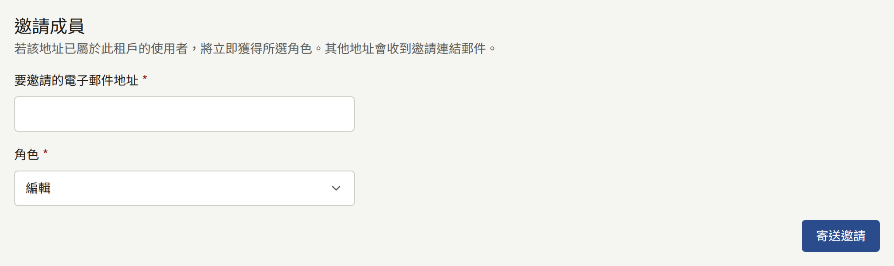
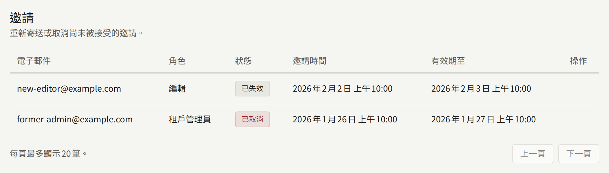
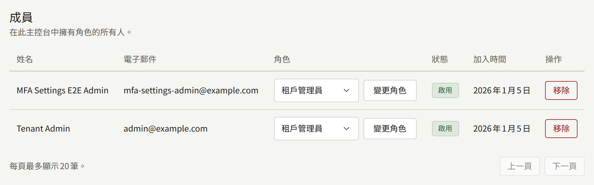

**成員**位於**管理**下，列出所有可以登入這個主控台的人，租戶管理員也在這裡讓工作人員加入、變更其角色，以及再將其移除。只有租戶管理員看得到這個畫面。

工作人員是租戶網站上的帳戶，同時也擁有主控台的角色。工作人員以在網站上使用的同一組電子郵件地址與密碼登入主控台，取消某人的角色後，其在網站上的帳戶仍會維持原樣。[租戶的工作人員](../../3-operations/3-tenant-staff.md#成員與使用者)從營運人員的角度說明了這一點。

## 角色

| 角色           | 可以做的事                                                 |
| -------------- | ---------------------------------------------------------- |
| **租戶管理員** | 主控台中的一切，包括這個畫面                               |
| **編輯**       | 作品目錄、網站的頁面與公告，以及留言的審核                 |
| **稽核員**     | 查看編輯所處理的內容以及租戶的設定，但不能變更其中任何項目 |

[租戶主控台](../index.md#角色)列出了每個角色涵蓋的範圍。請將租戶管理員的人數保持在少數：租戶管理員可以替換租戶的付款與郵件認證資訊、暫停及刪除讀者的帳戶，以及變更工作人員。

## 邀請成員

在**邀請成員**下，於**要邀請的電子郵件地址**中輸入地址，選擇其**角色**，然後選擇**寄送邀請**。角色一開始是**編輯**，因此只有在對方確實需要時，才刻意選擇**租戶管理員**。

- **在網站上沒有帳戶的地址**會收到以租戶預設語言寫成、邀請其擔任所選角色的郵件。郵件中的連結會通往這個主控台，受邀者在那裡輸入其**姓名**與**密碼**，然後選擇**接受邀請**。之後他們就會以該角色登入。連結的有效期限為24小時。
- **在網站上已有帳戶的地址**會立即獲得該角色，且不會寄送郵件。已擁有角色的帳戶可以透過這種方式成為租戶管理員，這會取代其原本的角色；若是其他角色，主控台會拒絕，並引導至**成員**，在那裡依照下方所述變更角色。

**邀請**會列出每一筆邀請及其授予的**角色**，狀態為**待處理**、**已接受**、**已取消**或**已失效**。在待處理的邀請上，**重新寄送**會以新的連結再次寄出邀請，有效期限為再24小時，**取消邀請**則會撤回邀請。無論哪一種，先前的連結都會失效。若要在邀請已失效或已取消後再試一次，或要變更待處理邀請所授予的角色，請以應有的角色再次邀請同一個地址。

邀請會由平台的郵件伺服器寄出，除非租戶透過自己的伺服器寄送，如[電子郵件](./7-email.md)所述。如果邀請沒有送達，請檢查受邀者的垃圾郵件資料夾，再檢查租戶的郵件設定。

## 變更角色

在**成員**中，於該成員的**角色**欄選擇新的角色，然後選擇**變更角色**。變更會套用到該成員在主控台中的下一個操作，包括在他們已經開啟的主控台中。

## 移除成員

成員那一列上的**移除**，經**移除**確認後，會取消其所有角色。從下一個操作起，他們就無法使用主控台。他們的帳戶會以讀者帳戶的形式保留在網站上，連同其購買紀錄與歷程。

若也要取消他們的閱讀權限，請從**讀者**中其頁面暫停或刪除該帳戶，清單中的成員名稱會連結到該頁面。[讀者帳戶](../2-readers/1-accounts.md)說明了這兩種方式各自會保留哪些內容。

## 最後一位租戶管理員

主控台會拒絕將租戶最後一位有效的租戶管理員降級或移除，包括您自己，以確保永遠有人可以管理工作人員。請先讓其他人成為租戶管理員。

如果最後一位租戶管理員仍然離開了出版社，或失去了其帳戶的存取權，營運人員可以將該角色授予其他人，如[讓沒有管理員的租戶恢復運作](../../3-operations/3-tenant-staff.md#讓沒有管理員的租戶恢復運作)所述。

## 記錄的內容

每一次邀請、重新寄送、取消、接受、角色變更與移除，都會連同執行的租戶管理員一起記錄在[稽核記錄](./8-audit-log.md)中。邀請、其重新寄送與接受，以及角色變更，也會記錄其所授予的角色。
