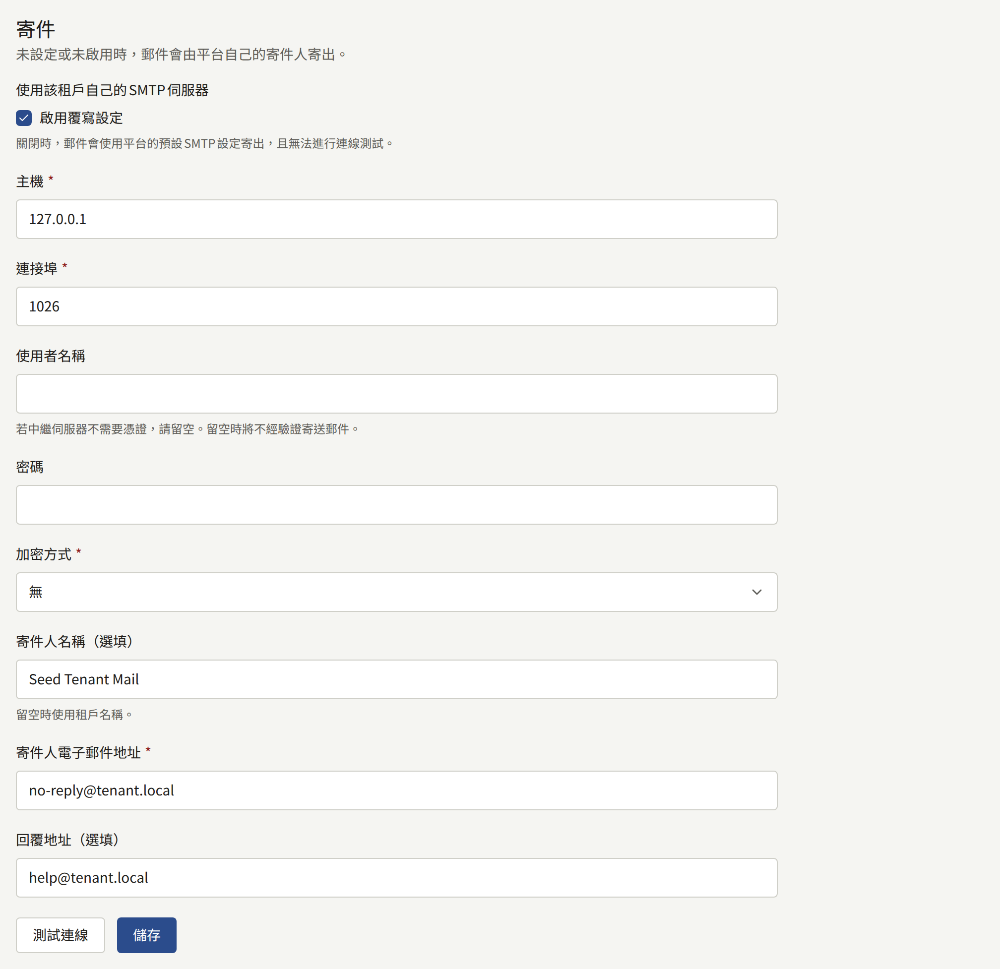
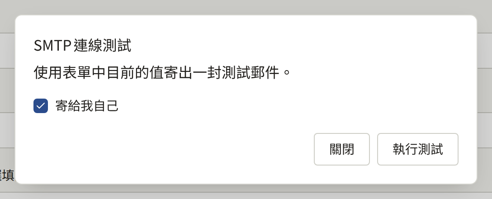
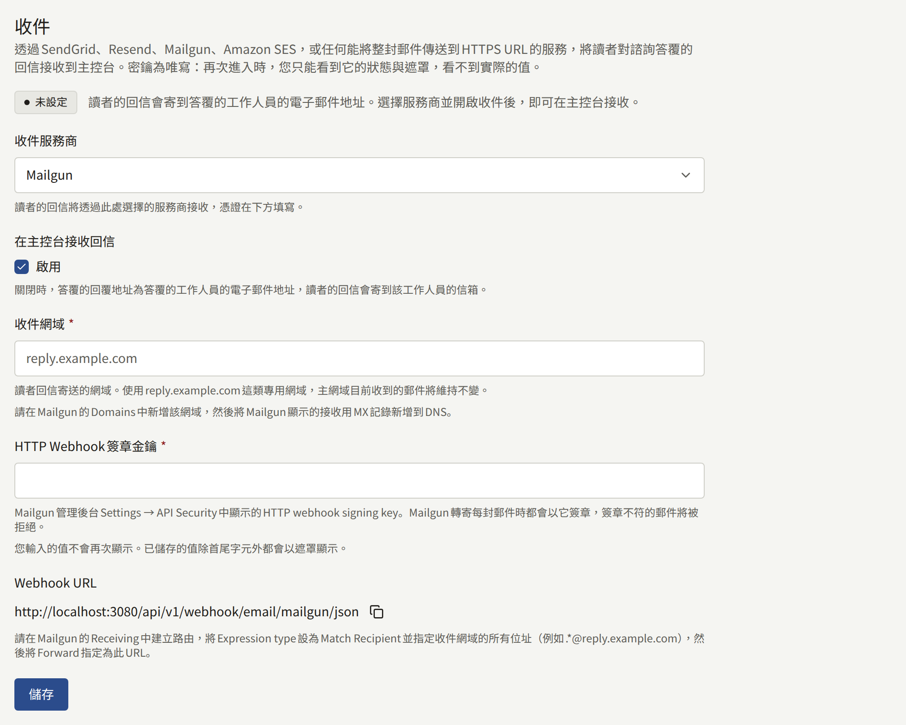

租戶會寄送郵件給讀者與工作人員：地址確認、密碼重設、購買收據、邀請，以及對諮詢訊息的回覆。在租戶管理員設定租戶自己的伺服器之前，這些郵件全都會透過平台的郵件伺服器，從營運人員所選擇的平台地址寄出。**整合** › **郵件**可以改為透過出版社自己的SMTP伺服器，從出版社網域上的地址寄出這些郵件。

只有租戶管理員看得到這個畫面。營運人員不需要事先允許任何事。

## 透過它寄送的郵件

開啟租戶自己的伺服器後，租戶寄送的每封郵件都會透過它寄出：

- 寄給讀者：註冊確認、密碼重設與密碼已變更的通知、電子郵件地址變更確認與地址已變更的通知，以及有人嘗試以已有帳戶的地址註冊的通知。
- 寄給在網站上購買章節的讀者：一份收據，載明系列與章節、支付的價格、購買時間，以及有閱讀期限的章節可以閱讀到何時，並附有讀者購買紀錄的連結。對於在[設定 › 稅金與發票](./1-settings.md#稅金與發票)中設定了「**稅率（%）**」的租戶，記錄了稅金之購買的收據還會載明稅金及其稅率，例如「其中稅額（10%）：¥100」，如[販售章節](../4-selling-episodes.md#價格中包含的稅金)所述。租戶在該處輸入後，每張收據都會以「開立者」載明其**開立名稱**，並載明其**登記編號**。
- 寄給在網站上打賞章節作者的讀者：寫明章節與打賞金額的收據。
- 寄給在網站上的購買或打賞被全額或部分退款的讀者：一份通知，載明所購買的內容、退款金額以及退款是否會關閉章節，如[退款](../4-selling-episodes.md#退款)所述。無論讀者的通知設定為何，都會寄送此通知。
- 寄給在網站上訂閱方案的讀者：首次付款完成時，以及此後每次付款使方案續訂到新的期間時，寄送一份通知，載明方案、支付金額以及該筆付款涵蓋的期間，如[讀者看到的內容](../5-subscription-plans.md#讀者看到的內容)所述。無論讀者的通知設定為何，都會寄送此通知。
- 寄給Stripe無法收取其續訂款項的讀者：每次收款失敗後，寄送一份通知，載明方案、應付金額、通知中載明時Stripe再次嘗試的時間，以及最晚到何時仍可閱讀方案的章節，如[讀者看到的內容](../5-subscription-plans.md#讀者看到的內容)所述。無論讀者的通知設定為何，都會寄送此通知。
- 寄給通知設定允許以電子郵件接收的讀者：所追蹤作品的新章節、其留言已公開的通知，以及公告，公告的部分如[讀者看到的內容](./4-announcements.md#讀者看到的內容)所述。
- 對讀者諮詢訊息的回覆。
- 寄給工作人員：給新租戶管理員的邀請、主控台的密碼重設與電子郵件地址變更，以及寄給租戶管理員的新諮詢訊息通知。

## 開始之前

請向負責出版社郵件的人取得以下資訊：

- SMTP伺服器的主機名稱與連接埠，以及它要求從連線一開始就使用TLS（通常為連接埠465），還是使用STARTTLS（通常為連接埠587）。
- 伺服器的使用者名稱與密碼，除非它在不需要認證資訊的情況下轉送郵件。
- 郵件的寄件地址，且伺服器必須獲准以該地址寄送。請讓網域的SPF與DKIM記錄涵蓋該伺服器，否則讀者的郵件服務很可能會將租戶的郵件歸類為垃圾郵件。

## 設定方式

1. 開啟**整合** › **郵件**，在**寄件**區塊中，勾選**使用該租戶自己的SMTP伺服器**下的**啟用覆寫設定**。其下方的欄位就會開啟。
2. 填寫：
   - **主機**與**連接埠**。
   - **使用者名稱**與**密碼**，如果伺服器要求登入。若是不需要認證資訊的轉送伺服器（例如信任平台地址的伺服器），請將**使用者名稱**留空：郵件會在不登入的情況下寄出，也不會保存任何密碼。只有密碼而沒有使用者名稱時會被拒絕。
   - **加密方式**：**TLS**、**STARTTLS**或**無**。**TLS**與**STARTTLS**都要求TLS 1.2或更新版本，而當伺服器不提供STARTTLS時，**STARTTLS**會失敗，而不是以明文寄送。只有在透過私人網路連線到伺服器時，才選擇**無**。
   - **寄件人電子郵件地址**：郵件的寄件地址，例如`noreply@comics.example.com`。
   - **寄件人名稱（選填）**：讀者在該地址旁看到的名稱，通常是網站的名稱。留空時，租戶的郵件與連線測試都會使用租戶的名稱。
   - **回覆地址（選填）**：讀者回覆時寄往的地址，例如客服地址。留空時，回覆會寄往寄件地址。對諮詢訊息的回覆則會保留其自己的回覆地址。
3. 選擇**測試連線**，然後選擇**執行測試**。測試會以表單中的值（不會儲存）寄送一則訊息到您自己的地址；如果取消勾選**寄給我自己**，則寄送到其他地址。測試失敗時，會在能夠判斷的情況下說明是哪個步驟失敗：連線、TLS或STARTTLS、登入、伺服器拒絕收件人，或是伺服器回應時間過長。
4. 選擇**儲存**。租戶寄出的下一封郵件就會透過新的伺服器寄送。





已儲存的密碼永遠不會再次顯示。欄位會顯示已保存密碼，**變更**則可以替換它。選擇**變更**後讓欄位保持空白並儲存，就會移除密碼，租戶就是以這種方式改用不需要認證資訊的轉送伺服器：請同時清空**使用者名稱**，因為只有使用者名稱而沒有密碼時會被拒絕。

## 停止運作時

開啟租戶自己的伺服器後，其郵件不會退回改用平台的伺服器。如果伺服器拒絕某封郵件或無法連線，平台會以逐漸拉長的間隔持續重試一段時間，然後放棄該郵件。主控台中不會回報任何失敗。如果讀者表示沒有收到確認郵件或密碼重設郵件，請以已儲存的設定再次執行**測試連線**。

若要改回平台的郵件伺服器，請取消勾選**啟用覆寫設定**，然後選擇**儲存**。其餘的設定會保留，供您再次開啟時使用。

每次儲存都會以**更新了郵件設定**記錄在[稽核記錄](./8-audit-log.md)中，每次測試無論成功與否，都會記錄為**測試了SMTP連線**。營運人員這一側的租戶郵件，在[電子郵件](../../3-operations/6-email.md#租戶自己的smtp帳戶)中說明。

## 讀者對諮詢訊息的回覆

對諮詢訊息的答覆會以郵件送達讀者。在租戶能自行接收郵件之前，答覆的回覆地址是作答工作人員的地址，因此回信的讀者會寄到該工作人員的信箱，主控台永遠看不到這些回覆。**整合** › **郵件**中的**收件**區塊，會將這些回覆帶回主控台，顯示在其所回覆的訊息下方，可以透過SendGrid、Resend、Mailgun或Amazon SES，或任何能將整封郵件以POST傳送到HTTPS URL的郵件服務或伺服器，例如Cloudflare Email Routing或出版社自己的Postfix伺服器。

### 開始之前

- SendGrid、Resend或Mailgun的帳戶，可以在接收電子郵件的區域使用Amazon SES的AWS帳戶，或是會將收到的每封郵件交給您自己的程式碼的郵件服務或伺服器：Cloudflare Email Routing或Postfix伺服器。
- 一個可以變更其DNS的回覆用網域，例如`reply.comics.example.com`。其MX記錄將指向服務商，因此寄到該網域的郵件不會送達其他任何信箱。使用專屬的子網域，可以讓出版社主要網域已在接收的郵件維持原狀。
- 網站必須能從網際網路連線：服務商會將每則回覆以POST傳送到網站本身的網域。網站前方的IP允許清單、登入提示或機器人驗證，必須讓這些請求通過，如[Webhook](../../2-deployments/4-edge/index.md#webhook)為營運人員所說明的。

### 設定方式

1. 開啟**整合** › **郵件**。在**收件**區塊中，於**收件服務商**下選擇服務商，勾選**在主控台接收回信**下的**啟用**，並在**收件網域**中輸入回覆用網域。
2. 設定服務商。區塊會顯示網站網域上的**Webhook URL**，並附有複製按鈕。
   - **SendGrid**：自行產生一串很長的隨機字串，輸入為**Webhook權杖**。在您的DNS中，將網域的MX記錄指向`mx.sendgrid.net`，優先順序為10。在SendGrid中，於**Settings** › **Inbound Parse**下新增該網域，並以**Webhook URL**作為目的地URL，將權杖放在`<token>`的位置：SendGrid不會為任何內容簽章，因此網站是靠URL中的權杖來區分其請求與其他人的請求。
   - **Resend**：在**API Keys**下建立一個具有**Full access**權限的API金鑰，並輸入為**API金鑰**；網站會用它從Resend讀取回覆。在**Domains**下新增該網域，為其開啟接收功能，並將Resend顯示的MX記錄新增到您的DNS中。在**Webhooks**下，為`email.received`事件新增**Webhook URL**，並將Resend為其顯示的簽章密鑰（`whsec_…`）輸入為**Webhook簽章密鑰**。
   - **Amazon SES**：自行產生一串很長的隨機字串，輸入為**Webhook權杖**，並將郵件所發布到的SNS主題的ARN輸入為**SNS主題ARN**。在AWS中設定網域、主題與接收規則，然後儲存，再依照下方[透過Amazon SES接收](#透過amazon-ses接收)的說明，讓主題訂閱**Webhook URL**。
   - **Raw MIME over HTTPS**：自行產生一串很長的隨機字串，輸入為**Webhook權杖**。將網域的MX記錄指向接收郵件的服務或伺服器，並讓它將網域上的每封郵件，完整且不經修改地以POST傳送到**Webhook URL**，內容類型為`message/rfc822`，將權杖放在`<token>`的位置，並在`X-Envelope-To`標頭中註明郵件的投遞地址。讀者端的轉寄或別名，常會使回覆的**To**中不含訊息本身的地址，而該標頭就是仍能將其對應起來的依據。下方的[Cloudflare Email Routing](#從cloudflare-email-routing傳送原始郵件)與[Postfix](#從postfix傳送原始郵件)會完成這一切。
   - **Mailgun**：從**Settings** › **API Security**複製**HTTP webhook signing key**，並輸入到同名的**HTTP Webhook簽章金鑰**中；Mailgun會用它為所傳送的每則回覆簽章，簽章不符的POST會被拒絕。對於子帳戶上的網域，子帳戶的金鑰與主帳戶的金鑰都可以使用。在**Domains**下新增該網域，並將Mailgun為接收所顯示的MX記錄新增到您的DNS中。在**Receiving**下，建立一個表達式類型為**Match Recipient**、收件人涵蓋網域上所有地址的路由，例如`.*@reply.comics.example.com`，並勾選**Forward**，填入與顯示內容完全相同、以`/json`結尾的**Webhook URL**：Mailgun只會為傳送到以此結尾之URL的整封郵件簽章，傳送到其他URL的POST都會被拒絕。Mailgun EU區域的帳戶也適用相同的步驟。
3. 選擇**儲存**。區塊會變為**就緒**，並顯示**回覆地址**，也就是`contact+*@`後面接上網域：從那時起，每則答覆都會請讀者回覆到這種形式的地址，其中`*`是訊息的ID，而回覆會顯示在該訊息下方。



在區塊變為**就緒**之前，答覆會保留作答工作人員的地址，區塊也會說明這一點。**未設定**表示沒有儲存任何內容；**已停用**表示設定已儲存，但**啟用**未勾選；**未完成**表示已啟用，但缺少網域或服務商所需的認證資訊。

權杖與金鑰一旦儲存就永遠不會再次顯示：每個欄位都會顯示遮罩，**變更**則可以替換它。選擇其他服務商並儲存，會刪除為先前服務商所儲存的認證資訊。

若要停止接收回覆，請取消勾選**啟用**，然後選擇**儲存**。下一則答覆會再次使用工作人員的地址，設定則會保留，供您重新開啟時使用。每次儲存都會以**更新了收件設定**記錄在[稽核記錄](./8-audit-log.md)中。

### 透過Amazon SES接收

Amazon SES會接收網域的郵件，並將每封郵件交給接收規則。規則會將郵件的通知發布到Amazon SNS主題，再由主題透過HTTPS訂閱將其傳送到**Webhook URL**。SNS會為每次傳送簽章，但任何AWS帳戶都可以讓自己的主題訂閱該URL，因此網站也會檢查URL中的權杖，以及傳送來源的主題。

SES只在部分AWS區域接收郵件，這些區域列於[Email receiving endpoints](https://docs.aws.amazon.com/general/latest/gr/ses.html#ses_inbound_endpoints)。請在以下的網域、主題與規則中使用其中一個區域；儲存貯體則可以位於其他區域。

1. 在SES的**Identities**下，驗證收件網域。在您的DNS中，將其MX記錄指向`inbound-smtp.<region>.amazonaws.com`，例如`inbound-smtp.us-east-1.amazonaws.com`，優先順序為10。
2. 在SNS中建立一個標準主題，例如`publira-inbound`。在主控台中將其ARN輸入為**SNS主題ARN**。
3. 在SES的**Email receiving**下，於作用中的規則集中建立一條規則，以收件網域作為其收件人條件，並為其設定以下其中一個動作：
   - **Deliver to Amazon S3 bucket**，並在**SNS topic**下選擇該SNS主題。SES會將每封郵件寫入儲存貯體，並告知主題其位置，網站再從那裡讀取。這是應該使用的動作：它能承載SES所接收的任何大小的回覆，最大40 MB。儲存貯體的政策必須允許SES寫入，如[Giving permissions to Amazon SES for email receiving](https://docs.aws.amazon.com/ses/latest/dg/receiving-email-permissions.html)所述。請讓**Message encryption**保持未勾選：否則SES會在用戶端對每封郵件加密，而網站無法將其解密。接著在IAM中建立一個具有存取金鑰的使用者，並附上允許對儲存貯體物件執行`s3:GetObject`的政策，然後將金鑰輸入為**AWS存取金鑰ID**與**AWS私密存取金鑰**。輸入**S3儲存貯體**，讓網站只從該儲存貯體讀取；當儲存貯體與主題位於不同區域時，請輸入**S3儲存貯體區域**。
   - **Publish to Amazon SNS topic**，並選擇該主題與編碼**Base64**，這能讓任何字元集的郵件保持寄出時的原樣。郵件會包含在通知中傳送，因此不需要儲存貯體或存取金鑰，但SES會退回所有超過150 KB的郵件，而附有圖片或附件的回覆很快就會超過這個大小。
4. 在主控台中選擇**儲存**：當SNS將其確認訊息以POST傳送到網站時，訂閱就會完成確認，而網站只會為其已儲存的權杖與主題進行確認。
5. 在SNS中建立對該主題的訂閱，通訊協定為**HTTPS**，並以**Webhook URL**作為其端點，將權杖放在`<token>`的位置。請讓**Enable raw message delivery**保持未勾選：沒有SNS簽章包覆的傳送會被拒絕。訂閱會在一分鐘內變為**Confirmed**。如果一直停留在**Pending confirmation**，請檢查主控台中的權杖與主題並儲存，然後在訂閱上選擇**Request confirmation**。

步驟3中使用者的IAM政策如下，請將`publira-inbound-mail`替換為儲存貯體的名稱：

```json
{
  "Version": "2012-10-17",
  "Statement": [
    {
      "Effect": "Allow",
      "Action": "s3:GetObject",
      "Resource": "arn:aws:s3:::publira-inbound-mail/*"
    }
  ]
}
```

當儲存貯體預設以KMS金鑰加密寫入的內容時，也請加入對該金鑰的`kms:Decrypt`。

SNS會將網站無法接收的傳送（網站停機期間，或無法從儲存貯體讀取郵件期間的`5xx`）每隔20秒重試三次，然後將其捨棄。訂閱上的[傳送政策](https://docs.aws.amazon.com/sns/latest/dg/sns-message-delivery-retries.html)可以讓它持續重試長達一小時，而無效信件佇列則會保留被捨棄的內容。無論如何，S3動作所寫入的郵件都會保留在儲存貯體中。

### 從Cloudflare Email Routing傳送原始郵件

Cloudflare Email Routing會將每封郵件交給Email Worker，再由它以POST傳送到**Webhook URL**。收件網域的DNS必須位於Cloudflare上。

1. 在Email Routing下，為收件網域開啟路由；`reply.comics.example.com`這類子網域是在**Settings** › **Subdomains**下新增的。Cloudflare會自行新增其MX記錄。請在同一個設定中開啟**Subaddressing**，讓寄往`contact+<message ID>@`的郵件能套用`contact@`的規則。
2. 在Email Routing的目的地地址下，新增一個工作人員信箱並加以驗證，用來接收網站在回覆抵達時無法接收的回覆。
3. 以下方的程式碼建立一個Worker。將不含`inbound:<token>@`部分的**Webhook URL**設為變數`WEBHOOK_URL`，將權杖設為密鑰`WEBHOOK_TOKEN`，並將工作人員信箱設為變數`FALLBACK_ADDRESS`。
4. 在Email Routing的路由規則下，於收件網域上建立自訂地址`contact`，動作為**Send to a Worker**，並選擇您建立的Worker。

```js
export default {
  async email(message, env) {
    let status;
    try {
      const response = await fetch(env.WEBHOOK_URL, {
        body: await new Response(message.raw).arrayBuffer(),
        headers: {
          Authorization: `Basic ${btoa(`inbound:${env.WEBHOOK_TOKEN}`)}`,
          "Content-Type": "message/rfc822",
          "X-Envelope-To": message.to,
        },
        method: "POST",
      });
      if (response.ok) {
        return;
      }
      status = response.status;
    } catch {
      // The site did not answer.
    }
    if (status === 400) {
      message.setReject("The site could not read this mail");
      return;
    }
    try {
      await message.forward(env.FALLBACK_ADDRESS);
    } catch {
      message.setReject(
        `The reply could not be delivered (${status ?? "no answer"})`
      );
    }
  },
};
```

`message.to`是郵件的投遞地址，包含`+<message ID>`。

Cloudflare沒有提供讓Email Worker要求寄件者稍後重試的方法：拒絕郵件是永久性的，讀者會收到退信。因此，Worker只會拒絕網站因無法讀取而拒收的郵件。當網站沒有回應或無法接收郵件時（網站停機期間的`5xx`，或主控台中儲存的權杖與Worker的權杖不一致期間的`401`），Worker會將郵件轉寄到工作人員信箱，改在那裡閱讀回覆，而不是在主控台中，只有在轉寄也失敗時才會拒絕。網站接受後又捨棄的郵件，例如沒有指定任何訊息的郵件，或在**啟用**未勾選期間抵達的郵件，會被回應為已接受，且不會送往其他任何地方。

### 從Postfix傳送原始郵件

接收收件網域郵件的Postfix伺服器，可以透過`pipe`傳輸以`curl`將每封郵件以POST傳送。將網域的MX記錄指向該伺服器，並將以下指令碼儲存為`/usr/local/bin/publira-inbound`，其中**Webhook URL**拆分為權杖與不含權杖的URL：

```sh
#!/bin/sh
# Posts the mail on standard input for the recipient named as $1, and tells
# Postfix whether a failure is worth retrying.
status=$(curl --silent --output /dev/null --write-out '%{http_code}' \
  --max-time 60 --user 'inbound:<token>' \
  --header 'Content-Type: message/rfc822' \
  --header "X-Envelope-To: $1" \
  --data-binary @- \
  https://comics.example.com/api/v1/webhook/email/mime)
case "$status" in
  2??) exit 0 ;;
  400) exit 65 ;; # EX_DATAERR: not a mail the site can read; bounce it
  *) exit 75 ;;   # EX_TEMPFAIL: keep it queued and try again later
esac
```

當郵件的指令以Postfix無法辨識的狀態碼結束時（例如`curl`結束時所用的狀態碼），Postfix會退回該郵件，因此指令碼會以Postfix能辨識的兩種狀態碼回應。只有網站因不是郵件而拒收的POST才會退信。其他任何情況（沒有回應、網站停機期間的`5xx`，或主控台中儲存的權杖與指令碼中的權杖不一致期間的`401`）都會讓郵件留在佇列中，Postfix會持續重試，直到其佇列存留期限屆滿為止。指令碼中含有權杖，因此請讓它只有傳輸所使用的使用者能讀取：`chown nobody /usr/local/bin/publira-inbound`與`chmod 700 /usr/local/bin/publira-inbound`。

將傳輸新增到`/etc/postfix/master.cf`：

```text
publira   unix  -       n       n       -       -       pipe
  user=nobody argv=/usr/local/bin/publira-inbound ${recipient}
```

然後在`/etc/postfix/main.cf`中將網域的郵件送往該傳輸，每次POST只有一位收件人，讓`${recipient}`只指定一個地址：

```text
relay_domains = reply.comics.example.com
transport_maps = hash:/etc/postfix/transport
publira_destination_recipient_limit = 1
```

並在`/etc/postfix/transport`中加入：

```text
reply.comics.example.com  publira:
```

執行`postmap /etc/postfix/transport`與`postfix reload`。
