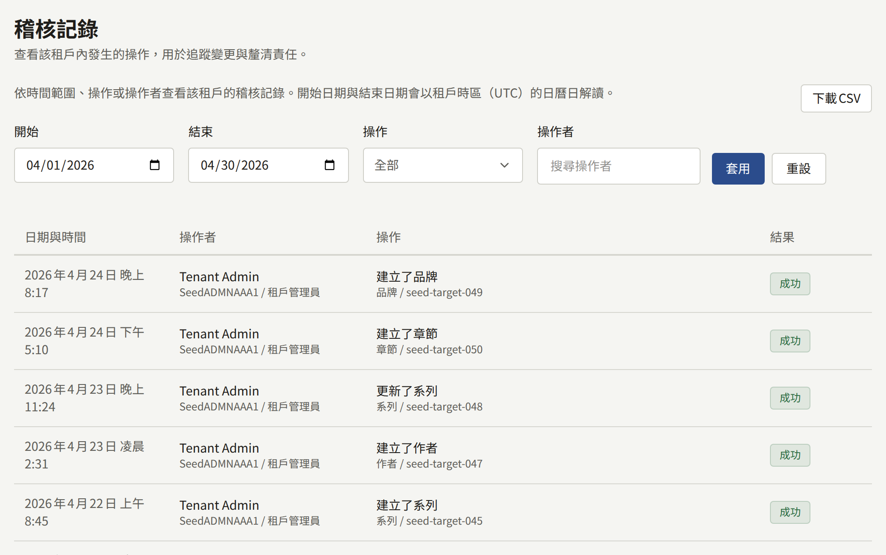

**稽核記錄**位於**管理**下，是租戶對其工作人員在主控台中所做之事的記錄：誰在何時變更了什麼，以及是否成功。它可以回答像是誰暫停了某位讀者、誰變更了付款設定，或某位成員何時獲得了某個角色等問題。只有租戶管理員看得到這個畫面。

## 閱讀記錄

每筆記錄會顯示：

- **日期與時間**，以租戶的時區顯示。
- **操作者**：工作人員，連同其公開ID與當時擔任的角色。**自動**表示平台自行執行的操作，例如因足夠多的讀者檢舉而被隱藏的留言。
- **操作**，下方顯示其操作對象的種類與ID，以及操作有記錄理由時的理由。
- **結果**：**成功**或**失敗**。失敗的嘗試也會被記錄，例如兩步驟驗證登入時輸入了錯誤的驗證碼，或未能成功的郵件伺服器測試。

最新的記錄排在最前面，每頁20筆。若要縮小清單範圍，請設定**開始**與**結束**（以租戶時區的整日計算）、**操作**或**操作者**，然後選擇**套用**。**重設**會清除這些條件。

記錄永遠不會被刪除。帳戶之後已被刪除的工作人員，其記錄仍會保留其名稱與公開ID。

## 下載記錄

篩選條件旁的**下載CSV**，會將所顯示的期間、**操作**與**操作者**的記錄儲存為一個CSV檔案，由舊到新排列，並以租戶的公開ID與期間命名，例如`audit-log-<tenant>-2026-04-01--2026-04-30.csv`。一個檔案最多涵蓋366天。沒有設定**結束**時，期間會在今天結束；沒有設定**開始**時，期間為到**結束**或今天為止的366天。超過此長度的期間，或**開始**晚於**結束**的期間，必須縮小範圍後才能下載。

各欄位，以及檔案如何編碼以便試算表將其以文字開啟，在[匯出記錄](../../3-operations/12-security/3-audit-logs.md#匯出記錄)中說明。每次下載本身也會以**下載了稽核記錄CSV**記錄在記錄中，因此記錄會顯示誰取得了哪個期間的副本。

## 記錄的內容

| 領域 | 記錄的內容 |
| --- | --- |
| 作品目錄 | 系列、章節、卷、作者、作者角色、品牌與類型的建立與變更，卷的開始販售、停止販售與重新排序，以某種語言刪除的系列與章節標題，作者角色與類型的刪除，其圖片的上傳，以及免費閱讀期間與等待即可免費的變更 |
| 網站 | 頁面的建立與變更，其版本的建立、發布與還原，其翻譯的新增與刪除，頁面的取消發布，公告的建立與其橫幅的撤下，以及活動橫幅的建立、變更、重新排序與刪除，連同其圖片的上傳 |
| 留言 | 留言的通過、移除、恢復與清除，因檢舉而自動進行的移除，以及檢舉的成立或駁回 |
| 讀者 | 讀者的暫停、恢復與刪除，其出生日期的變更或清除，其頭像的刪除，閱讀券的發放與撤銷，以及其購買退款的申請與執行。諮詢訊息的處理、重新開啟、指派、加註與答覆 |
| 版稅 | 結算設定的變更、月份的結算，以及以CSV下載的明細 |
| 分析 | 從**銷售額**、**讀者反應**與**流失**以CSV下載的報表 |
| 稽核記錄 | 以CSV下載的記錄，連同其涵蓋的期間 |
| 工作人員 | 成員的邀請，邀請的重新寄送、取消與接受，角色的變更，以及成員的移除 |
| 品牌 | 主題的變更，以及標誌、圖示、登入表單旁的圖片與品牌標誌的上傳與移除 |
| 設定 | **一般**分頁上的公開網站呈現、時區、預設語言、讀者留言、年齡驗證、服務條款與隱私權政策，以及不接受的電子郵件地址；**限制與保留**上的社群限制與保留期限；以及讀者可以顯示為頭像的內容，連同預設頭像的新增與刪除 |
| 整合 | 郵件設定及其測試、付款服務商的設定、**販售位置**、行動推播的認證資訊、**應用程式連結**中指定的應用程式、登入服務提供者，以及Google代碼 |
| 兩步驟驗證 | 工作人員的設定、關閉、重新產生復原碼，以及使用它或復原碼登入 |

成員變更自己的電子郵件地址不會留下記錄，讀者在網站上所做的任何事也不會。

營運人員從平台主控台或`publiractl`為租戶所做的變更，例如租戶的網域或管理員的角色，會記錄在平台主控台自己的記錄中，而不是這裡。
