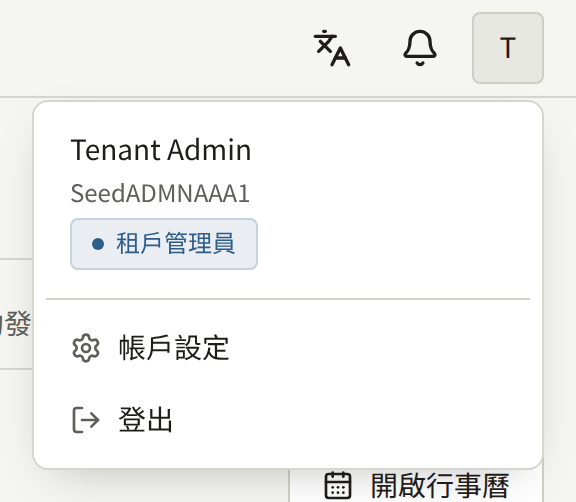
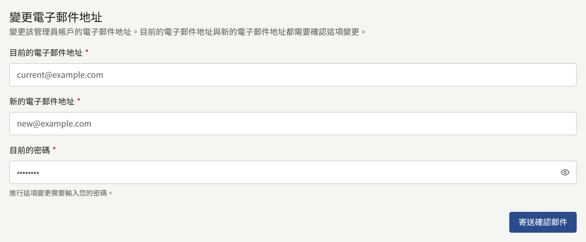
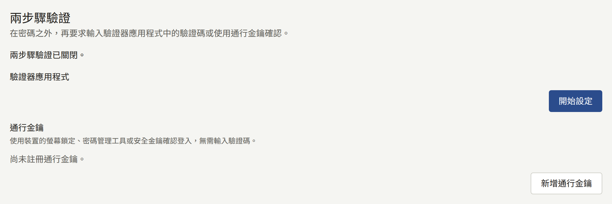
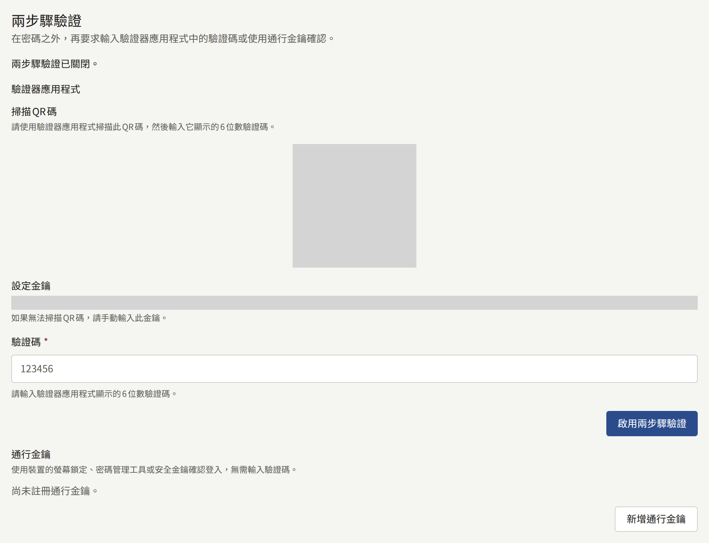
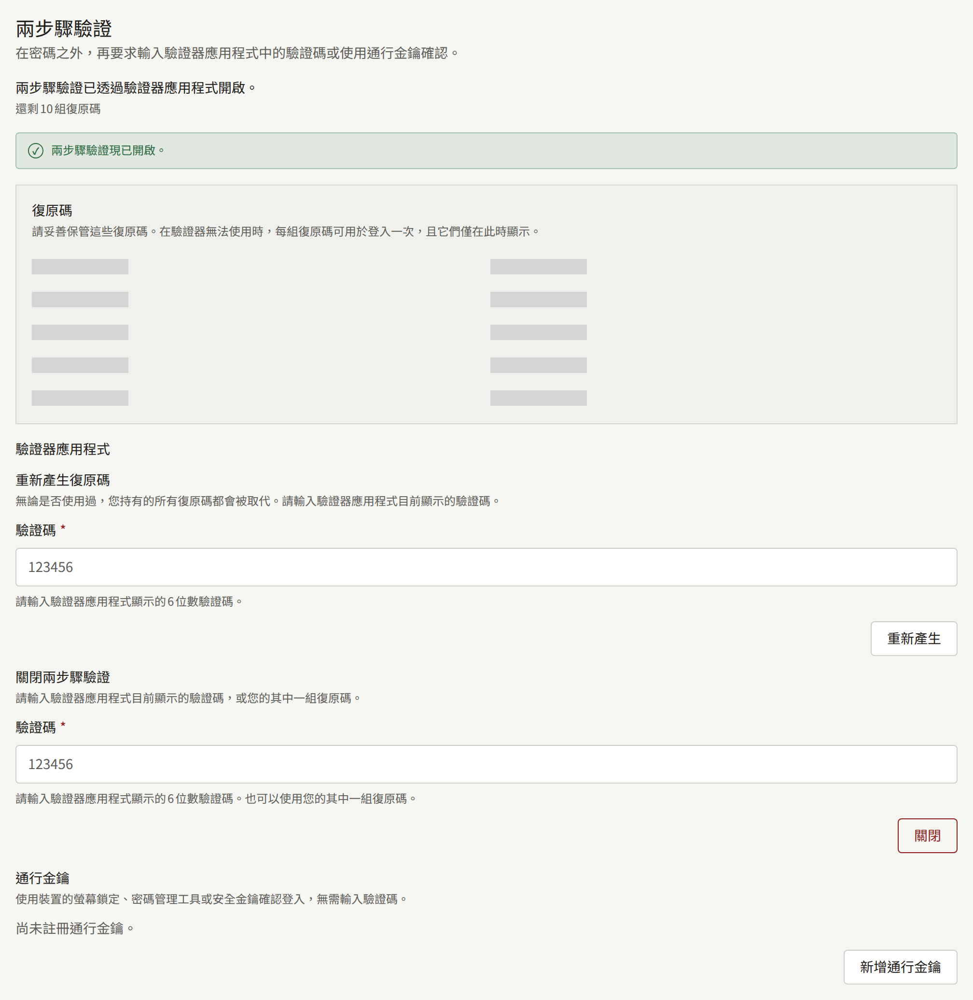

每位工作人員無論擔任哪種角色，都從主控台頂端帳戶選單中的**帳戶設定**管理自己的主控台帳戶。它有兩張卡片：**變更電子郵件地址**與**兩步驟驗證**。

主控台沒有變更密碼的畫面。請登出，並使用登入畫面上的**忘記密碼？**，它會寄給您一封內含設定新密碼連結的郵件。

## 變更電子郵件地址

在**變更電子郵件地址**下，輸入您的**目前的電子郵件地址**、**新的電子郵件地址**與**目前的密碼**，然後選擇**寄送確認郵件**。

確認郵件會寄到兩個地址，變更需要開啟兩個連結，且各自都要在24小時內開啟。要求目前地址也必須確認，可以防止只取得您密碼的人將帳戶轉移到他們自己的地址。在兩個連結都開啟之前，您仍會以目前的地址登入。兩個連結都開啟之後，您就會以新的地址登入，舊的地址也會收到地址已變更的通知。

新的地址不能屬於租戶上的其他帳戶，包括讀者的帳戶。第二次申請會取代第一次申請，第一次申請的連結會失效。

由於您的主控台帳戶同時也是您在網站上的帳戶，變更會同時套用到兩者。

## 兩步驟驗證

兩步驟驗證會在密碼之後要求第二項證明，因此光是密碼被盜並不足以登入。這項證明可以是手機上驗證器應用程式中的驗證碼，或是通行金鑰。任何能讀取QR碼的驗證器應用程式都可以使用，包括許多密碼管理工具內建的驗證器。通行金鑰透過裝置的螢幕鎖定、密碼管理工具或安全金鑰解鎖，不需要輸入任何內容。

**兩步驟驗證**卡片為兩者各提供一個部分：**驗證器應用程式**與**通行金鑰**。您可以使用其中任一種，或兩者都使用，卡片頂端的一行文字會說明其中哪些已開啟。只要您至少擁有其中一種，兩步驟驗證就會保持開啟。

營運人員可以要求安裝實例上的每位租戶管理員都使用兩步驟驗證。此時，尚未設定的租戶管理員會在輸入密碼後、能使用主控台之前，被要求進行設定，而**兩步驟驗證**會顯示「該租戶要求管理員啟用兩步驟驗證。」他們可以使用驗證器應用程式或通行金鑰其中一種來完成，如[使用通行金鑰登入](#使用通行金鑰登入)所述。編輯與稽核員永遠不會被要求使用，但可以自行開啟。

### 設定驗證器應用程式

1. 在**驗證器應用程式**下，選擇**開始設定**。
2. 以驗證器應用程式掃描QR碼。如果無法掃描，請手動輸入旁邊顯示的**設定金鑰**。
3. 在**驗證碼**中輸入應用程式顯示的六位數驗證碼，然後選擇**啟用兩步驟驗證**。
4. 如果該應用程式是您的第一個第二要素，主控台會顯示十組**復原碼**。請將它們存放在手機以外的地方，例如密碼管理工具或紙上。它們只會顯示這一次。

從那時起，每次登入時主控台都會要求輸入應用程式中的驗證碼。輸入密碼後，您有五分鐘的時間輸入驗證碼。輸入錯誤的驗證碼五次後，帳戶會被鎖定十五分鐘。

### 新增通行金鑰

1. 在**通行金鑰**下，選擇**新增通行金鑰**。
2. 瀏覽器會要求為主控台建立通行金鑰。請以裝置的螢幕鎖定、密碼管理工具或安全金鑰確認。
3. 如果該通行金鑰是您的第一個第二要素，主控台會顯示十組**復原碼**，與驗證器應用程式時相同。請以同樣的方式存放：它們只會顯示這一次。
4. 在**為通行金鑰命名**下，輸入能讓您知道通行金鑰存放位置的**名稱**，例如裝置或密碼管理工具，然後選擇**儲存**。**略過**則不為其命名。

每個通行金鑰都會連同其名稱、新增時間，以及最後一次用於登入的時間一起列出。**重新命名**可以變更名稱。您可以新增多個通行金鑰，例如一個在手機上、一個在安全金鑰上，任何一個都可以用來完成登入。存放在會同步的密碼管理工具中的通行金鑰，會自行同步到您的其他裝置，因此只需要新增一次。

在已經存有您帳戶通行金鑰的驗證器上，瀏覽器會拒絕建立第二個通行金鑰，主控台也會說明這一點。

### 移除通行金鑰

選擇通行金鑰旁的**移除**並確認。它將無法再用來登入主控台。在您也從裝置或密碼管理工具中刪除它之前，它仍會留在那裡。

如果那是您最後一個通行金鑰，且您沒有驗證器應用程式，兩步驟驗證就會關閉，您的復原碼也會隨之失效。當營運人員要求租戶管理員使用兩步驟驗證時，主控台會拒絕移除租戶管理員的最後一個第二要素：請先新增另一個通行金鑰，或設定驗證器應用程式。

### 使用通行金鑰登入

一旦您新增了通行金鑰（無論是從**帳戶設定**還是在登入時），它就可以用來完成密碼之後的畫面。當營運人員要求租戶管理員使用兩步驟驗證，而您尚未設定時，該畫面會提供**設定驗證器應用程式**與**設定通行金鑰**。**設定通行金鑰**會讓瀏覽器為主控台建立通行金鑰，您需要以裝置的螢幕鎖定、密碼管理工具或安全金鑰確認。接著主控台會顯示十組**復原碼**，與驗證器應用程式時相同，在您存放好之後就會進入主控台。

從那時起，密碼之後的畫面會優先提供**使用通行金鑰**。選擇它，並在瀏覽器要求時解鎖通行金鑰：您就會登入，不需要輸入任何驗證碼。**改為輸入驗證碼**會顯示用來輸入驗證器應用程式驗證碼或復原碼的欄位，**改為使用通行金鑰**則會返回。如果通行金鑰是您唯一的第二要素，該連結會顯示為**改為輸入復原碼**。

通行金鑰的回應時限與驗證碼相同，都是五分鐘，而被主控台拒絕的通行金鑰，會與錯誤的驗證碼一樣計入同一個鎖定次數。瀏覽器表示無法使用通行金鑰、您關閉了提示或提示逾時，以及主控台無法辨識的通行金鑰，都會在畫面上留下訊息，而驗證碼欄位仍然只需點一下就能開啟。

當主控台在租戶的網域上或其下（例如`admin.<domain>`）提供服務時，通行金鑰屬於租戶的網域；否則屬於主控台本身的主機。如果營運人員變更了租戶的網域，或將主控台移到該網域上或移出該網域，主控台就不會再提供先前建立的通行金鑰。如果您也有驗證器應用程式，請用它或復原碼登入。如果通行金鑰是您唯一的第二要素，主控台會只憑您的密碼讓您登入；或者，如果您是營運人員要求使用兩步驟驗證的租戶管理員，則會要求您重新設定。

### 復原碼

當您手邊沒有手機或存有通行金鑰的裝置時，復原碼可以代替應用程式或通行金鑰使用一次。請在主控台要求輸入應用程式驗證碼的地方輸入它；以通行金鑰登入時，則在**改為輸入復原碼**下輸入。之後主控台會告訴您還剩下幾組復原碼。這十組復原碼由應用程式與帳戶上的所有通行金鑰共用。

**重新產生復原碼**會發出十組新的復原碼，並讓先前所有的復原碼失效，無論是否使用過。它永遠不接受復原碼。設定了應用程式後，它位於**驗證器應用程式**下，並會要求輸入應用程式中的驗證碼。如果通行金鑰是您唯一的第二要素，它則位於**通行金鑰**下：選擇**使用通行金鑰重新產生**，並在瀏覽器要求時解鎖您的其中一個通行金鑰。被主控台拒絕的通行金鑰不會發出任何復原碼，您持有的復原碼也會維持原樣，且會與錯誤的驗證碼一樣計入同一個鎖定次數。請在使用復原碼後重新取回手機或通行金鑰時，或每當您認為復原碼可能已被他人看到時，執行這項操作。

### 關閉

**驗證器應用程式**下的**關閉兩步驟驗證**會移除驗證器應用程式。它會要求輸入應用程式中的驗證碼或復原碼。您的通行金鑰會保留，如果您有通行金鑰，兩步驟驗證會以它們保持開啟；若要完全關閉，請將每個通行金鑰也移除。如果營運人員要求租戶管理員使用兩步驟驗證，在沒有剩下任何通行金鑰的情況下關閉它的租戶管理員，會在下次登入時被要求重新設定。

### 新裝置或遺失的裝置

在更換裝有驗證器應用程式的手機之前，請以舊手機上的驗證碼登入、關閉兩步驟驗證，再以新手機重新開啟。有些驗證器應用程式也能自行將驗證碼移到新手機上。

在更換存有通行金鑰的裝置之前，請在新裝置上新增通行金鑰，並從清單中移除舊的通行金鑰。存放在會同步的密碼管理工具中的通行金鑰，會隨密碼管理工具一起轉移，不需要做任何事。

如果您遺失了裝置，請以剩下的方式登入：另一個通行金鑰、驗證器應用程式或復原碼。接著移除遺失裝置的通行金鑰，或關閉它所裝的驗證器應用程式，使其不再被視為您的裝置，然後新增新的裝置。撿到該裝置的人仍需要您的密碼才能登入，但將其移除後，他們永遠無法進展到第二個步驟。

如果您遺失了所有的第二要素與所有的復原碼，就無法再登入主控台，而僅憑您的密碼無法移除您帳戶的兩步驟驗證。請聯絡租戶的其他租戶管理員：他們可以在**讀者**中您的頁面上移除它，如[遺失兩步驟驗證](../2-readers/1-accounts.md#遺失兩步驟驗證)所述。如果沒有其他租戶管理員，請聯絡安裝實例的營運人員，他們可以依[租戶的工作人員](../../3-operations/3-tenant-staff.md#遺失兩步驟驗證)所述移除它。無論哪種方式，之後您都能以密碼登入並重新設定。

設定、通行金鑰的註冊、重新命名與移除、關閉、重新產生復原碼，以及每一次以驗證碼、通行金鑰或復原碼登入，都會記錄在租戶的[稽核記錄](./8-audit-log.md)中。
