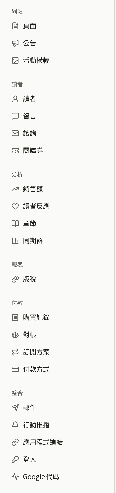

新租戶一開始只是一個空白的網站。它使用營運人員選擇的語言與時區、Publira的預設色彩，沒有標誌、沒有頁面、沒有留言，只有營運人員所邀請的管理員。這些頁面引導租戶管理員把它變成出版社自己的網站。相關畫面大多位於側邊欄的**管理**群組中。網站的頁面、公告與活動橫幅位於**網站**下，租戶自己的郵件伺服器則位於**整合** › **郵件**。

從營運人員建立租戶的那一刻起，網站就已在其網域上提供服務，而主控台沒有可以在您作業期間隱藏網站的開關。提早找到該網域的讀者會看到目前已儲存的所有內容，因此請在宣布網站之前完成以下步驟。

## 第一次作業的順序

1. 如果主控台尚未要求您，請從帳戶選單中的**帳戶設定**，**為自己開啟兩步驟驗證**。請參閱[您的帳戶](./9-your-account.md)。
2. 在**設定**中**確認語言與時區**。主控台與網站上的每個日期都會以該時區顯示。請參閱[設定](./1-settings.md#時區)。
3. 在**品牌**中**為網站打造外觀**：標誌、瀏覽器圖示、色彩與字體。請參閱[品牌](./2-branding.md)。
4. 在**頁面**中**撰寫並發布服務條款與隱私權政策**，再於**設定** › **服務條款與隱私權政策**中選擇它們，讓讀者在註冊時同意。請參閱[頁面](./3-pages.md#服務條款與隱私權政策)。
5. **填寫其餘的一般設定**：網站頁尾與登入畫面上的文字、讀者是否可以留言、哪些年齡分級需要證明年齡，以及讀者不能用來註冊的電子郵件地址。請參閱[設定](./1-settings.md)。
6. **決定由誰的郵件伺服器寄送租戶的郵件**。在您於**整合** › **郵件**中設定自己的伺服器之前，會使用平台的郵件伺服器。請參閱[電子郵件](./7-email.md)。
7. 在**成員**中**邀請其餘的工作人員**。請參閱[成員](./6-members.md)。

作品目錄、付款、透過Apple與Google登入、Google代碼以及應用程式，各有自己的頁面說明設定方式：本節中的[發布作品](../1-catalog/index.md)、[販售章節](../4-selling-episodes.md)、[使用Apple與Google登入](../7-sign-in.md)與[Google代碼](../8-google-tag.md)，以及[行動應用程式](../../5-mobile-app/index.md)。

## 誰可以變更什麼

租戶管理員可以變更這些頁面所說明的每項設定，編輯可以變更網站的頁面、公告與活動橫幅。除此之外，編輯與稽核員能看到部分畫面但無法儲存，其他畫面則完全看不到：

| 畫面 | 租戶管理員 | 編輯 | 稽核員 |
| --- | --- | --- | --- |
| **頁面**、**公告**、**活動橫幅** | 變更 | 變更 | 檢視 |
| **品牌**、**設定** | 變更 | 檢視 | 檢視 |
| **成員**、**稽核記錄**、**整合** › **郵件** | 變更 | 不顯示 | 不顯示 |
| **帳戶設定** | 自己的帳戶 | 自己的帳戶 | 自己的帳戶 |

## 本節內容

- [設定](./1-settings.md)：網站的文字、時區、預設語言、讀者留言、年齡驗證、服務條款與隱私權政策、不接受的電子郵件地址、租戶可以收緊的社群限制與保留期限，以及讀者可以顯示為頭像的內容。
- [品牌](./2-branding.md)：標誌、圖示、主題色彩、字體與預覽。
- [頁面](./3-pages.md)：網站自己的頁面、其版本與翻譯，以及讀者同意的服務條款與隱私權政策。
- [公告](./4-announcements.md)：向所有讀者公告事項，以及顯示在網站每個頁面上方的橫幅。
- [活動橫幅](./5-campaign-banners.md)：排定顯示在網站首頁頂端與應用程式作品目錄頂端的圖片橫幅，以及它們的順序。
- [成員](./6-members.md)：邀請工作人員、變更其角色，以及移除他們。
- [電子郵件](./7-email.md)：透過租戶自己的SMTP伺服器寄送租戶的郵件，以及在主控台中接收讀者對諮詢訊息的回覆。
- [稽核記錄](./8-audit-log.md)：主控台記錄了工作人員做過的哪些事。
- [您的帳戶](./9-your-account.md)：變更您的電子郵件地址，以及兩步驟驗證。
