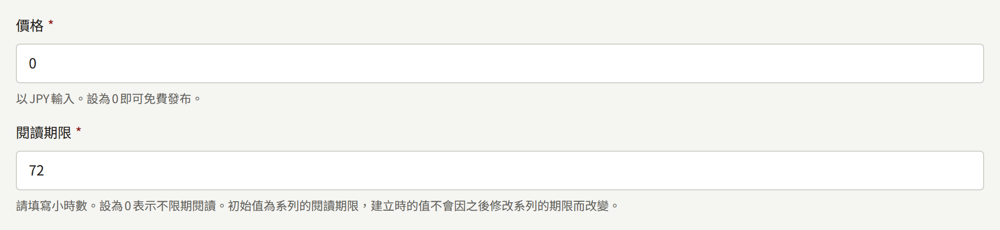
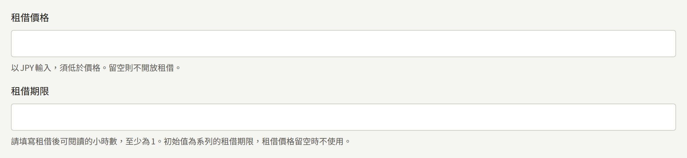
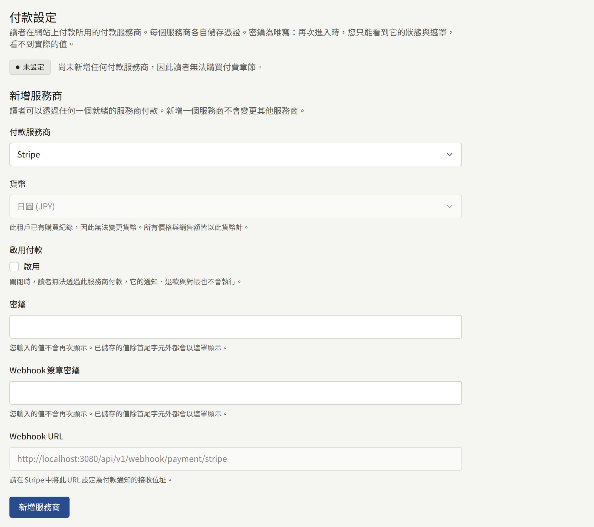
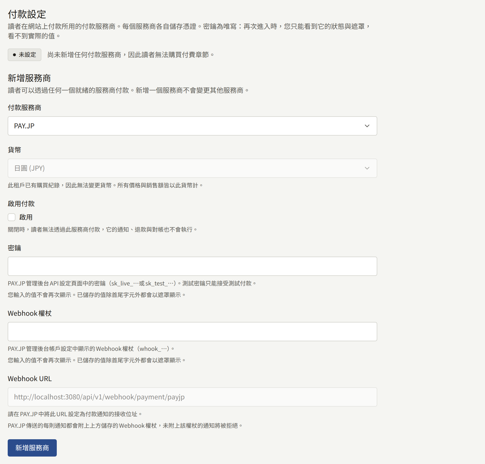
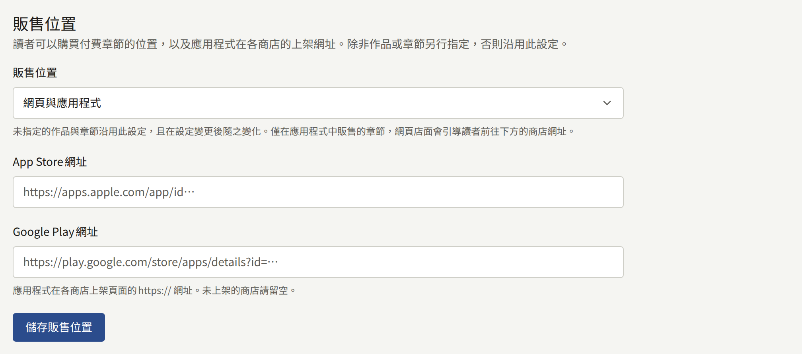
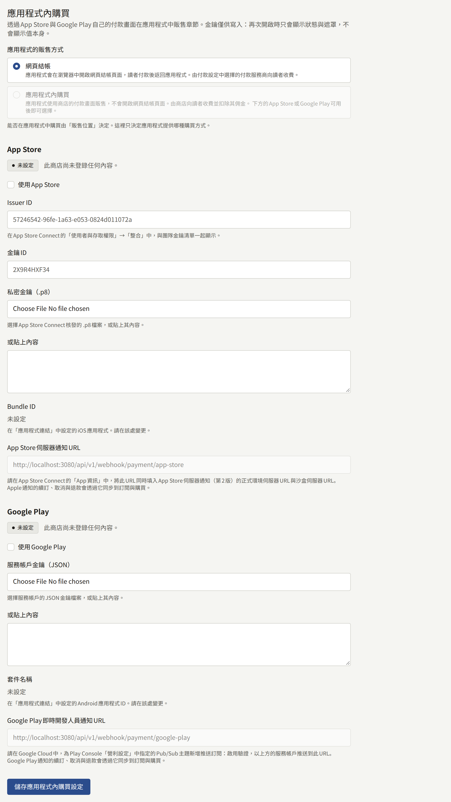
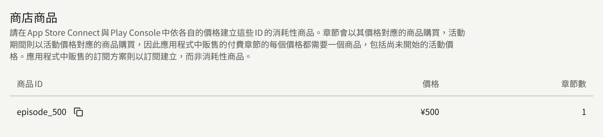

要在網站上販售章節，必須讓三件事彼此一致：租戶主控台中章節的價格、付款服務商的帳戶，以及付款服務商用來通知安裝實例讀者已付款的Webhook。向讀者收款的是付款服務商，但只有Webhook才會讓章節可以閱讀，因此三者中任何一項設定有誤，就會收了讀者的錢，章節卻仍然鎖定。本頁依設定的順序逐一說明這三項，最後以一次測試購買確認三者一致。

租戶的應用程式可以透過同一個付款服務商販售，也可以透過App Store與Google Play本身的付款機制販售。後者不需要付款服務商，購買改由安裝實例向商店驗證。[在應用程式中販售](#在應用程式中販售)說明如何選擇；只在應用程式中透過商店販售的租戶，可以略過付款服務商的各節。

本頁中**付款** › **付款方式**下的所有操作都只限**租戶管理員**；編輯與稽核員看不到該畫面。章節的定價則由建立章節的人進行。

## 讀者如何購買章節

### 價格與閱讀期限

章節的**價格**與**閱讀期限**最初是在建立章節的表單中輸入：

- **價格**以租戶的貨幣輸入，欄位上會標明貨幣，小數位數不得超過該貨幣的位數：500日圓輸入`500`，4.99美元輸入`4.99`。輸入`0`表示章節免費；其他任何值都會讓它成為付費章節。
- **閱讀期限**是購買後章節可以閱讀的時數。輸入`0`表示沒有期限。

付費章節也可以出租：以低於**價格**的金額，在有限的時間內販售。**閱讀期限**下方的兩個欄位用來設定租借，只有在**租借價格**填有金額時，章節才能租借：

- **租借價格**與**價格**一樣以租戶的貨幣輸入，且必須低於**價格**，因此免費章節無法租借。不想出租該章節時請留空。
- **租借期限**是租借後章節可以閱讀的時數，至少為`1`。**租借價格**為空時不會使用。

租借價格等於或高於**價格**時，或填了**租借價格**卻沒有填**租借期限**時，表單都不會接受，並指出需要修正的欄位。租借並不取代買斷：租借了章節的讀者仍然可以購買它。

付費章節也可以在購買前開放開頭的幾頁。租借欄位下方的**試讀頁數**就是開放的頁數，從第一頁算起；初始值`0`表示不開放任何頁面。免費章節的所有頁面本來就能閱讀，因此只有在**價格**大於`0`時才會顯示此欄位。[試讀頁數](./1-catalog/2-episodes.md#試讀頁數)有詳細說明。

這五個欄位之後都可以在章節編輯畫面的**價格與閱讀期限**中變更，方法見[章節](./1-catalog/2-episodes.md#變更價格與閱讀期限)。若想在不變更價格的情況下限時降價販售章節，請為章節預約[活動價格](./1-catalog/2-episodes.md#活動價格)。變更會套用於儲存之後的購買；已完成的購買或租借，仍維持當時支付的價格與到期時間。新章節的**閱讀期限**以系列的**閱讀期限**為初始值，**租借期限**則以系列的**租借期限**為初始值，因此只要在系列上設定一次，之後建立的每個章節都會帶有相同的期限，除非在表單中另行變更。變更系列的期限不會影響已建立的章節。

### 購買與閱讀

付費章節在網站上會顯示價格與**前往結帳**。可租借的章節則改為同時提供兩種販售方式，並各自標示金額：附上價格的「**以…購買**」，以及附上租借期限與租借價格的「**租閱…（…）**」。已登入的讀者選擇其中之一後，會被帶到付款服務商的結帳頁面，在那裡付款，然後回到章節頁面，頁面會告知讀者正在確認付款。章節要等付款服務商的付款通知送達安裝實例時才會開放，通常只需幾秒鐘。單是從結帳頁面返回，並不會開放任何內容。

設有[試讀頁數](./1-catalog/2-episodes.md#試讀頁數)的付費章節，尚無法閱讀該章節的讀者無論是否登入，在網站與應用程式上都會先讀到這些頁面，並使用與章節其餘部分相同的閱讀器：依章節的閱讀方向翻頁，並依其版面組成跨頁。頁碼與進度滑桿只計算試讀頁，例如網站上顯示`Page 3 of 3`，應用程式中顯示`3 / 3`。翻過最後一頁試讀頁後，會出現**試讀到此結束**，並列出購買以及該章節提供的其他閱讀方式。沒有試讀頁的付費章節，則是在頁面的位置顯示相同的選項，背景是模糊處理的開頭頁面。讀者在試讀中讀到哪裡、是否讀到最後都不會被記錄，因此購買後章節會從第一頁開啟。

購買之後，該章節：

- 在閱讀期限內保持開放，租借則在租借期限內保持開放，皆從購買被記錄的那一刻起算。
- 列在讀者帳戶的**已購買**下，標示為購買或租借，並顯示租借的剩餘時間；期限結束後則列在**購買記錄**下。
- 對同一個帳戶而言，不論在哪裡購買，在網站與租戶的應用程式上都能開啟。
- 開放期間無法再次購買；閱讀期限結束後就可以。持有租借的讀者仍可購買買斷版本，但在租借結束前無法再次租借。

**已購買**上的**下載CSV**會將列在其中的所有購買，跨越所有分頁且包含已退款的購買，儲存為一個CSV檔案。在租戶的應用程式中，**已購買**上的**匯出CSV**會產生同樣的檔案並交給裝置的分享面板，讀者可以從那裡儲存或傳送。

讀者在網站上購買的租戶代幣包，會列在**購買記錄**下，以租戶對代幣的稱呼與發放的代幣數量命名，例如`1,100 Points (including 100 bonus)`，並顯示讀者支付的金額以及是否已退款。代幣包不會開放任何章節，也沒有閱讀期限：代幣會自行到期。CSV中，它的`item`欄位是`coin_pack`，發放的代幣（含贈送部分）寫在`coins`與`bonus_coins`中。

### 使用代幣支付

租戶販售自己的代幣時（平台允許租戶發行代幣，且租戶已依[代幣](./9-coins.md)的說明開啟代幣），付費章節也會以代幣標價：以其價格（活動價格進行期間則為活動價格）除以一枚代幣的價值後無條件進位，租借也以相同方式計算。在網站上，章節會以租戶對代幣的稱呼，告訴已登入的讀者目前持有多少代幣；代幣足以支付價格時，會提供一個使用代幣購買的按鈕，例如**使用300點數購買**。按下後不經付款頁面，章節立即開放。

持有代幣不足的讀者，會在購買選項旁看到能補足差額的最小在售代幣包，以及它的價格、其代幣可使用的天數與租戶的揭露事項。購買代幣包會將讀者帶到付款服務商的結帳頁面，再回到章節，待付款服務商的通知發放代幣後，即可用代幣支付。沒有夠大的在售代幣包時，章節會改為連結到讀者的代幣頁面。只在應用程式中販售的章節，無法在網站上以代幣支付。

以代幣支付的章節與其他購買相同：在閱讀期限內保持開放，租借則在租借期限內保持開放，並列在**已購買**下，以所花費的代幣取代價格。CSV中，其`price`寫為`0`，所花費的代幣寫在`coins_spent`中。

**我的頁面**會顯示一個以租戶對代幣的稱呼為標題的區塊，內含讀者的餘額、最早一批代幣的到期時間，以及前往讀者代幣頁面的連結。該頁面列出在售的代幣包，各自附有價格與代幣可使用的天數，下方是租戶的揭露事項，並逐頁列出每一筆新增、花費、收回或到期的代幣。在該頁面購買代幣包後，讀者會回到該頁面。平台或租戶關閉代幣時，這些內容都不會出現。

### 系列的剩餘章節

讀者也可以在一次結帳中，購買某個系列中自己尚未擁有的所有付費章節。系列頁面會在章節列表上方提供**購買剩餘章節**，並標示章節數與合計金額，租戶應用程式的系列畫面也一樣。這次購買會像個別購買一樣開放每一個章節，各自依其閱讀期限開放。

合計金額是這些章節價格的總和，再扣除系列的**打包優惠**；其中適用[活動價格](./1-catalog/2-episodes.md#活動價格)的章節，在活動進行期間以活動價格計算。打包優惠在系列的表單中設定，如[系列](./1-catalog/1-series.md#打包優惠)所述：最多`99`的整數百分比，或新系列的初始值`0`，表示以總和販售。有優惠時，購買選項會標示比逐一購買便宜多少，結帳頁面也會在章節旁列出優惠。優惠後的價格會無條件捨去至貨幣的最小單位，優惠後若無須支付任何金額，則不提供結帳。變更優惠會從下一次結帳起套用：在變更前已開啟付款服務商結帳頁面的讀者，支付的是該頁面上顯示的金額。

### 免費閱讀期間與等待即可免費

價格是在沒有其他方式開放章節時，讀者需要支付的金額。另外還有兩種方式可以開放章節，只要其中任一種對某位讀者開放了章節，網站就不會向該讀者提供購買：

- **免費閱讀期間**設定在章節上，在兩個日期之間向所有人開放章節，不論是否登入。期間結束後恢復收費。先前已購買章節的讀者保有其購買，其閱讀期限在免費期間內也照常計算。系列的[發布後免費](./1-catalog/1-series.md#發布後免費)規則，會在每個付費章節發布後經過指定天數時，為其加上這樣的期間。
- **等待即可免費**設定在系列上，給每位已登入的讀者一張免費券，可在**章節可閱讀的時間**內開放該系列的一個付費章節，使用後經過**獲得下一張免費券的時間**再給一張新的。**免費券不可閱讀的最新章節數**會把最新的章節留給購買者。免費券不能用在免費閱讀期間中的章節，也不能用在讀者已能閱讀的章節上。

工作人員在**閱讀券**中發放的[閱讀券](./2-readers/4-access-tickets.md)，也能以同樣方式開放章節，無須付款。章節署名的作者可以免費閱讀該章節，不會被提供購買。租戶的[工作人員](../3-operations/3-tenant-staff.md#成員與使用者)不論擔任三種角色中的哪一種，只要以擁有該角色的帳戶登入網站或應用程式，就能免費閱讀所有已發布的章節。

## 選擇付款服務商

租戶在網站上一次只透過一個付款服務商收款，在**付款** › **付款方式**的**付款設定**中選擇：

| 付款服務商 | 讀者可使用的付款方式 |
| --- | --- |
| Stripe | 在Stripe控制台中為您的帳戶開啟的付款方式，例如信用卡與超商付款。以超商付款等事後付款的方式購買的章節，會在款項入帳後開放。 |
| PAY.JP | 信用卡，每次付款皆經過3-D Secure驗證。 |

付款以租戶的貨幣收取，在同一表單的**貨幣**中選擇：所有價格都以此貨幣輸入與顯示，在網站、應用程式與主控台中皆然。**貨幣**提供所選付款服務商可收取的貨幣（PAY.JP只收日圓），並在儲存設定之前，以安裝實例營運人員設定的平台預設貨幣為初始值。請在第一筆販售之前選好：租戶一旦有了購買，所有價格與每筆販售都是以該貨幣計算的金額，因此**貨幣**就無法再變更。

表單旁的狀態表示設定進行到哪一步：

- **未設定**：尚未選擇付款服務商。
- **未完成**：付款已開啟，但缺少付款服務商需要的認證資訊，因此不會收取任何費用。
- **已停用**：認證資訊已儲存，但**啟用付款**是關閉的。
- **就緒**：讀者可以購買。

在狀態變為**就緒**之前，付費章節會顯示價格但無法購買，並告知讀者網站目前無法受理購買。選擇其他付款服務商並儲存後，先前付款服務商的已儲存認證資訊會被刪除。

請先使用付款服務商的測試金鑰完成以下設定，如[正式上線前的測試](#正式上線前的測試)所述，待測試購買成功後，再換成正式金鑰。

### Stripe

在Stripe控制台中：

1. 從API金鑰頁面複製**secret key**。測試金鑰以`sk_test_`開頭，正式金鑰以`sk_live_`開頭。
2. 新增Webhook端點。其URL是選擇Stripe後，主控台在**付款設定**下顯示的**Webhook URL**，也就是租戶自己網站網域上的`https://<tenant-domain>/api/v1/webhook/payment/stripe`。選取以下事件；若租戶販售訂閱方案，再加上[訂閱方案](./5-subscription-plans.md#開始之前)列出的事件：
   - `checkout.session.completed`
   - `checkout.session.async_payment_succeeded`
   - `checkout.session.expired`
   - `charge.refunded`
   - `refund.updated`
   - `charge.dispute.created`
   - `charge.dispute.closed`
3. 開啟該端點，複製其**signing secret**，它以`whsec_`開頭。

接著在主控台的**付款設定**中：

1. 選擇Stripe作為**付款服務商**。
2. 輸入**密鑰**與**Webhook簽章密鑰**。
3. 在**啟用付款**下勾選**啟用**，然後選擇**儲存**。

Stripe將測試模式與正式模式的Webhook端點分開，各自有自己的signing secret。改用正式金鑰時，請在正式模式中再次新增端點，並將其signing secret與正式的secret key一起輸入。

#### 促銷代碼

讀者可以在Stripe的結帳頁面輸入促銷代碼。代碼在Stripe控制台中建立，位於與secret key相同帳戶、相同模式的優惠券下，主控台中不需要任何設定：章節或卷的每次結帳都接受促銷代碼。以優惠價販售的系列剩餘章節的結帳則不接受，因為Stripe在一次結帳中只會套用其中一種折扣，不會同時套用兩者。

購買會記錄扣除代碼折扣後讀者實際支付的金額，也就是讀者**購買記錄**中顯示的金額與全額退款退還的金額，並在旁邊記錄套用代碼前的價格，這才是計算章節作者版稅所依據的銷售額：促銷是租戶提供的，因此由租戶承擔。折抵全額的代碼會在不付款的情況下開放章節，因此沒有可退款的金額。PAY.JP的結帳不接受促銷代碼。

### PAY.JP

在PAY.JP控制台中：

1. 從API設定頁面複製**secret key**。測試金鑰以`sk_test_`開頭，正式金鑰以`sk_live_`開頭，測試金鑰只能進行測試付款。
2. 從帳戶設定中複製以`whook_`開頭的**webhook token**。
3. 將選擇PAY.JP後主控台在**付款設定**下顯示的**Webhook URL**，也就是`https://<tenant-domain>/api/v1/webhook/payment/payjp`，註冊為PAY.JP傳送通知的URL。正式上線前，也請在正式模式中註冊。

接著在主控台的**付款設定**中：

1. 選擇PAY.JP作為**付款服務商**。
2. 輸入**密鑰**與**Webhook權杖**。
3. 在**啟用付款**下勾選**啟用**，然後選擇**儲存**。

PAY.JP不會簽署任何內容：安裝實例因為通知帶有Webhook權杖而信任它，並拒絕未帶權杖的通知，因此請像保管secret key一樣妥善保管權杖。

### 付款後章節沒有開放時

付款服務商的控制台會列出每一次傳送到Webhook的紀錄，以及安裝實例回應的狀態。每種狀態都對應一個原因：

| 狀態 | 原因 | 處理方式 |
| --- | --- | --- |
| 2xx | 已接受。並非每個被接受的通知都會開放章節：超商付款時，Stripe會在讀者付款之前傳送`checkout.session.completed`，章節要等付款後傳來的`checkout.session.async_payment_succeeded`才會開放 | 在控制台中確認事件類型與付款狀態。若付款已完成而章節仍然鎖定，讀者可能是用另一個帳戶購買的。 |
| 400 | 主控台中的簽章密鑰或Webhook權杖與付款服務商的不一致 | 輸入付款服務商傳送通知所用端點的值。 |
| 404 | 路徑中沒有指定付款服務商 | 完全照主控台顯示的URL註冊。 |
| 503 | 付款不是**就緒**狀態，或URL指定的付款服務商不是目前選擇的那一個 | 完成上述設定。付款服務商會重新傳送。 |
| 沒有傳送紀錄 | 尚未註冊Webhook，或註冊在另一個模式中 | 在金鑰所屬的模式中註冊。 |

兩家付款服務商都會在一段時間內重新傳送失敗的通知，其控制台也可以重新傳送。設定修正後，只要付款的通知送達，就會開放該付款所購買的章節。

## 章節的販售位置

同一畫面上的**販售位置**決定讀者可以在哪裡購買付費章節。**販售位置**提供以下選項：

- **網頁與應用程式**：在網站與租戶的應用程式中販售。
- **僅網頁**：在網站上販售。應用程式會顯示該章節在網站上販售，並在讀者於網站購買後開啟它。
- **僅應用程式**：在應用程式中販售。網站會顯示該章節在應用程式中販售，向在應用程式中購買的讀者開放，並連結到**App Store網址**與**Google Play網址**所填的各商店應用程式頁面。

系列或章節可以設定自己的**販售位置**，沒有設定的則依循系列或租戶的設定，兩者變更後也一樣。章節只會在同時也顯示的位置販售。

之所以有這個選項，是因為應用程式商店。Apple與Google各自訂有應用程式販售數位內容的規則，在審查中判斷應用程式是否遵守，並對應用程式透過它們販售的內容抽取佣金。如下一節所述，應用程式透過商店本身的付款機制販售的租戶，在應用程式中售出的每個章節都要支付這筆佣金，而可以用**僅網頁**讓某個系列只在網站上販售。沒有應用程式，或不在應用程式中販售的租戶，請為每個章節選擇**僅網頁**。

## 在應用程式中販售

**應用程式內購買**區塊中的**應用程式的販售方式**，決定租戶的應用程式如何販售它可以販售的章節：

- **網頁結帳**會在手機的瀏覽器中開啟網站的結帳頁面，透過上述付款服務商付款，付款後讓讀者回到章節。
- **應用程式內購買**使用App Store與Google Play本身的付款畫面販售。由商店向讀者收款並抽取佣金，上述付款服務商不參與其中。

選擇**應用程式內購買**時，應用程式不需要[選擇付款服務商](#選擇付款服務商)中的付款服務商：應用程式透過商店購買，再由安裝實例向商店驗證購買。

販售位置為**僅應用程式**的章節，只有在應用程式能夠販售時，網站才會顯示該章節在應用程式中販售並連結到商店：選擇**網頁結帳**時，需有付款服務商為**就緒**；選擇**應用程式內購買**時，需有商店為**可用**，而且只會連結到處於該狀態的商店頁面。在此之前，網站會標示章節的價格，並告知讀者無法受理購買。販售位置為**網頁與應用程式**的章節，在付款服務商為**就緒**時於網站上購買；沒有付款服務商就緒而應用程式能販售時，網站會以與**僅應用程式**相同的方式處理。

至少有一個商店為**可用**時，才能選擇**應用程式內購買**：也就是以**使用App Store**或**使用Google Play**開啟、輸入了金鑰，並在**整合** › **應用程式連結**中指定了應用程式。

應用程式會以依價格命名的商店商品購買每個章節，例如¥300的章節為`episode_300`，因此商店只能販售已有對應商品的價格。[活動價格](./1-catalog/2-episodes.md#活動價格)販售期間，價格以活動價格為準：從¥500特價為¥300的章節，會以`episode_300`購買，並以¥300記錄。畫面底部的**商店商品**會列出應用程式販售的每個價格所需的商品ID，包括已預約或正在進行的每個活動的價格，並將章節計入其每一個價格之下。請在App Store Connect與Play Console中，將每個商品建立為該價格的消耗性商品，並在列表中出現新價格時新增商品；活動的價格在預約時就會出現，因此其商品能在活動開始前準備好。

在售的每個代幣包也會列在這裡，ID為`coins_`加上代幣包的ID，並附有其發放的代幣與贈送代幣，請以相同方式建立為代幣包價格的消耗性商品。商店顯示的商品名稱，是您在App Store Connect與Play Console中所取的名稱，而不是Publira傳送的名稱，因此請以您對代幣的稱呼，用應用程式上架的每種語言為每個代幣包的商品命名。

其下方的**訂閱方案**中，列出每個指定了**App Store商品ID**或**Google Play商品ID**的[訂閱方案](./5-subscription-plans.md#建立方案)，並附上其每期收取的金額與各商店的商品ID；沒有指定該商店商品的，則顯示**不販售**。方案不是消耗性商品：請在App Store Connect中於訂閱群組內建立為自動續訂訂閱，並在Play Console中建立為具有基本方案的訂閱，價格與扣款週期與方案相同。ID在方案上輸入，列表會隨之反映。

各商店需要的內容，從安裝實例用來驗證購買的金鑰，到使用商店的測試買家進行測試，都與應用程式本身的設定一起說明於[應用程式內購買與登入](../5-mobile-app/5-purchases-and-sign-in.md#在應用程式中販售章節)。來自App Store沙盒或Play授權測試人員的購買會開放章節，但會記錄為測試，不計入版稅明細與內容統計。

讀者在應用程式中儲存的章節，在應用程式最後一次於連線狀態下開啟它之後的七天內，仍可在該裝置上離線開啟，因此退款會在這段期間內關閉已儲存的章節，而不是立即關閉，如[離線閱讀](../5-mobile-app/7-offline-reading.md#付費章節離開安裝實例七天)所述。應用程式下次在連線狀態下開啟它時，章節會被鎖定並從裝置中刪除。

## 退款

網站上的購買可以從主控台退款，如[從主控台退款](#從主控台退款)所述，也可以在Stripe或PAY.JP控制台中退款。應用程式中的購買由Apple或Google退款。無論哪一種，Publira都不會通知讀者。

- **全額退款**會對讀者關閉章節。該購買仍保留在讀者的**購買記錄**中，標示為**已退款**，讀者可以再次購買該章節。
- **部分退款**會讓章節保持開放，直到該筆付款的退款總額達到讀者支付的金額為止。部分退款仍會減少計算章節作者版稅所依據的銷售額。

以[促銷代碼](#促銷代碼)折扣的購買，最多只能退還讀者支付的金額。其作者是以套用代碼前的價格計算版稅，因此部分退款會從其銷售額中扣除該價格的相同比例：退還讀者支付金額的一半，就會扣除套用代碼前價格的一半。

每筆退款都以其購買送達的相同途徑送達安裝實例：

- **Stripe與PAY.JP**透過上述Webhook通知退款，這就是Stripe的端點需要`charge.refunded`的原因。付款服務商已接受的退款之後仍可能失敗，例如讀者的信用卡已停用時；付款服務商也會通知這一點，在Stripe上是透過`refund.updated`，此時除非仍維持退款的金額總計仍達到讀者支付的金額，否則章節會再次向讀者開放。
- **App Store**會通知到主控台在**App Store**區塊中顯示的**App Store伺服器通知URL**，這個URL要在App Store Connect中同時註冊為Production與Sandbox的Server URL。
- **Google Play**會透過[應用程式內購買與登入](../5-mobile-app/5-purchases-and-sign-in.md#各商店的應用程式內購買需要什麼)所述的Pub/Sub推送訂閱，通知到主控台在**Google Play**區塊中顯示的**Google Play即時開發人員通知URL**。安裝實例也會每小時讀取一次Google Play過去30天的作廢購買，藉此套用通知始終未送達的退款；沒有這些通知時，已退款的購買最多可能讓章節保持開放一小時。這項讀取由營運人員保持運作的`publira worker`執行，如[概觀](../2-deployments/1-overview.md)所述。

在其所撤銷的購買之前送達的退款會被保留，並在該購買被記錄時套用。

### 從主控台退款

**付款** › **購買記錄**依新到舊列出租戶的購買，並可依讀者的電子郵件地址、系列、章節，以及以租戶時區計算的購買日期篩選。**檢視**會在列表旁開啟一筆購買，顯示讀者支付的金額、付款的管道，以及目前為止已退款的金額。只有租戶管理員看得到這個畫面。

代幣包的購買在此會以其發放的代幣列出，使用租戶在預設語言中對代幣的稱呼，且不屬於任何系列，因此將列表篩選為某個系列或章節時不會顯示。它的退款方式與其他購買相同，只是一律全額退款，因此對話方塊不會要求輸入金額。在付款服務商通知全額退款或該筆付款的爭議之前，其代幣都會留在讀者手上：屆時代幣包剩餘的代幣會被收回，讀者已花費的部分會記錄為欠額，並從讀者下次購買的代幣包中扣除。用這些已花費代幣支付的章節仍保持開放，而各筆購買會將這些代幣的價值顯示為已退款。

以代幣支付的章節購買，會在其他購買顯示付款服務商的位置顯示**使用代幣支付**，並以所花費代幣的價值作為其價格，這也是計算其作者版稅所依據的銷售額，如[版稅](./6-reports-and-royalties.md#作者應得的金額)所述。讀者看到的是自己花費的代幣，不會看到價格。

寫下原因後，**退款**會要求讀者付款時使用的付款服務商，以租戶的貨幣退還**退款金額**；原因會與退款一起記錄在稽核記錄中。金額的初始值是所有剩餘可退的金額，變更金額時，對話方塊會告知章節將對讀者保持開放還是關閉。

- **退還全部剩餘金額**時，章節會立即對讀者關閉，購買會顯示**已申請退款**，直到付款服務商透過Webhook通知退款後，才顯示**已退款**。付款服務商拒絕的退款，或付款服務商接受後才失敗的退款，會讓章節再次向讀者開放。
- **退還少於剩餘金額**時，章節仍對讀者保持開放。購買會顯示**已申請退款**並在旁邊標示金額，直到付款服務商通知退款後，才顯示**部分退款**，並將該金額加入已退款的金額。在此之前，該購買只能以相同金額再次退款，這是在申請沒有送達付款服務商時重新申請的方法。付款服務商拒絕的退款會撤回該申請。付款服務商通知後，請如上所述退還其餘金額以關閉章節。

主控台不提供以下購買的退款：在應用程式中進行的購買、讀者向銀行提出爭議的購買，以及透過租戶已不再使用的付款服務商支付的購買：請在讀者付款的地方退款。以代幣支付的購買也不提供退款，因為它沒有收取任何款項：錢屬於代幣包，退還代幣包才是收回款項的方式。

## 爭議

讀者就Stripe付款向銀行提出爭議時，Stripe會透過同一個Webhook通知，這就是其端點需要`charge.dispute.created`的原因。無論銀行之後如何判定，爭議一提出，章節就會對讀者關閉，該購買仍保留在讀者的**購買記錄**中，標示為**已取消**。請在Stripe控制台中回應爭議；主控台中不需要任何操作。

銀行的判定只會影響版稅明細，版稅明細透過`charge.dispute.closed`得知判定結果：

- 判定對您有利時，款項留在您這邊，因此該購買仍是一筆銷售。章節對讀者仍保持關閉。
- 判定對您不利時，款項退還給讀者，因此該購買不再是銷售，與全額退款相同。若購買當月已經結算，下一份明細會以調整的方式將其扣回，如[版稅](./6-reports-and-royalties.md#結算後的退款)對退款所作的說明。

## 放棄的結帳

未付款就離開付款頁面的讀者，隨時可以重新開始購買。Stripe通知放棄的結帳已過期後（這就是其端點需要`checkout.session.expired`的原因），讀者下次嘗試時會開啟新的付款頁面，而不是已過期的那一個。

## 與付款服務商對帳

版稅明細與**銷售額**只計算安裝實例記錄的購買，不含其他任何內容。始終未送達的通知、沒有對應購買的退款，或應用程式始終未確認的商店購買，都會讓這些數字與付款服務商或商店實際收取的金額不一致。對帳會在以您的日期計算的一段期間內比較雙方，並列出在另一方找不到對應的每一筆項目。對帳使用**付款** › **付款方式**中儲存的認證資訊讀取付款服務商與商店的記錄，不會變更它們或購買的任何內容：如何處理每一筆項目由您決定，在付款服務商的控制台或主控台中處理。

**付款** › **對帳**是開始與查看對帳的地方，只有租戶管理員看得到。以**開始**與**結束**選擇日期，初始值為上一個完整月份，最晚到今天，然後選擇**對帳**。

一段期間的對帳會針對租戶所有**就緒**的來源執行：其付款服務商、App Store與Google Play，各自為獨立的一次執行。worker處理程序會在數秒內接手執行，並在讀完該來源該期間的記錄後完成；對業務繁忙的租戶而言，較長的期間需要一些時間。再次對同一期間執行時，會取代該期間的上一次執行，除非上一次尚未完成。

列表會顯示每次執行的狀態：**等待中**、**進行中**、**已完成**或**失敗**，並在有執行尚未完成時自動重新整理。已完成的執行會計算該來源在期間內記錄的付款數、期間內記錄的購買數、兩者中相符的數量，以及剩下的發現項目。失敗的執行會說明原因：來源的認證資訊未儲存或被拒絕，這需要先在**付款** › **付款方式**中修正再重新對帳；或無法讀取來源，這可能在之後再次執行該期間時解決。

每個來源都在其保存記錄的地方讀取：

- **Stripe**：帳戶的餘額交易，各自以購買所記錄的payment intent比對。支付[訂閱方案](./5-subscription-plans.md)發票的付款不是購買，會被排除。
- **PAY.JP**：帳戶的付款流程，以及其中的退款。
- **App Store**：期間內與租戶有App Store購買的每一位顧客的交易記錄。Apple依顧客保存記錄，並沒有整個應用程式的記錄，因此若某位顧客的每一筆購買都未被應用程式記錄，對帳就看不到這位顧客的購買。
- **Google Play**：租戶在期間內的每一筆Google Play購買及其訂單，以及Google Play的作廢購買。Google Play不列出其他購買，並只保留作廢購買30天，因此應用程式未記錄的購買，只有在這段期間內被退款時才會出現。

一次執行會將以下項目列為發現項目：

- **無購買記錄的付款**：來源收取了款項，卻沒有購買記錄它。付款通知始終未送達安裝實例時就會是這樣。此項目會列出來源本身的付款ID，在Stripe上是payment intent，在PAY.JP上是付款流程，在App Store上是交易，在Google Play上是購買權杖，讓您能在來源的控制台中找到它。
- **無付款記錄的購買**：來源沒有記錄的期間內購買。
- **金額不一致**：購買與其付款在金額、貨幣或已退款金額上不一致。商店以讀者自己的貨幣收款，因此對商店而言，只有在以租戶的貨幣收款時才比較金額，否則只比較付款是否已退款。
- **暫掛的退款**或**暫掛的爭議**：針對沒有任何購買對應的付款送達的退款或爭議，且從期間開始之前就一直在等待其購買。找到購買的退款或爭議會在當時套用，如[退款](#退款)所述，因此仍在等待的，表示有一筆購買始終未被記錄。

購買的日期是安裝實例記錄它的時間，比付款晚了通知所花的時間，因此每個來源都會從期間的前一天讀到後一天。期間最後一天深夜收取的付款，仍能與隔天早上記錄的購買相符，而期間外的任一方項目都不會列出。

在付款服務商測試模式或商店沙盒中進行的付款，只會與測試購買比對，並與正式項目分開列出。暫掛的退款或爭議沒有模式，會與正式項目一起列出。

執行上的**檢視**會在列表旁開啟其發現項目，可以篩選為某一種類，以及**正式**或**測試**。每個發現項目都會顯示**對帳對象的付款ID**、**購買金額**與**對帳對象的金額**，並各自附上其中已退款的部分。與購買有關的發現項目有**開啟購買記錄**，會在**購買記錄**中開啟該購買。

### 下載購買記錄

**付款** › **購買記錄**上的**下載CSV**，會將**開始**與**結束**篩選所指定期間的購買儲存為CSV，供會計使用：期間內的每一筆購買一列，日期在期間內的每一筆退款一列，每一列都附有購買所帶的付款服務商與商店的ID。一個檔案最多涵蓋366天，因此沒有**結束**時檔案截至今天，沒有**開始**時則從結束日前366天開始。讀者、系列與章節的篩選不會套用到檔案。全額退款的日期是它送達安裝實例的時間；部分退款沒有自己的日期，因此列在其購買所在的期間。以代幣支付的購買，或未經付款而發放的購買，沒有向讀者收取任何費用，因此不在檔案中。每次下載都會記錄在**稽核記錄**中。

## 正式上線前的測試

在讀者可以付款之前，請使用付款服務商的測試金鑰測試整個設定：Webhook是最常出錯的部分，而只有實際的購買能證明它運作正常。

在付款服務商測試模式中進行的購買會開放章節，但會記錄為測試，不計入版稅明細與內容統計。讀者仍會收到郵件收據，上面註明該購買是在測試模式中進行，並未收取任何費用。主控台無法刪除章節，因此請將測試放在專用的系列中，事後再將其隱藏。

1. 使用付款服務商的**測試**secret key設定付款服務商，並如上所述在測試模式中註冊Webhook。確認**付款設定**顯示**就緒**。
2. 建立一個測試用的系列，顯示位置為**網頁與應用程式**或**僅網頁**，並立即發布。在其中建立一個章節，**價格**例如`100`、**閱讀期限**例如`1`，立即發布，並在網頁上販售。
3. 在網站上，以沒有任何主控台角色的讀者帳戶登入，開啟該章節，並選擇**前往結帳**。
4. 使用測試卡付款。`4242 4242 4242 4242`搭配任何未來的到期日與任何三位數安全碼，在兩家付款服務商都可使用。PAY.JP接著會顯示其測試用的3-D Secure畫面，讓您選擇結果。
5. 回到章節，等待它開放，然後確認它列在**已購買**下。若一分鐘內沒有開放，請在付款服務商的控制台中查看傳送紀錄，如[付款後章節沒有開放時](#付款後章節沒有開放時)所述。
6. 從**付款** › **購買記錄**退還該購買，或在付款服務商的控制台中全額退還該付款，藉此證明退款也會送達安裝實例。重新載入章節：章節再次鎖定，**前往結帳**也重新出現。

兩項都通過後，將測試系列的**顯示位置**設為**不在任何位置顯示**。接著將測試的secret key換成正式的，在正式模式中註冊Webhook，輸入其signing secret或權杖，然後儲存。

若要測試應用程式內購買，請依[測試購買](../5-mobile-app/5-purchases-and-sign-in.md#測試購買)的說明使用商店本身的測試買家。這些購買同樣會記錄為測試。
