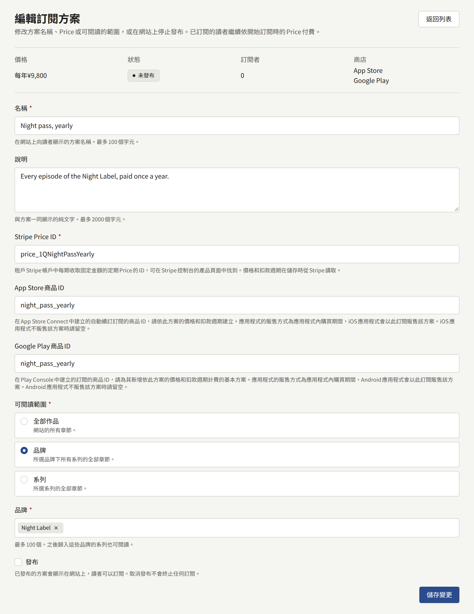
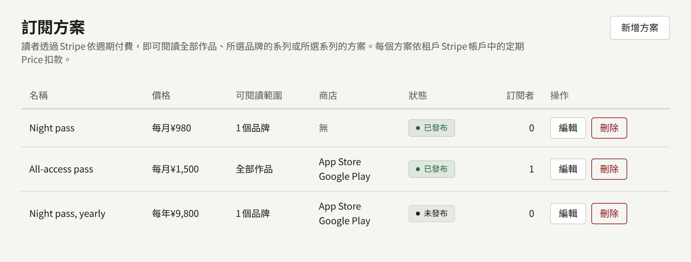

訂閱方案讓讀者透過Stripe每期付款，就能閱讀方案涵蓋的每個章節，而不必逐一購買。要販售方案，必須讓三件事彼此一致，與販售章節所需的三件事相同：租戶Stripe帳戶中的定期Price、在租戶主控台中指定該Price的方案，以及Stripe用來通知安裝實例讀者已訂閱、已付款、已續訂、付款逾期或已取消的Webhook。向讀者扣款的是Stripe，但只有Webhook才會向讀者開放方案的章節並再次關閉，因此三者中任何一項設定有誤，就會收了讀者的錢，章節卻仍然鎖定，或是讓已停止付款的讀者繼續閱讀。本頁依這個順序逐一說明這三項，最後以一次測試訂閱確認三者一致。

所有方案都是在網站上透過Stripe販售，因此租戶的付款服務商中必須有Stripe才能建立方案；與Stripe並用的PAY.JP則販售方案以外的所有項目。方案也可以指定租戶的應用程式在App Store與Google Play中以哪個訂閱販售它，如[建立方案](#建立方案)所述。租戶的應用程式以**網頁結帳**販售時，會將想要方案的讀者帶到網站的方案頁面，如[應用程式內購買與登入](../5-mobile-app/5-purchases-and-sign-in.md#在應用程式中販售章節)所述。

**付款** › **訂閱方案**只限**租戶管理員**；編輯與稽核員看不到該畫面。

## 開始之前

租戶需透過Stripe收款，且**付款** › **付款方式**的**付款設定**下Stripe的卡片顯示**就緒**，如[販售章節](./4-selling-episodes.md#stripe)所述。主控台會從該處所儲存secret key的Stripe帳戶讀取每個方案的Price，因此在此之前無法儲存方案。

除了販售章節所需的事件之外，Stripe的Webhook端點還需要以下事件：

- `customer.subscription.updated`，在訂閱續訂、付款逾期、被設定為取消或變更方案時傳送。
- `customer.subscription.deleted`，在訂閱結束時傳送。
- `invoice.payment_failed`，在Stripe無法收取續訂款項時傳送。
- `invoice.paid`，在Stripe收到訂閱的發票款項時傳送，包括第一次與每次續訂。

缺少`customer.subscription.updated`、`customer.subscription.deleted`與`invoice.payment_failed`時，訂閱會在其結帳付款時被記錄，之後卻不再隨Stripe更新：即使讀者的續訂已成功，章節也會在已付款的期間結束時關閉，而取消訂閱的讀者則可以繼續閱讀到那一天。缺少`invoice.paid`時，不會記錄任何付款，因此方案的收入不會出現在任何銷售額數字或任何版稅明細中，如[付款如何支付給作者](#付款如何支付給作者)所述。加入事件之前的付款，之後也不會被記錄。請在測試模式的端點中加入這些事件，並在正式上線前再加入正式模式的端點。

## 在Stripe中建立Price

在Stripe控制台中，於與secret key相同的帳戶與模式下：

1. 在商品目錄中為方案新增一個商品。其名稱就是Stripe在結帳頁面與讀者發票上向讀者顯示的名稱。
2. 為它設定一個固定金額的**Recurring**價格，並選擇扣款週期：每日、每週、每月、每年，或例如每3個月的自訂週期。
3. 開啟該價格並複製其ID，它以`price_`開頭。

主控台會拒絕不是每期固定金額的Price：一次性價格、依用量計費或計量計費的價格、分級價格，以及讓顧客自選支付金額的價格。已封存的Price也會被拒絕。方案會依該Price所訂的金額、貨幣與扣款週期收費，網站也會以該貨幣標示方案的價格，因此請以租戶的貨幣建立Price。Price的金額在Stripe中永遠不會變更：若要收取不同的金額，請建立新的Price，並將其ID輸入到方案上，如[變更、取消發布與刪除方案](#變更取消發布與刪除方案)所述。

測試模式與正式模式的Price是分開的，各自有自己的ID。改用正式金鑰時，請在正式模式中重新建立Price，並將其ID輸入到方案上，如[正式上線前的測試](#正式上線前的測試)所述。

### 客戶入口網站

訂閱者在Stripe的客戶入口網站中變更信用卡或取消訂閱，網站上的**管理付款**會開啟這個入口網站。入口網站是在租戶自己的Stripe控制台的帳單設定中設定，主控台中沒有相關設定：請開啟其設定並儲存，在測試模式中儲存一次，在正式模式中再儲存一次，讓Stripe有可用來開啟入口網站的設定。您可以在那裡選擇讀者能否取消訂閱，以及取消是立即生效還是在已付款期間結束時生效。

在租戶的應用程式中透過App Store或Google Play訂閱的讀者，要在商店中變更與取消該訂閱。Stripe的入口網站無法開啟這類訂閱，**我的頁面**也不會為其提供**管理付款**，而是提供**在App Store中管理**或**在Google Play中管理**，開啟讀者在其商店帳戶中管理訂閱的頁面。

入口網站也可以讓讀者改用其他商品的價格。改用租戶另一個方案所收費Price的讀者，從那時起會被記錄在該方案上，並閱讀該方案開放的內容。請只在那裡提供有方案收費的Price：改用沒有任何方案收費之Price的讀者，會留在原本訂閱的方案上，卻支付新的價格。

## 建立方案

在**付款** › **訂閱方案**中，選擇**新增方案**，填寫表單，然後選擇**建立方案**：

- **名稱**是讀者在網站上看到的方案名稱，最多100個字元。
- **說明**是與方案一同顯示的純文字，最多2000個字元。
- **Stripe Price ID**是上面複製的`price_`ID。方案的費用與扣款頻率會在儲存方案時從Stripe讀取，主控台會依Stripe所訂的內容顯示。
- **App Store商品ID**與**Google Play商品ID**指定租戶的應用程式在各商店中以哪個訂閱販售此方案，兩者都可以留空。只有在**應用程式的販售方式**為**應用程式內購買**時，而且只有方案指定了該商店的商品時，應用程式才會透過該商店販售方案。請在商店中以方案的價格與扣款週期建立商品：在App Store Connect中建立為自動續訂訂閱，在Play Console中建立為具有基本方案的訂閱，如[各商店的應用程式內購買需要什麼](../5-mobile-app/5-purchases-and-sign-in.md#各商店的應用程式內購買需要什麼)所述。主控台不會向商店確認ID，因此背後沒有商品的ID會在第一次購買時失敗，應用程式會將其顯示為不販售。
- **可閱讀範圍**決定方案開放哪些章節：
  - **全部作品**：網站的所有章節。
  - **書系**：歸入您所選書系（最多100個）之系列的所有章節。之後歸入其中某個書系的系列也會開放。
  - **系列**：您所選系列（最多100個）的所有章節。
- **發布**會將方案列在網站上，讓讀者可以訂閱。若要在提供之前先準備方案，請不要勾選。

當Stripe在該ID下沒有每期固定金額的Price，或另一個方案已經以該Price收費時，表單會指出需要修正的欄位：每個方案都以自己的Price收費，因此第二個相同金額的方案，需要在Stripe中建立第二個Price。商店商品ID同樣專屬於一個方案，若ID已被另一個方案用於販售，或含有商店不接受的字元，表單會標示該欄位：App Store商品ID可使用英文字母、數字、底線與句點，Google Play商品ID可使用小寫英文字母、數字、底線與句點，且必須以英文字母或數字開頭。只要Stripe不是租戶已啟用付款的付款服務商，表單就會拒絕任何方案。一個租戶最多可以有20個方案。

## 方案列表

**付款** › **訂閱方案**會依建立順序列出所有方案，並顯示每期費用、開放範圍、以應用程式販售它的**商店**、它是**已發布**還是**未發布**，以及它有多少**訂閱者**。訂閱者是指對該方案的訂閱已付清，或Stripe仍在嘗試收取其續訂款項的讀者。**編輯**會開啟方案的表單，上方顯示其價格、狀態、訂閱者與商店。

## 變更、取消發布與刪除方案

方案的**名稱**、**說明**或**可閱讀範圍**一經變更，會立即套用到每位訂閱者：從儲存的那一刻起，每位訂閱者閱讀的就是方案所開放的內容。

新的**Stripe Price ID**會變更此後訂閱的讀者所支付的費用。已經訂閱的讀者會繼續支付開始時的Price，並留在該方案上。若要變更他們支付的金額，請在Stripe控制台中變更他們的訂閱。

取消勾選**發布**會讓方案從網站上撤下：方案不再列出，鎖定的章節也不再提供它。取消發布不會終止任何訂閱。訂閱者在各自取消之前，會繼續閱讀方案開放的內容，Stripe也會繼續向他們收費；若要自行終止他們的訂閱，請在Stripe控制台中取消。

**刪除**會移除沒有任何人訂閱過的方案。現在或過去有任何讀者訂閱過的方案，會保留作為他們所支付內容的記錄，主控台會要求您改為取消發布。讀者最近一次結帳所針對的方案也一樣，不論是否已付款。

## 方案開放的內容

只要Stripe回報訂閱狀態良好，且其目前期間尚未結束，訂閱就會在網站與租戶的應用程式上開放其方案涵蓋的章節：

- **Active**，或處於試用期，在期間內開放。被設定為在期間結束時取消的訂閱，會開放到那時為止。
- **Past due**，在Stripe重試無法收取的續訂款項期間開放。這是給讀者修正信用卡的寬限期，其長短取決於租戶Stripe帳單設定中的重試排程，該設定也決定Stripe放棄後訂閱會變成什麼狀態：已取消或未付款。

已取消、未付款、已暫停，或第一次付款始終未成功的訂閱，不會開放任何內容。

訂閱者另外購買的章節，仍會列為其購買，並在訂閱結束後的閱讀期限內仍歸其所有。讀者一次只能持有一個訂閱。

## 付款如何支付給作者

Stripe為方案收取的每一筆款項，包括第一次與每次續訂，都會在`invoice.paid`通知送達安裝實例時被記錄。它會在付款當天計入租戶的銷售額，與購買分開計算，而在Stripe控制台中進行的退款則會在當天扣除。

在該款項所支付期間結束的月份，其版稅明細會將款項分配給訂閱者在該期間內讀完的方案章節，並依各章節作者的分潤比例，將每個章節所得的部分支付給作者。訂閱者沒有讀完任何章節的款項不分配給任何人，全部歸出版社所有。規則以及結算後的退款如何扣回，請見[報表與版稅](./6-reports-and-royalties.md#訂閱付款)。

## 讀者看到的內容

網站的方案頁面`https://<tenant-domain>/plans`會列出已發布的方案，並顯示每個方案的每期費用、說明，以及網站上顯示的其所涵蓋的書系或作品。讀者可以從**訂閱**進入此頁面（當已發布的方案涵蓋某個鎖定的章節時，該章節會在購買選項旁提供這個按鈕），也可以從**我的頁面**上的**查看方案**進入。網站上沒有其他地方連結到這個頁面，因此請在您向讀者介紹方案的地方自行連結。

1. 讀者在方案上選擇**訂閱**。未登入的讀者會改為看到**登入後訂閱**，已持有方案的讀者則會被告知是哪一個方案，並被帶到**我的頁面**。若該方案是透過App Store或Google Play收費，訊息會指出是哪一個商店。
2. Stripe的結帳頁面收取款項，讀者若有促銷代碼也可以使用，與章節相同。離開結帳頁面會讓讀者回到方案頁面，頁面會告知讀者尚未被收費。
3. 付款後，讀者會回到**我的頁面**，頁面會向讀者致謝，並說明方案會在確認付款後出現。方案的章節會在Webhook的通知送達安裝實例時開放，通常只需幾秒鐘。

首次付款確認後，網站還會像寄送購買收據一樣以租戶的名義寄信給讀者，不受讀者通知設定的影響。郵件會載明方案、支付金額以及該筆付款涵蓋的期間，告知讀者在該期間結束前可以閱讀方案的章節，屆時除非讀者取消，方案將續訂，並附上前往**我的頁面**的連結。此後Stripe每收取一次付款、方案續訂到新的期間時，網站都會以同樣的方式寄信：郵件載明方案、支付金額以及新的期間，並告知讀者在該期間結束前可以閱讀方案的章節。在Stripe測試模式下開始或續訂的訂閱，郵件會說明未產生任何扣款。

Stripe無法收取續訂款項時，網站也會在每次收款失敗後以同樣的方式寄信給讀者，不受讀者通知設定的影響：郵件載明方案與應付金額，在通知載明下次嘗試時間時說明Stripe何時再次嘗試，告知讀者最晚在目前期間結束前仍可閱讀方案的章節（如[方案開放的內容](#方案開放的內容)所述），並請讀者在**我的頁面**的**管理付款**中更新付款方式，附上前往我的頁面的連結。若某次失敗後訂閱不再開放任何內容，例如重試排程在最後一次失敗後取消訂閱，則不會為這次失敗寄信。在Stripe測試模式下失敗的嘗試，郵件會說明不會產生任何扣款。

訂閱結束時，無論是誰結束的，網站都會以同樣的方式再寄一封郵件給讀者，不受讀者通知設定的影響：無論是讀者在客戶入口網站中取消，還是重試排程在Stripe放棄收取續訂款項時結束訂閱，或是租戶在Stripe控制台中取消。郵件載明方案以及Stripe結束訂閱的日期，從這一天起讀者無法再閱讀方案的章節：立即取消的訂閱為取消的日期，設定為在期間結束時取消的訂閱為該期間結束時。郵件附上方案頁面的連結，讀者可以在那裡重新訂閱。首次付款未能完成的訂閱結束時不會寄信。

只有當租戶在Stripe控制台中開啟了Stripe的客戶電子郵件時，Stripe才會另外寄送自己的收據與付款失敗通知；開啟後，讀者會收到兩次同樣的通知。在應用程式中透過App Store或Google Play購買的方案由商店通知讀者，網站不會為此寄信。

此後，**我的頁面**會以**您的方案**開頭：顯示方案名稱，並依訂閱的狀態顯示續訂日期、取消後的結束日期、需要修正的付款，或已經結束。**管理付款**會開啟Stripe的客戶入口網站，讀者可以在那裡更新信用卡、查看發票或取消訂閱，在那裡所做的變更會透過Webhook反映到網站上。在應用程式中訂閱的讀者會看到由哪個商店收取方案費用，並看到**在App Store中管理**或**在Google Play中管理**，取代**管理付款**。付款未成功，或方案處於保留狀態時，會告知這位讀者到商店中更新付款方式，而不是在**管理付款**中更新。已結束的方案會提供**查看方案**，與由Stripe收費的方案相同。商店訂閱已結束的讀者可以在網站上訂閱：方案頁面會列出網站販售的方案，並提供**訂閱**。

**付款設定**下的Stripe不是**就緒**時，方案頁面會顯示網站目前無法受理訂閱，鎖定的章節也不會提供方案。在該處移除Stripe會讓網站停止販售方案，已售出的訂閱則維持原狀：Stripe會繼續向這些讀者收費，安裝實例也會繼續接受Stripe關於這些訂閱的通知，因此若租戶要停止向他們收費，請在Stripe控制台中取消這些訂閱。只要Stripe仍在為訂閱計費，就無法刪除Stripe，如[移除付款服務商](./4-selling-episodes.md#移除付款服務商)所述。

刪除讀者的帳戶會立即在Stripe中取消其訂閱，且不會退還已付款的期間，如[讀者帳戶](./2-readers/1-accounts.md#刪除讀者)所述。

## 訂閱沒有隨Stripe更新時

Stripe控制台中為Webhook端點列出的傳送紀錄會顯示原因，與購買時相同，各狀態的意義如[付款後章節沒有開放時](./4-selling-episodes.md#付款後章節沒有開放時)所述。以下五個原因是訂閱特有的：

- **讀者已付款，但我的頁面沒有顯示方案**。`checkout.session.completed`的傳送失敗。修正並重新傳送後，訂閱就會被記錄，其章節也會開放。
- **續訂、取消或付款失敗沒有顯示在我的頁面上**。端點沒有傳送`customer.subscription.updated`、`customer.subscription.deleted`或`invoice.payment_failed`。請加入這些事件。每當有關於某個訂閱的通知送達時，安裝實例都會從Stripe讀取整個訂閱，因此下一個通知就會讓每個訂閱更新到最新狀態。
- **續訂付款失敗的讀者沒有收到郵件**。端點沒有傳送`invoice.payment_failed`，或其傳送失敗。請加入該事件，並重新傳送失敗的通知：不論通知送達幾次，每次失敗的嘗試都只會寄送一封郵件；在訂閱不再開放章節之後重新傳送的嘗試，不會寄信。
- **訂閱已結束的讀者沒有收到郵件**。端點沒有傳送`customer.subscription.deleted`，或其傳送失敗。請加入該事件，並重新傳送失敗的通知：不論通知送達幾次，訂閱結束的郵件都只會寄送一封。
- **付款沒有出現在任何銷售額數字或任何版稅明細中**。端點沒有傳送`invoice.paid`，或其傳送失敗。請加入該事件，並重新傳送失敗的通知：不論通知送達幾次，一筆付款都只會記錄一次。

## 正式上線前的測試

在讀者可以訂閱之前，請在Stripe的測試模式中測試整個設定。只有實際的訂閱能證明Webhook運作正常，也只有實際的取消能證明之後會隨Stripe更新。

1. 使用Stripe的**測試**secret key設定Stripe，並如上所述將販售章節所需的事件與本頁列出的事件全部加入測試模式的端點。確認**付款設定**下Stripe的卡片顯示**就緒**。
2. 在測試模式中建立定期Price，並儲存客戶入口網站的設定。
3. 建立一個測試用的系列，顯示位置為**網頁與應用程式**或**僅網頁**，並立即發布，其中放一個付費章節，立即發布並在網頁上販售，如[正式上線前的測試](./4-selling-episodes.md#正式上線前的測試)對販售的說明。
4. 以測試的Price建立一個開放該系列的方案，並勾選**發布**。
5. 在網站上，以沒有任何主控台角色的讀者帳戶登入：工作人員可以免費閱讀所有已發布的章節，因此章節不會向他們提供任何選項。開啟付費章節，並選擇**訂閱**。
6. 在方案頁面上選擇**訂閱**，並使用測試卡`4242 4242 4242 4242`、任何未來的到期日與任何三位數安全碼付款。
7. 回到**我的頁面**，等待**您的方案**顯示方案與續訂日期，然後開啟章節：無須購買即可閱讀。讀者的信箱會收到一封告知訂閱已開始的郵件，郵件中載明的付款涵蓋期間在**您的方案**顯示的續訂日期結束。若方案在一分鐘內沒有出現，請在Stripe控制台中查看傳送紀錄，如[訂閱沒有隨Stripe更新時](#訂閱沒有隨stripe更新時)所述。
8. 選擇**管理付款**，並在入口網站中取消訂閱。回到**我的頁面**，**您的方案**會顯示取消：結束的日期，或在入口網站立即取消時顯示已經結束。若訂閱仍在進行，也請在Stripe控制台中取消，然後重新載入章節：章節再次鎖定。訂閱結束後，讀者的信箱會收到一封告知訂閱已結束的郵件，郵件中載明訂閱結束的日期。

測試通過後，取消勾選測試方案的**發布**，並將測試系列的**顯示位置**設為**不在任何位置顯示**。測試方案的歷史中現在有一位訂閱者，因此無法刪除，會以未發布的狀態留在列表中。接著將測試的secret key換成正式的，新增包含相同事件的正式模式端點，輸入其signing secret，然後儲存。在正式模式中重新建立方案的Price，在正式模式中儲存客戶入口網站的設定，並以正式的Price建立讀者將要訂閱的方案。
