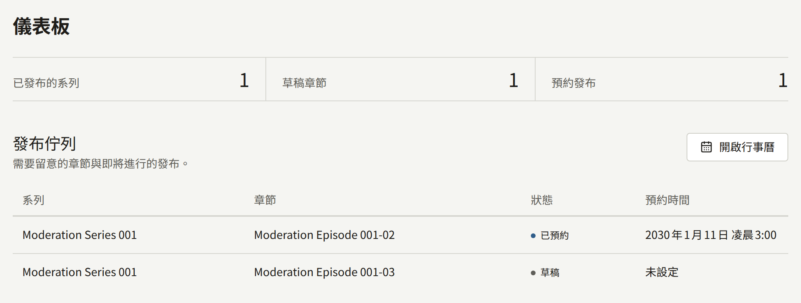
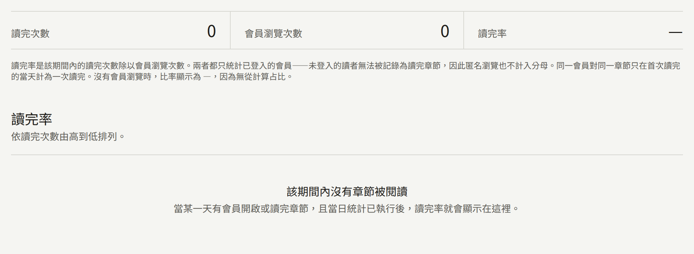
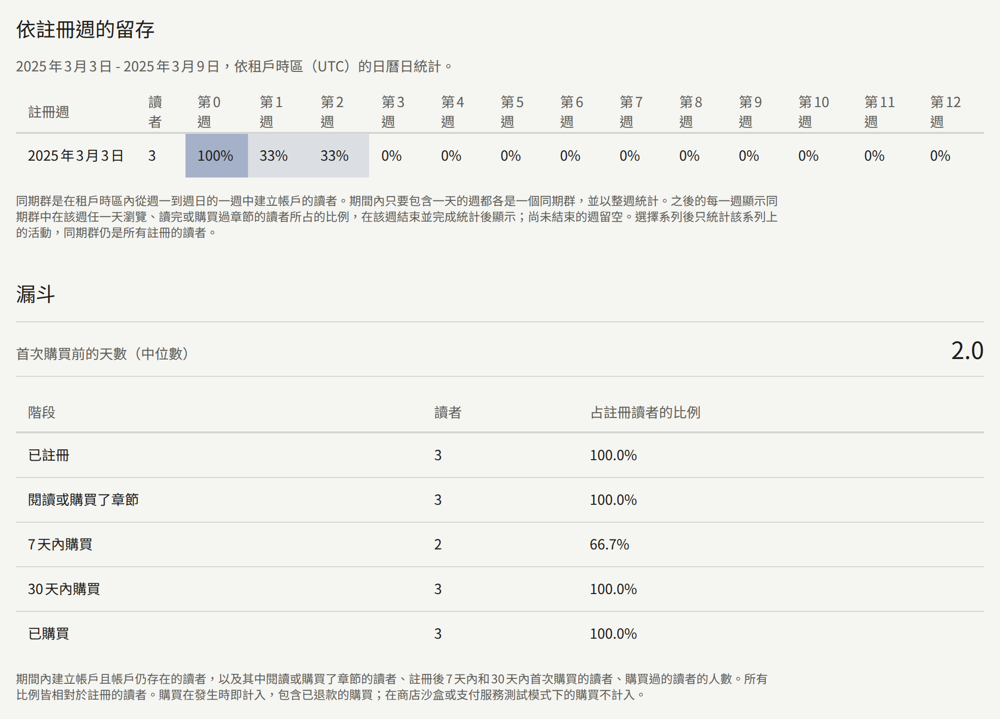
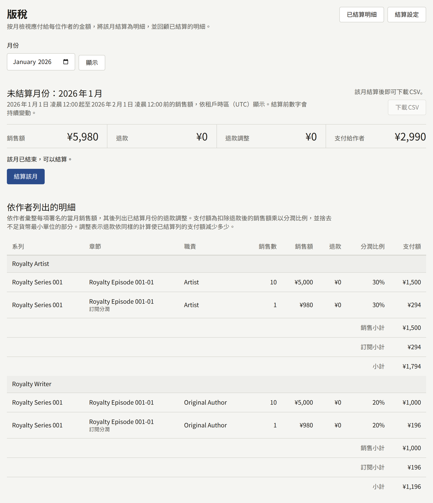
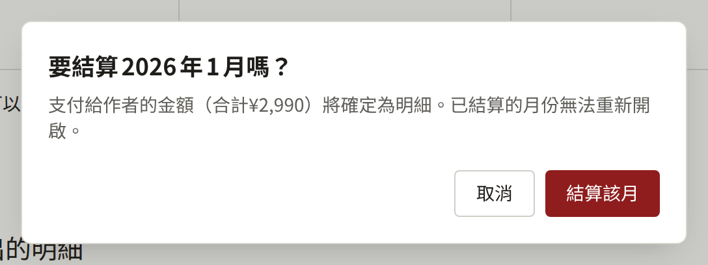
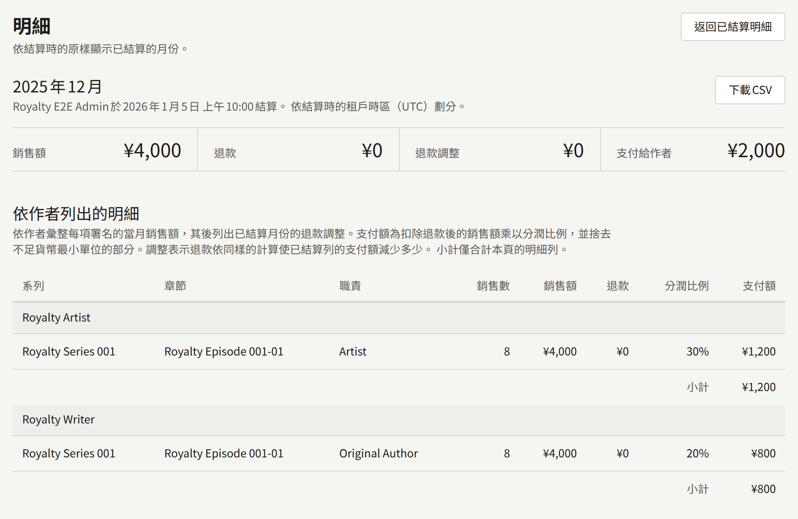
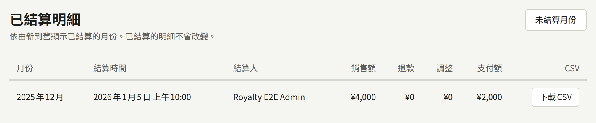
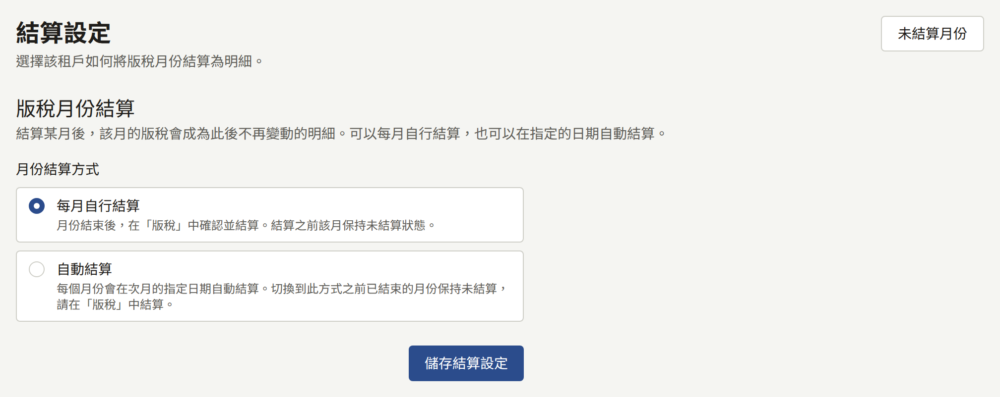

主控台中有幾個畫面會將網站上發生的事轉換成數字。**儀表板**顯示作品目錄的發布進度。在**分析**下，**銷售額**顯示賣出了什麼，**讀者反應**顯示讀者如何追蹤、閱讀與回應每個系列，**章節**顯示會員將每個章節讀到多遠，以及讀者在哪一頁離開，**同期群**則顯示每週註冊的讀者是否持續回訪，以及其中有多少人購買。**報表**下的**版稅**會計算租戶一個月的銷售應付給每位作者多少，然後將該月結算成一份永遠不會變更的明細。

所有工作人員都看得到**儀表板**、**讀者反應**、**章節**與**同期群**。只有**租戶管理員**看得到**銷售額**、**版稅**以及**同期群**上的**漏斗**，也只有租戶管理員能將報表或明細下載為CSV、結算月份，或變更月份的結算方式；對其他人而言，這些畫面與控制項並不存在。

## 銷售或閱讀歸屬於哪一天

這些畫面計算時所依據的日期，都是租戶時區中的日曆日，時區在**設定** › **一般** › **時區**中設定。從未設定時區的租戶，會使用營運人員所選的安裝實例預設時區。一天是該時區中的午夜到午夜，一個月則是從該月第一天的00:00到下個月第一天的00:00。在東京4月1日08:30進行的銷售，對時區為`Asia/Tokyo`的租戶而言屬於4月，對時區為`UTC`的租戶而言則屬於3月，因為那時在UTC仍是3月31日23:30。

- 銷售歸屬於購買被記錄的時刻；超商付款等事後付款的款項，則是款項入帳的時刻。
- 閱讀歸屬於會員開啟或讀完章節的那一天。
- 追蹤歸屬於追蹤的時刻，追蹤的結束則歸屬於讀者取消追蹤或刪除帳戶的時刻。
- 明細會保留其月份劃分時所用的時區，並在月份下方顯示為「**依結算時的租戶時區（…）劃分**」。

在明細結算後變更時區，該明細仍維持結算時的樣子。其下一個月從該明細結束的地方開始，也就是舊時區的午夜，並在新時區的午夜結束，因此在兩個午夜之間的時段內進行的銷售，只會計算一次，歸入舊時區所屬的月份。此後的每個月都是新時區的午夜到午夜。每日統計已經計算過的日子（**讀者反應**與**章節**讀取的就是這些統計）不會重新計算；變更從其下一次計算的日子開始套用。**銷售額**與**讀者反應**上的追蹤者是直接從銷售與追蹤本身讀取的，因此會立即依循新時區。

## 儀表板

**儀表板**是主控台的第一個項目，呈現的是作品目錄的發布概況，而不是銷售或閱讀。其中的數字計算整個租戶，沒有日期範圍：

| 數字 | 計算的內容 |
| --- | --- |
| **已發布的系列** | 已發布的系列 |
| **草稿章節** | 儲存為草稿的章節 |
| **預約發布** | 發布日期尚未到來的章節 |
| **待審核** | 等待租戶管理員決定的預約章節，只在租戶[要求審核](./1-catalog/2-episodes.md#發布前審核)時顯示 |

**發布佇列**最多列出其中十個章節：先列出預約的章節，發布時間最近的在前，再列出草稿，最新的在前。**預約時間**以租戶的時區顯示，沒有日期的草稿則顯示**未設定**。租戶要求審核時，等待決定的預約章節會在狀態旁標示**審核中**，被退回的則標示**已退回**。旁邊的**開啟行事曆**會開啟[行事曆](./1-catalog/2-episodes.md#何時發布什麼)，依發布的日期顯示每個預約與已發布的章節。

工作人員儲存系列或章節時，以及預約的章節自行發布時，畫面都會立即更新；自行發布的章節隨即離開佇列。

## 分析

**銷售額**、**讀者反應**、**同期群**與章節的流失，各自報告租戶日期中的一段期間。請以**開始**與**結束**選擇期間，再選擇**套用**；期間最長為366天。沒有選擇時，畫面涵蓋截至昨天（含）的28天，日期下方的一行會指出期間與時區。**重設**會回到這28天。

畫面開頭是期間的合計與依日顯示的圖表，下方是一個表格。**依日**、**依系列**與**依章節**決定表格的列是什麼，選擇欄位標題會依該欄排序表格；再次選擇則反向排序。期間、列與排序都包含在頁面的網址中，因此書籤或連結都會重新開啟相同的報表。

來自每日統計的數字，要在當天結束後才會計入該天。`publira worker`會在租戶時區的午夜之後，於下一次每小時的執行中計算每一天，因此今天的閱讀會在明天出現。worker處理程序停止期間不會計算新的日子，重新啟動後則會補算錯過的日子。[概觀](../2-deployments/1-overview.md)說明如何讓`publira worker`持續運作。

### 銷售額

**銷售額**以租戶的貨幣顯示期間內的銷售。

| 數字 | 計算的內容 |
| --- | --- |
| **購買次數** | 期間內的購買，包含已退款的購買 |
| **總銷售額** | 這些購買所支付的金額 |
| **退款額** | 退還給這些購買之讀者的金額：退款，以及租戶敗訴的爭議 |
| **訂閱** | 訂閱者在期間內為租戶的[訂閱方案](./5-subscription-plans.md)支付的金額 |
| **訂閱退款額** | 這些付款中退還的金額：退款，以及租戶敗訴的爭議 |
| **淨銷售額** | **總銷售額**減去**退款額**，以及**訂閱**減去**訂閱退款額**：租戶留下的金額 |
| **稅額** | **淨銷售額**中包含的稅金：對每筆購買與訂閱付款，租戶留下的部分中所包含的稅金，以其發生時記錄的稅率計算 |

只有在期間的淨銷售額包含稅金時，才會顯示**稅額**，因此從未在[設定 › 稅金與發票](./3-setup/1-settings.md#稅金與發票)中設定稅率的租戶看不到它，而未設定稅率期間的銷售也不會計入其中。只有在期間內有訂閱付款時，才會顯示**訂閱**與**訂閱退款額**，因此不販售方案的租戶只會看到其他四個數字。這類期間的圖表會將每天扣除退款後的訂閱付款，以較淺的色調堆疊在購買的淨銷售額之上，並在圖表下方標示，**依日**的表格也會為這兩個數字各設一欄。付款計入Stripe收到款項的那一天，其退還的金額則與購買的退款一樣，從那一天扣除。租戶敗訴的爭議會收回整筆付款；仍在進行中或租戶勝訴的爭議則不收回任何金額。付款不屬於任何系列，因此**依系列**與**依章節**的表格不包含它，其**淨銷售額**是購買的淨銷售額。使用Stripe測試金鑰進行的付款不計入任何數字。

圖表顯示每天的淨銷售額。銷售計入其發生的那一天，退還的金額也從同一天扣除，不論多久之後才退還，因此已報告過的某一天之後可能下降，而退還多於銷售的日子會畫在基準線以下。仍在進行中的爭議在敗訴之前不會收回任何金額。購買卷或系列剩餘章節，會視為所開放的每個章節以其在價格中所占部分的銷售（也就是版稅明細計入的部分），並視為其所屬系列以全額的銷售。以租戶目前貨幣以外的貨幣支付的購買，不計入任何數字。以租戶代幣支付的章節，會以其代幣的購買價格計為銷售，也就是版稅明細計入的金額；而購買代幣包本身不計入任何數字：其金額會在代幣被花費時計入，代幣包的全額退款或爭議，則會從其已花費代幣所產生的銷售中扣除。[打賞](./4-selling-episodes.md#打賞)以打賞金額計為該章節的一筆購買。銷售額直接讀取購買本身，因此剛剛進行的銷售也已包含在內。

### 讀者反應

**讀者反應**顯示期間內讀者如何追蹤、閱讀與回應租戶的系列。

| 數字 | 計算的內容 |
| --- | --- |
| **追蹤者** | 期間結束時正在追蹤的讀者。追蹤在建立的當下就計入，並在讀者取消追蹤或刪除帳戶時結束 |
| **瀏覽次數** | 系列頁面及其章節被瀏覽的次數，包含所有讀者，不論是否登入 |
| **讀完次數** | 會員第一次讀完其中某個章節的次數 |
| **回應** | 按下章節的回應控制項，且使讀者對該章節的評分增加的次數 |

圖表顯示每天結束時的追蹤者。**依系列**會列出每個系列，以及期間內新增與結束的追蹤，還有其**評分**與**評分讀者**：這是系列目前的評分，也就是其頁面上顯示的評分，涵蓋它所收到的所有回應，而不是期間內的回應。沒有讀者評分的系列顯示`—`。

### 章節

**章節**顯示會員開啟的每個章節中，有多少人讀完。不論其他畫面顯示的期間為何，這裡的數字都涵蓋租戶時區中截至昨天（含）的最近28天；標題下方的一行會說明日期與時區。

| 數字 | 計算的內容 |
| --- | --- |
| **讀完次數** | 會員讀完章節的次數。每位會員對每個章節只計算一次，計入第一次讀完的那一天，不論之後重讀多少次 |
| **會員瀏覽次數** | 已登入的會員開啟章節的次數。會員開啟同一章節的次數，在時鐘上的每半小時（:00到:29與:30到:59）內只計算一次，因此在同一個半小時內再次開啟不會增加次數，而在10:29開啟後於10:30再次開啟則計為兩次 |
| **讀完率** | **讀完次數**除以**會員瀏覽次數**，沒有瀏覽時顯示為`—` |

只計算已登入的會員。未登入的讀者無法被記錄為讀完章節，因此其瀏覽也不計入。會員以何種方式閱讀章節並沒有差別：購買、以閱讀券開啟或免費的章節都一樣計算，而單純購買則不計入任何數字。

**讀完率**會列出期間內被閱讀的每個章節，讀完次數最多的在前，每頁二十個。上方的合計涵蓋整個期間，不論顯示的是哪一頁。

#### 流失

在**讀完率**中選擇一個章節，會開啟其**流失**：期間內讀者逐頁讀到章節的哪裡。

| 數字             | 計算的內容             |
| ---------------- | ---------------------- |
| **讀者**         | 讀到第一頁的讀者       |
| **讀到最後一頁** | 讀到章節最後一頁的讀者 |
| **頁數**         | 章節目前的頁數         |

圖表從第一頁到最後一頁逐級下降，表格則為每一頁列出讀到該頁的讀者、他們占讀到第一頁的讀者的比例，以及在該頁離開的讀者：也就是讀到該頁但沒有讀到下一頁的讀者。依**在此離開**排序，最多讀者離開的頁面會排在最上方。讀者依其在章節中的閱讀位置在當天結束時所在的頁面計入，因此在期間內多天閱讀的讀者，每天各計一次。超過章節最後一頁、標示為「**（已刪除）**」的頁面，是在章節頁面被移除之前讀到的。

### 同期群與漏斗

**同期群**追蹤在期間內每週註冊的讀者。這裡的讀者是指租戶網站的帳戶；工作人員自己的帳戶不計入。

**依註冊週的留存**為期間內包含任一天的每一週各設一列，每週為租戶時區中的週一到週日，因此第一列可能在**開始**之前開始，最後一列可能在**結束**之後結束。每一列列出該週、在該週建立帳戶的讀者，以及在**第0週**到**第12週**下，他們之中在註冊週與之後十二週的每一週中，任一天瀏覽、讀完或購買過章節的比例。讀者在一週中不論回訪幾天，都只計算一次。儲存格的顏色越深，比例越大。一週要在結束並完成計算後才會進入表格，因此尚未結束的週為空白；沒有任何人註冊的週，其列顯示`—`。

在**系列**下選擇一個系列，可以只計算該系列的閱讀與購買。列仍然是所有註冊的讀者，因此比例顯示的是該週的新讀者中，有多少人繼續閱讀或購買了該系列。

**漏斗**只向**租戶管理員**顯示，計算在期間內註冊的讀者，以及他們走到了哪一步：

| 階段                 | 計算的內容                                         |
| -------------------- | -------------------------------------------------- |
| **已註冊**           | 帳戶在期間內建立且仍然存在的讀者                   |
| **閱讀或購買了章節** | 其中在任一已計算的日子瀏覽、讀完或購買過章節的讀者 |
| **7天內購買**        | 其中首次購買是在帳戶建立後未滿7天的讀者            |
| **30天內購買**       | 同上，但為30天內                                   |
| **已購買**           | 其中曾經購買過的讀者                               |

**占註冊讀者的比例**是每個數字相對於**已註冊**的比例。而**首次購買前的天數（中位數）**，是在購買過的讀者中，從帳戶建立到首次購買所等待天數的中位數；在有人購買之前為`—`。購買在發生時即計入，包含已退款的購買，但在商店沙盒或付款服務商測試模式中進行的購買不計入。

刪除的帳戶會立即從其所在的列與所有相關的計數中移除。這些畫面計算的閱讀與購買，是從安裝實例開始保存它們的那一天起保存的；對於升級到加入**同期群**之版本的安裝實例，這一天是升級時仍保存著分析事件的最早一天：在此之前的週會顯示在該週註冊的讀者，但不會顯示他們的任何活動，之後也不會補上。

### 將報表下載為CSV

**銷售額**、**讀者反應**與**流失**的表格旁的**下載CSV**，會下載該表格在畫面所示期間內的報表：與表格一樣，依日、依系列或依章節。檔案包含報表的每一列，不論表格如何排序，都依報表本身的順序排列：日期依序排列，**銷售額**的系列或章節依淨銷售額、**讀者反應**的系列依追蹤者由高到低排列，流失的頁面則依序排列。**章節**上的**讀完率**與**同期群**沒有下載功能。

檔案以報表、租戶與期間命名，例如`revenue-by-series-<tenant>-2025-03-03--2025-03-09.csv`，流失則為`drop-off-<tenant>-<episode>-<from>--<to>.csv`。檔案為UTF-8，並帶有位元組順序標記，讓Excel能正確讀取；在標題列之下，報表的每一列對應一列，沒有合計列。其欄位如下：

| 報表 | 欄位 |
| --- | --- |
| 依日的銷售額 | `date`, `purchase_count`, `gross_amount`, `refunded_amount`, `net_amount`, `subscription_amount`, `subscription_refunded_amount`, `currency` |
| 依系列的銷售額 | `start_date`, `end_date`, `series_id`, `series_title`, `purchase_count`, `gross_amount`, `refunded_amount`, `net_amount`, `currency` |
| 依章節的銷售額 | `start_date`, `end_date`, `series_id`, `series_title`, `episode_id`, `episode_title`, `purchase_count`, `gross_amount`, `refunded_amount`, `net_amount`, `currency` |
| 依日的讀者反應 | `date`, `follower_count`, `followed_count`, `unfollowed_count`, `view_count`, `complete_count`, `reaction_count`, `reaction_points` |
| 依系列的讀者反應 | `start_date`, `end_date`, `series_id`, `series_title`, `follower_count`, `followed_count`, `unfollowed_count`, `view_count`, `complete_count`, `reaction_count`, `reaction_points`, `rating_average`, `rating_count` |
| 流失 | `start_date`, `end_date`, `episode_id`, `page_index`, `reader_count` |

`date`、`start_date`與`end_date`是租戶的日期，格式為`YYYY-MM-DD`；後兩者是下載的期間，每一列都相同。`subscription_amount`是訂閱者當天為租戶的[訂閱方案](./5-subscription-plans.md)支付的金額，與購買分開計算；`subscription_refunded_amount`則是這些付款中退還的金額，也就是退款或租戶敗訴的爭議（後者計為整筆付款），與購買的退款一樣從付款當天扣除；使用Stripe測試金鑰進行的付款兩者皆不計入。付款不屬於任何系列，因此依系列與依章節的報表都不包含付款。與畫面上的**淨銷售額**不同，`net_amount`只包含購買。金額以貨幣的最小單位表示，JPY為日圓，USD為美分，`currency`是租戶的貨幣。`rating_average`有一位小數，沒有讀者評分的系列為`0.0`。`page_index`從`0`開始計算第一頁，`reader_count`是讀到該頁的讀者。標題使用租戶的預設語言，ID則讓每一列在改名後仍能對應到其系列或章節。試算表會解讀為公式的儲存格，會以保持為文字的方式寫入。

報表在下載時才讀取，因此包含今天的期間，之後下載可能得到不同的數字。每次下載都會記錄在**稽核記錄**中，顯示為**下載了分析CSV**。

## 版稅

**版稅**會逐月計算每位作者在其署名章節的銷售中，以及分配給這些章節的訂閱付款中，應得多少。月份在結算之前保持開放，其數字會隨每一筆銷售、退款與分潤比例的變更而變動。結算後會產生一份永遠不再變更的明細。租戶依這份明細支付作者：Publira不會支付任何人，明細是應付金額的記錄。

### 作者應得的金額

作者可以獲得其署名之每個章節的一定比例。分潤比例設定在署名上，以章節銷售額的百分比表示，章節上各分潤比例分配後剩下的部分歸出版社所有：

- **在系列表單上**，**作者**會在「**作者1的分潤**」這類欄位中設定每個署名的分潤比例。這些署名是新章節建立時使用的範本；變更它們不會影響既有的章節。
- **在章節上**，**作者**可以變更該章節本身的署名與分潤比例，**儲存作者**會將其儲存。
- **在系列的章節列表上**，**署名** › **設定分潤**可以一次變更許多章節上某個署名的分潤比例。

分潤比例介於0到100%之間，最多兩位小數，一個章節上的分潤比例合計不得超過100。分潤比例為0表示署名作者但不支付。編輯也可以設定分潤比例，因為他們負責編輯作品目錄。

每個署名的月支付額為：

> （該月章節的銷售額 − 這些銷售的退款）× 分潤比例，無條件捨去至租戶貨幣的最小單位，例如日圓或美分

一個月的銷售包括：

- 在網站上透過Stripe或PAY.JP購買該章節，以套用任何促銷代碼前的價格計算，無論是租戶自己的[促銷代碼](./4-selling-episodes.md#促銷代碼)，還是讀者在[Stripe結帳頁面](./4-selling-episodes.md#stripe促銷代碼)輸入的代碼。促銷是租戶提供的，因此由租戶承擔折扣。因代碼而免費的購買，也是以該價格計算的銷售。在安裝實例開始保存套用代碼前的價格之前記錄的購買，則以讀者支付的金額計算銷售。
- 在網站上購買包含該章節的卷，各自視為該章節以其在卷套用任何促銷代碼前的價格中所占部分的銷售。該價格會依購買被記錄時卷中各章節本身價格的比例分配給各章節，若其中沒有任何章節有價格則平均分配，因此在含有付費章節的卷中，免費章節不分得任何部分，也沒有銷售。各部分在購買時就已固定：之後變更章節的價格或卷的內容都不會改變它們。卷的部分退款也以相同比例分配，每個章節的部分無條件捨去。
- 在網站上購買系列的剩餘章節，各自視為所開放的每個章節以其在讀者支付價格中所占部分的銷售。每個章節所占的部分在讀者開始結帳時就已固定：打包優惠會依各章節售出時的價格（活動進行期間則為活動價格）比例分攤到各章節，因此之後變更章節的價格或系列的優惠都不會改變它。部分退款以與價格相同的比例分配，每個章節的部分無條件捨去。
- 在租戶的應用程式中透過App Store或Google Play購買，以章節套用租戶任何促銷代碼前的價格計算。不扣除商店的佣金。
- 在網站或應用程式中以租戶的代幣購買該章節，以所花費代幣的購買價格計算。代幣包中的每一枚代幣，價值都是讀者為代幣包支付金額的均等部分，贈送的代幣也包含在內，因此贈送部分是租戶給予的折扣：以¥1,000購買的1,100枚代幣包（其中100枚為贈送）中，每枚代幣價值¥0.909，100枚代幣的章節就是¥90的銷售，無條件捨去至貨幣的最小單位。未經付款而發放的代幣沒有價值，測試購買的代幣，或以租戶目前貨幣以外的貨幣支付的代幣包中的代幣也一樣。銷售的價值在代幣被花費時就已固定：之後編輯代幣包不會改變它。
- 讀者在網站或應用程式中對該章節的[打賞](./4-selling-episodes.md#打賞)，以打賞金額計算。當月的打賞依相同的分潤分配，並與該章節的銷售行分開，單獨成行。

所有金額都以租戶的貨幣表示，已結算的明細會保留結算時的貨幣。以其他貨幣支付的購買，只會發生在讀者完成了租戶變更貨幣之前就已開始的付款時，這類購買會開放章節，但不會成為明細上的銷售。

除此之外沒有其他銷售。購買代幣包不是銷售：其金額會在代幣被花費時成為其所產生的銷售。閱讀券、**等待即可免費**、免費閱讀期間，以及作者閱讀自己的章節，都不經銷售就開放章節。來自App Store沙盒或Play授權測試人員的購買，以及使用Stripe或PAY.JP測試金鑰進行的購買，都是測試，不予計入。以這些方式支付的打賞同樣如此。

全額退款的購買會從其購買的月份中移除。部分退款則保留該筆銷售，並將退款金額列在**退款**下扣除。對於以促銷代碼折扣的購買，扣除的是套用代碼前價格中，與退款占讀者支付金額相同比例的金額：¥500的章節以¥400付款，退還一半時會扣除¥250，無條件捨去至貨幣的最小單位。無論哪一種，只要購買的月份仍未結算，退款就計入該月，而不是退款發生的月份。

讀者的銀行判定[爭議](./4-selling-episodes.md#爭議)對您不利的Stripe付款，從Stripe通知判定結果的那一刻起，就視為全額退款，結算前後皆同。仍在進行中或判定對您有利的爭議，則保留該筆銷售。

全額退款或發生爭議的代幣包，會在其已花費代幣所支付的每一筆購買上，退還這些代幣的價值。讀者保留已開放的章節，因此每筆購買仍是銷售，並將該金額列在**退款**下：若購買所花費的代幣全部來自該代幣包，則為全部價格；若部分來自其他代幣包，則為該代幣包所占的部分。與其他退款一樣，購買的月份仍未結算時計入該月，結算後則從下一份明細中扣除。

### 訂閱付款

Stripe為租戶的[訂閱方案](./5-subscription-plans.md)收取的款項，會在其所支付期間結束的月份，分配給其訂閱者所閱讀內容的作者。款項會平均分配給訂閱者在該期間內讀完的方案章節，每個章節所得的部分，再像章節的銷售一樣，依分潤比例支付給該章節的作者。各部分會無條件捨去，使其合計正好等於該筆款項，而因捨去而分不到任何金額的章節不分得任何部分。

- 每位訂閱者的每個章節只計算一次，計入其第一次讀完的期間。在之後的期間重讀的章節，不分得該期間款項的任何部分。
- 訂閱者在該期間內沒有讀完任何方案章節的款項，不分配給任何人：它不會出現在明細上，全部歸出版社所有。訂閱者之後已刪除帳戶的款項也一樣。
- 款項所分配的章節在月份結算時就已固定。訂閱者在結算後、仍在該期間內讀完的章節，不會改變已結算的月份。
- 讀完記錄是從內容事件讀取的，內容事件的保存期間在[設定 › 限制與保留](./3-setup/1-settings.md#限制與保留)中設定。請將保存期間設定得比方案的扣款週期加上到月份結算為止的時間更長，否則在結算前被刪除的讀完記錄將不會計入。年繳方案需要超過一年。
- 款項的部分退款會以相同比例分配給各章節，每個部分無條件捨去；全額退款的款項則像購買一樣被移除。使用Stripe測試金鑰進行的付款，或以租戶目前貨幣以外的貨幣支付的付款，不予計入。
- 讀者的銀行判定爭議對您不利的款項，視為全額退款並被移除，與全額退款的款項相同。在結算後才敗訴的，會以全額退款的方式扣回。仍在進行中或判定對您有利的爭議，則保留該筆款項。

款項分配的部分會各自成為獨立的明細行，與章節的銷售行分開，但位於相同的作者、系列、章節與職責之下。這類明細行上的**銷售數**是分配給該章節的款項筆數，**銷售額**則是該章節分得的部分。

### 結算後的退款

在購買的月份結算後才記錄的退款，無法變更該份明細，而是改從其後結算的下一份明細中，以調整行的方式扣除：調整行位於與計入該筆銷售的已結算明細行相同的作者、系列、章節與職責之下，並註明其所調整的已結算月份。調整行排在該月本身的明細行之後，其數字是變動量，因此在銷售行為正數的地方會是負數：

- **銷售數**是負的全額退款購買筆數，**銷售額**是負的其價格。
- **退款**是仍屬於銷售之購買的退款變動量。若某筆在結算時已部分退款的購買，之後又被全額退款，這一欄就會是負數，因為該筆購買改由**銷售額**移除。
- **支付額**是退款從已結算明細行的支付額中扣除的金額：以已結算月份套用的分潤比例，並與之前一樣無條件捨去，針對剩餘的銷售重新計算該明細行的支付額，再減去原本的支付額。結算後變更的分潤比例或之後新增的作者署名，都不會影響它。已結算的明細行與其調整行合計，支付的金額與退款若發生在結算之前時該明細行應支付的金額相同；因此當其中每一筆銷售都被退款時，合計為零。

以促銷代碼折扣之購買的退款，會以與結算前相同的比例，從套用代碼前的價格中扣除，因此該購買全額退款後，已結算的明細行與其調整行合計仍為零。

訂閱款項在結算後的退款，也以同樣的方式扣除：從已結算月份分配該款項之各章節的訂閱明細行中，依各自所占退款的部分扣除。爭議在結算後才敗訴的款項，會以全額退款的方式扣除。結算後的打賞退款也以同樣方式，從已結算的打賞行中扣除。

退款的每個部分只會扣除一次。在一次結算後部分退款、又在下一次結算後全額退款的購買，會分兩次調整扣除，第二次扣除第一次未涵蓋的部分，各份明細合計對它的支付為零。

調整只會帶入比其所調整月份更晚的月份。不依順序、比更早的月份先結算的月份，不會帶入那個更早月份的任何退款；在兩者之後結算的下一個月份才會帶入。某個月的調整超過其本身的銷售時，其**支付給作者**為負數；某位作者的調整超過其銷售行時，其小計也是負數。

### 稅金與扣繳

租戶管理員在[設定 › 稅金與發票](./3-setup/1-settings.md#稅金與發票)中設定「**稅率（%）**」後，每筆銷售與訂閱付款都會記錄其發生時適用的稅率，如[販售章節](./4-selling-episodes.md#價格中包含的稅金)所述，明細也依此計算：

- **每個稅率一行**。一行計算同一稅率的銷售或付款，也就是各自記錄的稅率。稅率在月中變更的月份，每個署名會依稅率各有一行，未設定稅率時的銷售行排在最前面。調整行的稅率與其所調整的明細行相同。
- **明細行支付額中包含的稅金**。明細行的**稅額**是其支付額減去以該行稅率計算的未稅支付額，其中未稅支付額無條件捨去至貨幣的最小單位。調整行的稅額，是調整從其所調整的明細行中扣除的稅金，因此明細行與其調整行合計，包含的是兩者合計支付金額的稅金。未設定稅率時的銷售行沒有稅金。
- **對每位作者小計的扣繳**。設定了「**扣繳稅率（%）**」時，每位作者會被扣繳其支付額扣除其中所含稅金後金額的該稅率，無條件捨去至貨幣的最小單位；支付額未超過其稅金時則不扣繳。以10.21%計算，支付額¥2,200（其中¥100為稅金）的作者會被扣繳¥214。
- **已結算明細保留的稅率**。已結算的明細會保留結算時的扣繳稅率，就像保留時區一樣，因此之後變更的稅率只會影響變更後結算的月份。未結算的月份則以租戶目前的稅率扣繳。

Publira會計算並載明這些金額；繳納稅金與扣繳的金額，與向作者支付一樣，由租戶在Publira之外處理。兩種稅率都未設定的租戶，看到的明細與以往完全相同：沒有稅金、沒有扣繳，CSV欄位也相同。

### 查看未結算的月份

**版稅**會開啟在最新的已結算明細的下一個月；若尚未結算任何月份，則開啟上個月。以**月份**搭配**顯示**，可以開啟任何其他尚未結算且已經開始的月份。

**未結算月份**提供四個合計，該月載明[稅金與扣繳](#稅金與扣繳)時再多兩個：

| 合計 | 內容 |
| --- | --- |
| **銷售額** | 該月的每一筆銷售，以其價格計算，包含沒有署名任何作者之章節的銷售，以及該月分配的每一筆[訂閱付款](#訂閱付款) |
| **退款** | 這些銷售與付款的退款 |
| **退款調整** | 該月從已結算月份中，結算後才退款的銷售與訂閱付款所收回的金額，如[結算後的退款](#結算後的退款)所述，每筆只計算一次：為零或負數 |
| **支付給作者** | 該月應付給作者的金額，也就是下方各明細行（含調整）的總和。**銷售額**扣除**退款**與**退款調整**後，其餘部分歸出版社所有 |
| **支付額中的稅金** | **支付給作者**中包含的稅金，也就是各明細行稅金的總和。只有在某一行有稅率時才會顯示 |
| **扣繳稅額** | 從作者扣繳的金額，也就是各作者扣繳稅額的總和。只有在適用扣繳稅率時才會顯示 |

**依作者列出的明細**依作者將該月分組，該月有銷售之章節上的每個署名各一行，並為每位作者列出**小計**。每一行列出**系列**、**話**、署名的**職責**、**銷售數**、**銷售額**、**退款**、**分潤比例**與**支付額**。在同一章節上以兩種職責署名兩次的作者，每種職責各有一行；該月分配了訂閱付款的章節，除了銷售行之外，還會有一行訂閱付款，並在其章節下方註明**訂閱分潤**。調整行排在其作者分組中該月本身的明細行之後，在其章節下方註明「**（月份）的退款調整**」，並計入該作者的**小計**。有訂閱付款行的作者，在其**小計**上方會有**銷售小計**與**訂閱小計**，各自計算同類的明細行及其調整。

某一行有稅率時，每一行還會列出其**稅率**與**稅額**（未設定稅率時的銷售行顯示`—`），每位作者的**小計**也會列出其各行的稅金。該月載明稅金或扣繳時，明細行上方的**依作者列出的支付額**會列出每位作者的**支付額**、其中包含的**稅額**與從中扣繳的**扣繳稅額**，並說明扣繳所用的稅率。

合計上方的畫面會說明該月目前的狀態：

- **該月仍在進行中**。在租戶時區中該月的最後一天結束後即可結算。
- **該月已結束，可以結算**。**結算該月**會將其結算。
- 「**該月將於（日期）自動結算**」。該月會在該日期由`publira worker`結算，主控台不提供手動結算的方式。

### 結算月份之前

結算月份會將其固定在當下的狀態，之後發生的任何事都不會影響它。結算前請確認：

- **署名與分潤比例**。明細採用的是月份結算時的分潤比例，而不是章節售出時的比例。在結算前變更分潤比例，整個月都會以新的比例支付；在結算後變更，則只有未結算的月份會套用。
- **預期中的退款**。結算後才記錄的退款，會從下一份明細中扣除，而不是從已結算的月份中扣除，如[結算後的退款](#結算後的退款)所述，因此作者會先因該筆銷售獲得支付，之後再從較晚的月份中扣回支付額。若您知道有退款即將發生，請等它發生，讓它計入其本身的月份。
- **該月確實已經結束**。在最後一天深夜進行的銷售，是依租戶的時區計算的，而那不一定是您的時區。

請依序結算月份。主控台正因如此才會提供最新明細的下一個月，而被跳過的月份，之後必須以**月份**選取才能結算。

### 結算月份

1. 開啟**報表** › **版稅**。顯示的月份就是下一個要結算的月份。
2. 確認畫面顯示**該月已結束，可以結算**，並瀏覽**依作者列出的明細**。
3. 選擇**結算該月**。對話方塊會顯示將被固定的**支付給作者**金額。再次選擇**結算該月**以確認。

主控台接著會開啟該月的**明細**，顯示結算日期、結算人，以及與未結算時相同的合計、**依作者列出的支付額**與明細行。**依作者列出的支付額**計算明細的每一行，而明細行中作者的**小計**只計算該頁上的行。結算會記錄在**稽核記錄**中，顯示為**結算了版稅月份**。

結算後，明細會保留結算時每位作者、系列、章節與職責的名稱：之後重新命名作者、編輯分潤比例、退還購買或刪除署名，都不會改變它。之後記錄的退款會改從下一份明細中扣除。已結算的月份無法重新開啟，工作人員與營運人員皆然。之後發現的錯誤，請在Publira之外，於租戶的支付中更正。

**已結算明細**會列出每個已結算的月份，最新的在前，並顯示結算時間、結算人與其合計；該頁上有明細載明稅金或扣繳時，還會有**稅額**與**扣繳稅額**欄。自動結算的月份在**結算人**下顯示`—`。

### 將明細匯出為CSV

**下載CSV**會下載已結算的明細：位於**明細**本身，或**已結算明細**中該明細的那一列。未結算的月份無法下載，因為其數字仍在變動。

檔案名稱為`royalties-<tenant>-<YYYY-MM>.csv`。檔案為UTF-8，並帶有位元組順序標記，讓Excel能正確讀取；在標題列之下，明細的每一行對應一列，沒有合計列。載明[稅金或扣繳](#稅金與扣繳)的明細，還會在明細行之後，按照**依作者列出的支付額**的順序，為每位作者的小計各加一列。其欄位如下：

| 欄位 | 內容 |
| --- | --- |
| `period` | 月份，`YYYY-MM` |
| `creator_id`, `creator_name` | 作者 |
| `role_id`, `role_name` | 署名的職責，沒有職責的署名為空 |
| `series_id`, `series_title` | 系列 |
| `episode_id`, `episode_title` | 章節 |
| `sale_count` | 銷售筆數 |
| `gross_amount` | 銷售額，以明細貨幣的最小單位表示：JPY為日圓，USD為美分 |
| `refunded_amount` | 其退款，單位相同 |
| `share_percent` | 分潤比例，兩位小數，例如`12.50` |
| `payout_amount` | 支付額，單位相同 |
| `currency` | 明細的貨幣，例如`USD`：月份結算時租戶的貨幣，也是該明細唯一計入其銷售的貨幣 |
| `adjusted_period` | 該月本身的銷售行為空。調整行則為其收回退款的已結算月份，`YYYY-MM`，其金額為[結算後的退款](#結算後的退款)所述的負變動量 |
| `source` | 銷售行為`sale`，[訂閱付款](#訂閱付款)行為`subscription`，[打賞](./4-selling-episodes.md#打賞)行為`tip`。調整行的來源與其所調整的明細行相同 |
| `row_type` | 明細行為`line`，作者的小計為`creator_subtotal`。小計會填入`period`、`creator_id`、`creator_name`、`payout_amount`、`currency`與下方各欄，其他欄位則為空 |
| `tax_rate_percent` | 明細行的稅率，兩位小數，例如`10.00`。沒有稅率的明細行與小計為空 |
| `tax_amount` | 明細行支付額中包含的稅金，在小計上則為該作者各行稅金的總和，單位相同。沒有稅率時為空 |
| `withholding_amount` | 從作者扣繳的金額，單位相同，位於有扣繳之明細的小計上。其他情況為空 |

最後四個欄位只出現在有某一行帶有稅率，或有任何扣繳的明細上。其他明細，包括安裝實例開始記錄稅金之前結算的每份明細，都只有上方那些欄位。

名稱是結算時的名稱，ID則讓每一行在改名後仍能對應到其作者與章節。試算表會解讀為公式的儲存格，會以保持為文字的方式寫入。同一份明細每次下載的檔案都相同，每次下載都會記錄在**稽核記錄**中，顯示為**下載了版稅明細CSV**。

### 連結的作者能看到明細的哪些內容

帳戶與作者連結的讀者（如[作者與作者角色](./1-catalog/4-authors.md#將作者連結到讀者帳戶)所述），在租戶開啟作者頁面並向作者顯示其銷售後，可以看到每份已結算明細中屬於該作者的部分。他們會看到：

- 每個已結算月份中，該作者本身各明細行的銷售數、銷售額、退款與支付額的總和，包含調整。沒有為該作者計入任何金額的月份顯示為零。
- 某個月份中該作者本身的明細行，依明細的順序排列，每一行附有系列、章節、職責、銷售數、銷售額、退款、分潤比例與支付額，並標示是銷售行還是[訂閱付款](#訂閱付款)行，以及調整行所調整的月份。

他們永遠看不到明細的合計、其他作者的明細行，或未結算的月份。明細行與明細上的其他內容一樣，維持結算時的樣子。

某個月份上的**下載CSV**，會以[將明細匯出為CSV](#將明細匯出為csv)所述的檔案格式，儲存該作者在該月的明細行，但省略三個欄位：每一列都會是同一位作者的`creator_id`與`creator_name`，以及`role_id`。檔案沒有稅金或扣繳欄位，也沒有小計列。`series_id`與`episode_id`存放的是網站網址中使用的ID，而不是主控台檔案中的內部ID。檔案名稱為`royalties-<author>-<YYYY-MM>.csv`，依作者的公開ID與月份命名。在應用程式中，月份上的**分享CSV**會將同一個檔案交給裝置的分享面板。

### 自動結算月份

**版稅**上的**結算設定**決定月份的結算方式：

- **每月自行結算**為預設值：月份會保持開放，直到租戶管理員依上述方式結算。
- **自動結算**：每個月會在下個月的**結算日**結算，結算日為租戶時區中的1到28日。

選擇**儲存結算設定**以套用選擇；變更會記錄在**稽核記錄**中，顯示為**更新了版稅結算設定**。

自動結算會在結算日午夜之後`publira worker`第一次每小時的執行時進行，結算方式與**結算該月**完全相同，且不會在**結算人**下記錄任何人。若worker處理程序在結算日停止，重新啟動時會從最舊的開始，結算其積欠的月份。沒有執行`publira worker`時，不會自動結算任何月份。

**自動結算**適用於選擇之後才結束的月份。切換時已經結束的月份仍需手動結算：請如上所述從**版稅**結算。請選擇一個能留下時間完成[結算月份之前](#結算月份之前)中各項確認的**結算日**，因為結算前不會詢問任何人；並請在該日之前修正分潤比例，而不是在之後。
