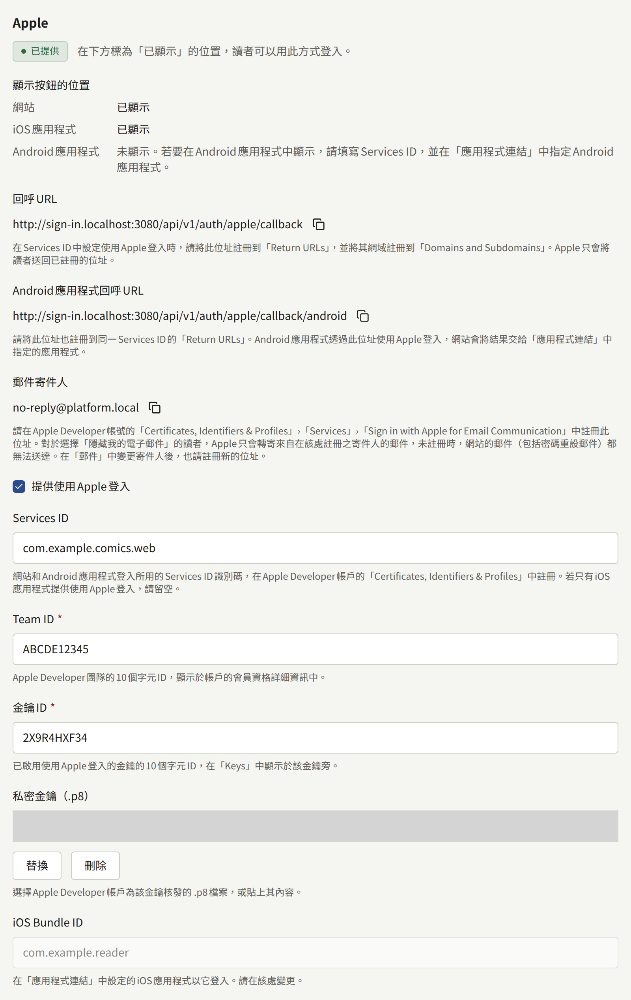
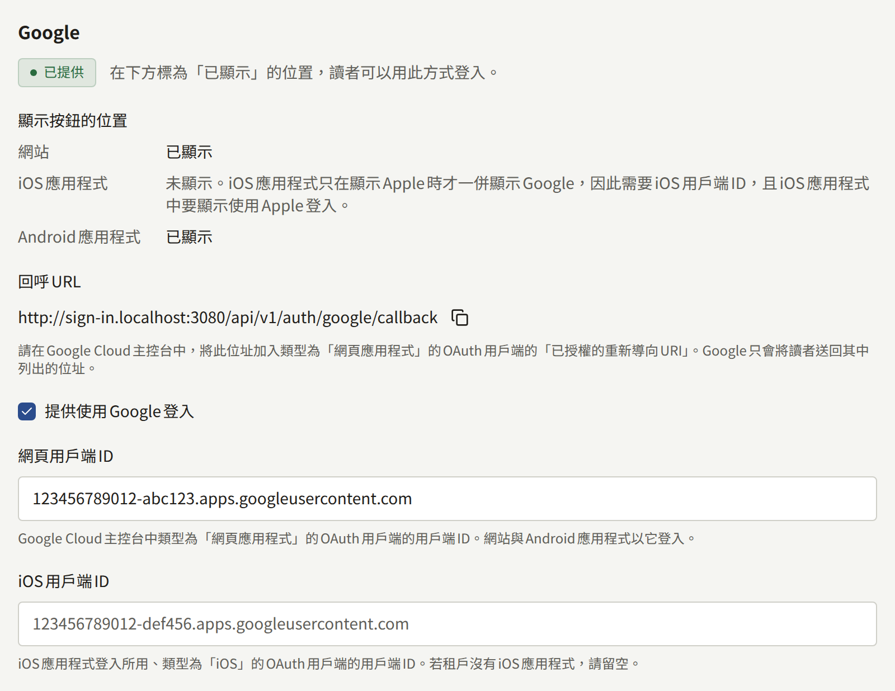

讀者以電子郵件地址與密碼登入租戶的網站。**整合** › **登入**會在該表單旁加上**透過Apple繼續**與**透過Google繼續**兩個按鈕，讓讀者以已經擁有的帳戶註冊與登入。本頁引導租戶管理員為網站設定這兩種登入方式，並說明開啟後讀者會看到什麼。應用程式共用同一套設定；只有應用程式才需要的部分，請見[應用程式內購買與登入](../5-mobile-app/5-purchases-and-sign-in.md#使用apple與google登入)。

只有租戶管理員看得到**登入**，每次儲存都會以**更新了登入方式設定**記錄在**稽核記錄**中。

## 開始之前

- **網站以自己的網域透過HTTPS提供**。Apple與Google只會將讀者送回已向它們註冊的HTTPS位址，而該位址位於租戶公開網站的網域上，不在主控台主機上。
- **使用Apple時，需要Apple Developer Program的會員資格**，並以讀者應看到自己正在登入的組織名義申請。若租戶有應用程式，就使用發布該應用程式的同一份會員資格。
- **使用Google時，需要Google Cloud專案**，同樣由出版社擁有。為[推播通知](../5-mobile-app/3-push-notifications.md)建立的Firebase專案也是Google Cloud專案，可以直接使用。
- **若租戶有應用程式**，請先依[應用程式連結](../5-mobile-app/4-app-links.md)的說明填寫**整合** › **應用程式連結**。使用Apple登入會信任在該處指定的應用程式。

開啟**整合** › **登入**並保持開啟：每種登入方式的區段都會顯示**回呼URL**與複製按鈕，您要在下列步驟中將它註冊到對應的服務商。它以網站的網域組成：

| 登入方式 | 回呼URL                                                  |
| -------- | -------------------------------------------------------- |
| Apple    | `https://comics.example.com/api/v1/auth/apple/callback`  |
| Google   | `https://comics.example.com/api/v1/auth/google/callback` |

Apple區段還會顯示第二個位址**Android應用程式回呼URL**，只有Android應用程式會使用它。

若營運人員之後將租戶移到其他網域，這些位址也會隨之改變，新的位址必須重新註冊到兩個服務商，如[租戶](../3-operations/2-tenants.md)所述。

## 使用Apple登入

Apple端的所有項目都在Apple Developer帳戶的**Certificates, Identifiers & Profiles**中建立。

### 要在Apple Developer帳戶中建立的項目

1. **啟用Sign in with Apple的App ID**。在**Identifiers**中開啟租戶iOS應用程式的App ID（租戶沒有應用程式時則註冊一個），並開啟**Sign in with Apple**功能。另外兩個識別碼都會歸在這個App ID之下，Apple稱它為主要App ID（primary App ID）。
2. **Services ID**。在**Identifiers**中註冊一個Services ID，填入讀者可能會看到的說明（例如網站名稱），以及`com.example.comics.web`之類的識別碼。為它開啟**Sign in with Apple**，並選擇**Configure**：
   - **Primary App ID**：步驟1的App ID。
   - **Domains and Subdomains**：只填網站的網域，例如`comics.example.com`。
   - **Return URLs**：主控台中Apple的**回呼URL**。若租戶有Android應用程式，也請在這裡加入**Android應用程式回呼URL**。
3. **金鑰**。在**Keys**中註冊一把開啟**Sign in with Apple**的金鑰，並設定同一個主要App ID。下載它提供的`.p8`檔案。Apple只提供一次，請妥善保存；遺失的金鑰只能以註冊新金鑰的方式取代。**Key ID**會顯示在金鑰旁。
4. **Team ID**，顯示在帳戶的會員資格詳細資訊中。

### 在主控台中輸入

在**整合** › **登入**的**Apple**區段中：

- **Services ID**：Services ID的識別碼，例如`com.example.comics.web`。只有填寫此欄時，網站才會顯示Apple按鈕。只有在僅由iOS應用程式提供Apple登入時才留空。
- **Team ID**與**金鑰ID**：步驟4與步驟3中的10個字元ID。
- **私密金鑰（.p8）**：選擇下載的檔案，或貼上其內容。
- **iOS Bundle ID**不在這裡輸入：它顯示的是在**應用程式連結**中指定的iOS應用程式。

開啟**提供使用Apple登入**，並選擇**儲存登入方式**。

金鑰無法讀回：之後再開啟時，主控台只會顯示已儲存一把金鑰。**替換**會將它換成新的金鑰，**刪除**則會在儲存時刪除它。

## 使用Google登入

Google端的所有項目都在Google Cloud主控台中出版社的專案裡，於**Google Auth Platform**下建立。

### 要在Google Cloud主控台中建立的項目

1. **同意畫面**。在**Branding**中輸入讀者選擇帳戶時看到的名稱、支援用電子郵件地址，並在**Authorized domains**中輸入網站的網域。在**Audience**中選擇**External**，讓任何Google帳戶都能登入，並將應用程式發布到正式環境。發布之前，只有列在該處的測試使用者能登入。Publira只向Google要求讀者的身分、電子郵件地址與姓名，Google將這些歸類為非敏感資訊，因此發布不需要等待針對它們的審查。
2. **網頁應用程式用戶端**。在**Clients**中建立類型為**Web application**的OAuth用戶端，並將主控台中Google的**回呼URL**加入**Authorized redirect URIs**。**Authorized JavaScript origins**不需要填寫任何內容。

Google會為新的用戶端顯示用戶端密鑰。Publira不會使用它，主控台中也沒有地方可以輸入。

### 在主控台中輸入

在**整合** › **登入**的**Google**區段中：

- **網頁用戶端ID**：網頁應用程式用戶端的用戶端ID，以`.apps.googleusercontent.com`結尾。只有填寫此欄時，網站才會顯示Google按鈕，Android應用程式也以同一個用戶端登入。
- **iOS用戶端ID**：只有iOS應用程式使用的iOS用戶端的用戶端ID。若租戶沒有iOS應用程式，請留空。

開啟**提供使用Google登入**，並選擇**儲存登入方式**。

## 確認是否正常運作

每種登入方式的區段都會顯示其狀態：

| 狀態       | 意義                                         |
| ---------- | -------------------------------------------- |
| **已提供** | 已開啟且資訊齊全：讀者可以用它登入           |
| **未完成** | 已開啟，但缺少所需的項目，因此不會提供給讀者 |
| **已停用** | 已儲存，但已關閉                             |
| **未設定** | 尚未為它儲存任何內容                         |

狀態為**已提供**的登入方式，還會在**顯示按鈕的位置**下列出讀者可能遇到它的每個位置：**網站**、**iOS應用程式**與**Android應用程式**。每個位置會顯示**已顯示**，或是該位置在顯示按鈕之前還需要什麼：

|  | Apple | Google |
| --- | --- | --- |
| 網站 | **Services ID** | **網頁用戶端ID** |
| iOS應用程式 | 在**應用程式連結**中指定的iOS應用程式 | **iOS用戶端ID**，以及iOS應用程式中顯示Apple，因為應用程式只會在Apple旁邊一併提供Google |
| Android應用程式 | **Services ID**，以及在**應用程式連結**中指定的Android應用程式 | **網頁用戶端ID** |

因此，登入方式可能顯示**已提供**，卻同時表示網站上不會顯示它：沒有**Services ID**的Apple，或沒有**網頁用戶端ID**的Google，是只為應用程式設定的。應用程式顯示**已顯示**，表示設定已涵蓋它；應用程式本身也必須為此建置，如[應用程式的頁面](../5-mobile-app/5-purchases-and-sign-in.md#使用apple與google登入)所述。iOS應用程式中的Google比其他項目更取決於建置，因為應用程式只有在以同一個**iOS用戶端ID**建置時才會顯示它，所以該列改為顯示**在使用此iOS用戶端ID建置的iOS應用程式中顯示**。

變更儲存後不久，網站就會套用。請在無痕視窗中開啟網站的登入頁面，選擇**透過Apple繼續**或**透過Google繼續**並登入。若服務商將您帶到它自己的錯誤頁面，通常是位址不相符：請將它回報的位址與**回呼URL**逐字比對。

## 讀者看到的內容

網站的**登入**與註冊頁面會在電子郵件表單下方顯示**透過Apple繼續**與**透過Google繼續**，並以**或**分隔。以這種方式註冊的讀者不需要設定密碼，也不需要確認電子郵件地址：服務商已經確認過了。若網站要求讀者同意服務條款或隱私權政策，第一次登入會停在**完成註冊**，讓讀者在帳戶建立前表示同意。

網站的**登入**頁面還會在它們旁邊提供**使用通行金鑰登入**，所有能使用通行金鑰的瀏覽器都會顯示，且不需要在**登入**中做任何設定。持有該網站通行金鑰的讀者只用它就能登入，不必輸入電子郵件地址或密碼：選擇該按鈕，或在瀏覽器於電子郵件欄位的建議中提供通行金鑰時選擇它。為租戶主控台建立的通行金鑰是另一把，無法登入網站。若讀者關閉提示，或網站不接受該通行金鑰，頁面會如此告知，電子郵件表單則維持原樣。帳戶已暫停，或電子郵件地址從未確認的讀者，也無法以通行金鑰登入。

應用程式在設定涵蓋的每種手機上，都會顯示相同的Apple與Google按鈕，如[應用程式的頁面](../5-mobile-app/5-purchases-and-sign-in.md#使用apple與google登入)所述；在應用程式就是**應用程式連結**中指定的那一個時，也會顯示**使用通行金鑰登入**，如該頁的[使用通行金鑰登入](../5-mobile-app/5-purchases-and-sign-in.md#使用通行金鑰登入)所述。同一個帳戶在兩邊都能使用：在網站上以Apple註冊的讀者可以用Apple登入應用程式，在網站上新增的通行金鑰可以登入應用程式，反之亦然。

### 既有帳戶與Apple或Google登入

一個Apple或Google帳戶會連結到租戶上的一個讀者帳戶。連結到哪一個，在讀者第一次使用時決定：

- **讀者已經有使用相同電子郵件地址的帳戶**。Apple或Google帳戶會連結到該帳戶，讀者會登入自己既有的帳戶，保有購買內容與記錄。沒有確認步驟：Apple與Google已確認過該地址，這與網站自己的確認郵件所要求的證明相同。
- **讀者有使用該地址的帳戶，但從未確認**。Apple或Google帳戶會接管它：帳戶被連結，其地址視為已確認，建立時設定的密碼則會被移除。在無法確認地址的情況下建立該帳戶的人，會失去它，帳戶歸地址的擁有者所有。
- **沒有任何帳戶使用該地址**。會建立一個新帳戶，使用服務商提供的地址，且沒有密碼。

以Apple選擇**隱藏我的電子郵件**的讀者，提供給網站的是`privaterelay.appleid.com`上的地址，而不是自己的地址。它不符合任何既有帳戶，因此會建立新帳戶；以不同於讀者帳戶地址的Google帳戶登入時也是如此。已經有帳戶並想保留它的讀者，請以電子郵件地址登入，再從**已連結的帳戶**將Apple或Google帳戶連結到該帳戶，如下所述。

租戶在**設定**中拒絕的電子郵件地址不適用於這些登入，因為地址是由服務商提供的。帳戶已暫停的讀者也無法以Apple或Google登入。

### 讀者可以管理的項目

在網站的**設定** › **安全性**中，以及應用程式的帳戶畫面上，**已連結的帳戶**會列出讀者可以用來登入的Apple與Google帳戶，每個都附有**解除連結**；對於網站或應用程式提供、但帳戶尚未連結的每種登入方式，則提供**連結**。**連結**會帶讀者以該服務商登入，並連結他們登入的帳戶，無論它使用什麼地址，因此**隱藏我的電子郵件**的地址也能和讀者自己的地址一樣連結。之後在網站和應用程式上以它登入，都會開啟同一個帳戶。

以下情況會拒絕連結，並在畫面上顯示原因：該Apple或Google帳戶已經用於登入網站上的另一個帳戶，必須先從那個帳戶解除連結；或讀者的帳戶已經連結了該服務商的帳戶，必須先解除連結才能連結另一個。

網站上的同一個畫面會列出讀者的**通行金鑰**，每把都附有新增時間、上次用來登入的時間，以及**移除**。**新增通行金鑰**會向瀏覽器要求一把新的通行金鑰（由裝置的螢幕鎖定、密碼管理工具或安全金鑰保存），接著要求為它取一個便於區分的名稱，讀者可以略過。之後，**使用通行金鑰登入**就會以它登入。無論**登入**中設定了什麼，所有能使用通行金鑰的瀏覽器都會顯示此區段，一位讀者最多可以持有20把通行金鑰。應用程式帳戶畫面上的**通行金鑰**會列出相同的通行金鑰，可以新增，也可以為每把重新命名和移除。

透過Apple或Google建立的帳戶沒有密碼。同一個畫面提供**設定密碼**，會寄出設定密碼的連結，設定後讀者也能以電子郵件地址登入。在此之前：

- 帳戶會保留一種登入方式：在沒有通行金鑰時，最後一個已連結的帳戶無法解除連結；在沒有已連結的帳戶時，最後一把通行金鑰無法移除。
- 刪除帳戶與變更電子郵件地址，不是以密碼確認，而是透過**透過Apple確認**或**透過Google確認**再次以Apple或Google登入，或透過**使用通行金鑰確認**以讀者的一把通行金鑰確認，網站與應用程式皆是如此。

### 寄往隱藏我的電子郵件地址的郵件

寄往`privaterelay.appleid.com`地址的郵件，Apple只會轉寄來自出版社已向它註冊之寄件人的郵件。來自其他寄件人的郵件，包括網站自己的密碼重設郵件，都不會送達讀者。

**整合** › **登入**的**Apple**區段會以**郵件寄件人**顯示租戶郵件的寄件地址，並附有複製按鈕：租戶透過自己的伺服器寄信時，是**整合** › **郵件**中的**寄件人電子郵件地址**，否則是平台的寄件地址。請在Apple Developer帳戶的**Certificates, Identifiers & Profiles** › **Services** › **Sign in with Apple for Email Communication**中註冊它。Apple也會檢查寄件網域是否通過SPF，如該處所述。若之後寄件人有所變更（因為租戶開始或停止透過自己的伺服器寄信，或變更了地址），也請註冊新的寄件人。

## 關閉登入方式

關閉**提供使用Apple登入**或**提供使用Google登入**，會從網站和應用程式移除其按鈕，並保留為它儲存的所有內容，因此可以原樣重新開啟。讀者的連結也會保留。

有密碼的讀者可以繼續以電子郵件地址登入。以該服務商註冊的讀者沒有密碼，在設定密碼之前無法登入：登入頁面上的「**忘記密碼？**」會寄給他們一個連結。關閉登入方式之前，請先告知這些讀者，例如透過公告。使用隱藏我的電子郵件地址的讀者，只有在寄件人已向Apple註冊時才會收到該郵件，如上所述。
