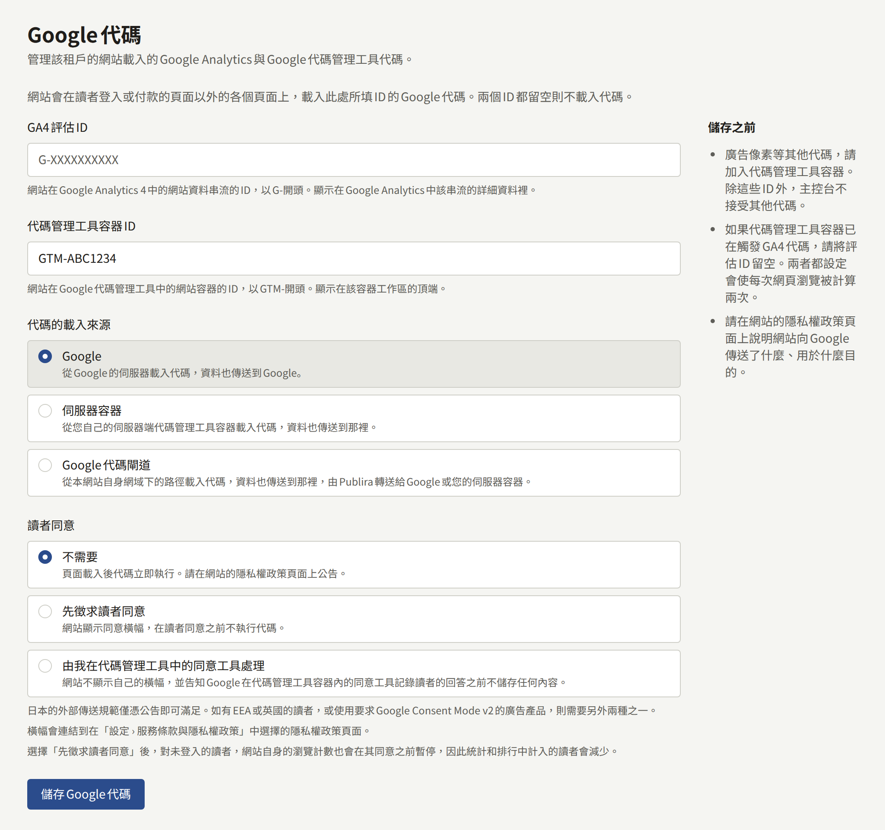
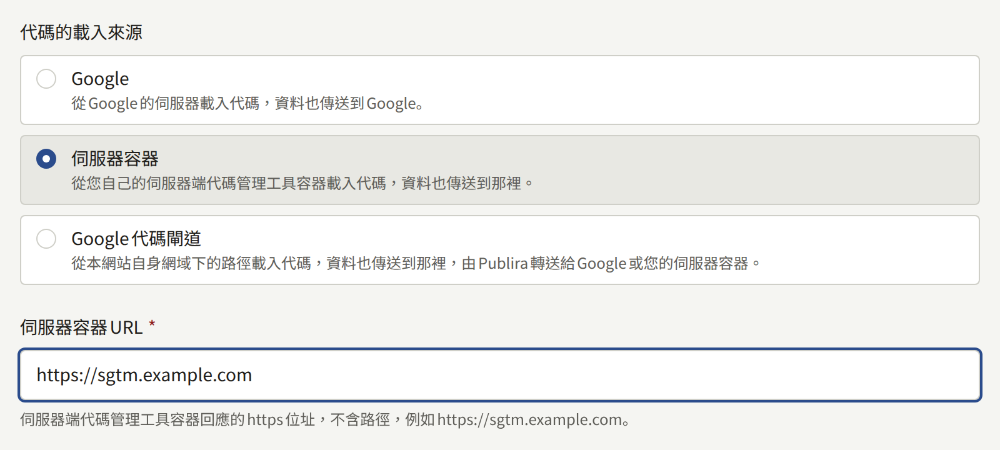
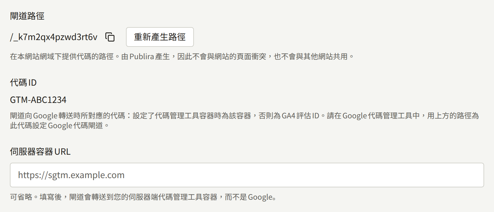
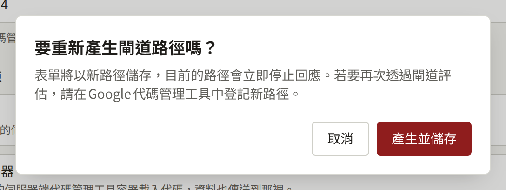
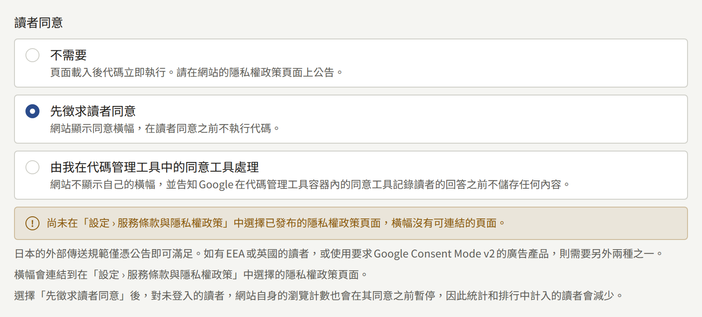

**整合** › **Google代碼**會讓租戶的網站載入Google代碼：填寫評估ID時載入Google Analytics 4，填寫容器ID時載入Google Tag Manager，也可以兩者都載入。本頁引導租戶管理員了解這些ID、代碼可以從哪三個地方載入、每種方式需要在Google Analytics與Google Tag Manager中設定什麼，以及代碼執行前是否要先徵求讀者同意。

只有租戶管理員看得到**Google代碼**，每次儲存的變更都會以**更新了Google代碼**記錄在**稽核記錄**中。此設定涵蓋在瀏覽器中開啟的網站。租戶的應用程式不會載入任何Google代碼。

## 開始之前

- **一個Google Analytics 4資源，且其中有網站的網頁資料串流**，或**Google Tag Manager中的一個網頁容器**，由出版社擁有。除了Google Analytics以外的所有代碼都應放在容器中，如下所述。
- **涵蓋此代碼的隱私權政策**。代碼會設定它自己的Cookie，並將收集到的內容傳送給Google，而Publira自己列出的網站儲存內容清單並未涵蓋這些。請在代碼上線前將其寫入政策，如[頁面](./3-setup/3-pages.md#網站在讀者瀏覽器中儲存的內容)所述。

## ID

- **GA4評估ID**：網站網頁資料串流的ID，以`G-`開頭。Google Analytics會在**Admin** › **Data collection and modification** › **Data streams**中該串流的詳細資料裡顯示它。以`UA-`開頭的Universal Analytics ID會被拒絕，因為Google已不再為它收集資料。
- **代碼管理工具容器ID**：網站網頁容器的ID，以`GTM-`開頭。Google Tag Manager會在容器工作區的頂端顯示它。

請輸入用來評估網站的那一個：

- **只填容器**：Google Analytics設定在容器內時。會觸發GA4代碼的容器若同時搭配**GA4評估ID**，每次網頁瀏覽都會被計算兩次，**儲存之前**會對此提出警告。
- **只填評估ID**：網站沒有容器時。
- **兩者都填**：只限容器本身不觸發GA4時，例如只放廣告代碼的容器。

除了這兩個ID之外，主控台不接受任何其他代碼。廣告像素、轉換代碼或其他任何代碼，都放進Tag Manager容器中，網站會連同其中所有內容一起載入該容器。若要停止載入任何代碼，請將兩個ID都清空並儲存。

網站在頁面之間移動時不會重新載入頁面，因此第一頁之後的網頁瀏覽，是根據瀏覽器在其歷史記錄中記下的變更來計算的。無論GA4代碼是由網站載入，還是從容器觸發，GA4的加強型評估預設都會計算這些瀏覽。若該串流關閉了以瀏覽器歷史記錄事件為準的網頁瀏覽，每次造訪只會計算第一頁。

## 代碼的載入來源

**代碼的載入來源**決定讀者的瀏覽器從哪裡取得代碼的指令碼，以及代碼將收集到的內容傳送到哪裡：

| 模式 | 代碼的載入來源 | 資料的傳送目的地 | 需要的項目 |
| --- | --- | --- | --- |
| **Google** | Google的伺服器 | Google | 不需要其他項目 |
| **伺服器容器** | 租戶的伺服器端Tag Manager容器 | 伺服器容器 | **伺服器容器URL**，以及在Tag Manager容器中為Google代碼設定的伺服器容器URL |
| **Google代碼閘道** | 網站自身網域上的一個路徑 | 同一路徑，由Publira轉送到Google或伺服器容器 | 在Google Tag Manager中設定閘道 |

**Google**是預設值，除了ID之外不需要任何設定。

### 伺服器容器

**伺服器容器**會從出版社營運的伺服器端Tag Manager容器載入代碼，代碼也會將資料傳送到該處，而不是傳送給Google。Publira不會執行該容器。

**伺服器容器URL**是容器回應所用的`https`位址，不含路徑，例如`https://sgtm.example.com`。它必須是網域名稱：IP位址會被拒絕。將容器放在網站自身網域的子網域上，可讓代碼保持第一方，這是Google在[Map a custom domain](https://developers.google.com/tag-platform/tag-manager/server-side/custom-domain)中建議的配置。

網站會從該位址、在Google提供這些指令碼的路徑下載入`gtm.js`與`gtag.js`。因此，容器除了接收資料之外，也必須提供Google的指令碼，如Google的[Load Google scripts first-party](https://developers.google.com/tag-platform/tag-manager/server-side/dependency-serving)針對代碼伺服器所述。不提供這些指令碼的容器不會在網站上載入任何代碼，在它開始提供之前，網站什麼也評估不到。

資料的去向取決於由哪個ID載入Google Analytics：

- **GA4評估ID**：網站會告訴它所載入的GA4代碼將資料傳送到伺服器容器。不需要其他設定。
- **代碼管理工具容器ID**：網站從伺服器容器載入容器，但容器內的代碼會將資料傳送到容器所指定的地方，在變更之前那就是Google。請在網頁容器中，為Google代碼將`server_container_url`設為**伺服器容器URL**，並發布容器，如Google的[Send data to server-side Tag Manager](https://developers.google.com/tag-platform/tag-manager/server-side/send-data?option=GTM)所述。在此之前，網站會照舊評估，每次命中都直接傳送給Google。

### Google代碼閘道

**Google代碼閘道**就是Google所稱的「Google tag gateway for advertisers」：代碼從網站自身網域上的一個路徑載入，也將資料傳送到該路徑，再由Publira將抵達該處的內容轉送給Google。一般而言，網站擁有者要在自己的CDN或負載平衡器上設定這一點。Publira網站的網域由Publira提供，因此這部分由Publira負責，剩下的只是將該路徑告訴Google Tag Manager。

- **閘道路徑**是提供代碼的路徑，例如`/_k7m2qx4pzwd3rt6v`。Publira會在此模式下第一次儲存表單時產生它，因此它絕不會與網站的頁面衝突，也不會與其他任何網站共用。租戶切換到其他模式時它仍會保留，因此切換回來時，代碼會在先前的位置提供。
- **代碼ID**是閘道代為轉送給Google的代碼：設定了**代碼管理工具容器ID**時就是它，否則是**GA4評估ID**。容器涵蓋它觸發的所有代碼，因此兩者都有的網站只需針對容器設定一次。
- **伺服器容器URL**在此為選填。輸入它，閘道就會轉送到出版社的伺服器容器，而不是Google；此時容器本身必須回應閘道路徑，如Google的[Load Google scripts first-party](https://developers.google.com/tag-platform/tag-manager/server-side/dependency-serving)所述。Publira只會在其名稱解析為公開位址時才連線，因此不會連到私人網路上的容器。

Publira會將閘道路徑上的請求原樣（包括路徑與查詢）轉送到`https://<Tag ID>.fps.goog`，或轉送到伺服器容器。在讀者的Cookie中，它只會傳遞Google自己的評估Cookie，例如`_ga`、`_gcl_au`與`FPID`，回傳時也只允許這些Cookie通過。讀者在網站上的登入狀態，以及網站的其他所有Cookie，都不會離開Publira。讀者的IP位址會依Google閘道的預期傳遞過去。讀者的國家與地區，只有在安裝實例的邊緣會查詢它們時才會傳遞，Google會將其用於依地區的報表以及特定地區的同意預設值；在不查詢的邊緣後方，Google透過閘道回報網站流量時不會包含地區。請向營運安裝實例的人詢問是哪一種。

#### 在Google Tag Manager中設定

1. 以**Google代碼閘道**模式儲存表單，並複製它顯示的**閘道路徑**。
2. 若使用容器，請在Google Tag Manager中開啟它，並前往**Admin** › **Google tag gateway**。若使用沒有容器的評估ID，則改為開啟Google代碼的設定：在Google Analytics中依序前往**Admin** › **Data collection and modification** › **Data streams**、網站的串流、**Configure tag settings**，再前往**Admin** › **Google tag gateway**。
3. 選擇**Continue**，並在**Scan your site**中輸入網站的位址。
4. Publira不是Google代您連線的任何一家CDN：請在**More ways to set up**下選擇**Guided**，並將**閘道路徑**作為評估路徑提供。引導說明接著描述的路由（從該路徑到`fps.goog`）Publira已經在做，不需要您做任何事。

Google的[設定指南](https://developers.google.com/tag-platform/tag-manager/gateway/setup-guide)針對自行處理路由的網站說明了這種路由，從中可以看出Publira代為處理了什麼。

#### 確認是否正常運作

- **路徑有回應**。在瀏覽器中開啟`https://comics.example.com/<gateway path>/healthy`，並代入網站的網域與**閘道路徑**。閘道連上Google後，頁面會顯示`ok`。Google的第二項檢查`?validate_geo=healthy`不會顯示`ok`，因為Publira不傳遞讀者的國家與地區。
- **命中經由閘道傳送**。在Tag Assistant中預覽容器並瀏覽網站。在**Summary** › **Output** › **Hits Sent**下，可以看到命中被傳送到閘道路徑。
- **Google看得到它**。在Google收到經由該路徑的資料之前，Google Tag Manager中的**Google tag gateway**畫面會將網站的網域顯示為**Pending**，之後則顯示為**First-party**。

#### 重新產生路徑

**重新產生路徑**會取代**閘道路徑**。它會以新的路徑儲存表單，目前的路徑則會立即停止回應，因此在Google Tag Manager中改用新路徑設定之前，網站無法透過閘道評估任何內容。

## 讀者同意

**讀者同意**決定網站是否在代碼執行前先徵求讀者同意。它適用於網站的每位讀者，無論他們從哪裡閱讀。

| 選項 | 網站的行為 | 需要的項目 |
| --- | --- | --- |
| **不需要** | 頁面一載入就執行代碼 | 在隱私權政策頁面上揭露此代碼 |
| **先徵求讀者同意** | 顯示同意橫幅，在讀者同意之前暫不執行代碼 | 供橫幅連結的隱私權政策頁面 |
| **由我在代碼管理工具中的同意工具處理** | 不顯示自己的橫幅，並告訴Google在出版社的同意工具記錄讀者的回答之前不要儲存任何內容 | **代碼管理工具容器ID**，以及該容器中的同意工具 |

**不需要**是預設值。哪個選項合適，取決於網站的讀者是誰：

- **只有日本的讀者**：在隱私權政策頁面上揭露此代碼，即符合日本《電氣通信事業法》的外部傳送規定，因此**不需要**就足夠了。
- **有歐洲經濟區（EEA）或英國的讀者**，或**使用要求Google Consent Mode v2的廣告產品**：請選擇其他兩個選項之一。兩者都會依讀者的回答傳送Google Consent Mode v2訊號。

### 先徵求讀者同意

讀者第一次造訪時，視窗底部會顯示橫幅。橫幅說明網站會計算瀏覽次數，以及Google會為出版社評估網站，並並排提供**同意**與**不同意**，兩者同樣醒目。橫幅開啟期間，頁面的其他部分仍可使用，在讀者選擇**同意**之前，不會載入任何來自Google的內容。

回答會以[頁面](./3-setup/3-pages.md#網站在讀者瀏覽器中儲存的內容)所列的Cookie保存在讀者的瀏覽器中六個月，在到期前不會再次顯示橫幅。頁尾連結最後的**Cookie設定**會重新顯示橫幅，讓讀者可以變更回答。撤回同意會告訴Google不再儲存任何內容，但Google的代碼已經設定的Cookie會保留到到期為止，橫幅會告知讀者這一點。傳送Global Privacy Control的瀏覽器會被視為已拒絕：既不顯示橫幅，也不顯示**Cookie設定**，且不會為它儲存任何內容。

橫幅會連結到在[設定 › 服務條款與隱私權政策](./3-setup/1-settings.md#服務條款與隱私權政策)中選為隱私權政策的頁面。只要該處尚未選擇已發布的頁面，選擇**先徵求讀者同意**時，表單就會警告橫幅沒有可連結的頁面。選擇已發布的頁面後，警告就會消失；無論如何都可以儲存此設定。

在未登入的讀者同意之前，網站也不會計算他們的瀏覽次數；否則網站會以[頁面](./3-setup/3-pages.md#網站在讀者瀏覽器中儲存的內容)為未登入讀者列出的識別碼來計算。已登入讀者的瀏覽次數無論他們如何回答，都會計入其帳戶，因為這不會在他們的瀏覽器中留下任何新內容。因此，先徵求同意的網站，其統計與排行榜計入的讀者，會比同一個網站不徵求同意時少。

### 由我在代碼管理工具中的同意工具處理

此選項適用於已經在其Tag Manager容器內，以代碼形式執行同意管理平台的出版社。網站會在容器載入之前將所有Consent Mode v2訊號設為`denied`，容器中的同意工具則顯示自己的橫幅，並依讀者的回答更新這些訊號。

只有在輸入了**代碼管理工具容器ID**時才會提供此選項，因為工具沒有其他地方可以執行；在輸入之前，表單會在此選項下方如此說明。儲存此選項時清空容器ID，也會以同樣方式被拒絕，並在ID旁邊顯示原因。

## 不載入代碼的頁面

網站會在每個頁面上載入代碼，但讀者在其中輸入密碼、通行金鑰或郵件中的連結的頁面除外：

- **登入**與註冊頁面。
- 帳戶相關郵件引導的步驟：確認電子郵件地址、重設密碼，以及重新寄送確認郵件。
- **設定**及其下的所有頁面。

付款在金流服務商的結帳頁面上進行，該頁面不會載入網站的任何代碼。讀者從該處回到網站上照常載入代碼的頁面，因此可以在他們返回的頁面上評估購買。

這些頁面也都不會顯示同意橫幅。直接開啟或重新載入這些頁面時，不會載入任何代碼。讀者從網站的其他頁面移到這些頁面時，已經在執行的代碼會繼續執行，因為網站在兩者之間不會重新載入頁面。

## 隱私權政策必須說明的內容

**儲存之前**要求網站的隱私權政策頁面說明網站會傳送什麼給Google，以及用途為何。代碼會設定Google的Cookie，並將收集到的內容傳送給Google或伺服器容器，容器觸發的每個代碼也是如此。[頁面](./3-setup/3-pages.md#網站在讀者瀏覽器中儲存的內容)列出了Publira本身保存在讀者瀏覽器中的內容，政策除了涵蓋該清單之外，還要根據Google的說明文件以及容器中每個代碼的說明文件涵蓋此代碼。

無論在[讀者同意](#讀者同意)中做了哪個選擇，政策都要說明代碼會傳送什麼：先徵求同意決定的是代碼何時執行，而不是它傳送什麼。

## 變更何時反映到網站

儲存的變更在儲存後不久，就會在網站下次載入頁面時套用。重新產生的閘道路徑會從下一個請求開始停止回應。
