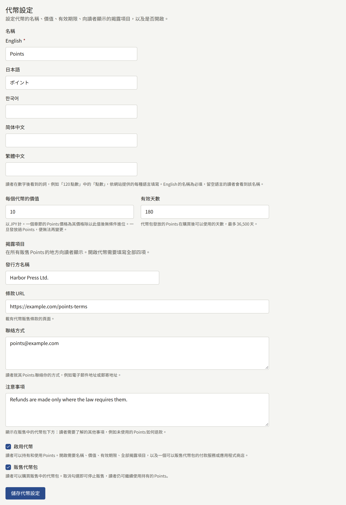
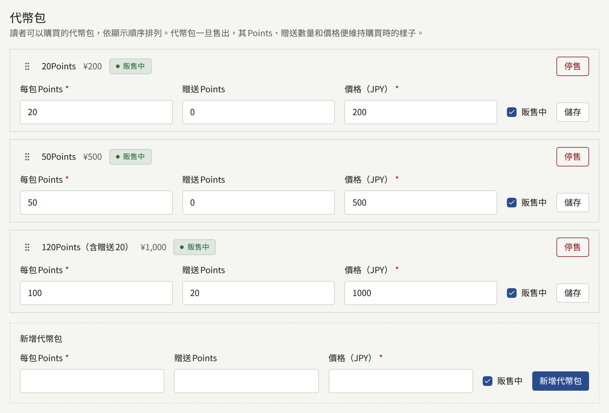
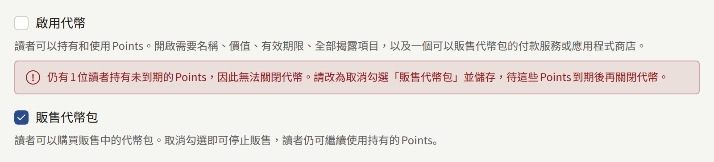

代幣讓讀者可以預先為章節付款：讀者一次購買一包租戶的代幣，每個章節花用幾個，不必在每個章節都經過付款頁面。代幣由租戶發行與命名，並由租戶決定一個代幣在其貨幣中值多少、可以使用多久，以及販售哪些代幣包。代幣開啟後讀者在網站與應用程式上看到的內容，請見[販售章節](./4-selling-episodes.md#使用代幣支付)。

**付款** › **代幣**供**租戶管理員**使用；編輯或稽核員看不到該畫面。

## 開始之前

代幣是一種預付式支付工具，販售代幣的租戶就是其發行方。視租戶及其讀者所在的地區而定，關於預付式支付工具、電子貨幣、資金移轉或禮物卡的法律可能適用於代幣，這些法律可能要求租戶申報、提存保證金、退還未使用的餘額，或在販售代幣的地方顯示特定資訊。租戶是否可以發行代幣、必須做些什麼，應由租戶自行確認。此畫面提供開關與揭露項目的欄位，不會再就法律提供任何說明。

有兩件事必須先備妥：

- **平台允許租戶發行代幣**。新的安裝實例預設為關閉。關閉期間，側邊欄中不會出現**代幣**，以網址開啟該畫面時，會顯示平台不允許租戶發行代幣。營運人員依[平台預設值與政策](../3-operations/9-platform-policies.md#租戶發行的代幣)所述開啟它。
- **可以販售代幣包**。只有在**付款** › **付款方式**下有金流服務商處於**就緒**，或App Store或Google Play處於就緒時，才能開啟代幣，如[販售章節](./4-selling-episodes.md)所述。畫面上的其他項目都可以在此之前填寫。

## 三種狀態

畫面頂端會顯示租戶代幣目前的狀態：

| 狀態 | 讀者看到的內容 |
| --- | --- |
| **關閉** | 看不到任何與代幣相關的內容。每個章節都照原樣在沒有代幣的情況下販售 |
| **開啟，販售中** | 以代幣標價的章節、讀者的餘額，以及販售中的代幣包 |
| **開啟，已停售** | 同上，但無法購買任何代幣包：讀者可以繼續使用持有的代幣 |

**代幣設定**中的**啟用代幣**與**販售代幣包**用於在這些狀態之間切換。租戶要結束代幣時，必須先經過**開啟，已停售**，如[停止](#停止)所述，因為關閉代幣會拿走讀者已付費購買的代幣。

## 代幣設定

- **名稱**是讀者在數字後看到的詞，例如`120 Points`中的`Points`，依網站提供的每種語言各輸入一次。網站預設語言的名稱為必填，未填寫就儲存時，會在該欄位下方被拒絕。使用留空語言的讀者會看到預設語言的名稱。名稱儲存後，畫面也會以您閱讀主控台所用的語言使用它：代幣包的欄位會顯示為**每包點數**與**贈送點數**。
- **每個代幣的價值**是一個代幣在租戶貨幣中的價值，例如`10`代表¥10。章節的代幣價格，是將其價格（活動特價期間則為活動價格）除以此值後無條件進位，因此每個代幣價值¥10時，¥300的章節需要30個代幣。沒有第二份價目表：變更章節的價格，其代幣價格也會跟著改變。一旦有任何讀者獲得代幣，所有餘額都會以此價值計算，便無法再變更。
- **有效天數**是購買代幣包後，其代幣可以使用的天數，最多36,500天。未使用而到期的代幣就此消失；讀者的記錄中會顯示這一點。
- **揭露項目**會在所有販售代幣的地方顯示在代幣包下方，供讀者閱讀：**發行方名稱**、**條款URL**（記載代幣販售條款的頁面）、**聯絡方式**（讀者就其代幣聯絡您的方式），以及**注意事項**（讀者需要了解的其他事項，例如未使用的代幣如何退款）。

**啟用代幣**會開啟代幣，需要預設語言的名稱、價值、有效期限、全部四個揭露項目，以及販售代幣包的方式。缺少其中任何一項時儲存會被拒絕，並指出每個缺少的欄位。**販售代幣包**會讓代幣包開始販售，在代幣保持開啟的情況下也可以取消勾選。

## 代幣包

**代幣包**列出讀者可以購買的代幣包，依網站顯示的順序排列。每一列都以讀者看到的樣子顯示代幣包，例如`120 Points (including 20 bonus)`，並附有價格以及是否販售中。

- 清單下方的**新增代幣包**需要輸入代幣包發放的代幣、額外加贈的代幣，以及以租戶貨幣計的價格，價格必須大於零。新的代幣包會加到清單末尾。一個租戶最多提供20個代幣包。
- 代幣包的欄位在其所在列中編輯，並以該列的**儲存**儲存。**販售中**可以讓單一代幣包停止販售或重新販售，不影響其他代幣包。
- 代幣包一旦售出，其代幣、贈送數量與價格就會維持購買它的讀者所支付的內容。此時該列會以文字顯示這些值並說明原因，只留下**販售中**。若要販售不同的代幣包，請新增一個並停售舊的。
- **停售**會在您確認後讓代幣包永久停止販售。它會從清單中移除，讀者則保有透過它購買的代幣。
- 拖曳列的控點即可變更順序，也可以用鍵盤操作：將焦點移到控點上，按空白鍵，用方向鍵移動，再按一次空白鍵。

贈送的代幣是租戶提供的折扣，版稅則依購買代幣時支付的金額計算，如[報表與版稅](./6-reports-and-royalties.md#作者應得的金額)所述。

### 應用程式中的代幣包

當租戶的應用程式透過App Store與Google Play販售時，每個代幣包都以各自的商店商品購買，商品名稱為`coins_`加上代幣包的ID。**付款** › **付款方式**底部的**商店商品**，會在章節價格所需的商品旁列出每個代幣包的商品。請以代幣包的價格將每一個建立為消耗性商品，如[在應用程式中販售](./4-selling-episodes.md#在應用程式中販售)針對章節所述。

## 停止

取消勾選**販售代幣包**並儲存，會在網站與應用程式上同時停止所有代幣包的販售，每位讀者仍可使用持有的代幣。狀態會變成**開啟，已停售**。

只要有任何讀者持有尚未到期的代幣，取消勾選**啟用代幣**就會被拒絕：畫面會顯示有多少位讀者持有代幣，並要求改為停止販售。請等到最後一批代幣到期（最多是最後一個代幣包售出後的**有效天數**），再關閉代幣。

若營運人員不再允許租戶發行代幣，無論租戶儲存了什麼設定，所有租戶的代幣都會立即停止：不會有任何販售或使用，讀者則保有自己的餘額。租戶的設定會保留，並在營運人員重新允許代幣時再次套用。

每次儲存設定，以及每次新增、變更或停售代幣包，都會連同執行操作的租戶管理員一起記錄在[稽核記錄](./3-setup/8-audit-log.md)中。
