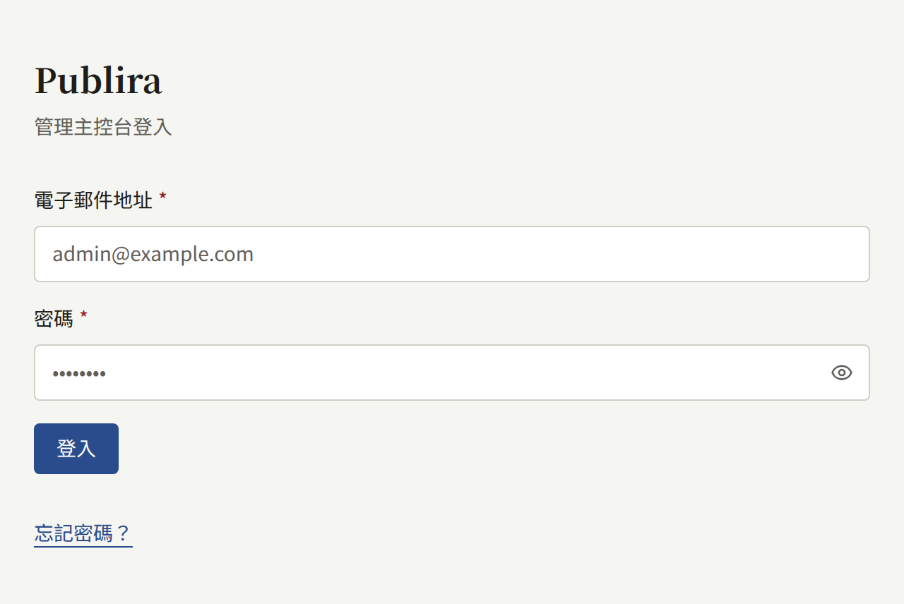
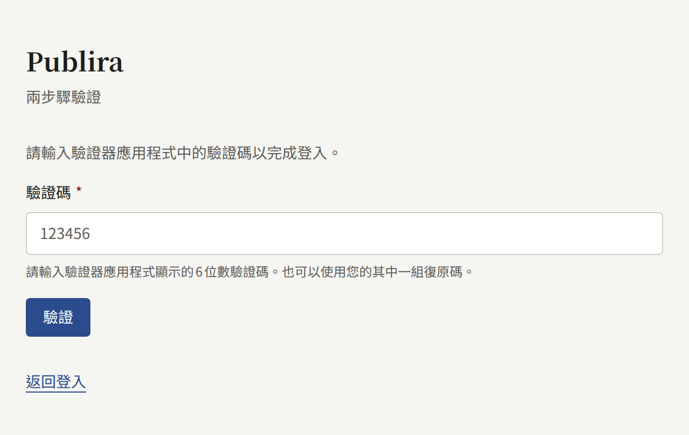
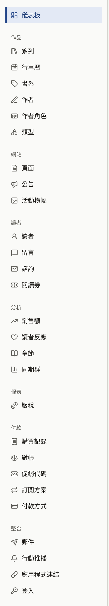

每個租戶都有自己的主控台，出版社的工作人員在這裡管理網站上的作品、讀者與網站設定。這些頁面是寫給這些工作人員的，並假設租戶已經存在、您也已獲得存取權限，也就是[租戶的工作人員](../3-operations/3-tenant-staff.md)從營運人員角度所說明的狀態。

## 登入

主控台位於租戶的主控台主機上。除非營運人員另外指定，否則主控台主機就是在公開網站的網域前面加上`admin.`：網站在`comics.example.com`時，主控台就在`admin.comics.example.com`。請在該處以您帳戶的電子郵件地址與密碼登入。選擇同一畫面上的**忘記密碼？**，系統會寄出一封郵件，內含設定新密碼的連結。

如果您的帳戶已開啟兩步驟驗證，主控台接著會要求輸入驗證器應用程式中的驗證碼。營運人員可以要求安裝實例上的每位租戶管理員都使用兩步驟驗證，此時尚未註冊驗證器應用程式的租戶管理員，必須先註冊一個才能繼續。[您的帳戶](./3-setup/9-your-account.md)說明如何開啟兩步驟驗證，以及手機遺失時該怎麼辦。

您的主控台帳戶同時也是租戶網站上的帳戶：您可以用同一組電子郵件地址與密碼在網站上閱讀與購買，主控台只是您的角色額外加上的部分。

## 角色

每位工作人員都擔任三種角色之一，主控台只會向每個人顯示他們可以使用的部分：

| 角色 | 可以做的事 |
| --- | --- |
| **租戶管理員** | 主控台中的一切：工作人員、租戶的每項設定、與郵件、付款、推播通知、登入、Google代碼的整合，以及透過API金鑰與Webhook與其自有系統的整合、讀者的帳戶、購買及其退款與和金流服務商的對帳、訂閱方案、代幣、版稅，以及稽核記錄 |
| **編輯** | 撰寫作品目錄與網站的頁面、公告和活動橫幅，以及管理留言 |
| **稽核員** | 查看編輯所處理的內容以及租戶的設定，但不能變更其中任何項目 |

租戶管理員在**成員**中為其他工作人員指派角色。[租戶的工作人員](../3-operations/3-tenant-staff.md#三種角色)完整說明了這些角色。

## 本節內容

- [發布作品](./1-catalog/index.md)：從空的作品目錄到讀者可以開啟的第一個章節，以及構成作品目錄的系列、章節、書系、作者、作者角色與類型。
- [讀者、留言與諮詢](./2-readers/index.md)：暫停與刪除讀者的帳戶、處理留言的審核與檢舉佇列、回覆諮詢，以及以閱讀券向讀者開放付費章節。
- [設定租戶](./3-setup/index.md)：透過設定、品牌形象、頁面、公告、活動橫幅、成員、郵件伺服器、稽核記錄與您自己的帳戶，讓新租戶成為具有出版社風格、法律頁面與工作人員的網站。
- [販售章節](./4-selling-episodes.md)：為章節定價、透過Stripe或PAY.JP收款、章節在哪裡販售、應用程式內購買、退款，以及正式上線前測試設定。
- [訂閱方案](./5-subscription-plans.md)：向讀者販售透過Stripe按期計費、開放整個作品目錄、部分書系或部分系列的方案，它在Stripe中所需的Price與webhook事件，以及訂閱者在網站上會做什麼。
- [報表與版稅](./6-reports-and-royalties.md)：儀表板與分析畫面計算的項目、每位作者的版稅如何計算、將一個月結算為明細，以及匯出為CSV。
- [使用Apple與Google登入](./7-sign-in.md)：讓讀者以Apple或Google帳戶登入網站與應用程式，以及為此需要在Apple與Google的主控台中建立什麼。
- [Google代碼](./8-google-tag.md)：以Google Analytics或Google Tag Manager評估網站成效、代碼可以從哪三個地方載入，以及要在Google Tag Manager中為閘道設定什麼。
- [代幣](./9-coins.md)：為讀者預先購買的代幣命名、代幣附帶的揭露事項、販售代幣的組合包，以及開啟代幣、停止銷售與關閉代幣。
- [API金鑰與Webhook](./10-api-keys-and-webhooks.md)：為租戶自有的系統提供管理API的唯讀金鑰、向它們傳送銷售、退款、註冊與訂閱的簽章事件、驗證簽章，以及重新傳送已被放棄的傳送。

如果您還沒讀過Publira是什麼，請從[快速入門](../1-getting-started.md)開始。
